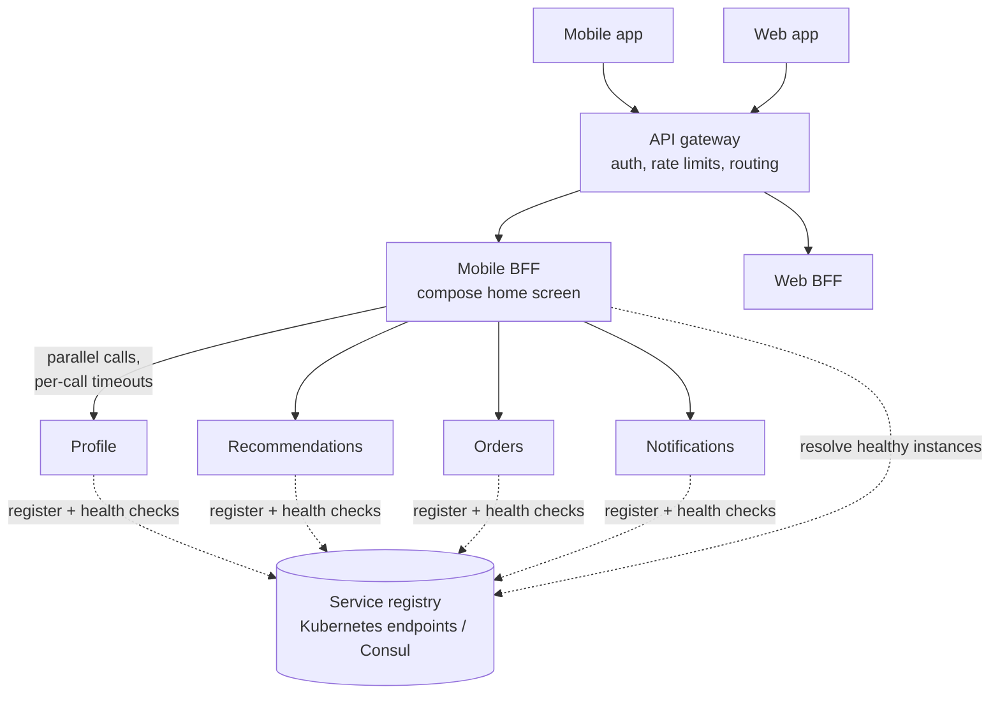
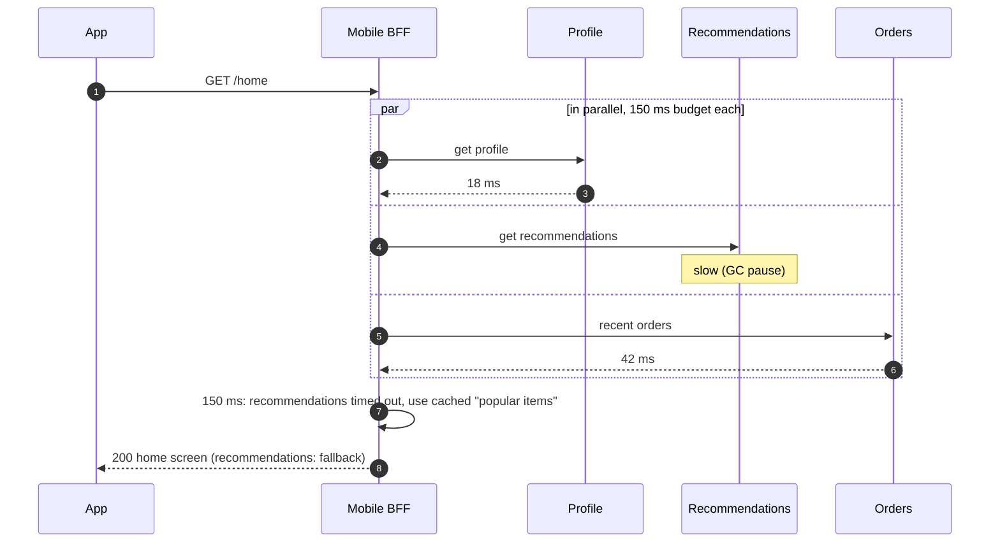

In a microservice system, one screen often needs data from many services, and every service needs to find healthy instances of the
others as they scale up, down and restart. **API aggregation** (a backend-for-frontend or gateway that composes responses) solves the
first problem; **service discovery** (a registry plus client- or server-side load balancing) solves the second. A **service mesh** packages
both, along with retries, timeouts and mutual TLS.

## The problem

A mobile home screen shows the user's profile, recommendations, recent orders, unread notifications, promotions and cart — six services.

- **Chatty clients**: six sequential calls over a mobile network at 100–300 ms each is a second or more; even in parallel, each call pays
  connection and TLS costs, and every client re-implements composition logic.
- **Different clients want different shapes**: the watch app needs three fields, the web app needs thirty.
- **Moving targets**: each service runs 3–300 instances whose IP addresses change on every deploy and autoscaling event; hard-coded
  addresses break immediately.
- **Fan-out amplifies tail latency**: a response that waits for many backends is as slow as the slowest one ([tail latency](lesson:servers-latency)).

```drill
? A page waits for 10 backend calls in parallel. Each call independently exceeds 100 ms 1% of the time. What percentage of pages exceed 100 ms?
= 9.6
~ 1.1
> 1 − 0.99¹⁰ ≈ 0.096, so about 9.6% of pages — a 1% tail per service becomes a 10% tail for the page.

? Same page, but now 50 backend calls. Roughly what percentage of pages exceed 100 ms?
= 39.5
~ 1.1
> 1 − 0.99⁵⁰ ≈ 0.395 — almost 40%. Fan-out width is a latency risk on its own.
```

## Architecture



**Aggregation** options:

- **Backend-for-frontend (BFF)**: one thin service per client type, owned by the client team, that calls backends in parallel and shapes
  the response for that screen.
- **Gateway aggregation**: the [API gateway](lesson:api-gateway) composes simple responses itself — convenient, but risks turning the
  gateway into a monolith of business logic.
- **GraphQL** (often federated across services): clients ask for exactly the fields they need, and a router resolves each field from the
  owning service ([REST, GraphQL and gRPC](lesson:rest-graphql-grpc)).

**Service discovery** options:

- **Registry**: instances register on start (or the platform registers them) and are removed when health checks fail — Kubernetes
  Endpoints/EndpointSlices, Consul, Eureka, etcd.
- **Server-side discovery**: callers send traffic to a stable name or virtual IP (a Kubernetes Service, a cloud load balancer), which
  forwards to a healthy instance. Simple for callers.
- **Client-side discovery**: callers fetch the instance list and load-balance themselves (gRPC clients with xDS, Netflix-style Ribbon,
  Consul-aware clients). One fewer hop and smarter balancing, but logic in every client library.
- **DNS-based discovery**: services resolve names to instance IPs; watch TTLs and client-side DNS caching, which can keep sending traffic
  to instances that are gone.

A **service mesh** (Istio, Linkerd, Consul service mesh) puts a proxy — a sidecar per pod, or a shared per-node proxy in "ambient" or
sidecarless modes — on the path of every call. A control plane programs the proxies with discovery data, routing rules, mutual TLS
certificates, retries, timeouts and circuit breakers, and the proxies emit uniform telemetry.

## Request and data flow



Rules for aggregators:

- **Call in parallel** where there are no dependencies; sequence only true dependencies.
- **A deadline for the whole request**, split into per-call timeouts, propagated downstream so backends stop work nobody will use
  ([timeouts and retries](lesson:timeouts-retries)).
- **Partial responses**: mark non-critical sections optional and fill them with cached or default content on failure
  ([graceful degradation](lesson:graceful-degradation)).
- **Bound fan-out**: batch calls (one "get 20 products" instead of 20 calls) and cap concurrency.
- **Keep business rules in the services**, not in the BFF or gateway.

## Advantages

- **Fewer round trips** for clients, especially on mobile networks.
- **Client-specific shapes** without changing backend services.
- **Independent deployment and scaling** of services, with discovery tracking instances automatically.
- **Uniform cross-cutting behaviour** (mTLS, retries, metrics) when a mesh is used.

## Disadvantages

- **An extra hop** and another service to run per client type.
- **Tail latency of fan-out**: the aggregate is as slow as the slowest required call.
- **Risk of logic creep** into BFFs and gateways.
- **Discovery and mesh infrastructure** add operational complexity and failure modes.

## Failure scenarios

| Failure | What happens | Mitigation |
|---|---|---|
| One backend slow | Whole page slow | Per-call timeouts, partial responses, hedged requests for idempotent reads |
| Backend down | Section fails | Fallbacks, circuit breaker per backend ([circuit breakers](lesson:circuit-breakers-bulkheads)) |
| Stale registry entries | Calls to dead instances | Health checks, short TTLs, outlier detection in clients or proxies |
| Registry unavailable | New lookups fail | Clients cache the last known instance list |
| Retries at every layer | Load multiplies during incidents | Retry budgets; retry at one layer only |
| BFF becomes a monolith | Slow changes, shared failure | Keep BFFs thin and per client; move logic into owning services |

## Alternatives

- **Direct client calls** to a few coarse-grained services — fine when screens need one or two services.
- **Precomputed views**: build the home-screen payload asynchronously (a read model) when it's the same for many users
  ([event sourcing and CQRS](lesson:event-sourcing-cqrs)).
- **Static configuration** of service addresses for small, stable deployments.
- **A modular monolith** if most of the fan-out exists only because of premature service boundaries
  ([monolith vs microservices](lesson:monolith-vs-microservices)).

## Where it shows up in interviews

API gateway design, mobile app backends, e-commerce product pages composed from many services, and any microservices architecture question
("how do services find each other?"). Draw the BFF or gateway, show parallel calls with timeouts and fallbacks, and name the discovery
mechanism.

````question title="Why use a backend-for-frontend instead of letting the mobile app call each service?"
The mobile network is slow and unreliable, so one request to a BFF that fans out in parallel inside the data centre is much faster than six
calls from the phone. The BFF shapes responses for that client (fewer fields, different pagination), applies per-call timeouts and fallbacks
so a slow recommendation service doesn't break the screen, and lets the mobile team change composition without changing backend services or
shipping an app update. It should stay thin: no business rules.
````

````question title="How do services find each other when instances change constantly?"
Through service discovery. The platform keeps a registry of healthy instances — in Kubernetes, Services and EndpointSlices updated from
readiness probes; elsewhere Consul or similar. Callers either use a stable service name that a load balancer or proxy resolves
(server-side), or fetch the instance list and balance themselves (client-side, e.g. gRPC with xDS). A service mesh automates this with
proxies that also add mutual TLS, retries and telemetry.
````

## Common mistakes

- **Sequential calls** where parallel ones would do.
- **No per-call timeouts or fallbacks**, so one backend takes down the page.
- **Business logic in the gateway or BFF.**
- **Retries at every layer**, multiplying load.
- **Hard-coded addresses** or long DNS caching in dynamic environments.
- **Ignoring fan-out tail latency** in the latency budget.

## Key takeaways

- **Aggregate** close to the services with a **BFF**, gateway aggregation or GraphQL; call in **parallel** with **deadlines** and
  **partial responses**.
- Fan-out **amplifies tail latency**: 1 − (1 − p)ⁿ of requests hit at least one slow call.
- **Service discovery** = registry + health checks + server-side or client-side balancing; a **mesh** adds mTLS, retries and telemetry.
- Keep aggregators **thin** and retries **in one layer**.

## Knowledge check

```quiz
? A BFF calls profile (40 ms), orders (60 ms) and recommendations (120 ms) sequentially. What is the best quick improvement?
- Cache the BFF's code
! Code isn't the bottleneck.
+ Call them in parallel, so the response takes about the slowest call (~120 ms) instead of the sum (~220 ms)
- Add retries to each call
! Retries add latency.
- Move the BFF to the client
! Brings back the mobile round trips.
> Parallelise independent calls.

? 20 parallel calls each have a 0.5% chance of being slow. Roughly what fraction of aggregated responses is slow?
- 0.5%
! Ignores fan-out.
+ About 10%
- 20%
! That would be 20 × 1%.
- 100%
! Most responses avoid all slow calls.
> 1 − 0.995²⁰ ≈ 9.5%.

? In Kubernetes, how does a caller usually reach "the orders service" without knowing pod IPs?
+ Through the Service's stable name, which resolves to healthy endpoints maintained from readiness probes (server-side discovery)
- By reading pod IPs from a config file
! Pods change IPs constantly.
- By broadcasting to every pod
! Not how discovery works.
- Through the API gateway for every internal call
! Internal calls typically don't need the edge gateway.
> Services and endpoints are Kubernetes' registry.

? What does a service mesh add beyond service discovery?
- A database for each service
! Unrelated.
+ Proxies on every call that handle mutual TLS, retries, timeouts, traffic shifting and uniform telemetry
- Automatic schema migrations
! Unrelated.
- A replacement for the API gateway at the edge
! It focuses on service-to-service traffic.
> Cross-cutting network behaviour, configured centrally.
```
