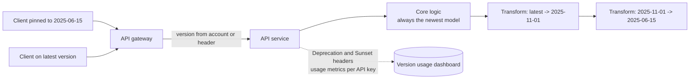

An API outlives the code behind it. Mobile apps that haven't been updated in a year, partner integrations nobody remembers
writing, and scripts in customers' cron jobs all keep calling it. Evolving an API means changing it without breaking any of them — or,
when you must break something, doing it on a schedule they can follow.

## Why it matters

Internal code can be refactored in an afternoon; a public contract can't, because you don't control the clients. A field rename that
looks harmless breaks every client that reads that field. Interviewers ask about versioning to see whether you think about the clients
you don't control — especially in designs with mobile apps, public APIs, webhooks or many internal teams.

## How it works

### Backward-compatible vs breaking changes

A change is **backward compatible** when every existing client keeps working without modification.

| Usually safe (additive) | Breaking |
|---|---|
| Add a new endpoint | Remove or rename an endpoint |
| Add an optional request field | Make an optional field required |
| Add a response field | Remove or rename a response field |
| Add a new value to an enum clients **know to tolerate** | Change a field's type or format (`"42"` → `42`, seconds → milliseconds) |
| Relax validation (accept longer names) | Tighten validation (reject values that used to work) |
| Add a new optional query parameter | Change default behaviour (default sort, page size) |
| Add a new error code clients can treat generically | Change the meaning of an existing field or status code |

Two caveats: adding an enum value breaks clients that `switch` over it without a default branch, and adding a response field can break
clients that validate responses strictly. That is why API guidelines tell clients to be **tolerant readers** — ignore unknown fields,
handle unknown enum values gracefully — and why you document that you will add fields without notice.

### Versioning schemes

When a breaking change is unavoidable, clients need a way to keep the old behaviour while new clients opt into the new one.

| Scheme | Example | Pros | Cons |
|---|---|---|---|
| URL path | `/v1/courses`, `/v2/courses` | Obvious, easy to route and cache, visible in logs | Coarse; whole API versions move together |
| Header | `Api-Version: 2026-03-01` | Clean URLs, fine-grained, per-request | Less visible; caches must vary on the header |
| Media type | `Accept: application/vnd.example.v2+json` | Fits HTTP content negotiation | Awkward tooling; rarely used outside a few APIs |
| Date-based, pinned per account | Account pinned to `2025-06-15`; override with a header | Each client upgrades on its own schedule | Server must maintain transformations for every version |
| Query parameter | `?version=2` | Easy to try | Easy to forget; pollutes caching |

URL versioning is the most common for public REST APIs and the easiest to explain in an interview. Date-based versioning (Stripe's model)
lets the server evolve continuously: the core code implements the newest behaviour, and a chain of small **version transformers**
converts responses back into the shape each older version expects.

### Evolving schemas, not just URLs

- **Protocol Buffers / gRPC:** fields are identified by number, so you can add fields freely; never reuse or renumber a field — mark
  removed ones `reserved`.
- **GraphQL:** usually unversioned. Add fields, mark old ones `@deprecated(reason: ...)`, watch usage, remove when unused.
- **Events and webhooks:** consumers deserialize old messages for as long as they are retained, so event schemas need the same discipline
  — often enforced with a schema registry and compatibility rules.
- **Databases behind the API:** use the **expand–contract** sequence — add the new column, write both, migrate readers, then remove the old
  one — so no deploy step breaks the running version; see [zero-downtime migrations](lesson:zero-downtime-migrations).

### Deprecation without surprises

1. **Announce** the change and the replacement, with a timeline (often 6–12 months for public APIs).
2. **Signal it in responses.** The `Deprecation` header (RFC 9745, published 2025) marks a resource as deprecated; the `Sunset` header
   (RFC 8594) gives the date it will stop working; a `Link` header can point to migration docs.
3. **Measure usage** per client (API key) so you know who still calls the old version, and contact them directly.
4. **Brownouts:** before the final shutdown, briefly fail old-version requests at scheduled times so unmaintained integrations surface.
5. **Remove** only when usage is near zero or the date has passed — and keep the response helpful (`410 Gone` with a link).

## Architecture



Older clients get their response passed through the transformers back to the shape they were built against; new clients get the core
response directly. Usage metrics per version show when a transformer can finally be deleted.

## Failure scenarios

- **"Harmless" rename.** A field renamed in a refactor ships without anyone noticing it is part of the contract; old app versions crash.
  Contract tests against published schemas catch this before deploy.
- **Version sprawl.** Five live major versions, each a separate code path with its own bugs. Keep the number small, or use transformers
  around one core.
- **Silent semantic changes.** Same field, new meaning (amount now includes tax). Clients keep working technically and produce wrong
  results. Treat meaning changes as breaking.
- **Mobile long tail.** Users who never update their app keep calling old endpoints for years. Support a minimum app version and force
  upgrades only when necessary.
- **Unenforceable sunset.** A big customer still depends on v1 on shutdown day. Usage tracking and direct outreach months earlier avoid
  the stand-off.

## Trade-offs

- **Stability vs velocity.** Never breaking anything slows design improvements; breaking often burns client trust. Most teams accept
  additive change continuously and breaking change rarely, with long notice.
- **Coarse vs fine-grained versions.** `/v2` for everything is simple but forces big-bang migrations; per-change or date versions let
  clients move gradually but cost more server-side machinery.
- **Visibility vs cleanliness.** URL versions are obvious in logs and docs; header versions keep URLs stable but are easier to forget.

## In real systems

- Stripe pins each account to the API version current when it was created and lets requests override it with a `Stripe-Version` header;
  new versions are released by date.
- GitHub's REST API uses a date-based `X-GitHub-Api-Version` header (for example `2022-11-28`).
- Google's API design guidance uses major versions in the path (`v1`, `v2`) and treats additive changes within a version as compatible.
- Protocol Buffers' `reserved` keyword exists specifically to stop removed field numbers being reused.

## Common mistakes

- **Versioning every small change** instead of evolving additively.
- **Not telling clients to ignore unknown fields**, so additive changes break strict clients.
- **Changing meaning without changing names.**
- **Deprecating without measuring usage** — you can't safely remove what you can't see.
- **Forgetting events and webhooks** are APIs too.

## In the interview

````question title="How would you version this API, and how do you change it without breaking clients?"
I'd put a major version in the URL — /v1/... — because it's simple to route, cache and see in logs. Within a version, changes are
additive only: new endpoints, new optional request fields, new response fields, with clients told to ignore unknown fields and tolerate
new enum values. A breaking change — removing or renaming a field, changing a type or meaning — goes into a new version that runs side
by side with the old one. I'd announce the old version's deprecation with Deprecation and Sunset headers, track usage per API key, reach
out to the remaining users, run brownouts near the end and only then remove it.
````

````question title="Which of these changes are breaking: adding a response field, making a request field required, adding an enum value?"
Adding a response field is normally compatible, provided clients follow the tolerant-reader rule and ignore unknown fields. Making a
previously optional request field required is breaking: old clients that don't send it start getting errors. Adding an enum value is
compatible only if clients were told to handle unknown values; clients that switch over a closed set may crash or misbehave, so
document enums as open-ended from the start and treat additions carefully.
````

## Key takeaways

- **Additive changes** (new endpoints, optional fields, new response fields) are compatible; **removals, renames, type and meaning
  changes** are breaking.
- Clients should be **tolerant readers**: ignore unknown fields, handle unknown enum values.
- Version with **URL majors** for simplicity or **dates/headers** for gradual upgrades; keep live versions few.
- Deprecate with **Deprecation/Sunset headers, usage tracking, outreach and brownouts** before removal.

## Knowledge check

```quiz
? Which change is backward compatible for well-behaved clients?
+ Adding a new optional field to a response
- Renaming `price` to `amount`
! Clients reading `price` find nothing.
- Changing `createdAt` from ISO strings to epoch seconds
! Type and format changes break parsing.
- Making an optional request field required
! Old clients that omit it now fail validation.
> Additive response fields are safe when clients ignore what they don't understand.

? A protobuf field `string email = 4;` is removed. What should you do with field number 4?
- Reuse it for the next new field
! Old clients would decode the new field's data as email.
+ Mark it `reserved` so it can never be reused
- Renumber all later fields
! Renumbering breaks every existing client.
- Nothing; numbers don't matter
! Field numbers are the wire identity of fields.
> Reserving removed numbers (and names) prevents silent misinterpretation of old and new data.

? Which headers tell clients an endpoint is deprecated and when it will stop working?
- Retry-After and Cache-Control
! Those concern retrying and caching.
+ Deprecation and Sunset
- ETag and If-Match
! Those support conditional requests.
- Location and Link only
! Link can point to docs, but it doesn't signal deprecation or a shutdown date by itself.
> RFC 9745 defines Deprecation; RFC 8594 defines Sunset.

? Why do date-based API versions (like Stripe's) usually involve response transformers?
+ The core implements only the newest behaviour, and transformers convert responses back to each older version's shape
- Because dates can't be put in URLs
! They could be, but that isn't why transformers exist.
- To encrypt responses for old clients
! Transformers change shape, not security.
- Because every version needs its own database
! Versions share data; only the API shape differs.
> One core plus small per-version adapters keeps many versions supportable.
```
