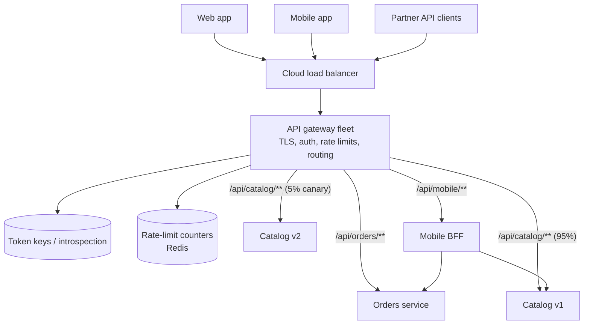
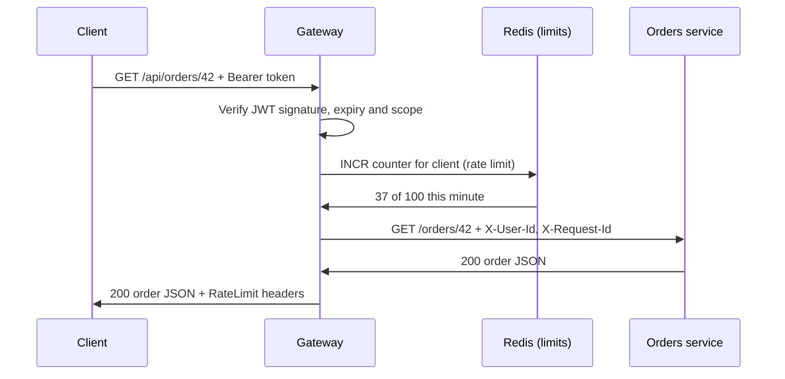

When a product is built from many services, clients shouldn't need to know them all. An API gateway gives every client one
front door: it routes each request to the right service and applies the rules every request must pass — authentication, rate
limits, validation, logging — in one place.

## Why it matters

Without a gateway, each service must implement token validation, rate limiting, CORS, request logging and TLS itself, slightly
differently; clients must know every service's address; and changing the internal layout breaks clients. A gateway centralises the
**cross-cutting** concerns and hides the **internal topology**.

It also appears constantly in interviews: as a box at the front of most microservice diagrams, as the natural home of a rate limiter,
and as a full design problem of its own ([design an API gateway](problem:api-gateway)). You should be able to say what it does, what it
must *not* do, and how it differs from a load balancer.

## How it works

### Responsibilities

| Concern | What the gateway does |
|---|---|
| Routing | Maps external paths and hosts to internal services (`/api/orders/**` → orders service) |
| Authentication | Validates API keys, session cookies or JWTs once; forwards the verified identity to services |
| Coarse authorization | Rejects requests lacking the right scope or plan before they reach services |
| Rate limiting and quotas | Limits per client, API key or plan (see [rate limiting](lesson:rate-limiting)) |
| Request validation | Rejects malformed requests, oversized bodies and unknown versions early |
| Transformation | Rewrites paths and headers, translates protocols (REST to gRPC), adds request IDs |
| Traffic management | Canary and weighted routing, retries, timeouts, circuit breaking |
| Observability | Central access logs, metrics per route and per client, trace propagation |
| Edge concerns | TLS termination, CORS, compression, response caching for public endpoints |

### What it must not do

- **Business logic.** Pricing rules or order validation in the gateway couple every team's deploys to the gateway team's.
- **Data ownership.** The gateway shouldn't own a database of domain data.
- **Heavy orchestration.** Aggregating many calls with complex error handling belongs in a dedicated service or a
  [backend-for-frontend](lesson:aggregation-discovery), not in shared gateway configuration.
- **Fine-grained authorization.** "Can user 42 edit document 9?" needs domain data; the owning service decides. The gateway checks the
  coarse rules (authenticated, right scope).

### Gateway vs load balancer vs service mesh

| | Load balancer | API gateway | Service mesh |
|---|---|---|---|
| Traffic | Any, into a pool of identical servers | External clients into many different services (north–south) | Service-to-service (east–west) |
| Knows about | Servers and health | APIs, clients, keys, plans, routes | Services, identities, call policies |
| Typical features | Distribution, health checks, TLS | Auth, rate limits, quotas, transformation, API keys, developer portal | mTLS, retries, timeouts, telemetry for every call |
| Where it runs | Edge or in front of a tier | Edge | Sidecar or node proxy next to every service |

They layer: a cloud load balancer in front of a gateway fleet; the gateway routes to services; a mesh handles calls between them.

### Backends for frontends (BFF)

Different clients want different APIs: a mobile app wants compact, aggregated responses; a partner API wants stability. The **BFF pattern**
gives each client type its own thin gateway or aggregation service, owned by the team that builds that client, behind the shared edge
gateway that enforces common policy.

### The gateway is a critical, shared hot path

Every request passes through it, so it must be **stateless** (state such as rate-limit counters lives in a shared store like Redis),
**horizontally scaled**, deployed across zones, and fast: per-request overhead should be a small fraction of the latency budget. It should
fail safely — if the rate-limit store is unreachable, decide in advance whether to fail open (allow) or closed (reject).

## Architecture





## Failure scenarios

- **Gateway outage = total outage.** Run multiple instances across zones, keep it stateless, and deploy it carefully (canaries) — a bad
  route configuration breaks everything at once.
- **Gateway becomes a bottleneck.** CPU-heavy plugins (body transformation, large JWT verification without caching keys) add latency to
  every request. Measure per-filter overhead.
- **Dependency failures.** If the identity provider or the rate-limit store is slow, the gateway is slow. Cache signing keys locally,
  set tight timeouts, and choose fail-open or fail-closed behaviour per policy.
- **Retry amplification.** Gateway retries on top of client retries on top of service retries multiply load during an incident. Retry
  only idempotent requests, at one layer, within a budget.
- **Configuration drift.** Many teams editing shared gateway configuration causes conflicts and outages; treat routes as code with
  review, validation and per-team ownership.

## Trade-offs

- **Centralisation vs coupling.** One place for policy is consistent and auditable, but a shared gateway can become a bottleneck for
  team velocity. Keep it policy-only and let teams own their routes and BFFs.
- **Managed vs self-hosted.** Managed gateways (AWS API Gateway, Apigee, Azure API Management) bring developer portals, keys and quotas
  out of the box but add cost and some latency; self-hosted (Kong, Envoy-based, Spring Cloud Gateway) give control and lower per-request
  cost but need operating.
- **Auth at the gateway vs in services.** Gateway-only auth is simple but trusts the internal network; defence in depth has services
  verify identity too (signed internal tokens or mTLS).

## In real systems

- Kong, Tyk and Envoy-based gateways (including many Kubernetes Gateway API implementations) are common self-hosted options; AWS API
  Gateway, Google Apigee and Azure API Management are managed ones.
- Netflix popularised the gateway-plus-BFF approach for serving many device types.
- In the Spring ecosystem, Spring Cloud Gateway provides routing, filters, retries, rate limiting (backed by Redis) and weighted routing.

## Java and Spring Boot example

Spring Cloud Gateway expresses routes as code. This configuration strips the `/api` prefix, tags requests, retries the orders route on
transient failures, and splits catalog traffic 95/5 between two versions for a canary release. `lb://` names resolve through service
discovery (compiled against Spring Cloud Gateway 5.0 on Spring Framework 7):

```java title="GatewayRoutes.java"
import org.springframework.cloud.gateway.route.RouteLocator;
import org.springframework.cloud.gateway.route.builder.RouteLocatorBuilder;
import org.springframework.context.annotation.Bean;
import org.springframework.context.annotation.Configuration;

// One front door, three backends. "lb://name" resolves instances through service discovery
// (Spring Cloud LoadBalancer), so the gateway never hard-codes server addresses.
@Configuration
public class GatewayRoutes {

    @Bean
    public RouteLocator routes(RouteLocatorBuilder builder) {
        return builder.routes()
                // /api/orders/42 -> orders-service /orders/42, retried on transient failure
                .route("orders", r -> r.path("/api/orders/**")
                        .filters(f -> f.stripPrefix(1)
                                .addRequestHeader("X-Request-Source", "edge-gateway")
                                .retry(2))
                        .uri("lb://orders-service"))
                // Canary: 95% of catalog traffic to v1, 5% to v2 (same weight group)
                .route("catalog-v1", r -> r.weight("catalog", 95)
                        .and().path("/api/catalog/**")
                        .filters(f -> f.stripPrefix(1))
                        .uri("lb://catalog-service-v1"))
                .route("catalog-v2", r -> r.weight("catalog", 5)
                        .and().path("/api/catalog/**")
                        .filters(f -> f.stripPrefix(1))
                        .uri("lb://catalog-service-v2"))
                .build();
    }
}
```

Notice what is *not* here: no business rules, no database access. Authentication would be added with Spring Security's resource-server
support and rate limiting with the gateway's Redis-backed limiter — both cross-cutting policies, not domain logic.

## Common mistakes

- **Putting business logic in the gateway**, turning it into a distributed monolith every team must change.
- **A single gateway instance** or one without zone redundancy.
- **Skipping auth in services entirely** because "the gateway checks it" — anything inside the network can then impersonate anyone.
- **Retrying non-idempotent requests** at the gateway.
- **Confusing gateway and load balancer** — a gateway understands APIs and clients; a load balancer only spreads traffic.

## In the interview

````question title="What does an API gateway do, and what should it not do?"
It is the single entry point for external clients: it terminates TLS, authenticates requests once (API keys, sessions or JWTs) and
forwards the verified identity, enforces coarse authorization, rate limits and quotas per client, validates and size-limits requests,
routes to the right service and version (including canaries), adds request IDs and records metrics and logs. It should not contain
business logic, own domain data, perform fine-grained authorization that needs domain knowledge, or orchestrate complex multi-service
workflows — those belong in services or a backend-for-frontend. It must be stateless, horizontally scaled and redundant, because every
request depends on it.
````

````question title="How is an API gateway different from a load balancer and a service mesh?"
A load balancer spreads traffic across identical instances of one service using health checks; it doesn't know about API keys, plans or
routes to many services. An API gateway sits at the edge for north–south traffic and understands APIs and clients: auth, quotas,
transformation, versioned routing to many services. A service mesh handles east–west traffic between services with sidecar or node
proxies, giving every call mTLS, retries, timeouts and telemetry. In practice they stack: a load balancer in front of the gateway fleet,
the gateway routing to services, and a mesh between services.
````

## Key takeaways

- An API gateway is the **single front door**: routing, authentication, rate limits, validation, transformation and observability.
- Keep it **policy-only** — no business logic, no domain data, no fine-grained authorization.
- It is on **every request's path**: stateless, horizontally scaled, multi-zone, carefully deployed, fast.
- **Load balancer, gateway and mesh** are layers with different jobs; **BFFs** tailor APIs per client type behind the gateway.

## Knowledge check

```quiz
? Where should the rule "a user may edit a document only if they are its owner or an editor" be enforced?
- In the API gateway, for every route
! The gateway lacks document ownership data; putting it there couples the gateway to the domain.
+ In the document service, which owns the document and its permissions
- In the load balancer
! Load balancers don't understand users or documents.
- In the CDN
! CDNs cache content; they don't hold permissions.
> The gateway checks coarse rules (authenticated, right scope); fine-grained authorization belongs to the service that owns the data.

? Which feature distinguishes an API gateway from a plain L7 load balancer?
- Routing by URL path
! L7 load balancers also route by path.
- TLS termination
! Both commonly terminate TLS.
+ Per-client API keys, quotas and plan-based rate limits
- Health checks
! Load balancers health-check their targets too.
> Gateways understand API consumers; load balancers understand servers.

? The gateway retries failed requests twice, the client SDK retries three times, and services retry downstream calls twice. What is the risk during an incident?
- Requests are processed out of order
! Ordering isn't the main danger here.
+ Retry amplification multiplies load on already failing services
- The gateway loses its configuration
! Retries don't affect configuration.
- TLS sessions expire
! Unrelated to retries.
> Layered retries multiply: 3 × 3 × 3 attempts per user action. Retry at one layer, idempotent requests only, within a budget.

? The gateway validates JWTs by calling the identity provider on every request, and login latency spikes slow every API. What is the fix?
+ Verify JWT signatures locally with cached public keys, refreshing them periodically
- Remove authentication from the gateway
! That removes a necessary control.
- Add more identity provider instances only
! It helps capacity but keeps a remote call on every request's path.
- Make the gateway stateful
! Statefulness doesn't remove the dependency.
> Signed tokens exist precisely so they can be verified without a network call.
```
