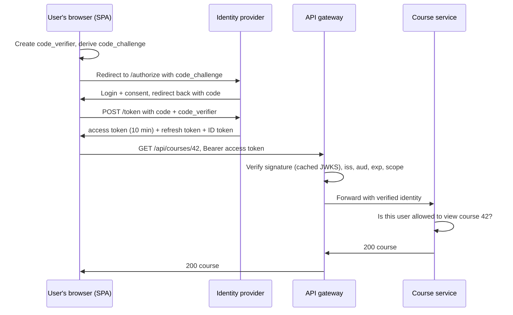

Every API has to answer two questions about each request: **who is calling** (authentication) and **are they allowed to do
this** (authorization). The mechanisms — sessions, tokens, OAuth, API keys, mutual TLS — differ mostly in where state lives, how
credentials are revoked, and which component checks them.

## Why it matters

Security is a non-functional requirement in almost every design, and "how do users log in and how do services trust each other?" is a
common follow-up. Good answers place each check at the right layer: the edge verifies identity once, services enforce permissions on
their own data, and service-to-service calls are authenticated too. Weak answers say "use JWT" and stop.

## How it works

### Authentication vs authorization

- **Authentication (authN)**: proving identity — password plus a second factor, a passkey, a single sign-on login, an API key, a client
  certificate. Output: a verified identity (user 42, service `billing`).
- **Authorization (authZ)**: deciding whether that identity may perform this action on this resource. Output: allow or deny.

Keep them separate in your design: authentication usually happens once per session at the edge; authorization happens on every action,
close to the data.

### Server-side sessions

After login, the server creates a random session ID, stores the session (user ID, roles, expiry) in a shared store such as Redis, and
sends the ID in a `Secure`, `HttpOnly`, `SameSite` cookie. Each request looks the session up.

- **Pros:** instant revocation (delete the session), small cookie, server controls everything.
- **Cons:** a lookup per request and a highly available session store (see [stateless vs stateful](lesson:stateless-vs-stateful)).

### Self-contained tokens (JWT)

A JSON Web Token carries claims (`sub`, `iss`, `aud`, `exp`, scopes) signed by the issuer. Any service holding the issuer's public key can
verify it without a network call.

- **Pros:** stateless verification, scales across services and regions, carries identity to downstream services.
- **Cons:** can't be revoked before `exp` without extra machinery; size grows with claims; mistakes in validation are dangerous.

The usual compromise: **short-lived access tokens** (minutes) plus **long-lived refresh tokens** stored server-side, rotated on use and
revocable. Revocation takes effect within one access-token lifetime; a deny-list covers emergencies.

Validating a JWT properly means checking the **signature** against a key fetched from the issuer's JWKS endpoint (cached), an allow-listed
**algorithm**, the **issuer**, the **audience** (this API), and **expiry** with small clock-skew tolerance.

### OAuth 2.0 and OpenID Connect

**OAuth 2.0** is a framework for delegated authorization: a user lets an application call an API on their behalf without giving it their
password. **OpenID Connect (OIDC)** adds an identity layer on top — an **ID token** that tells the application who the user is — and is
what "Sign in with Google" uses.

| Flow | Who uses it | Notes |
|---|---|---|
| **Authorization code + PKCE** | Web apps, single-page apps, mobile apps | The standard user flow. The OAuth 2.0 Security Best Current Practice (RFC 9700, 2025) requires PKCE for public clients and recommends it for all |
| **Client credentials** | Service-to-service, batch jobs | No user; the service authenticates as itself and gets a token with its own scopes |
| **Device authorization** | TVs, CLIs | User approves on another device |
| Implicit | Legacy browser apps | Should not be used (RFC 9700) |
| Resource owner password | Legacy | Must not be used (RFC 9700) |

### API keys

A long random secret identifying a calling application (not a user), common for server-to-server public APIs. Store only a hash, show the
key once, support multiple active keys for rotation, scope keys to permissions, and rate-limit per key. Keys in mobile or browser apps are
not secret.

### Service-to-service identity

Inside your system, "it came from our network" is not authentication. Options:

- **Mutual TLS (mTLS):** both sides present certificates; each service has a cryptographic identity, often issued and rotated
  automatically by a service mesh.
- **Service tokens:** client-credentials access tokens, or short-lived signed tokens minted by a platform identity service.
- **Propagating the user:** pass the user's identity downstream as a signed token (not a plain `X-User-Id` header that anything could
  set), so each service can authorize on behalf of the user.

### Authorization models

| Model | Rule shape | Example |
|---|---|---|
| **RBAC** (role-based) | Users have roles; roles have permissions | `instructor` can create courses |
| **ABAC** (attribute-based) | Policies over user, resource and context attributes | Edit allowed if `user.org == course.org` and during business hours |
| **ReBAC** (relationship-based) | Permissions follow relationships in a graph | Can view a document if a member of a group that has viewer access to its folder |
| **ACLs** | Each resource lists who can do what | A shared file's access list |

Coarse checks (is the token valid, does it have the `courses:write` scope?) belong at the gateway. Fine-grained checks (is this user an
editor of *this* course?) belong in the service that owns the data, or in a central policy/permission service (Zanzibar-style systems such
as SpiceDB or OpenFGA) that services query.

## Architecture



The gateway authenticates once per request with no network call; the course service makes the fine-grained decision because only it
knows who may see course 42.

## Failure scenarios

- **Identity provider outage.** New logins fail. Already-issued access tokens keep working until expiry because verification uses cached
  keys — one reason to verify locally rather than call the provider per request.
- **Stolen access token.** Valid until it expires; keep lifetimes short, bind tokens to clients where possible, and revoke the refresh
  token.
- **Key rotation.** The issuer rotates signing keys; services with stale JWKS caches reject valid tokens. Publish new keys before using
  them, and refresh caches on an unknown key ID.
- **Header spoofing internally.** A service trusting a plain `X-User-Id` header can be impersonated by any compromised internal caller.
  Use signed tokens or mTLS.
- **Confused deputy.** A service calls another with its own powerful credentials on behalf of a user who shouldn't have that access.
  Propagate the user's identity and authorize as the user.

## Trade-offs

- **Sessions vs JWTs.** Sessions: instant revocation, a lookup per request. JWTs: no lookup, delayed revocation. Short-lived JWTs with
  revocable refresh tokens get most of both.
- **Central vs local authorization.** A central permission service gives consistent policies and auditing but is a dependency on every
  request; local checks are fast but duplicate logic.
- **Token size vs lookups.** Putting roles and permissions in the token saves lookups but bloats every request and goes stale when roles
  change.
- **Build vs buy.** Identity providers (Auth0/Okta, Amazon Cognito, Keycloak, Microsoft Entra ID) handle MFA, passkeys, social login and
  compliance that are expensive to build correctly.

## In real systems

- "Sign in with Google/Apple/Microsoft" is OpenID Connect; enterprise single sign-on uses OIDC or SAML.
- Service meshes such as Istio issue and rotate workload certificates automatically to provide mTLS between services.
- Google's Zanzibar paper describes a global relationship-based authorization system; SpiceDB and OpenFGA are open-source systems
  inspired by it.
- Spring Security's OAuth2 resource-server support validates JWTs against an issuer's JWKS endpoint with a few lines of configuration.

## Common mistakes

- **Mixing up authentication and authorization**, or doing only one.
- **Long-lived JWTs with no revocation plan.**
- **Trusting identity headers from inside the network** without verification.
- **Accepting any JWT algorithm** (including `none`) or skipping audience checks.
- **Putting fine-grained, data-dependent checks in the gateway**, which doesn't have the data.

## In the interview

````question title="How would you handle authentication and authorization in this design?"
Users sign in through an identity provider using OpenID Connect with the authorization code flow and PKCE. The client gets a short-lived
access token (around 10 minutes) and a refresh token that is stored server-side, rotated on use and revocable. The API gateway verifies
each access token locally — signature against cached JWKS keys, issuer, audience, expiry and scopes — and forwards the verified identity.
Each service enforces fine-grained authorization on its own resources, such as "is this user an instructor of this course?", using RBAC
or relationship checks. Service-to-service calls use mTLS or client-credentials tokens, and user identity is propagated as a signed token
so downstream services authorize as the user.
````

````question title="Sessions or JWTs — which would you choose and why?"
For a browser-based product on one domain, server-side sessions in Redis are simple and give instant logout and revocation, at the cost
of a fast lookup per request and a highly available session store. For APIs consumed by mobile apps, many services or multiple regions,
JWT access tokens avoid a shared lookup on every request; I'd keep them short-lived and pair them with revocable refresh tokens, plus a
small deny-list for emergencies. Many systems combine them: a session at the edge for the browser, and JWTs internally.
````

## Key takeaways

- **Authentication** establishes who; **authorization** decides what they may do — on every action, close to the data.
- **Sessions** revoke instantly but need a lookup; **JWTs** verify locally but revoke late — use **short-lived access + revocable refresh**.
- Use **OIDC authorization code + PKCE** for users, **client credentials** or **mTLS** for services; implicit and password grants are
  out.
- The gateway does **coarse** checks; services do **fine-grained** ones (RBAC, ABAC or relationship-based).

## Knowledge check

```quiz
? A user's role is removed, but they can still act with their old permissions for up to an hour. What design caused this?
- Server-side sessions in Redis
! Deleting or updating the session takes effect immediately.
+ JWT access tokens carrying roles with a one-hour lifetime
- mTLS between services
! mTLS authenticates services; it doesn't carry user roles.
- API keys
! API keys identify applications, not user roles.
> Self-contained tokens keep their claims until expiry; shorten lifetimes or check roles server-side.

? Which OAuth 2.0 flow should a single-page web app use to sign users in?
- Implicit flow
! RFC 9700 says clients should not use the implicit grant.
- Resource owner password credentials
! RFC 9700 says this grant must not be used.
+ Authorization code with PKCE
- Client credentials
! Client credentials authenticate a service, not a user.
> Authorization code + PKCE is the recommended flow for browser and mobile apps.

? Where should "only the course's instructors may edit its lessons" be enforced?
- In the CDN
! CDNs don't know about course membership.
- Only in the API gateway
! The gateway lacks course-membership data; it can check the token and scopes.
+ In the course service (or a permission service it queries), which knows who instructs the course
- In the client app
! Client-side checks are trivially bypassed.
> Fine-grained, data-dependent authorization belongs with the data owner.

? Internal services trust an `X-User-Id` header set by the gateway. What is the risk?
+ Any compromised or misconfigured internal caller can set the header and impersonate any user
- Headers are too slow to read
! Reading a header is cheap.
- The gateway can't set headers
! Gateways routinely add headers.
- It prevents caching
! Caching isn't the concern here.
> Propagate identity as a signed token or authenticate callers with mTLS.
```
