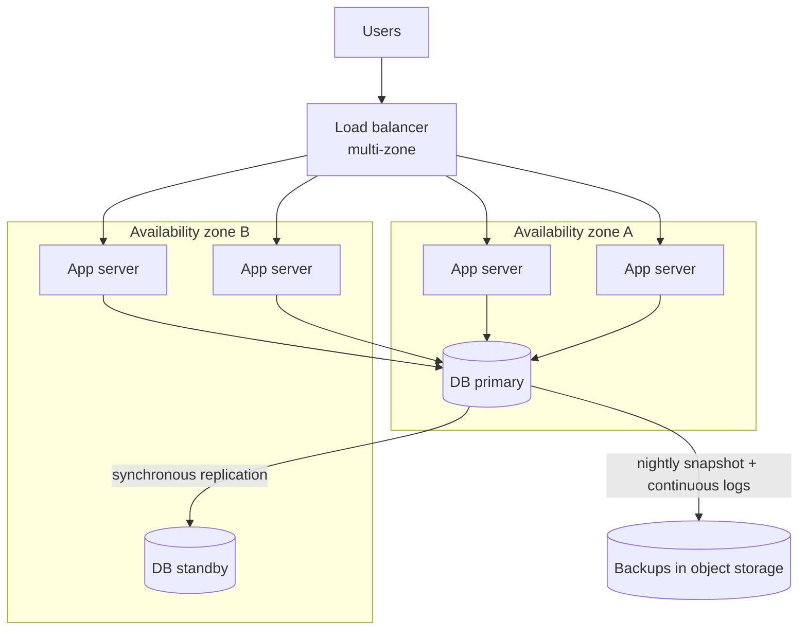

"It must be reliable" is four different promises in disguise. A system can be up but wrong, correct but often down, survive a
server crash but lose data in a fire. Separating the four lets you choose the right mechanism — and price it.

## Why it matters

| Property | The promise | Measured as | Main mechanisms |
|---|---|---|---|
| **Availability** | The system answers requests | % of time (or of requests) served successfully | Redundancy, failover, load balancing |
| **Reliability** | The system does the right thing, consistently, over time | Failure rate, mean time between failures | Testing, safe deploys, validation, redundancy |
| **Fault tolerance** | Individual component failures don't become system failures | Which failures it survives | Replication, retries, isolation, graceful degradation |
| **Durability** | Data that was acknowledged is never lost | Probability of losing an object per year | Replication across failure domains, checksums, backups |

They overlap but are not interchangeable. A cache that answers every request with stale data is *available* but not *reliable*. A
database with nightly backups is *durable* (you will get the data back) but may be *unavailable* for hours while you restore. Each
non-functional requirement should name which of these it means.

## How it works

### Availability and the "nines"

Availability is usually expressed as a percentage of successful time or requests over a period. Each additional nine cuts allowed
downtime by ten:

| Availability | Downtime per year | Per 30-day month | Per week |
|---|---|---|---|
| 99% ("two nines") | 3.65 days | 7.2 hours | 1.7 hours |
| 99.9% | 8.76 hours | 43.2 minutes | 10.1 minutes |
| 99.95% | 4.38 hours | 21.6 minutes | 5 minutes |
| 99.99% | 52.6 minutes | 4.3 minutes | 1 minute |
| 99.999% | 5.3 minutes | 26 seconds | 6 seconds |

Two consequences follow immediately. First, at four nines there is no time for a human to wake up, diagnose and fix an outage by
hand — failover must be automatic. Second, availability depends on *both* how often things fail and how fast they recover:

```text
availability = MTBF / (MTBF + MTTR)
```

where MTBF is the mean time between failures and MTTR the mean time to recovery. Halving recovery time improves availability as
much as halving failure frequency — and is often far cheaper. [Availability maths](lesson:availability-math) in Stage 11 shows how to
compose these numbers across dependencies.

### Reliability

Reliability is about correctness over time. Most production failures are not hardware: they are **bad deploys, configuration changes,
software bugs and overload**. Reliability mechanisms therefore include engineering practice — canary deployments, input validation,
idempotent operations, load shedding — as much as extra machines.

### Fault tolerance

A fault is a component deviating from spec (a disk dies, a process crashes, a network link drops); a failure is the *system*
stopping service to users. Fault tolerance is the art of not letting the first become the second:

- **Redundancy**: more than one of every critical component, so one can fail.
- **Replication**: copies of data on other machines.
- **Retries with timeouts**: transient faults are retried; slow calls are abandoned.
- **Isolation**: failures are contained (separate pools, cells, regions) so one bad dependency doesn't take down everything.
- **Graceful degradation**: when part of the system fails, serve a reduced experience instead of an error.

### Durability

Durability means: once you tell a user "saved", the data survives. It is achieved by writing data to several independent places
*before* acknowledging, across **failure domains** that don't fail together — different disks, racks, availability zones or regions —
plus checksums to detect corruption and backups to recover from mistakes.

> [!WARNING] Replication is not a backup
> Replication copies *every* change — including an accidental `DELETE` or a corrupting bug — to all replicas within milliseconds.
> Only backups (snapshots, point-in-time recovery, versioned objects) let you go back to before the mistake.

## Architecture

A design that targets high availability and durability for a typical web service: redundant stateless servers across two zones, a
database primary with a synchronous standby in another zone, and backups stored separately.



If a server fails, the load balancer stops routing to it. If zone A fails, the standby in zone B is promoted and the remaining servers
keep serving. If someone deletes a table, the backups restore it to a point in time — something the standby cannot do.

## Failure scenarios

| Failure | Property tested | What saves you |
|---|---|---|
| One app server crashes | Availability | Health checks + other replicas behind the load balancer |
| A disk fails on the DB primary | Durability, availability | Replica with the data; automated failover |
| A whole availability zone loses power | Availability | Capacity and data in a second zone |
| A bad deploy returns wrong results | Reliability | Canary release, fast rollback |
| An engineer runs `DELETE` without `WHERE` | Durability | Point-in-time backups — replication made it worse |
| A region-wide outage | Availability | Multi-region deployment (expensive; often unnecessary) |

## Trade-offs

- **Each nine costs more.** Going from 99.9% to 99.99% typically means automatic failover, multi-zone everything, rigorous deploy
  practices and on-call — often several times the cost. Ask what downtime actually costs the business.
- **Durability vs latency.** Waiting for a synchronous replica (ideally in another zone) before acknowledging a write adds a network
  round trip to every write; asynchronous replication is faster but can lose the last few writes on failover.
- **Availability vs consistency.** During a network partition a replicated system must choose between staying available with
  possibly stale data or refusing requests until it can be sure — the CAP trade-off covered in [Stage 6](lesson:cap-pacelc).
- **Redundancy vs complexity.** Every failover mechanism is itself code that can fail, and is exercised rarely. Untested failover is a
  hope, not a mechanism.

## In real systems

- Amazon S3 Standard is designed for **99.999999999% (eleven nines) durability** and 99.99% availability: it stores data redundantly
  across multiple availability zones. Durability and availability are stated — and engineered — separately.
- Managed databases typically offer a "multi-AZ" option: a standby in another zone with automated failover, usually completing in tens
  of seconds to a few minutes. That is availability engineering bought as a feature.
- Postmortems across the industry repeatedly find the same root causes: configuration changes, deploys and dependency overload — which
  is why reliability work is as much about process as about hardware.

## Common mistakes

- **Using "reliable" for everything.** Say which property you mean and how it is measured.
- **Treating replication as backup.** Replicas faithfully copy mistakes.
- **Promising five nines casually.** Five minutes of downtime a year rules out almost any manual recovery.
- **Putting all replicas in one failure domain.** Two copies on the same rack or zone fail together.
- **Never testing failover.** The first real failover is the worst time to discover it doesn't work.

## In the interview

````question title="What is the difference between availability and durability?"
Availability is whether the system answers requests — measured as the percentage of time or requests served successfully. Durability is
whether data that was acknowledged survives — measured as the probability of losing it. They can diverge: a database that is down for
an hour while restoring from backup has lost availability but not durability; a cache cluster that keeps answering after losing its
data is available but not durable. Durability comes from writing to several failure domains before acknowledging, plus backups;
availability comes from redundancy and fast failover.
````

````question title="How much downtime does 99.99% availability allow, and what does that imply for the design?"
About 52.6 minutes per year, or roughly 4.3 minutes per month. That is too little time for a human to notice, diagnose and fix most
incidents, so the design needs automated failure detection and failover, redundancy across availability zones, deploys that can be
rolled back in seconds, and no single points of failure — including in dependencies such as DNS, configuration and authentication.
````

````question title="Why isn't database replication enough to protect against data loss?"
Replication protects against losing a machine or disk, because another copy has the data. But it copies every change, including
accidental deletes, bad migrations and data-corrupting bugs, to all replicas almost immediately. To recover from those you need
backups that let you restore to a point in time before the mistake — snapshots plus continuous logs, or versioned objects — stored
separately from the primary.
````

## Key takeaways

- **Availability** (answers requests), **reliability** (does the right thing), **fault tolerance** (survives component faults) and
  **durability** (keeps acknowledged data) are different promises with different mechanisms.
- Each nine of availability is ten times less downtime; above three nines, recovery must be automatic.
- `availability = MTBF / (MTBF + MTTR)` — **faster recovery** is often the cheapest improvement.
- Spread copies across **failure domains**, and remember **replication is not backup**.

## Knowledge check

```quiz
? A service must be 99.9% available. Roughly how much downtime is allowed per 30-day month?
- About 4 minutes
! That is 99.99%.
+ About 43 minutes
- About 7 hours
! That is 99%.
- About 26 seconds
! That is 99.999%.
> 0.1% of 30 days × 24 h × 60 min = 43.2 minutes.

? An engineer accidentally deletes a table. The database has two synchronous replicas in other zones. What recovers the data?
- Promoting a replica
! The delete was replicated; every replica deleted the table too.
- Restarting the primary
! Restarting doesn't undo a committed delete.
+ A point-in-time restore from backups
- Reading the data from the cache
! A cache holds a partial, possibly stale copy and is not a system of record.
> Replication copies mistakes; only backups let you return to before them.

? Which change most directly improves availability when failures are rare but each takes two hours to fix by hand?
+ Automating detection and failover to cut recovery time
- Buying more expensive hardware to make failures rarer
! It helps somewhat, but recovery time is the dominant term here.
- Adding a cache
! A cache helps load and latency, not recovery from failure.
- Adding more replicas in the same rack
! Same-rack replicas share failure causes and don't speed up recovery.
> Availability = MTBF / (MTBF + MTTR); when MTTR is large, reducing it gives the biggest gain.

? What does "durability" protect against that "availability" does not?
- Slow responses
! That is a latency concern.
- A server crashing
! Server crashes threaten availability; data on disk usually survives.
+ Losing data that was acknowledged as saved
- Too many concurrent users
! That is a capacity and scalability concern.
> Durability is the promise that acknowledged data is never lost, whatever happens to individual machines.
```

Two downtime estimates — include a unit such as `min`:

```drill
? A service promises 99.95% availability. How much downtime does that allow in a 30-day month?
= 21.6 min
~ 1.25
> 30 days × 24 h × 60 min = 43,200 minutes; 0.05% of that is 21.6 minutes.

? How much downtime per year does 99.99% availability allow?
= 52.6 min
~ 1.25
> A year has 525,600 minutes; 0.01% of that is about 52.6 minutes — under an hour.
```
