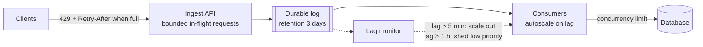

When producers generate work faster than consumers can handle it, the difference has to go somewhere. It can pile up in a buffer, slow
the producer down, be dropped, or be absorbed by more consumers. Backpressure is the deliberate choice among those options — made in advance,
with limits — instead of the accidental one, which is usually an unbounded queue that grows until something runs out of memory.

## Why it matters

Ingestion pipelines, crawlers, log collectors, notification fan-outs and job queues all face bursts. Interviewers ask "what happens when the
consumers fall behind?" and expect you to talk about bounded buffers, consumer lag, what the producer experiences, when to shed load, and how
autoscaling fits — rather than "the queue will absorb it".

## How it works

### Why unbounded queues fail

A queue absorbs bursts only if consumers eventually catch up: the **average** arrival rate must be below the **average** processing rate. If
arrivals exceed processing for long enough:

- The backlog grows linearly; by Little's law, the **wait time** grows with it (backlog ÷ processing rate). Messages become stale long
  before they're processed.
- Memory or disk eventually runs out; the broker or service crashes, often losing in-memory work.
- Catching up takes as long again: if consumers are only slightly faster than producers once the burst ends, a backlog drains slowly.

```text title="Formula"
backlog growth rate   = arrival rate − processing rate
time to drain backlog = backlog ÷ (processing rate − arrival rate)
wait for a new item   ≈ backlog ÷ processing rate
```

A backlog of 1.8 million messages, with consumers at 2,000/s and producers still sending 1,500/s, drains at only 500/s: **an hour**.

### The four responses

1. **Buffer (bounded)** — absorb short bursts in a queue or log with explicit limits on size or age. Durable logs (Kafka) can buffer days of
   data cheaply; in-memory buffers must be small.
2. **Slow the producer (backpressure proper)** — make the producer wait or reject when the buffer is full: blocking puts, TCP flow control,
   credit-based protocols (the consumer grants permits; Reactive Streams `request(n)`, gRPC/HTTP/2 flow-control windows), or HTTP
   `429`/`503` with `Retry-After` to clients.
3. **Shed load** — drop or reject work deliberately, starting with the least valuable: sample analytics events, skip low-priority
   notifications, return cached or degraded responses ([graceful degradation](lesson:graceful-degradation)).
4. **Scale consumers** — add consumers when lag grows (autoscaling on queue depth or age of the oldest message). Limited by partition counts
   (Kafka) and by downstream capacity: more consumers can overload the database they write to.

Usually you combine them: a durable buffer for bursts, autoscaling for sustained increases, producer backpressure at the edges, and shedding
as the last resort.

### Signals to watch

- **Consumer lag** (messages or time behind the head of the log) per partition/consumer group.
- **Age of the oldest message** in a queue — the user-facing delay.
- **Queue depth trend** — growing steadily means processing rate < arrival rate.
- **Downstream saturation** — the real bottleneck may be the database consumers write to.

### Backpressure inside a service

Within one process, the same idea applies: bounded thread-pool queues (reject or block when full instead of queueing forever), bounded
connection pools with short acquire timeouts, and concurrency limits per dependency. Adaptive concurrency limiters (inspired by TCP
congestion control) lower the limit automatically when latency rises.

## Architecture



## Failure scenarios

- **In-memory queue grows until out-of-memory**: the service crashes and loses everything buffered. Bound in-memory queues; buffer durably.
- **Autoscaling consumers overwhelms the database**: lag triggers more consumers, which add load to the slow database, which slows further.
  Cap consumer concurrency to what the downstream can take.
- **Stale processing**: a backlog of hours means notifications arrive too late to matter. Drop or expire items older than their usefulness.
- **Retry storm adds to the backlog**: failed items re-enqueued immediately double the load. Backoff and DLQs.
- **Head-of-line blocking**: one slow message type delays all others in a shared queue. Separate queues per priority or type.

## Trade-offs

| Response | Gains | Costs |
|---|---|---|
| Buffer | Smooths bursts; no data loss | Latency grows with backlog; bounded by storage |
| Slow producers | Protects the system; no loss | Pushes latency/errors to callers |
| Shed | Keeps the system healthy for important work | Some work is lost or degraded |
| Scale consumers | Raises capacity | Cost; limited by partitions and downstream |

## In real systems

- Kafka provides long durable buffering; consumer lag is the standard health metric, and autoscalers such as KEDA scale consumers on lag.
- TCP flow control and HTTP/2 stream windows are backpressure built into the network stack.
- Reactive Streams (Project Reactor, RxJava, Akka Streams) make demand-driven backpressure explicit with `request(n)`.
- AWS Lambda event-source mappings and SQS-based workers scale with queue depth, with configurable maximum concurrency to protect
  downstreams.

## Common mistakes

- **"The queue will absorb it"** with no bound, no lag monitoring and no plan.
- **Autoscaling consumers without capping downstream load.**
- **One queue for all priorities.**
- **Keeping work that's no longer useful** (expired notifications, stale prices).
- **Unbounded thread-pool queues** inside services.

## In the interview

````question title="Your consumers fall behind during a traffic spike. What happens and what do you do?"
Messages accumulate in the durable log, which is fine for a bounded burst — Kafka with a few days' retention absorbs it — but processing delay
grows with the backlog, so I'd watch consumer lag and the age of the oldest message. If lag keeps rising, consumers scale out (up to the
partition count) as long as the downstream database has headroom, with a concurrency cap so we don't move the bottleneck. At the edge, the
ingest API limits in-flight work and returns 429 with Retry-After when the buffer is near its limit. If the backlog still exceeds what's
useful — say, notifications older than an hour — we expire or shed low-priority items rather than deliver them late. After the spike, the
drain time is backlog divided by the spare processing rate, which tells us whether we need more capacity.
````

````question title="Why is an unbounded in-memory queue dangerous?"
Because if arrivals exceed processing for long enough, it grows until the process runs out of memory and crashes — losing everything in it —
and before that, every item waits longer and longer, so the queue delivers stale work. It also hides the problem: callers see success while
the system falls further behind. Bounded queues force an explicit decision at the limit — block the producer, reject with a retryable error,
or drop low-value work — and make overload visible.
````

## Key takeaways

- A queue absorbs bursts only if **processing rate > arrival rate on average**; otherwise backlog and delay grow without limit.
- Choose explicitly: **bounded buffering, slowing producers, shedding, scaling consumers** — usually a combination.
- Watch **consumer lag and age of oldest message**; drain time = backlog ÷ (processing − arrival).
- Scale consumers **within downstream limits**, separate priorities, and drop work that's **no longer useful**.

## Knowledge check

```quiz
? Producers send 3,000 messages/s; consumers process 2,500/s. What happens over an hour?
- Nothing; the queue absorbs it
! The backlog grows continuously.
+ The backlog grows by about 1.8 million messages, and wait times keep rising
- Consumers speed up automatically
! Not without scaling.
- Messages are dropped by default
! Most queues keep them until limits are hit.
> 500/s × 3,600 s = 1.8 million.

? Consumers autoscale on lag, but each new consumer adds load to an already slow database. What should you add?
+ A cap on consumer concurrency (or a downstream concurrency limit) based on the database's capacity
- Unlimited autoscaling
! It moves the bottleneck and makes it worse.
- A larger message size
! Unrelated.
- Removing the queue
! The queue is what absorbs the burst.
> Scale consumers only as far as the downstream can take.

? Which response is backpressure in the strict sense?
- Dropping random messages
! That's load shedding.
+ Making producers wait or receive 429/503 with Retry-After when buffers are full
- Adding more brokers
! That adds capacity.
- Compressing messages
! That reduces size, not rate.
> Backpressure propagates "slow down" upstream.

? A notification backlog is 6 hours old after an outage. What should you do with stale items?
- Deliver all of them in order
! Six-hour-old "your ride is arriving" messages help no one.
+ Expire or drop items older than their usefulness, deliver the rest, and prioritise new ones
- Restart from the beginning of the log
! That replays even more stale items.
- Pause producers until the backlog is empty
! New, timely notifications would be delayed too.
> Value decays with age; shed what's no longer useful.
```

```drill
? A backlog of 2.4 million messages; consumers process 4,000/s while producers still send 3,000/s. How long until the backlog is drained?
= 2400 s
~ 1.2
> Net drain rate = 4,000 − 3,000 = 1,000/s; 2,400,000 ÷ 1,000 = 2,400 s = 40 minutes.
```
