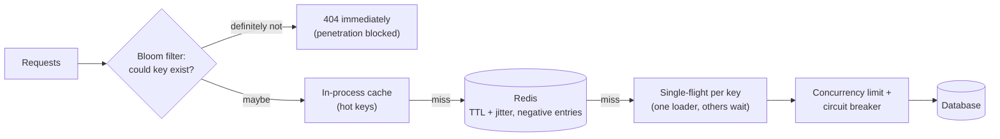

Caches fail in four characteristic ways, and each one sends a flood of requests to the database the cache was protecting: a **stampede**
when a hot key expires, **penetration** when requests ask for keys that don't exist, an **avalanche** when many keys expire or a whole cache
disappears at once, and **hot keys** that overwhelm a single node. Each has well-known fixes, and naming them precisely is a strong signal in
interviews.

## Why it matters

The more effective a cache is, the bigger the cliff when it stops working: a database sized for a 2% miss rate receives fifty times its
normal load when the hit ratio collapses. Interviewers love asking "what happens when your cache fails?" or "when the popular key expires?"
— and expect specific mechanisms, not "we'll add more cache servers".

## How it works

### 1. Cache stampede (thundering herd, dog-piling)

A hot key expires (or is deleted). Before anyone refills it, thousands of concurrent requests miss, and **all of them** query the database
for the same value.

Fixes:

- **Request coalescing / single-flight**: only one request per key loads from the database; others wait for its result (in-process with
  per-key futures — Spring's `@Cacheable(sync = true)` does this per instance; across instances with a short Redis lock or a lease).
- **Serve stale while revalidating**: keep a logical expiry inside the value; when it passes, one request refreshes in the background while
  everyone else gets the slightly stale value.
- **Probabilistic early refresh** ("XFetch"): each read refreshes early with a probability that rises as expiry approaches, so one request
  usually refreshes before the key actually expires.
- **Never-expiring hot keys** refreshed by a background job.

### 2. Cache penetration

Requests ask for keys that **don't exist** — random IDs from a scanner, a buggy client, or an attack. Every request misses the cache *and*
the database finds nothing, so nothing is cached and every request reaches the database.

Fixes:

- **Negative caching**: cache "not found" (a sentinel value) with a short TTL (seconds to a minute).
- **Bloom filter of existing keys**: check "definitely doesn't exist" before touching the cache or database (see
  [deduplication](lesson:dedup)); rebuild or update it as keys are created.
- **Validate inputs** (ID formats, ranges) and **rate-limit** clients that generate many misses.

### 3. Cache avalanche

Many keys miss **at the same time**:

- **Synchronised expiry**: a batch job or a deploy populated thousands of keys with the same TTL; they all expire together.
- **Cache node or cluster failure**, or a restart that loses the data.
- **Mass invalidation** (bumping a namespace).

Fixes:

- **TTL jitter**: `ttl = base + random(0, 20% of base)`.
- **Replicated, highly available cache** (replicas and automatic failover) and, for planned work, **warming** before cutover
  ([cache warming](lesson:cache-warming)).
- **Protect the database**: concurrency limits on the miss path, circuit breakers, and **load shedding** — serve degraded responses rather
  than let the database collapse.
- **Size the backend for a degraded hit ratio**, not the best case.

### 4. Hot keys

One key receives so much traffic that the node holding it saturates, hurting every other key on that node. Fixes: in-process L1 caching,
replicating the key across nodes (`key:r0…r7`), request coalescing — covered in [hot keys](lesson:hot-keys) and
[local vs distributed caching](lesson:local-vs-distributed-cache).

## Architecture



## Failure scenarios

- **Expiry of a celebrity's profile** at peak: 20,000 requests a second miss together. Single-flight plus stale-while-revalidate turns it
  into one query.
- **A scanner requests random user IDs**: every request goes to the database. Negative caching and a Bloom filter stop it.
- **Morning traffic after a nightly cache rebuild** with a uniform TTL: everything expires at 9:00 sharp. Jitter.
- **Redis primary failover with a cold replica** (or a full cluster restart): hit ratio drops to zero; the database is overwhelmed.
  Replicas, persistence for faster restarts, warming, and load shedding.
- **Negative cache too long**: a newly created item stays "not found" for minutes. Short negative TTLs and deleting the negative entry on
  creation.

## Trade-offs

| Fix | Cost |
|---|---|
| Single-flight / locks | Waiting requests add latency; cross-instance locks add a dependency |
| Stale-while-revalidate | Users see slightly stale data during refresh |
| Negative caching | Newly created items may be reported missing for the negative TTL |
| Bloom filters | Memory, rebuild/update logic, small false-positive rate |
| TTL jitter | Slightly less predictable expiry |
| Load shedding | Some users get degraded responses — by design, instead of everyone getting errors |

## In real systems

- Facebook's memcache paper describes **leases** that limit stampedes (only the lease holder refills) and stale values for waiting readers.
- CDNs implement request collapsing so many simultaneous misses for one object produce one origin request; HTTP's
  `stale-while-revalidate` directive expresses the same idea for browsers and caches.
- Many Redis client libraries and Spring's cache abstraction support single-flight loading per instance.

## Common mistakes

- **Uniform TTLs** for keys populated together.
- **No negative caching**, leaving databases open to missing-key floods.
- **Backends sized for the cache's best day.**
- **Distributed locks with long timeouts** for stampede protection — when the holder dies, everyone waits.
- **Caching nothing on errors and retrying immediately**, turning a database blip into a storm.

## In the interview

````question title="A very popular key expires and the database falls over. What happened and how do you prevent it?"
A cache stampede: thousands of concurrent requests missed the same key at once and all queried the database. To prevent it I'd coalesce
loads so one request per key refreshes while others wait or are served the previous value — single-flight in each instance and a short lease
or lock in Redis across instances — and refresh hot keys before they expire using a logical expiry inside the value
(stale-while-revalidate) or probabilistic early refresh. I'd add jitter to TTLs so related keys don't expire together, and protect the
database with a concurrency limit on the miss path so a stampede degrades latency rather than taking it down.
````

````question title="Attackers request millions of non-existent product IDs. How do you protect the database?"
That's cache penetration: misses that the database can't fill, so nothing gets cached. I'd validate ID formats at the edge and rate-limit
clients with high miss rates, cache "not found" results for a short TTL (and delete the negative entry when the product is created), and
put a Bloom filter of existing product IDs in front of the cache so IDs that definitely don't exist are rejected without touching the cache
or the database.
````

## Key takeaways

- **Stampede**: hot key expires → herd of misses. Fix with **single-flight/leases, stale-while-revalidate, early refresh**.
- **Penetration**: missing keys never cached. Fix with **negative caching, Bloom filters, validation, rate limits**.
- **Avalanche**: many keys or the whole cache lost at once. Fix with **TTL jitter, replication, warming, load shedding**.
- **Hot keys**: one node saturated. Fix with **L1 caching, key replication, coalescing** — and size the backend for **degraded** hit ratios.

## Knowledge check

```quiz
? A cache warmed by a batch job at 02:00 sets every key's TTL to 7 hours. What happens at 09:00?
- Nothing unusual
! Every key expires together.
+ A cache avalanche: most keys expire at once and the database is flooded
- A cache penetration attack
! Penetration is about non-existent keys.
- A stampede on a single key
! It's many keys, not one.
> Add jitter to TTLs.

? Scanners request random user IDs; the database CPU rises while the cache hit ratio looks fine for real users. What is the best fix?
+ Negative caching of "not found" with a short TTL, plus a Bloom filter of existing IDs
- A longer TTL for existing users
! The problem is non-existent keys.
- More database replicas only
! That pays to serve garbage instead of stopping it.
- LFU eviction
! Eviction policy doesn't affect missing keys.
> Penetration needs misses for missing keys to be cached or filtered.

? What does stale-while-revalidate do during a hot key's refresh?
- Blocks every request until the refresh completes
! That's plain locking.
+ Serves the previous value to most requests while one request refreshes in the background
- Deletes the key
! Deleting causes the stampede.
- Doubles the TTL
! TTL changes don't coordinate refreshes.
> Users get slightly stale data instead of a database flood.

? Why size database capacity for a degraded cache hit ratio?
- Because caches are always slow
! Caches are fast; the risk is losing them.
+ Because cache failures, cold starts and mass invalidations temporarily send far more reads to the database
- Because hit ratios are always low
! They're usually high; the point is the bad day.
- Because Redis has no replicas
! It can be replicated; failures still happen.
> The miss path must survive the cache's worst day.
```
