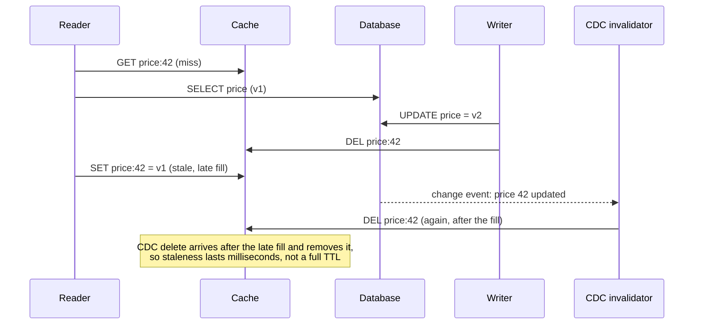

"There are only two hard things in computer science: cache invalidation and naming things," goes the old joke. Invalidation is hard
because the cache and the source of truth are updated at different moments, by different processes, over an unreliable network. This
lesson covers how stale a cache may be, how to make it less stale, and the races that leave old data in the cache long after the database
changed.

## Why it matters

The follow-up to "add a cache" is always "how do you keep it consistent?" Interviewers want concrete mechanisms — TTLs chosen from
requirements, delete-on-write, change-data-capture invalidation, versioning — and an honest account of the remaining window of staleness.
Knowing the classic read-fill race shows real depth.

## How it works

### Start from the staleness each value can tolerate

| Data | Acceptable staleness | Mechanism |
|---|---|---|
| Product description | Minutes | TTL 10–30 min + delete on update |
| Price shown on a listing page | Seconds to a minute | Short TTL + delete on update; check the real price at checkout |
| Inventory at checkout | None | Don't cache — read the source of truth |
| A user's own profile after editing | None for that user | Delete on write; read-your-writes from the source |
| Trending list | Minutes | Recomputed periodically; TTL |
| Feature flags / configuration | Seconds | Local cache + push invalidation + short TTL |

### The mechanisms

- **TTL (time to live)**: every entry expires after a fixed time. Simple, self-healing, bounded staleness — but data is stale for up to the
  TTL, and expiries cause misses. **Add random jitter** to TTLs so many keys don't expire at the same moment (see
  [cache failure modes](lesson:cache-failure-modes)).
- **Explicit invalidation**: the writer deletes affected keys after updating the source. Fresh quickly — if every write path remembers to do
  it, and the delete itself doesn't fail.
- **Change-data-capture invalidation**: a consumer reads the database's change stream (via CDC — see [outbox and CDC](lesson:outbox-cdc))
  and deletes the keys for every changed row. No write path can forget; it catches changes made by scripts and other services; it lags by
  the pipeline's delay (usually sub-second to seconds).
- **Versioned keys**: include a version in the key (`product:42:v17`, or a namespace like `catalog:v3:` in front of every key). Bumping the
  version makes old entries unreachable at once — ideal for invalidating everything derived from a changed configuration or a deploy; old
  entries age out by TTL or eviction.
- **Tag-based invalidation**: associate entries with tags (`category:shoes`) and purge by tag — common in CDNs ("surrogate keys") and some
  caching libraries, useful for computed results that depend on many rows.

### The races

**Update-then-set race (why to delete, not update).** Writers W1 and W2 update the database in the order W1, W2, but their "set cache"
calls arrive in the order W2, W1. The cache ends up with W1's older value. Deleting avoids it: both deletes leave the key empty.

**Read-fill race (the subtle one).** Even with delete-on-write:

1. Reader R misses the cache and reads the database: value v1.
2. Writer W updates the database to v2 and deletes the cache key.
3. R, slow, now writes v1 into the cache.

The cache holds v1 until the TTL expires. Fixes:

- **Short TTL** bounds the damage — the pragmatic default.
- **Delayed double delete**: the writer deletes again after a short delay (longer than a typical read-fill), catching most late fills.
- **Versioned compare-and-set**: store a version with each value and fill only if the cached version is older (or absent) — with an atomic
  script in Redis.
- **Leases** (from Facebook's memcache design): a miss returns a lease token; a delete invalidates outstanding leases, so the slow reader's
  late fill is rejected. This also limits stampedes, since only the lease holder fills.

### Caches across regions and services

Invalidation messages must reach every copy: per-region caches, in-process caches on every server, CDN edges. Broadcast invalidations over
pub/sub (or from the CDC stream per region), and keep TTLs on everything so a lost message only causes bounded staleness.

## Architecture



## Failure scenarios

- **Forgotten invalidation**: a new code path or a manual SQL fix updates data without deleting the cache key. CDC-driven invalidation and
  TTLs guard against it.
- **Invalidation message lost**: a pub/sub message to in-process caches is dropped; one server serves stale data. Short local TTLs.
- **Mass expiry**: thousands of keys with the same TTL expire together, causing a miss storm. Jitter.
- **Invalidating too broadly**: one change flushes a whole namespace, the hit ratio collapses, the database is overwhelmed. Invalidate
  narrowly; warm before bumping versions.
- **Derived data never invalidated**: a cached list includes a product that was renamed; only the product key was deleted. Track
  dependencies or use tags and short TTLs for computed results.

## Trade-offs

- **Freshness vs hit ratio**: shorter TTLs and broader invalidation are fresher and miss more.
- **Simplicity vs reliability**: application-level deletes are simple but forgettable; CDC is reliable but adds a pipeline.
- **Precision vs effort**: per-key invalidation is precise; versioned namespaces and tags are coarse but easy.

## In real systems

- Facebook's memcache paper describes leases to prevent stale sets and thundering herds, and invalidation driven by the database's commit
  log ("mcsqueal") rather than application code.
- CDNs such as Fastly and Cloudflare support purge by surrogate key or cache tag.
- Debezium-style CDC pipelines commonly feed cache invalidators and search indexers from the same change stream.

## Common mistakes

- **No TTL** — any missed invalidation becomes permanent staleness.
- **Same TTL for every key**, producing synchronised expiry.
- **Updating instead of deleting** on writes.
- **Ignoring the read-fill race** and claiming the cache is "always consistent".
- **Caching data that must be exact**, then trying to invalidate it perfectly.

## In the interview

````question title="How do you keep the cache consistent with the database?"
Choose staleness per data type, then layer mechanisms. Every entry has a TTL with jitter, bounding staleness and self-healing missed
invalidations. On writes, the service updates the database and then deletes the affected keys rather than writing new values, which avoids
writer ordering races. Because write paths can be missed and a slow reader can refill an old value after the delete, a CDC consumer reading
the database's change stream also deletes keys for every changed row, closing that window to the pipeline lag. Data that must be exact —
inventory at checkout — isn't served from the cache at all.
````

````question title="Describe a race that leaves stale data in a cache-aside cache even with delete-on-write."
A reader misses and reads the old value from the database; before it writes that value into the cache, a writer updates the database and
deletes the key; then the reader's delayed set puts the old value back, where it stays until the TTL expires. Mitigations are a short TTL,
a second delayed delete by the writer or a CDC-driven delete after the change commits, a versioned compare-and-set so older versions can't
overwrite newer ones, or leases that a delete invalidates so the late fill is rejected.
````

## Key takeaways

- Decide **acceptable staleness per data type**; don't cache what must be exact.
- Combine **TTLs with jitter** (safety net), **delete-on-write**, **CDC-driven invalidation** (reliability), and **versioned keys or tags**
  (bulk invalidation).
- Know the **update-then-set** and **read-fill** races and their fixes (delete, double delete, versioned CAS, leases).
- Every cached copy — regional, in-process, CDN — needs an invalidation path **and** a TTL.

## Knowledge check

```quiz
? Why add random jitter to cache TTLs?
- To make entries live longer
! Jitter spreads expiries; it doesn't lengthen them on average.
+ So keys cached at the same time don't all expire at the same moment and cause a miss storm
- To encrypt keys
! Unrelated.
- Because Redis requires it
! It doesn't.
> Synchronised expiry causes avalanches.

? A reader fills the cache with an old value after a writer deleted the key. Which mechanism would remove it within seconds?
- A longer TTL
! That makes the stale value last longer.
+ A CDC consumer that deletes keys for every committed change (arriving after the late fill)
- Write-back caching
! Write-back doesn't address read fills.
- Removing the TTL
! That makes staleness permanent.
> CDC-driven deletes happen after commit, catching most late fills.

? How do you invalidate every cached entry derived from a changed pricing configuration at once?
- Delete each key individually by scanning the cache
! Scanning a large cache is slow and risky.
+ Use a version or namespace in the keys and bump it, letting old entries age out
- Restart the cache cluster
! That drops everything and causes a cold-cache storm.
- Wait for TTLs to expire
! Works eventually, but not "at once".
> Versioned keys make old entries unreachable immediately.

? A support engineer fixes a typo directly in the database with SQL. Why might users keep seeing the typo, and what prevents it?
- The database didn't commit
! It did.
+ No application code deleted the cache key; CDC-driven invalidation (or the TTL) catches changes from any source
- The CDN encrypts the page
! Unrelated.
- The cache uses write-back
! Unrelated.
> Invalidation tied to the change stream catches every write path.
```
