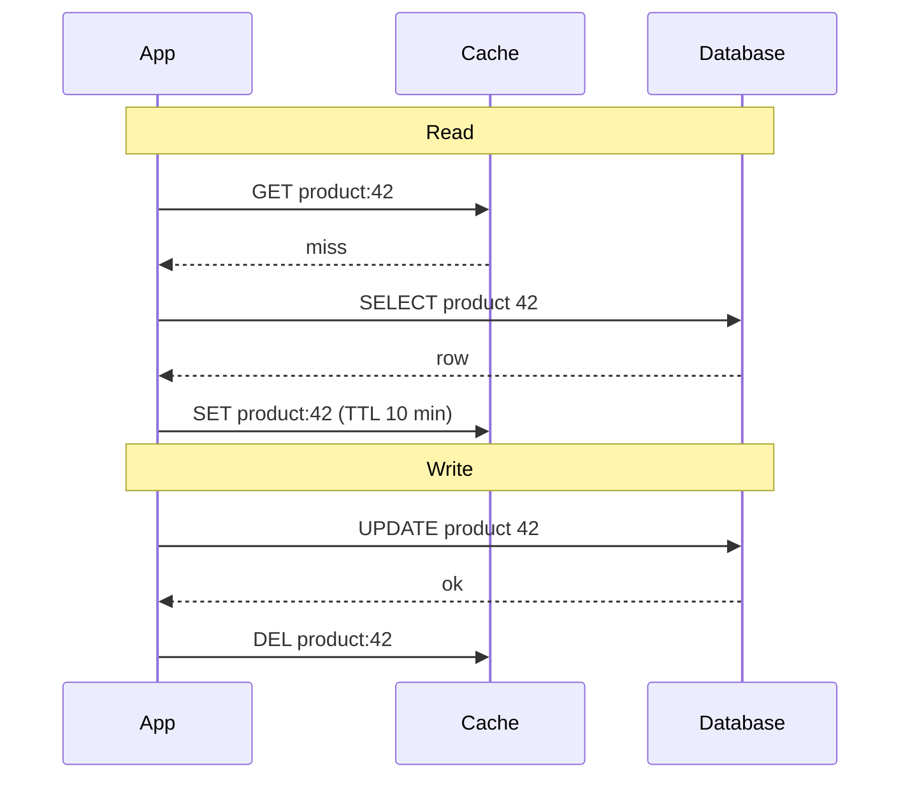

A cache and a database can share the work of reads and writes in five standard ways. They differ in who loads the cache on a miss, when
the database is written, and what happens to data that is written but rarely read. Each pattern trades latency, consistency and durability
differently — and a single design often uses different patterns for different data.

## Why it matters

"Which caching pattern would you use?" is a direct interview question, and "cache-aside" is usually right — but only if you can explain why,
describe its race conditions, and recognise when write-through, write-back or write-around fits better. Interviewers also check that you
never use a pattern that can lose acknowledged data without saying so.

## How it works

### Read patterns

**Cache-aside (lazy loading).** The application owns the logic:

1. Read the cache. On a hit, return.
2. On a miss, read the database, put the value in the cache (with a TTL), return.
3. On a write, update the database, then **delete** the cache entry (the next read reloads it).

The cache holds only data that was actually requested; if the cache is down, the application can still read the database. It's the
default for most systems.

**Read-through.** The application asks only the cache; on a miss, *the cache* (or a caching library) loads from the database. Same behaviour
as cache-aside, but the loading logic is centralised — common with caching libraries (`@Cacheable` in Spring, Caffeine's `LoadingCache`) and
some managed caches.

### Write patterns

**Write-through.** Every write goes to the cache and the database synchronously, before acknowledging. The cache is always populated and
consistent with the database for written keys; writes pay both latencies, and the cache fills with data that may never be read.

**Write-back (write-behind).** Writes go to the cache and are acknowledged immediately; the cache writes them to the database later, often
in batches. Very fast writes and natural coalescing of repeated updates — but **acknowledged writes can be lost** if the cache fails before
flushing, and the database lags behind. Use only when that loss is acceptable or the cache is itself durable and replicated.

**Write-around.** Writes go straight to the database, bypassing the cache (which may be invalidated). Reads populate the cache later via
cache-aside. Avoids filling the cache with write-once data that's rarely read — logs, bulk imports, cold records.

### Side by side

| Pattern | Read latency | Write latency | Consistency risk | Durability risk | Good for |
|---|---|---|---|---|---|
| Cache-aside | Fast on hit; miss pays DB + fill | DB only (+ delete) | Race between fill and invalidation | None | General read-heavy data |
| Read-through | Same | Same | Same | None | Centralised loading in a library |
| Write-through | Fast, cache warm for written keys | DB + cache | Low for written keys | None | Data read soon after writing |
| Write-back | Fast | Fastest (cache only) | Database lags | **Loss of unflushed writes** | Counters, metrics, high-rate updates tolerant of loss |
| Write-around | Miss after write | DB only | Low | None | Write-heavy, rarely-read data |

### Delete, don't update

In cache-aside, invalidate by **deleting** the cache entry after writing the database, not by writing the new value into the cache. With
concurrent writers, "update DB, then set cache" can interleave so that an older value is written to the cache last and stays there until
the TTL expires. Deleting avoids ordering races between writers (a reader may still refill a stale value in a narrow window — covered with
its fixes in [invalidation](lesson:cache-invalidation)). The TTL remains the safety net that bounds any staleness.

### Choosing per data type

| Data | Pattern |
|---|---|
| Product pages, profiles | Cache-aside, TTL + delete on update |
| A user's just-created post | Write-through (so the author sees it immediately) |
| View counters, rate counters | Write-back (aggregate in cache, flush periodically) |
| Audit logs, bulk imports | Write-around |
| Configuration | Read-through from a local cache refreshed on change |

## Architecture



## Java and Spring Boot example

Spring's cache abstraction turns annotated methods into cache-aside (or read-through) operations. `@Cacheable` checks the cache and, on a
miss, runs the method and stores the result; `@CacheEvict` deletes the entry after the write. (Compiled against Spring Framework 7; the
Redis configuration is in the [Redis lesson](lesson:redis).)

```java file="ProductService.java"
import org.springframework.cache.annotation.CacheEvict;
import org.springframework.cache.annotation.Cacheable;
import org.springframework.stereotype.Service;

@Service
public class ProductService {

    public record Product(long id, String name, long priceInPaise) {}

    public interface ProductRepository {
        Product findById(long id);

        void save(Product product);
    }

    private final ProductRepository repository;

    public ProductService(ProductRepository repository) {
        this.repository = repository;
    }

    // Cache-aside: on a miss Spring calls the method and stores the result under "products::42".
    // sync = true lets only one caller per key load a missing entry (less stampede on one node).
    @Cacheable(cacheNames = "products", key = "#id", sync = true)
    public Product find(long id) {
        return repository.findById(id);
    }

    // Write to the database first, then delete the cached copy (never update it in place).
    @CacheEvict(cacheNames = "products", key = "#product.id()")
    public void update(Product product) {
        repository.save(product);
    }
}
```

`sync = true` makes concurrent callers on the same instance wait for one load instead of all querying the database — a local defence
against stampedes on hot keys.

## Failure scenarios

- **Stale value after a race** — two writers and a reader interleave so the cache holds an old value. Delete instead of update, keep TTLs,
  and use the fixes in [invalidation](lesson:cache-invalidation).
- **Write-back cache crashes** before flushing — acknowledged writes lost.
- **Write-through with the cache down** — writes fail or must skip the cache; decide which, and invalidate on recovery.
- **Cold cache after deploy or failover** — cache-aside fills lazily, so the database takes the full read load at first; see
  [cache warming](lesson:cache-warming).
- **Caching failures**: a database timeout returns an error object that gets cached. Never cache errors (except deliberate negative
  caching of "not found").

## Trade-offs

- **Lazy vs eager loading**: cache-aside caches only what's read; write-through warms the cache for every written key.
- **Write latency vs durability**: write-back is fastest and riskiest.
- **Cache pollution vs freshness**: write-around avoids caching rarely-read writes at the cost of a miss on first read.

## In real systems

- Cache-aside with Redis or Memcached is the dominant pattern in web applications.
- Hibernate's second-level cache and Spring's `@Cacheable` implement read-through behaviour inside the application.
- Write-back appears in counters and analytics (aggregate in Redis, flush periodically) and inside storage systems (OS page cache, disk
  controllers with battery-backed write caches).
- Amazon DynamoDB Accelerator (DAX) is a managed read-through/write-through cache for DynamoDB.

## Common mistakes

- **Updating the cache with the new value** instead of deleting it.
- **Write-back for data you can't afford to lose.**
- **Write-through for write-heavy, rarely-read data**, filling the cache with junk.
- **No TTL**, so a missed invalidation means staleness forever.
- **Caching error responses.**

## In the interview

````question title="Which caching pattern would you use for product data, and how do updates work?"
Cache-aside. On a read, the service checks Redis; on a miss it loads from the database and stores the product with a TTL of, say, ten
minutes. On an update, it writes the database first and then deletes the cache key, so the next read reloads the new value — deleting rather
than writing the new value avoids races where an older value lands in the cache last. The TTL bounds staleness if an invalidation is ever
missed, and if Redis is unavailable, reads fall back to the database. I'd use write-through only where users must see their own writes
immediately and write-back only for loss-tolerant counters.
````

````question title="What is the risk of write-back caching, and when is it acceptable?"
Writes are acknowledged once they're in the cache and flushed to the database later, so if the cache node fails before flushing, those
acknowledged writes are lost, and the database is always somewhat behind. It's acceptable when losing the last few seconds of updates is
tolerable and the speed matters — view counters, rate-limit counters, analytics aggregates — or when the cache is itself durable and
replicated. It's not acceptable for orders, payments or anything a user was told is saved.
````

## Key takeaways

- **Cache-aside** (app loads on miss, deletes on write) is the default; **read-through** moves loading into the cache layer.
- **Write-through** keeps written keys warm and consistent at double write cost; **write-back** is fastest but can **lose data**;
  **write-around** keeps write-once data out of the cache.
- **Delete, don't update** cache entries on writes, and always keep a **TTL** as the safety net.
- Choose a pattern **per data type**.

## Knowledge check

```quiz
? In cache-aside, what should a service do after updating a product in the database?
- Write the new product into the cache
! Concurrent writers can leave an older value cached last.
+ Delete the product's cache entry so the next read reloads it
- Nothing; the TTL will handle it
! Users would see stale data for up to the TTL.
- Flush the whole cache
! Far too disruptive.
> Delete-on-write plus a TTL is the standard approach.

? Which pattern can lose writes that were acknowledged to the user?
- Cache-aside
! Writes go to the database first.
- Write-through
! The database is written synchronously.
+ Write-back
- Write-around
! Writes go straight to the database.
> Write-back acknowledges before the database has the data.

? A service ingests 50,000 audit log entries a second that are almost never read. Which pattern fits?
- Write-through
! It would fill the cache with entries nobody reads.
+ Write-around
- Write-back
! Risking loss of audit logs is unacceptable.
- Read-through only
! Read-through concerns reads, not writes.
> Keep write-once, rarely-read data out of the cache.

? What happens to a cache-aside system when the cache cluster is down?
- All reads fail
! The application can read the database directly.
+ Reads fall back to the database, which must absorb the extra load
- Writes fail
! Writes go to the database regardless.
- The database is bypassed
! It becomes the only source.
> Cache-aside degrades gracefully if the database has capacity.
```
