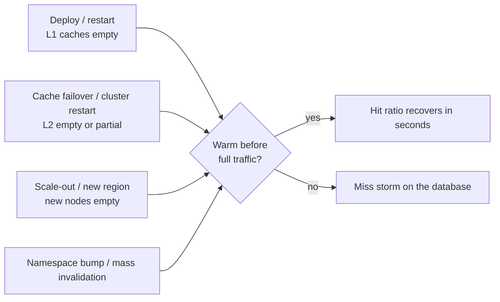
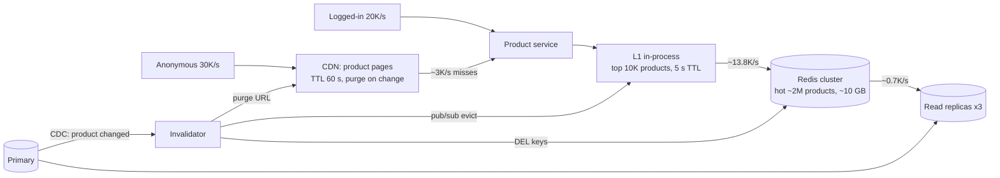

A cache that starts empty is a cache that isn't working — and caches start empty more often than you'd think: after deploys, failovers,
scale-outs, region launches and namespace bumps. This workshop practises warming caches before traffic arrives, then designs a read-heavy
product catalogue end to end with layered caching, and finishes with how to measure whether a cache is doing its job.

## How to use this workshop



- Work each exercise for 10–15 minutes before opening hints and solutions.
- Write your answers as you'd say them in an interview: the mechanism, the numbers, and the failure you're protecting against.
- Exercise 3 is a full mini-design; draw it.

## Exercises

### Exercise 1 — Warming after a deploy

A product service runs 40 instances, each with an in-process (L1) cache in front of Redis. Every deploy restarts all instances; for about
two minutes afterwards p99 latency doubles and Redis CPU spikes. Design a warming strategy.

````hint title="Hint: what do the new instances not know yet?"
They don't know which keys are hot. Where could that list come from — and how could traffic reach them gradually?
````

````solution title="Worked solution"
- **Know the hot set**: keep a periodically refreshed list of the top few thousand keys (from a heavy-hitter sketch in each instance, Redis
  `--hotkeys` with LFU, or access logs). Store it in Redis or object storage.
- **Preload on startup**: before reporting ready, each new instance fetches those keys from Redis in pipelined batches (thousands of keys in
  well under a second) into its L1. Readiness checks wait for warming to finish, with a time limit so a Redis problem can't block deploys.
- **Shift traffic gradually**: roll instances in small batches and use load-balancer slow start, so each new instance receives an increasing
  share of traffic while its cache fills.
- **Avoid a Redis herd**: stagger preloading (jitter) so 40 instances don't fetch the same keys in the same second.

The latency spike was L1 starting cold everywhere at once; preloading the hot set and rolling gradually removes most of it.
````

### Exercise 2 — Warming after losing the shared cache

The Redis cluster (L2) is restarted for maintenance — or loses a primary whose replica wasn't caught up. The database is sized for about
2,000 reads/s of misses; normal traffic is 30,000 reads/s at a 95% hit ratio. What do you do before, during and after?

````hint title="Hint: three levers"
Avoid losing the data (persistence, replicas), avoid sending all misses at once (warming, shedding), and protect the database while the
cache fills.
````

````solution title="Worked solution"
**Before (prevention):** replicas with automatic failover; persistence (RDB snapshots and/or AOF) so a restarted node reloads data instead of
starting empty; planned maintenance done node by node, promoting warm replicas first.

**Warm deliberately:** for planned work, pre-populate a new cluster from the database for the hot set (the top keys list from Exercise 1,
or the most-read products from analytics) *before* switching traffic to it; or dual-write to old and new clusters for a while.

**Protect the database during the gap:** at a 0% hit ratio, 30,000 reads/s would reach a database sized for 2,000. So: single-flight per key
(each missing key loaded once), a concurrency limit on the miss path, the in-process L1 still serving the hottest keys, serving stale or
degraded responses for non-critical data, and load shedding for the rest. The hit ratio climbs within minutes as hot keys refill.

**After:** alert on hit ratio and miss rate, and review whether the database needs headroom for a degraded hit ratio (for example 70%,
i.e. 9,000 reads/s) as a planned scenario.
````

### Exercise 3 — A read-heavy product catalogue

Design the read path for an online store's product catalogue:

- **20 million products**, about **5 KB** of data each (title, description, attributes, image URLs, price).
- **50,000 product-page reads/s** at peak; **60%** come from anonymous visitors, **40%** from logged-in users (who also see personalised
  bits such as "in your wishlist", served separately).
- Products change rarely — prices a few times a day, descriptions occasionally; about **2,000 updates/minute** across the catalogue.
- A price shown on the page may be up to a minute stale; checkout always re-reads the real price.

Choose the cache layers, estimate the load at each layer, describe invalidation, and say what happens if Redis fails.

````hint title="Hint: which requests are identical for everyone?"
Anonymous product pages are the same for every visitor. What can serve them without reaching your servers at all?
````

````hint title="Hint: work out the load layer by layer"
Start from 50,000/s; subtract what the CDN serves; then what an in-process cache serves; then Redis. What reaches the database — and what
would reach it with Redis down?
````

````solution title="Worked solution"


**Load by layer (peak):**

- Anonymous: 30,000/s to the CDN; with a 60-second TTL and popular products, ~90% hit → **27,000/s served at the edge**, ~3,000/s to origin.
- At the service: 20,000/s logged-in + 3,000/s CDN misses = **23,000/s**.
- L1 (each instance's top ~10,000 products, 5-second TTL) serves ~40% → ~9,200/s; **~13,800/s reach Redis**.
- Redis holds the hot ~10% of products (2M × 5 KB ≈ 10 GB plus overhead — a small cluster with replicas); at a ~95% hit ratio,
  **~700/s reach the read replicas**.

**Invalidation:** a CDC consumer on the products table deletes the Redis key, purges the product's CDN URL (or its cache tag) and publishes
an L1 eviction for every changed product — 2,000 updates/minute is ~33/s, trivial. TTLs (60 s CDN, 5 s L1, ~30 min Redis, all jittered)
bound staleness if anything is missed. Prices meet "up to a minute stale"; checkout reads the primary.

**If Redis fails:** ~13,800/s would hit the replicas. Three replicas at roughly 10,000 simple reads/s each can absorb it briefly, with
single-flight loading and a concurrency limit on the miss path; the CDN and L1 keep serving the hottest pages throughout.

**Why not cache everything in Redis?** 20M × 5 KB = 100 GB, most of it rarely read; caching the hot 10% gives nearly the same hit ratio for a
tenth of the memory.
````

### Exercise 4 — Measuring a cache

You've deployed the catalogue caches. Which metrics and alerts tell you they are working — and which warn you before an incident?

````solution title="Worked solution"
| Metric | Why | Alert when |
|---|---|---|
| Hit ratio per layer and per key prefix | The cache's whole purpose | Drops sharply (e.g. Redis below 90%) |
| Miss rate (absolute, per second) | What the database actually receives | Approaches the database's degraded-mode capacity |
| Cache latency p99 | Slow cache = slow everything | Above a few milliseconds for Redis |
| Evictions per second | Working set outgrowing memory | Sustained rise |
| Memory used vs maxmemory; fragmentation | Capacity planning | Above ~80% |
| Top keys / per-node ops | Hot keys | One key or node far above peers |
| Stale-serve and single-flight wait counts | Stampede protection working | Spikes at expiries |
| Invalidation lag (CDC consumer lag) | Freshness | Above the staleness budget |

Watch these alongside database load: the best early warning of cache trouble is a rising miss rate reaching the database.
````

## Key takeaways

- Caches go **cold on deploys, failovers, scale-outs and mass invalidations** — plan warming for each.
- Warm with a **known hot-key list**, **preload before readiness**, **gradual traffic shifts**, and **persistence/replicas** for shared caches.
- Layer caches (**CDN → L1 → Redis → replicas**), estimate load **layer by layer**, and invalidate from **CDC** with TTLs as the safety net.
- Measure **hit ratio, miss rate, latency, evictions, memory, hot keys and invalidation lag** — and size the database for a degraded hit ratio.

## Knowledge check

```quiz
? After every deploy, p99 latency doubles for two minutes. Which change helps most?
- Increase Redis memory
! Redis wasn't emptied; the in-process caches were.
+ Preload each instance's hot keys before it reports ready, and roll instances gradually
- Lower the L1 TTL
! A shorter TTL makes L1 colder, not warmer.
- Disable L1 caching
! That removes the benefit permanently.
> Cold local caches on restart are fixed by warming and gradual rollout.

? In the catalogue design, why cache only the hot ~10% of products in Redis?
+ Access is skewed: the hot set gives nearly the same hit ratio for a tenth of the memory
- Redis can't hold 100 GB
! A cluster could; it's just wasteful.
- The other products are never read
! They're read rarely, and misses go to replicas.
- To avoid invalidation
! Invalidation is still needed.
> Size caches by the working set, not the dataset.

? What is the best early-warning metric that the cache tier is in trouble?
- CPU of the application servers
! Indirect and noisy.
+ A rising absolute miss rate reaching the database
- The number of keys in Redis
! Key count changes slowly and isn't an incident signal.
- CDN bandwidth
! A CDN signal says little about Redis or L1.
> Misses are the load the database actually sees.

? A Redis cluster will be replaced during maintenance. How do you avoid a cold-cache storm?
- Switch traffic and let it fill naturally
! The database would take the full read load at first.
+ Pre-populate the new cluster with the hot set (or dual-write for a while) before switching, and protect the miss path
- Restart all app instances at the same time
! That empties L1 too.
- Remove all TTLs
! Unrelated to warming.
> Warm before cutover; protect the database during it.
```
