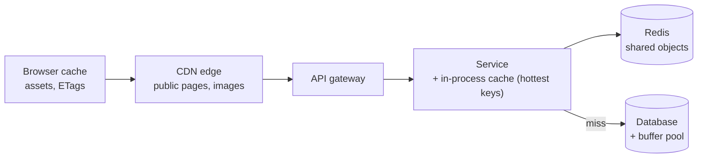

A cache keeps a copy of data somewhere faster or closer than its source, so repeated reads skip the expensive trip. Caching is the most
effective performance tool in system design — and the source of some of its hardest bugs, because every cache is a second copy that can be
wrong. This lesson covers why to cache and where caches live; the rest of the stage covers how to keep them correct and alive.

## Why it matters

Nearly every read-heavy design in an interview includes a cache, and the interviewer will ask what you cache, where, for how long, and what
happens when it's stale or gone. A strong answer quantifies the benefit (hit ratio → database load), places the cache at the right layer,
and names the consistency cost up front.

## How it works

### What caching buys

- **Latency**: a Redis lookup in the same zone takes well under a millisecond plus the network hop; an in-process lookup, about a hundred
  nanoseconds; a database query, milliseconds; a cross-region call, a hundred milliseconds or more (see [numbers to know](lesson:numbers-to-know)).
- **Throughput**: one cache node serves on the order of 100,000 simple operations a second — far more than a database for the same
  lookups.
- **Cost**: memory is expensive per GB, but serving a read from cache is far cheaper than from a database or an origin server.
- **Protection**: the cache absorbs load that would otherwise saturate the database — which is also its danger: when it fails, that load
  returns all at once.

### Hit ratio and what it means

```text title="Formula"
hit ratio    = hits ÷ (hits + misses)
backend load = total reads × (1 − hit ratio)
average latency ≈ hit ratio × cache latency + (1 − hit ratio) × (cache latency + backend latency)
```

The useful way to think about hit ratio is through **misses**. At 100,000 reads/s, a 90% hit ratio sends 10,000 reads/s to the database; 99%
sends 1,000. Going from 90% to 99% looks like nine points; it's a **tenfold** reduction in backend load.

Caching works when access is **skewed** (a small set of items gets most reads) and items are **read more often than they change**. It does
little for data read once, or for data that changes on every read.

### Where caches live

| Layer | Example | Best for | Freshness control |
|---|---|---|---|
| Client / browser | HTTP cache, app memory | Static assets, a user's own data | `Cache-Control`, ETags, app logic |
| CDN / edge | CloudFront, Cloudflare, Fastly | Public, shared content and some API responses | TTLs, purge, versioned URLs ([CDN](lesson:cdn)) |
| API gateway / reverse proxy | NGINX, Varnish | Whole responses for anonymous requests | TTLs, purge |
| Application, in-process | Caffeine, Guava, a map | The hottest keys; sub-microsecond reads | Short TTLs; invalidation messages |
| Application, distributed | Redis, Memcached | Shared objects, sessions, computed results | TTLs, explicit invalidation |
| Database | Buffer pool, query cache | Hot pages and indexes, automatically | Managed by the database |

Layers stack: a request may be served by the browser, then the CDN, then an in-process cache, then Redis, before the database is touched.
Each layer closer to the user is faster and serves fewer users' data per copy — and is harder to invalidate.

### What to cache

- **Objects by ID** (a product, a profile) — the most common, easiest to invalidate.
- **Computed results** (a rendered page, an aggregate, a recommendation list) — high value, harder to invalidate because many inputs
  change them.
- **Negative results** ("user 999 does not exist") — protects the database from repeated misses (see
  [cache failure modes](lesson:cache-failure-modes)).
- **Not**: data that must be exactly current for correctness (account balances during a transfer, stock at checkout), data read once,
  or data larger than the benefit justifies.

## Architecture



## Failure scenarios

- **Stale data served** after the source changed — every cache's built-in risk; covered in [invalidation](lesson:cache-invalidation).
- **Cache down or cold** — the backend suddenly sees all reads; capacity planned for a 95% hit ratio can't cope.
- **Stampede** — many concurrent misses for one hot key all hit the backend.
- **Memory pressure** — evictions rise, hit ratio falls, backend load climbs (see [eviction](lesson:eviction)).
- **Caching errors or partial results** — a failed backend call's error response is cached and served for the TTL.

## Trade-offs

- **Speed vs freshness**: longer TTLs and closer layers are faster and staler.
- **Memory cost vs backend cost**: caching more costs RAM; caching less costs database capacity.
- **Simplicity vs layers**: each extra layer adds speed and another place for stale or inconsistent data.
- **Local vs shared**: in-process is fastest; shared is consistent across servers ([local vs distributed](lesson:local-vs-distributed-cache)).

## In real systems

- Large social and content platforms run cache tiers of thousands of nodes in front of their databases; Facebook's memcache and TAO papers
  describe serving billions of reads per second mostly from cache.
- CDNs serve the majority of bytes for media and web traffic.
- Relational databases cache hot pages in memory automatically (PostgreSQL's shared buffers, InnoDB's buffer pool) — the first cache you
  get for free.

## Common mistakes

- **Adding a cache without estimating the hit ratio** or the backend load on a miss.
- **Caching data that must be exact** at the moment of use.
- **No invalidation story.**
- **Sizing the backend only for the cache's best day.**
- **Caching everything** rather than the hot, read-mostly data.

## In the interview

````question title="Where would you add caching in this design, and what would it buy?"
I'd cache at two layers. Public, shared responses — product pages, images — at the CDN with short TTLs and versioned asset URLs. Hot objects
by ID — products, profiles — in a replicated Redis cluster using cache-aside, plus a small in-process cache for the very hottest keys. With
about 50,000 reads a second and an expected 95% hit ratio, the database sees around 2,500 reads a second instead of 50,000, and p99 latency
drops from database time to a sub-millisecond cache hop. I wouldn't cache inventory counts at checkout or balances, which must be exact, and
I'd size the database replicas to survive a degraded hit ratio if the cache fails.
````

````question title="Why does a hit ratio going from 90% to 99% matter so much?"
Because what matters to the backend is the miss ratio. At 90% hits, 10% of reads go to the database; at 99%, only 1% do — a tenfold
reduction in backend load and in the share of requests paying database latency. So the last few points of hit ratio are often the most
valuable, which is why teams tune TTLs, key design and cache size, and why losing the cache entirely is so dangerous.
````

## Key takeaways

- Caching buys **latency, throughput, cost savings and backend protection** — and creates a second, possibly stale copy.
- Think in **misses**: backend load = reads × (1 − hit ratio); 90% → 99% is a **10× cut**.
- Caches live at the **client, CDN, gateway, application (local and distributed) and database** — each faster and harder to invalidate
  the closer it is to the user.
- Cache **hot, read-mostly** data; never data that must be exact at the moment of use.

## Knowledge check

```quiz
? A service receives 80,000 reads/s. Raising the hit ratio from 95% to 99% changes database reads from…
- 76,000/s to 79,200/s
! Those are the cache hits, not database reads.
+ 4,000/s to 800/s
- 8,000/s to 800/s
! 95% hits leaves 4,000/s, not 8,000/s.
- No meaningful change
! It's a fivefold reduction.
> Backend load = reads × miss ratio.

? Which data is the worst candidate for caching?
- A product description read 10,000 times a day and changed weekly
! That's ideal: read-mostly and hot.
+ An account balance checked during a funds transfer
- A user's avatar URL
! Read often, changes rarely.
- A public trending list
! Shared and tolerant of slight staleness.
> Data that must be exact at the moment of use shouldn't be served from a cache.

? Which cache layer is closest to the user and hardest to invalidate?
+ The browser's HTTP cache
- Redis
! Redis can be invalidated directly by the service.
- The database buffer pool
! The database manages it automatically.
- An in-process cache
! It's controlled by your own servers.
> You can't reach into users' browsers; control them with headers and versioned URLs.

? What is the biggest operational risk of a high-hit-ratio cache?
- It uses too much CPU
! CPU is rarely the issue.
+ If it fails or starts cold, the backend suddenly receives load it was never sized for
- It makes writes slower
! Caching reads doesn't slow writes much.
- It always serves stale data
! Staleness is bounded by invalidation and TTLs.
> The better the cache works, the larger the cliff when it disappears.
```
