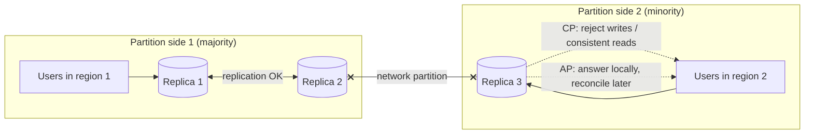

CAP is the most quoted and most misunderstood result in distributed systems. Stated precisely, it is narrow: when the network splits a
replicated system, each operation must either wait (and fail) to stay consistent, or answer from the side it can reach and risk being
stale. PACELC adds the trade-off you face every day when the network is fine: latency versus consistency.

## Why it matters

"Is your design CP or AP?" comes up in nearly every interview involving replicated data. The weak answer is "we pick availability and
partition tolerance" as if choosing two items from a menu. The strong answer explains what happens to *each operation* during a partition,
and what consistency costs in latency even without one.

## How it works

### CAP, stated carefully

- **Consistency** in CAP means **linearizability**: every read returns the most recent completed write, as if there were one copy of the
  data (see [consistency models](lesson:consistency-models)).
- **Availability** means every request to a non-failed node gets a non-error response — eventually, without waiting for other nodes.
- **Partition tolerance** means the system keeps operating when the network drops or delays messages between nodes.

The theorem: **while a network partition is happening, a replicated system cannot provide both linearizable consistency and full
availability.** A node cut off from the others either refuses (or blocks) requests it can't be sure about — **CP** — or answers with
what it has, possibly stale or conflicting — **AP**.

### Why "pick two" is misleading

- Partitions aren't optional in distributed systems — networks fail — so P isn't a choice you can skip. The real choice is **what to do
  during a partition**.
- The choice is made **per operation**, not per product. A shopping site can keep the catalogue available during a partition (AP) while
  refusing to confirm payments it can't verify (CP).
- Most of the time there is **no partition**, and CAP says nothing about that time — which is where PACELC comes in.

### PACELC

**If there is a Partition (P), choose Availability or Consistency; Else (E), choose Latency or Consistency.**

Even without failures, strong consistency costs latency: a linearizable write must reach a majority of replicas (often in other zones or
regions) before it's acknowledged, and a linearizable read must check it's current. Serving from the nearest replica without coordination
is faster but may be stale.

| System (default behaviour) | During a partition | Normally | PACELC |
|---|---|---|---|
| Spanner, CockroachDB, etcd, ZooKeeper | Minority side refuses writes and consistent reads | Coordination on writes (consensus) | PC/EC |
| Cassandra, DynamoDB-style stores (default settings) | Keep answering; reconcile later | Fast local reads/writes | PA/EL |
| Cassandra with `QUORUM` reads and writes | Requests fail where a quorum can't be reached | Quorum round trips | Closer to PC/EC, per request |
| PostgreSQL primary + async replicas | Writes stop if the primary is unreachable; replicas serve stale reads | Replica reads fast but possibly stale | Depends on where you read |

Many modern stores make the choice **tunable per request**: DynamoDB offers eventually consistent reads by default and strongly consistent
reads on request; Cassandra's consistency level is set per query.

### Choosing per operation

Ask of each operation: during a partition, **is a wrong or stale answer worse than no answer?**

| Operation | Prefer | Why |
|---|---|---|
| Debiting a balance, booking the last seat, claiming a username | Consistency (CP) | A duplicate or oversell is worse than a retry later |
| Reading a product page, a feed, a like count | Availability (AP) | Slightly stale content is fine; an error page is not |
| Adding to a shopping cart | Availability, then merge | Accept writes on both sides; merge carts on reconciliation |
| Configuration and leader election | Consistency | Two leaders or two configs causes damage |

## Architecture



On the minority side, a CP system returns errors for operations that need the latest data; an AP system keeps serving and must later
reconcile divergent writes (last-write-wins, merges, or CRDTs — see [leaderless replication](lesson:leaderless-quorums)).

## Failure scenarios

- **Split brain in an "AP" store.** Both sides accept writes to the same key; after healing, one write silently overwrites the other
  (last-write-wins) — a lost update the application never sees.
- **A CP system's minority side goes dark.** Users routed to it get errors for the duration. Route them to the majority side if possible.
- **Assuming consistency you don't have.** Reading from asynchronous replicas while believing the data is linearizable leads to double
  bookings and lost updates.
- **Partial partitions**: node A can reach B and C, but B can't reach C. Systems relying on simple heartbeats behave strangely; consensus
  protocols handle these correctly.

## Trade-offs

- **Correctness vs uptime** during partitions, per operation.
- **Latency vs consistency** every day: cross-zone or cross-region coordination adds round trips to every strongly consistent write.
- **Simplicity vs flexibility**: one global consistency level is simple; per-operation levels are more efficient but require care.

## In real systems

- Spanner and CockroachDB use consensus (Paxos and Raft respectively) per data range and provide strongly consistent transactions across
  regions, paying commit latency for it.
- Cassandra lets each query choose `ONE`, `QUORUM`, `LOCAL_QUORUM`, `ALL` and more; `LOCAL_QUORUM` keeps quorum latency within a region.
- DynamoDB reads are eventually consistent by default; `ConsistentRead=true` returns the latest committed value from the table's
  region.
- etcd and ZooKeeper — used for leader election and configuration — choose consistency: the minority side of a partition stops serving
  writes.

## Common mistakes

- **"We choose AP and P"** as if it were a menu.
- **Labelling a whole product** CP or AP instead of each operation.
- **Using "consistency" loosely** — CAP's C is linearizability, not ACID's C.
- **Forgetting the normal case** — the latency cost of consistency when nothing is wrong.
- **Ignoring reconciliation** in AP designs: how are conflicting writes resolved?

## In the interview

````question title="Is your design CP or AP?"
It's per operation. For booking a seat and charging a payment, I choose consistency: those writes go through a single leader (or a
quorum) and fail during a partition rather than risk double booking. For browsing events, reading profiles and showing counts, I choose
availability: those reads come from caches and replicas that may be slightly stale but always answer. And outside partitions, PACELC
reminds me that the strongly consistent writes cost a majority round trip, so I keep them to the operations that need them and keep
reads latency-optimised.
````

````question title="What does PACELC add to CAP?"
CAP only describes behaviour during a network partition. PACELC adds the normal case: even when the network is healthy, a system must trade
latency against consistency, because keeping replicas in agreement requires coordination round trips before acknowledging. So a system is
described as, for example, PA/EL — available during partitions and low-latency otherwise, like Cassandra's default settings — or PC/EC,
consistent in both cases at a latency cost, like Spanner.
````

## Key takeaways

- **CAP**: during a partition, an operation can't be both **linearizable** and **always available** — choose per operation.
- Partitions aren't optional; "pick two" is misleading.
- **PACELC**: otherwise, trade **latency vs consistency** — coordination costs round trips.
- Choose **consistency** for scarce resources, money and uniqueness; **availability** for browsing and counts; plan **reconciliation** for AP writes.

## Knowledge check

```quiz
? In CAP, what does "consistency" mean?
- That database constraints hold, as in ACID
! That is ACID's C, a different concept.
+ Linearizability: every read sees the most recent completed write
- That all replicas eventually converge
! That's eventual consistency, a weaker model.
- That transactions are serializable
! Serializability is about transactions, not single-object recency.
> CAP's consistency is the strong, single-copy illusion.

? During a partition, a node on the minority side receives a request to book the last seat. What does a CP design do?
- Books it locally and reconciles later
! That's the AP choice, risking a double booking.
+ Refuses or fails the request until it can reach a majority
- Books it and also books it on the other side
! That double-books.
- Redirects the user to a cached page saying booked
! That's misleading and wrong.
> Consistency for scarce resources means refusing when uncertain.

? Which statement about PACELC is accurate?
+ Even without partitions, stronger consistency usually costs latency because replicas must coordinate
- PACELC replaces CAP entirely
! It extends CAP with the no-partition case.
- PACELC says you must always choose latency
! It describes a trade-off, not a rule.
- PACELC only applies to SQL databases
! It applies to any replicated system.
> The "else" clause is the everyday latency-consistency trade-off.

? An online store must stay up during network problems. How should it treat "view product" and "charge card"?
- Both strongly consistent
! Product views don't need it and would lose availability.
- Both eventually consistent
! Charging cards with possibly stale state risks double charges.
+ Product views available (possibly stale); card charges consistent (fail rather than risk duplicates)
- Neither; disable both during partitions
! Browsing can stay available safely.
> Choose per operation based on the cost of a wrong answer.
```
