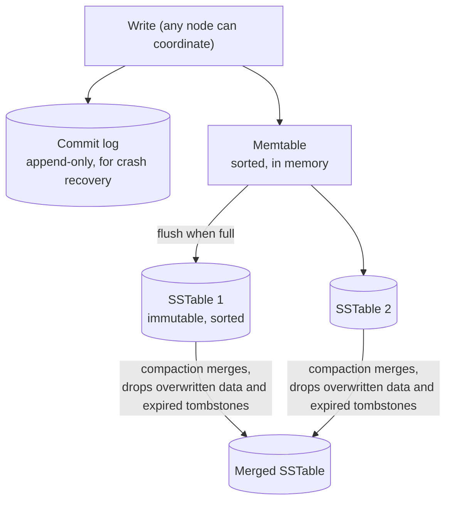

Apache Cassandra is a distributed wide-column database built for very high write throughput and availability across data centres. Every
node is equal, data is spread by consistent hashing, and you choose per query how many replicas must answer. It's the classic pick for
messaging, time series and activity data at scale — and the classic trap when used with relational habits.

## What it is for

- **Write-heavy workloads**: events, messages, sensor readings, activity logs, audit trails — hundreds of thousands to millions of writes
  per second across a cluster ([scaling writes](lesson:scaling-writes)).
- **"Latest N for X" reads**: messages in a conversation, readings for a device, actions by a user — one partition, read in sorted order.
- **Always-writable, multi-datacentre deployments**: replicas in several regions accept writes locally; no single primary to fail over.
- **Linear scale-out**: add nodes to add capacity, with no sharding layer to manage.

## Data model

A **keyspace** sets replication; **tables** have a **primary key** made of a **partition key** (which node holds the row) and optional
**clustering columns** (sort order within the partition). Tables are designed **one per query** ([NoSQL families](lesson:nosql-families)):

```cql title="Readings per sensor per day, newest first"
CREATE KEYSPACE telemetry
  WITH replication = {'class': 'NetworkTopologyStrategy', 'eu-west': 3, 'us-east': 3};

CREATE TABLE telemetry.readings_by_sensor (
  sensor_id   uuid,
  day         date,
  reading_at  timestamp,
  temperature double,
  humidity    double,
  PRIMARY KEY ((sensor_id, day), reading_at)
) WITH CLUSTERING ORDER BY (reading_at DESC)
  AND compaction = {'class': 'TimeWindowCompactionStrategy',
                    'compaction_window_unit': 'DAYS', 'compaction_window_size': 1}
  AND default_time_to_live = 7776000;   -- 90 days

SELECT reading_at, temperature
FROM telemetry.readings_by_sensor
WHERE sensor_id = 5b6f0c1e-1d2a-4f6b-9a37-2f4e8c7d9a10 AND day = '2026-11-07'
LIMIT 50;
```

- `(sensor_id, day)` is a **composite partition key**: one partition per sensor per day, so partitions stay bounded.
- `reading_at DESC` makes "latest 50" a sequential read from the start of the partition.
- A query must give the full partition key; filtering on other columns needs another table, a secondary index (Cassandra 5.0's
  storage-attached indexes are much better than the old ones, but still scatter across nodes without a partition key), or `ALLOW
  FILTERING` — a warning sign on any hot path.
- Writes are **upserts**: `INSERT` and `UPDATE` both write cells with timestamps; the newest timestamp wins per cell.

## How it works inside

### The write path



A write appends to the **commit log** and updates the in-memory **memtable**; that's all it waits for, which is why writes are fast. Full
memtables are flushed to immutable **SSTables**. Background **compaction** merges SSTables, keeping the newest version of each cell —
choose a strategy per table: size-tiered (write-heavy), leveled (read-heavy), time-window (time series with TTL), or the unified strategy
added in Cassandra 5.0.

### The read path

A read checks the memtable and every SSTable that might hold the partition. Per-SSTable **Bloom filters** skip files that certainly don't
contain it; partition indexes find the offset; results are merged by timestamp. Reads get slower as SSTables pile up — which compaction
prevents.

### Distribution and replication

Nodes form a **token ring** ([consistent hashing](lesson:consistent-hashing)); the partition key's hash picks a token range, and the
replication factor (RF) sets how many nodes hold each partition — typically 3 per data centre. Any node can be the **coordinator** for a
request; it forwards to the replicas.

### Tunable consistency

Each query chooses how many replicas must respond ([leaderless quorums](lesson:leaderless-quorums)):

| Level | Waits for | Use |
|---|---|---|
| `ONE` | 1 replica | Fastest; may read stale data |
| `QUORUM` | ⌊RF/2⌋+1 replicas across all DCs | Strong if writes also use `QUORUM` (R + W > RF) |
| `LOCAL_QUORUM` | Quorum in the local DC | The common default: strong within a region, no cross-region latency |
| `EACH_QUORUM` | Quorum in every DC (writes) | Rare; cross-region latency on every write |
| `ALL` | Every replica | One replica down = failure; avoid |

With RF = 3, `LOCAL_QUORUM` writes and reads (2 + 2 > 3) give read-your-writes within a data centre while tolerating one replica down.

### Repairing divergence

Replicas drift when nodes are down or writes time out. Three mechanisms converge them: **hinted handoff** (the coordinator stores writes
for a down replica and replays them later), **read repair** (fixes mismatches found during reads), and **anti-entropy repair**
(`nodetool repair` compares Merkle trees and streams differences) — which must run regularly.

### Deletes and tombstones

A delete writes a **tombstone** — a marker that shadows older data until compaction removes both after `gc_grace_seconds` (10 days by
default). Two consequences:

- Queries that scan many tombstones slow down; by default Cassandra warns at 1,000 tombstones per query and fails at 100,000. Queue-like
  patterns (insert, read, delete) are a classic anti-pattern.
- If a replica misses a delete and repair doesn't run within `gc_grace_seconds`, the deleted data can **come back** once tombstones are
  purged elsewhere.

### Lightweight transactions

`INSERT ... IF NOT EXISTS` or `UPDATE ... IF balance = 100` run a Paxos round among replicas: linearizable compare-and-set for one partition,
at several round trips per operation. Use them for uniqueness (claiming a username), not for every write.

## Strengths and weaknesses

| Strengths | Weaknesses |
|---|---|
| Very high, linearly scalable write throughput | Query-first modelling; ad-hoc queries and joins aren't possible |
| No primary: survives node and data-centre loss and stays writable | Eventual consistency by default; strong reads need quorums |
| Multi-DC replication built in | Tombstones, wide partitions and repairs need operational care |
| Tunable consistency per query | Lightweight transactions are slow; no multi-partition transactions |
| TTLs and time-window compaction suit time series | JVM tuning and compaction can make latency spiky (ScyllaDB addresses this) |

## Scaling characteristics

- **Add nodes, get capacity**: virtual nodes (16 tokens per node by default since 4.0) spread data; new nodes stream their ranges in.
- **Throughput scales with partitions, not within one**: a single partition lives on RF nodes, so a hot partition doesn't spread
  ([hot keys](lesson:hot-keys)). Bucket hot keys by time or a shard suffix.
- **Partition size**: keep partitions bounded — a common rule of thumb is to stay well under 100 MB — by adding time buckets to keys.
- **Multi-region**: each DC has its own replicas; `LOCAL_QUORUM` keeps latency regional while data replicates asynchronously between DCs.
- **ScyllaDB** reimplements Cassandra's model in C++ with a shard-per-core design, giving higher per-node throughput and steadier tail
  latency; Discord publicly described moving its message store from Cassandra to ScyllaDB.

## When to use it

- **Sustained high write rates** with simple, known read patterns: messages, feeds, time series, event logs, IoT, tracking.
- **Multi-region active-active** where every region must accept writes during a network partition.
- **Not** for data needing joins, multi-row invariants or flexible querying (PostgreSQL), heavy update-and-delete churn (tombstones), or
  small datasets that fit comfortably in one relational primary.

## Alternatives

| Alternative | Prefer it when |
|---|---|
| ScyllaDB | Same data model with better per-node performance and fewer JVM issues |
| DynamoDB | You're on AWS and want the same key design without operating a cluster |
| HBase / Bigtable | Strongly consistent single-row operations on the Hadoop or Google Cloud ecosystem |
| PostgreSQL (partitioned) | Writes fit one primary and you want SQL and transactions |
| ClickHouse / a time-series DB | The workload is analytical aggregation over time series, not key-based reads |

## Interview trade-offs

- **Writes vs queries**: unmatched write throughput, paid for with one table per query and no joins.
- **Availability vs consistency**: `LOCAL_QUORUM` is the usual compromise; `ONE` for metrics where staleness is fine; LWT only for
  uniqueness.
- **Partition design**: say the partition key, the time bucket that bounds it, and the clustering order — and how hot keys are spread.
- **Operational cost**: repairs, compaction tuning and tombstones are real work; managed offerings (Astra, Keyspaces) or ScyllaDB reduce it.

## Key takeaways

- Writes go to a **commit log and memtable**, flushed to **immutable SSTables** merged by **compaction** — fast writes, merge-on-read.
- Partition key → token ring → RF replicas; **clustering columns** sort rows inside a partition.
- **Tunable consistency**: `LOCAL_QUORUM` reads and writes give strong reads within a DC at RF 3.
- **Model one table per query** with bounded partitions (time buckets).
- **Tombstones** and **repair** are the operational traps; lightweight transactions are for rare compare-and-set.

## Knowledge check

```quiz
? Why are Cassandra writes fast even on spinning disks or busy nodes?
+ A write only appends to the commit log and updates the in-memory memtable; sorting and merging happen later
- Writes skip durability
! The commit log makes them durable.
- Each write updates a B-tree in place
! That's the relational approach; Cassandra uses LSM storage.
- Writes go to one node only
! They go to RF replicas.
> Sequential appends plus background compaction.

? RF = 3 in one data centre. Which combination guarantees a read sees the latest acknowledged write?
- Write ONE, read ONE
! 1 + 1 is not greater than 3.
+ Write QUORUM, read QUORUM
- Write ONE, read QUORUM
! 1 + 2 = 3, not greater than 3.
- Write ALL, read ALL
! Strong, but any replica outage fails both reads and writes.
> R + W > RF.

? A job-queue table inserts tasks and deletes them after processing; reads slow down over weeks. Why?
- Bloom filters are disabled
! They're on by default.
+ Each delete leaves a tombstone, and reads must scan accumulating tombstones until compaction purges them
- Inserts overwrite the commit log
! The commit log is append-only.
- The partition key is too short
! Key length isn't the issue.
> Queue-like delete patterns are a classic Cassandra anti-pattern.

? Users must claim unique usernames in Cassandra. What is the right tool?
- A QUORUM write
! Two clients can both write; last write wins.
+ A lightweight transaction: INSERT ... IF NOT EXISTS
- ALLOW FILTERING
! That's a query flag, not a uniqueness check.
- A materialized view
! Views don't enforce uniqueness.
> LWT gives compare-and-set per partition via Paxos.
```
