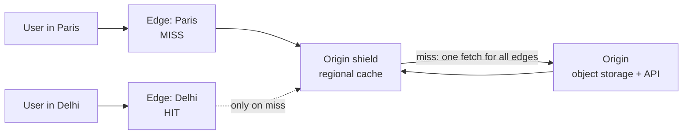

A content delivery network is a worldwide fleet of caching reverse proxies. It serves your content from a location near each
user, so responses arrive in a few milliseconds instead of a few hundred, and most requests never reach your servers at all.

## Why it matters

Physics sets a floor on latency: a round trip from Sydney to Virginia takes roughly 200 ms no matter how fast your servers are. A CDN
removes most of that distance for cacheable content. It also absorbs load — at a 95% hit ratio, only one request in twenty reaches the
origin — and soaks up traffic spikes and many denial-of-service attacks at the edge.

In interviews, a CDN is the expected answer for static assets, images, video segments and other large or popular content — and a
thoughtful option for some API responses.

## How it works

### Edges, origins and hits

- **Edge locations** (points of presence) are CDN data centres in many cities. DNS or anycast routes each user to a nearby one.
- The **origin** is your system: object storage, a web server or an API.
- On a **cache hit**, the edge returns its stored copy immediately.
- On a **cache miss**, the edge fetches from the origin (or from a regional mid-tier cache), returns the response and stores it for next
  time.

The **hit ratio** is the fraction of requests served from cache. Origin load is `total requests × (1 − hit ratio)`:

| Edge traffic | Hit ratio | Requests reaching the origin |
|---|---|---|
| 50,000 requests/s | 90% | 5,000 requests/s |
| 50,000 requests/s | 95% | 2,500 requests/s |
| 50,000 requests/s | 99% | 500 requests/s |

Going from 95% to 99% cuts origin traffic by a factor of five — which is why teams work hard on cacheability.

### Pull vs push

- **Pull CDN** (the usual model): the edge fetches from the origin on the first miss. Nothing to upload; the first user in each location
  pays the miss latency.
- **Push** (pre-positioning): you upload content to the CDN or its storage ahead of time. Useful for large files you know will be
  requested — a software release or a video premiere — or to warm caches before an event.

An **origin shield** (a designated mid-tier cache) collapses misses from many edges into one request to the origin, protecting it when
content is new or caches are cold.

### Controlling freshness

HTTP headers tell every cache how long a response may be reused:

| Header | Meaning |
|---|---|
| `Cache-Control: public, max-age=31536000, immutable` | Cache for a year everywhere; never revalidate. For versioned files like `app.3f9a1c.js` |
| `Cache-Control: public, max-age=60, s-maxage=300` | Browsers keep 60 s; shared caches (CDN) keep 300 s |
| `Cache-Control: public, max-age=30, stale-while-revalidate=60` | Serve the stale copy for up to 60 s while refreshing in the background |
| `Cache-Control: private, no-store` | Personal or sensitive; no shared cache may store it |
| `ETag` / `Last-Modified` | Let caches revalidate cheaply with a conditional request that may return `304 Not Modified` |
| `Vary: Accept-Encoding` | Store separate copies per encoding (gzip, Brotli) |

Three ways to change cached content:

1. **Versioned URLs** (best): put a content hash or version in the filename. New content gets a new URL, so nothing needs invalidating
   and old pages keep working.
2. **Short TTLs**: content refreshes on its own within the TTL — simple, but more origin traffic.
3. **Purge (invalidation) APIs**: tell the CDN to drop specific URLs or tags now. Useful for mistakes and takedowns; it takes seconds to
   minutes to reach every edge and some CDNs charge per invalidation.

### What belongs on a CDN

- **Always:** static assets (JS, CSS, fonts), images, video segments, downloads, public documents.
- **Often:** public API responses that are the same for everyone and tolerate seconds of staleness — a trending list, a product page, a
  public paste or article.
- **Carefully:** personalised content. Keep it out of shared caches, or split the page into a cacheable public shell and a small
  personalised request.
- **Edge compute:** many CDNs run code at the edge (redirects, A/B splits, auth token checks, image resizing) — handy, but keep business
  logic and data at the origin.

## Architecture



The Delhi user gets a cached copy from a nearby edge. The Paris edge misses, asks the shield; if the shield misses too, exactly one request
reaches the origin, and both caches store the result.

## Failure scenarios

- **Origin outage.** Cached content keeps working until it expires; `stale-if-error` lets edges serve expired copies while the origin is
  down. Uncached and dynamic requests fail.
- **Cache stampede after a purge or deploy.** Every edge misses at once and floods the origin. Use an origin shield, request collapsing,
  and avoid purging everything at once.
- **Serving personal data from a shared cache.** A missing `private` directive or a cache key that ignores the auth header can show one
  user's page to another — a serious incident. Default API responses to `private, no-store` and opt specific endpoints into caching.
- **Stale content after an update.** Without versioned URLs, users see old files until TTLs expire or a purge propagates.
- **CDN outage.** Rare but wide-reaching. Very large sites use multiple CDNs with DNS-based switching.

## Trade-offs

| Decision | Benefit | Cost |
|---|---|---|
| Long TTLs | High hit ratio, low origin load | Slow to update unless URLs are versioned |
| Short TTLs | Fresh content | More misses and origin traffic |
| Caching API responses | Big latency and load wins for popular public data | Staleness; must keep personal data out |
| Push / pre-warming | No first-request misses | Storage cost, upload pipeline |
| Multi-CDN | Resilience, price leverage | Configuration and monitoring complexity |

## In real systems

- Amazon CloudFront, Cloudflare, Akamai and Fastly are major CDNs; most support cache tags or surrogate keys for targeted purges, origin
  shields and edge compute.
- Front-end build tools emit content-hashed filenames precisely so assets can be cached for a year with `immutable`.
- Video platforms serve almost all bytes from CDNs as small segments (HLS or DASH), which makes popular videos extremely cache-friendly
  — see [large blobs and content delivery](lesson:large-blobs).

## Common mistakes

- **Treating the CDN as only for images.** Public API responses and HTML can be cached too.
- **Caching personalised responses** in shared caches.
- **Purging instead of versioning** static assets.
- **Ignoring the hit ratio in capacity estimates** — origin capacity should be sized for misses plus a cold-cache scenario.
- **No plan for a cold cache** after a purge, new content launch or CDN switch.

## In the interview

````question title="What would you put on a CDN in this design, and how do you keep it fresh?"
Static assets with content-hashed filenames, cached for a year with immutable; media such as images and video segments; and public,
non-personalised API responses that tolerate a little staleness, with short shared-cache TTLs and stale-while-revalidate. Personalised
or sensitive responses stay private and uncached. For freshness I prefer versioned URLs so new content never needs invalidation, short
TTLs where content changes in place, and purge by URL or tag for mistakes. I'd add an origin shield so misses from many edges collapse
into one origin request, and size the origin for the miss rate plus a cold-cache spike.
````

````question title="How does a CDN reduce latency and origin load, quantitatively?"
Latency: users connect to a nearby edge, so TCP and TLS round trips are a few milliseconds instead of a hundred or more, and cached
responses never travel to the origin. Load: the origin sees total traffic times the miss ratio. At 50,000 requests per second, a 95%
hit ratio leaves 2,500 requests per second for the origin; 99% leaves 500. So improving cacheability — longer TTLs on versioned
content, fewer cache-key variations, an origin shield — directly shrinks the origin you have to build.
````

## Key takeaways

- A CDN is a global set of **caching reverse proxies**: hits are served near the user; misses go to the **origin**.
- **Origin load = traffic × (1 − hit ratio)** — each point of hit ratio matters at scale.
- Control freshness with **Cache-Control**, prefer **versioned URLs** over purges, and use an **origin shield** against stampedes.
- Cache **public** content (including some API responses); keep **personal data out of shared caches**.

## Knowledge check

```quiz
? A site serves 80,000 requests per second through a CDN with a 98% hit ratio. How many requests reach the origin?
- 78,400 per second
! That is the number of hits, not misses.
+ 1,600 per second
- 160 per second
! That would be a 99.8% hit ratio.
- 16,000 per second
! That would be an 80% hit ratio.
> 80,000 × (1 − 0.98) = 1,600 requests per second.

? You deploy a new version of `app.js` but users keep getting the old one for hours. What is the best long-term fix?
- Set `max-age=0` on all assets
! That destroys the hit ratio for files that rarely change.
+ Include a content hash in the filename so each version has a new URL, cached long-term
- Purge the entire CDN on every deploy
! That causes a cold-cache stampede and propagates slowly.
- Stop using a CDN for JavaScript
! You'd lose the latency and load benefits.
> Versioned URLs make old and new files distinct, so neither needs invalidation.

? Which response must NOT be stored in a shared CDN cache?
- A product image
! Images are ideal CDN content.
- A public trending-topics list
! Public lists can be cached with short TTLs.
+ A user's account page with their address and orders
- A versioned CSS file
! Versioned static assets are perfect for long caching.
> Personal data must be `private` or `no-store`; a shared cache could serve it to another user.

? A popular video is published and every edge misses at once, overwhelming the origin. Which feature helps most?
+ An origin shield (mid-tier cache) with request collapsing
- Lowering TTLs
! Shorter TTLs cause even more misses.
- More edge locations
! More edges means more simultaneous misses.
- Disabling compression
! Compression doesn't change the miss count.
> The shield turns many edge misses into one origin request per object.
```

Two quick origin-load estimates:

```drill
? 40,000 requests per second hit the CDN at a 90% hit ratio. How many requests per second reach the origin?
= 4000
~ 1.1
> 40,000 × (1 − 0.90) = 4,000.

? The team raises the hit ratio to 99.5%. How many requests per second reach the origin now?
= 200
~ 1.1
> 40,000 × 0.005 = 200 — twenty times less than at 90%.
```
