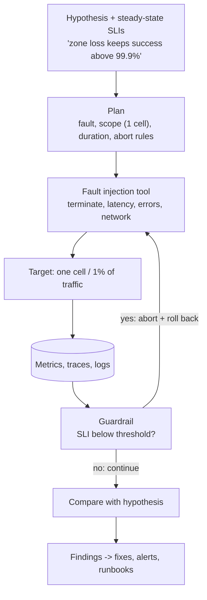
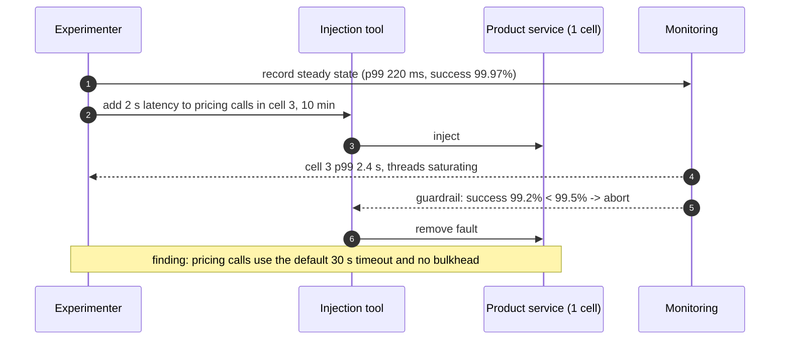

Every design in this course claims to survive failures: an instance dies, a zone disappears, a dependency slows down. **Chaos engineering**
checks those claims by causing the failures on purpose — carefully, with a hypothesis, a limited blast radius and a way to stop — so you find
the broken failover, the missing timeout or the alert that never fires before a real outage finds it for you.

## Why it matters

- Failure handling is the **least exercised code** in most systems: it runs only during incidents, when it's too late to discover it's
  broken ([production failures](lesson:production-failures)).
- Redundancy and failover are only as good as their last test; configuration drifts, capacity changes, dependencies are added
  ([failover](lesson:failover)).
- Teams that rehearse recover faster: runbooks get fixed, alerts get tuned, people know what to do ([disaster recovery](lesson:disaster-recovery)).

## How it works

### The experiment loop

1. **Define steady state** in user terms — SLIs such as success rate and p99 latency, plus business metrics (orders per minute).
2. **Form a hypothesis**: "If one of three availability zones becomes unreachable, checkout success stays above 99.9% and p99 below 800 ms."
3. **Choose the fault** that represents a real-world event.
4. **Limit the blast radius**: one instance, one percent of traffic, one cell, a staging environment first.
5. **Set abort conditions** and an automatic stop: if the SLI drops below a threshold, end the experiment and roll back immediately.
6. **Run, observe, and compare** with the hypothesis.
7. **Fix what you learn**, then repeat — ideally automatically and regularly.

### What to inject first

Start with the failures most likely to happen and most likely to be mishandled:

| Fault | What it tests |
|---|---|
| Kill an instance or pod | Health checks, load balancing, statelessness, autoscaling |
| Add latency to a dependency (e.g. +500 ms) | Timeouts, circuit breakers, thread-pool bulkheads, fallbacks |
| Return errors from a dependency | Retries (and retry storms), fallbacks, alerts |
| Block a zone or a network path | Zone redundancy, failover, quorum behaviour, split-brain protection |
| Fail over the database primary | Promotion time, client reconnection, lost writes (RPO) |
| Fill a disk, exhaust a connection pool | Saturation alerts, graceful degradation |
| Skew a clock, expire a certificate, break DNS | Time bombs and hidden dependencies |

### Game days

A **game day** is a scheduled, team-wide exercise: a realistic scenario (lose a region, restore last night's backup, rotate every
certificate) run with the on-call team using real runbooks. Its value is as much in exercising people and process as systems.

### Safety first

- Begin in non-production environments; move to production with tiny blast radii once confident.
- Run during business hours with the owning team present and informed.
- Make the stop button reliable and independent of the system under test.
- Never experiment on a system that is already burning its error budget ([SLOs and error budgets](lesson:slos-error-budgets)).

## Architecture





## Failure scenarios

- **The experiment causes a real outage**: no abort conditions, a blast radius that was larger than thought, or a stop mechanism that
  depends on the broken system.
- **Testing only in staging**: production has different traffic, data, configuration and dependencies; confidence doesn't transfer fully.
- **No observability**: without clear SLIs, you can't tell whether the hypothesis held.
- **Findings not fixed**: experiments that repeat the same failure every month without changes erode trust in the practice.
- **Unannounced chaos**: on-call engineers treat an experiment as a real incident and waste effort, or real incidents get dismissed as
  experiments.

## Trade-offs

| Choice | Gain | Cost |
|---|---|---|
| Production experiments | Real confidence | Risk to users (bounded by blast radius) |
| Staging only | Safe | Misses production-only behaviour |
| Continuous automated chaos | Catches regressions quickly | Needs mature guardrails and on-call buy-in |
| Manual game days | Exercises people and process | Infrequent; time-consuming |
| Broad faults (region loss) | Tests the big failure modes | Expensive and risky; do rarely, with preparation |

## In real systems

- Netflix introduced **Chaos Monkey** (randomly terminating instances) around 2011, followed by tools that simulated larger failures such as
  losing an AWS region; the practice became widely known as chaos engineering.
- Managed and open-source tools now cover fault injection: AWS Fault Injection Service, Azure Chaos Studio, Gremlin, Chaos Mesh and
  LitmusChaos for Kubernetes, and Toxiproxy for network faults in tests.
- Many organisations run regular DR game days that combine chaos experiments with backup restores and region failovers.

## Common mistakes

- **Starting with the scariest experiment** instead of the most likely failure.
- **No hypothesis or steady state**, so results can't be judged.
- **No automatic abort**.
- **Running while the system is already unhealthy.**
- **Treating chaos as a one-off event** rather than a regular practice.

## In the interview

Chaos engineering usually comes up as a follow-up: *"How would you know your failover works?"* Answer with regular failover drills and
targeted fault injection — kill instances, add dependency latency, fail over the database — each with a hypothesis, a small blast radius
and abort conditions, run first in staging and then in production.

````question title="How would you verify that your system survives losing an availability zone?"
Define steady state first — success rate, p99 latency and orders per minute — and the hypothesis that losing one of three zones keeps them
within SLO. In staging, then in production during business hours, block traffic to one zone for one cell or a small share of users, with an
automatic abort if SLIs drop below a threshold. Watch load balancer behaviour, database failover, capacity headroom in the remaining zones
and alerts. Fix what breaks, then make it a recurring, automated experiment.
````

````question title="What would you inject first in a new microservices system?"
The common, cheap faults: terminate instances to check health checks and statelessness; add latency and errors to each critical dependency
to check timeouts, circuit breakers, bulkheads and fallbacks; and fail over the database to check reconnection and data loss. These catch
the bugs behind most cascading failures. Larger experiments like zone or region loss come after these pass, with careful planning.
````

## Key takeaways

- Chaos engineering = **experiments on purpose**: steady state, hypothesis, injected fault, small blast radius, abort conditions.
- Start with **likely failures**: instance loss, dependency latency and errors, database failover; then zones and regions.
- **Game days** exercise people, runbooks and DR, not just software.
- Only experiment with **good observability**, a **healthy error budget** and a **reliable stop button** — and fix what you find.

## Knowledge check

```quiz
? What must be defined before injecting a fault?
- The tool vendor
! Tools are interchangeable.
+ The steady-state metrics, the hypothesis, the blast radius and abort conditions
- The postmortem template
! Postmortems are for real incidents.
- A new SLA
! Unrelated.
> Without a hypothesis and guardrails it's just breaking things.

? A team wants to run a region-failover experiment, but the service has burned 90% of this month's error budget. What should they do?
- Run it anyway; that's the point of chaos
! The budget says users can't absorb more risk now.
+ Postpone it until the budget recovers, and fix the reliability issues first
- Run it in production without telling on-call
! Unsafe and confusing.
- Increase the SLO
! Moving targets doesn't help.
> Experiments spend error budget.

? Injecting 2 seconds of latency into a dependency causes the calling service's thread pool to saturate. What has the experiment found?
+ Missing or too-long timeouts and no bulkhead for that dependency
- The dependency is too fast normally
! Unrelated.
- Chaos engineering is unsafe
! It found a real weakness safely.
- The load balancer is misconfigured
! The saturation is inside the caller.
> Latency injection exposes cascading-failure risks.

? Why run chaos experiments in production at all, rather than only in staging?
- Staging is always broken
! Not necessarily.
+ Production has the real traffic, data, configuration and dependencies, so only it can confirm resilience — with a small blast radius
- It's required by most SLAs
! It isn't.
- It's cheaper than staging
! Cost isn't the reason.
> Confidence comes from the real system, carefully bounded.
```
