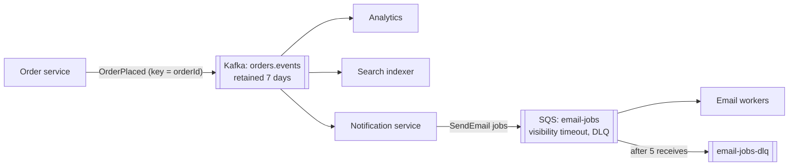

Kafka, RabbitMQ, SQS, SNS, Google Pub/Sub, Redis Streams, even a database table — all can move messages between services. They're built
on different models with different strengths, and the right choice in an interview is the **simplest** one that provides the guarantees the
design needs, justified in a sentence or two.

## Why it matters

"Why Kafka?" is a common follow-up whenever a candidate draws a queue, and "because it's scalable" isn't an answer. Interviewers want to hear
that you know the difference between a **log** and a **broker**, what a managed queue gives you for free, and when a table in the database you
already have is enough.

## How it works

### Two models

**Log-based (Kafka, Kinesis, Pulsar, Redpanda, Event Hubs, Redis Streams).** Messages are appended to partitioned logs and **retained**;
consumers track their own position.

- Many consumer groups read the same data independently; **replay** is natural.
- Ordering per partition; consumer parallelism tied to partitions.
- Very high throughput; long retention.
- Per-message features (delays, priorities, individual acknowledgements) are limited — newer share groups in Kafka add queue-style
  consumption.

**Broker/queue-based (RabbitMQ, ActiveMQ, SQS, Azure Service Bus).** The broker routes messages to queues and **deletes** them once
acknowledged.

- Per-message acknowledgement, redelivery and dead-lettering built in.
- Rich routing (RabbitMQ exchanges: direct, topic, fanout, headers); delays, TTLs and priorities.
- Competing consumers scale without partition planning.
- Once consumed, a message is gone — no replay for new consumers (RabbitMQ streams add a log-style option).

### The main options

| System | Model | Strengths | Watch out for | Choose when |
|---|---|---|---|---|
| **Kafka** (self-run or managed) | Partitioned log | Throughput, retention, replay, many consumers, ordering per key, ecosystem (Connect, Streams, CDC) | Operating it; partition planning; consumer lag management | Event streaming between many services, analytics ingestion, CDC |
| **RabbitMQ** | Broker with exchanges | Flexible routing, per-message acks, priorities, delays, quorum queues for durability | Lower throughput than logs; no replay (except streams) | Task queues and command routing with rich delivery features |
| **Amazon SQS** | Managed queue | Zero operations, effectively unlimited scale (standard), DLQs, visibility timeouts; FIFO with ordering per group | No pub/sub on its own; 1 MiB messages; standard queues are best-effort ordering, at-least-once | Background jobs and buffering on AWS |
| **SNS / Google Pub/Sub / EventBridge** | Managed pub/sub | Fan-out to many subscribers, managed | Limited retention/replay (varies); per-subscriber queues usually needed | Fan-out of events to several services |
| **Redis Streams** | Log in memory | Simple, fast, consumer groups; already have Redis | Memory-bound retention; Redis durability caveats | Lightweight streams at modest scale |
| **Database table as a queue** | Rows + `SKIP LOCKED` | No new infrastructure; transactional with your data | Polling load; limited throughput | Low-volume jobs, outbox relays, small teams |

### Choosing in practice

Ask, in order:

1. **Does more than one consumer need the same messages, or will we replay history?** → a log (Kafka or a managed equivalent).
2. **Is it work distribution with per-message retries, delays or priorities?** → a queue (SQS, RabbitMQ).
3. **Is volume modest and is the database already there?** → a table with `SKIP LOCKED` may be enough.
4. **Do we want to run it ourselves?** → managed services remove operational load at a price.

And be ready to say it in two sentences: *"Order events go to Kafka because five services consume them independently, we need per-order
ordering and the ability to replay into new services. Email jobs go to SQS with a dead-letter queue because they're independent tasks that
need per-message retries and delays."*

## Architecture



## Failure scenarios

- **Kafka chosen for a simple job queue**: per-message retries, delays and DLQs must be built by hand; partitions cap worker parallelism.
- **A queue chosen for events with many consumers**: consumers steal each other's messages, or the producer must send to N queues.
- **Database-as-queue at high volume**: polling contention and table bloat degrade the primary database.
- **Managed limits ignored**: message size limits (SQS 1 MiB), FIFO throughput per group, retention limits.
- **Two systems with no clear rule** for which flow uses which — inconsistent semantics and duplicated operations.

## Trade-offs

- **Capability vs operational cost**: Kafka does the most and costs the most to run; managed queues do less and cost almost nothing to
  operate.
- **Replay vs simplicity**: logs keep history; queues forget.
- **Routing features vs throughput**: brokers route and prioritise per message; logs maximise throughput and ordering per key.
- **One system vs several**: using one for everything simplifies operations; using the right tool per flow simplifies each flow.

## In real systems

- Many organisations run Kafka (or a managed equivalent such as Amazon MSK or Confluent Cloud) as the event backbone and SQS/RabbitMQ for
  task queues.
- SNS-to-SQS fan-out is a common AWS pattern for pub/sub with durable per-subscriber queues.
- Kafka 4.2's production-ready share groups and RabbitMQ's streams show the two models converging, but their defaults still differ.

## Common mistakes

- **"Kafka because it's scalable"** with no mention of consumers, ordering or replay.
- **One queue for many consumers** of the same event.
- **Ignoring managed services** when operations matter.
- **No dead-letter strategy** whatever the system.
- **Overlooking the database** as a perfectly good queue at low volume.

## In the interview

````question title="Why did you choose Kafka here instead of a simple queue?"
Because several independent services — search indexing, analytics, notifications — need every order event, at their own pace, and Kafka's
retained log lets each consumer group read independently and lets a new service replay history. Keying by order ID gives per-order ordering,
and partitions give parallelism at our volume. For the email-sending jobs triggered by those events, which need per-message retries, delays
and a dead-letter queue but no replay, I'd use a managed queue like SQS instead.
````

````question title="When is a database table good enough as a queue?"
When volume is modest — tens to hundreds of jobs a second — and the jobs relate to data already in that database. Workers claim rows with
SELECT … FOR UPDATE SKIP LOCKED, so several workers share the table without conflicts, and enqueueing can be in the same transaction as the
business change, which is exactly the outbox pattern. It avoids running another system. At higher volumes the polling, locking and table
churn start to load the primary, and a real queue or log is the better choice.
````

## Key takeaways

- **Logs** (Kafka and similar) retain and replay, serve many consumer groups and order per partition; **brokers/queues** (RabbitMQ, SQS) route,
  acknowledge, delay and dead-letter per message.
- Choose by **consumers and replay**, **per-message features**, **volume** and **operations**.
- A **database table with `SKIP LOCKED`** is a valid queue at low volume.
- Justify the choice in **two sentences tied to requirements**.

## Knowledge check

```quiz
? Five services need every OrderPlaced event, and a new service may need last week's events. Which fits best?
+ Kafka (or a managed log), with one consumer group per service
- A single SQS queue
! Consumers would compete for messages, and there's no replay.
- RabbitMQ with one shared queue
! Same competition problem; no replay.
- A database table polled by all services
! Polling by many services at volume loads the database; no clean replay model.
> Logs support many independent consumers and replay.

? Image-resize jobs need per-message retries, a 30-second delay on failure and a dead-letter queue. No replay is needed. Which fits best?
- Kafka
! Possible, but you'd build retries, delays and DLQs yourself.
+ A managed queue such as SQS (or RabbitMQ)
- SNS alone
! SNS fans out but doesn't queue for workers on its own.
- A CDN
! Unrelated.
> Queues provide per-message delivery features out of the box.

? A small team needs a background job queue for 20 jobs per second, all related to rows in their PostgreSQL database. What is reasonable?
- Deploy a Kafka cluster
! Heavy operational cost for 20 jobs/s.
+ A jobs table with workers using `FOR UPDATE SKIP LOCKED`
- A Redis Cluster with Lua
! More infrastructure than needed.
- Cron jobs on each server
! Duplicate execution and no coordination.
> At low volume, the database you already have can be the queue.

? Which statement about SQS standard queues is accurate?
- They guarantee strict ordering
! Standard queues are best-effort ordering.
+ They deliver at least once with best-effort ordering
- They retain messages forever
! Maximum retention is 14 days.
- They support unlimited message sizes
! The maximum is 1 MiB.
> FIFO queues add ordering per message group and deduplication.
```
