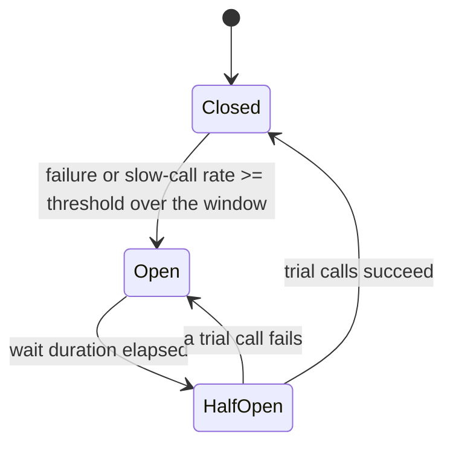
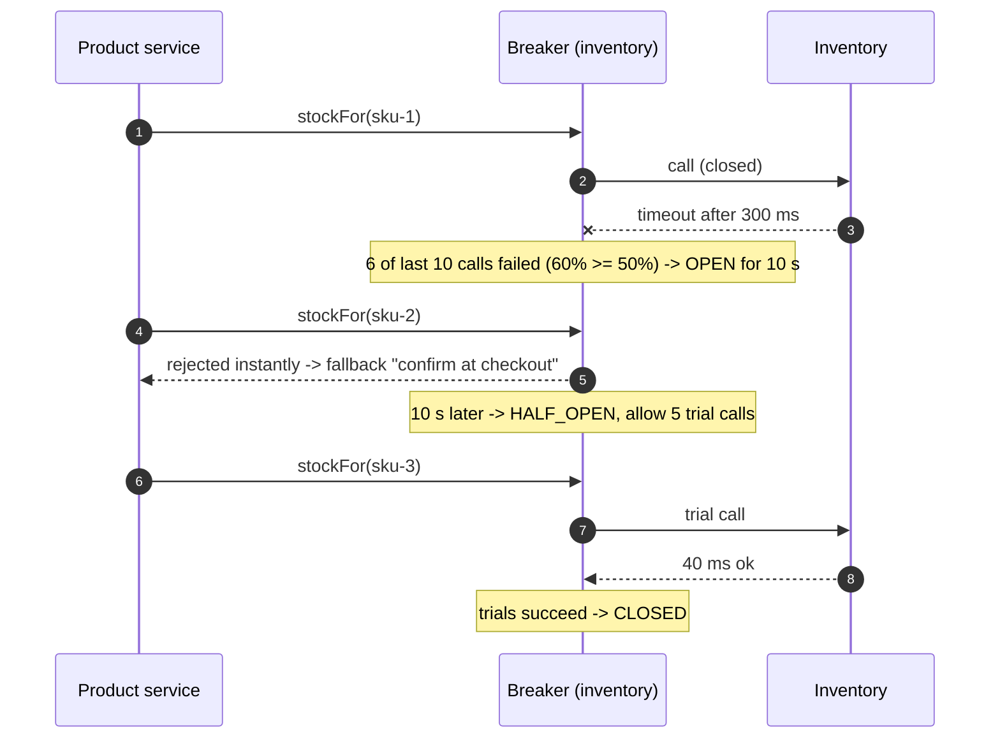

When a dependency is failing, the worst thing a caller can do is keep waiting on it. A **circuit breaker** notices a dependency is
unhealthy and fails calls instantly for a while, giving it room to recover; a **bulkhead** caps how many resources any one dependency can
consume, so its slowness can't take everything else down. Together with [timeouts and retries](lesson:timeouts-retries), they stop one bad
component from becoming a full outage.

## The problem

A product page calls inventory, pricing, reviews and recommendations. Inventory's database slows down, and inventory calls now take 5
seconds before timing out:

- Every product request now holds a thread and a connection for 5 seconds; at 500 requests/s that's 2,500 threads waiting.
- The thread pool fills; **requests that don't even need inventory** queue behind them; the product service stops responding.
- Callers of the product service time out and retry, adding more load. Within a minute, a slow inventory database has become a site-wide
  outage — a **cascading failure**.

Two missing protections:

- **Fail fast** once it's clear inventory is unhealthy, instead of paying the full timeout on every call.
- **Isolation**: inventory should only be able to use a bounded share of threads and connections.

```drill
? A service handles 400 requests/s; each calls a dependency that now hangs until a 3-second timeout. How many requests are in flight waiting on it (Little's law)?
= 1200
~ 1.05
> 400 req/s × 3 s = 1,200 concurrent waits — far more threads than a typical pool has.
```

## Architecture



- **Closed**: calls pass through; outcomes (failures, and calls slower than a threshold) are recorded in a sliding window of the last N
  calls or last N seconds.
- **Open**: when the failure or slow-call rate crosses a threshold (with a minimum number of calls, so two failures don't trip it), calls
  are **rejected immediately** — no waiting — and the caller uses a **fallback**.
- **Half-open**: after a wait, a few trial calls are let through; success closes the breaker, failure reopens it.

```mermaid title="Per-dependency bulkheads and breakers inside one service"
flowchart TB
  IN["Incoming requests<br/>(request thread pool)"]:::client --> PS["Product service"]:::svc
  PS --> B1["Bulkhead: inventory<br/>max 20 concurrent"]:::lb
  PS --> B2["Bulkhead: pricing<br/>max 30 concurrent"]:::lb
  PS --> B3["Bulkhead: reviews<br/>max 10 concurrent"]:::lb
  B1 --> CB1["Breaker: inventory<br/>OPEN, fallback = 'confirm at checkout'"]:::svc
  B2 --> CB2["Breaker: pricing<br/>CLOSED"]:::svc
  B3 --> CB3["Breaker: reviews<br/>CLOSED"]:::svc
  CB1 -.->|"no calls while open"| INV["Inventory (slow)"]:::ext
  CB2 --> PR["Pricing"]:::ext
  CB3 --> RV["Reviews"]:::ext
```

**Bulkheads** come in two forms:

- **Semaphore bulkhead**: at most N concurrent calls to a dependency; extra calls are rejected immediately (or wait briefly).
- **Thread-pool bulkhead**: each dependency gets its own small pool, so a slow dependency exhausts only its own threads.

The same idea applies at larger scales: separate connection pools per downstream, separate worker pools for interactive and batch work, and
whole deployments split into independent cells, so a failure is contained to one compartment (as in a ship's hull).

## Request and data flow



**Tuning** (per dependency):

- **Window and minimum calls**: large enough that a couple of failures don't trip the breaker (e.g. last 50 calls, minimum 20).
- **What counts as failure**: timeouts, connection errors and 5xx — not 404s or validation errors, which are the caller's problem.
- **Slow calls**: count calls above a latency threshold, so a dependency that is slow but not failing still trips the breaker.
- **Wait duration**: long enough for recovery (seconds to a minute), short enough to resume quickly.
- **Fallbacks**: cached data, defaults, a degraded feature, or a clear error — and the fallback must not depend on the failing system
  ([graceful degradation](lesson:graceful-degradation)).

## Advantages

- **Stops cascading failures**: callers stop wasting threads and time on a dead dependency.
- **Gives dependencies room to recover** by removing load instead of piling retries on.
- **Fast, predictable failure** enables fallbacks and partial responses.
- **Contains blast radius**: bulkheads keep one slow dependency from starving the rest.
- **Visibility**: breaker state changes are clear operational signals.

## Disadvantages

- **Tuning is per dependency** and drifts as traffic changes.
- **False trips** reject healthy traffic if windows are small or thresholds too tight.
- **Fallbacks must be designed** — otherwise an open breaker just returns errors faster.
- **Per-instance state**: each caller instance has its own breaker and opens independently, which is usually fine but makes behaviour
  less uniform.

## Failure scenarios

| Failure | What happens | Mitigation |
|---|---|---|
| Breaker trips on a handful of calls at low traffic | Healthy dependency treated as down | Minimum number of calls; time-based windows |
| One breaker for a whole service with mixed endpoints | One bad endpoint blocks good ones | Breaker per dependency and operation |
| Breaker flaps open/closed | Unstable behaviour | Longer windows, more half-open trials, slow-call thresholds |
| Fallback calls the same failing database | Fallback fails too | Fallbacks from independent sources (cache, defaults) |
| Bulkhead too small | Rejections under normal peaks | Size from Little's law: rate × normal latency, plus headroom |
| No timeout under the breaker | Slow calls hold bulkhead slots for minutes | Always combine breakers with timeouts |

## Alternatives

- **Timeouts with retry budgets** alone — enough for many internal calls.
- **Service mesh outlier detection** (Envoy, Istio): eject failing instances from load balancing without application code
  ([aggregation and discovery](lesson:aggregation-discovery)).
- **Adaptive concurrency limits**: automatically adjust allowed concurrency from observed latency (Netflix's concurrency-limits library,
  Envoy's adaptive concurrency filter).
- **Load shedding** at the server: reject excess work before it queues ([graceful degradation](lesson:graceful-degradation)).

## Where it shows up in interviews

Microservice architectures, API gateways, payment and checkout flows (what if the payment provider is down?), and every "what happens when X
is slow?" question. Say: per-dependency timeouts, a circuit breaker with a fallback, a bulkhead sized from Little's law, and how the system
behaves while the breaker is open.

````question title="What is a circuit breaker and when does it open?"
A wrapper around calls to a dependency that tracks recent outcomes in a sliding window. When the failure rate — or the rate of calls slower
than a threshold — exceeds a configured percentage over at least a minimum number of calls, it opens: calls fail immediately without
contacting the dependency, and the caller uses a fallback. After a wait it goes half-open and lets a few trial calls through; if they
succeed it closes, otherwise it opens again. It protects both the caller's resources and the struggling dependency.
````

````question title="How do bulkheads differ from circuit breakers?"
A circuit breaker reacts to a dependency's health: it stops calls when the dependency is failing. A bulkhead limits resources regardless of
health: at most N concurrent calls (or a dedicated thread pool) per dependency, so even a slow-but-not-failing dependency can only tie up its
own share of threads and connections. They're complementary — the bulkhead contains damage immediately, the breaker stops the calls once the
pattern is clear.
````

## Java and Spring Boot example

First, Resilience4j 2.4 in plain Java: a breaker over a failing inventory call (window of 10, minimum 5 calls, 50% threshold, 200 ms open
wait, 2 half-open trials), then a semaphore bulkhead with two slots. The output is from a real run.

```java file="BreakerDemo.java"
import io.github.resilience4j.bulkhead.Bulkhead;
import io.github.resilience4j.bulkhead.BulkheadConfig;
import io.github.resilience4j.bulkhead.BulkheadFullException;
import io.github.resilience4j.circuitbreaker.CallNotPermittedException;
import io.github.resilience4j.circuitbreaker.CircuitBreaker;
import io.github.resilience4j.circuitbreaker.CircuitBreakerConfig;
import java.time.Duration;
import java.util.concurrent.CountDownLatch;
import java.util.function.Supplier;

// Resilience4j in plain Java: a circuit breaker opening on failures and recovering through
// half-open, and a bulkhead capping concurrent calls to one dependency.
public class BreakerDemo {
    static boolean inventoryHealthy = false;

    static String callInventory() {
        if (!inventoryHealthy) throw new IllegalStateException("timeout");
        return "ok";
    }

    public static void main(String[] args) throws Exception {
        CircuitBreaker breaker = CircuitBreaker.of("inventory", CircuitBreakerConfig.custom()
                .slidingWindowSize(10)                    // judge the last 10 calls
                .minimumNumberOfCalls(5)
                .failureRateThreshold(50)                 // open at >= 50% failures
                .waitDurationInOpenState(Duration.ofMillis(200))
                .permittedNumberOfCallsInHalfOpenState(2)
                .build());
        breaker.getEventPublisher().onStateTransition(e ->
                System.out.println("  state: " + e.getStateTransition()));

        Supplier<String> guarded =
                CircuitBreaker.decorateSupplier(breaker, BreakerDemo::callInventory);
        System.out.println("inventory is failing:");
        for (int i = 1; i <= 8; i++) {
            try {
                guarded.get();
            } catch (CallNotPermittedException open) {
                System.out.printf("  call %d: rejected instantly (open), use fallback%n", i);
            } catch (IllegalStateException failed) {
                System.out.printf("  call %d: failed after waiting on the dependency%n", i);
            }
        }

        Thread.sleep(300);                                // longer than the open wait
        inventoryHealthy = true;
        System.out.println("inventory recovered; trial calls:");
        for (int i = 1; i <= 2; i++) System.out.printf("  trial %d: %s%n", i, guarded.get());

        Bulkhead bulkhead = Bulkhead.of("reports", BulkheadConfig.custom()
                .maxConcurrentCalls(2).maxWaitDuration(Duration.ZERO).build());
        CountDownLatch hold = new CountDownLatch(1);
        Runnable slowCall = Bulkhead.decorateRunnable(bulkhead, () -> {
            try { hold.await(); } catch (InterruptedException ignored) { }
        });
        Thread a = new Thread(slowCall), b = new Thread(slowCall);
        a.start(); b.start();
        while (bulkhead.getMetrics().getAvailableConcurrentCalls() > 0) Thread.sleep(5);
        System.out.println("bulkhead with 2 slots, both busy:");
        try {
            slowCall.run();
        } catch (BulkheadFullException full) {
            System.out.println("  third call: rejected immediately, other dependencies unaffected");
        }
        hold.countDown();
        a.join(); b.join();
    }
}
```

```text title="Output" output="BreakerDemo.java"
inventory is failing:
  call 1: failed after waiting on the dependency
  call 2: failed after waiting on the dependency
  call 3: failed after waiting on the dependency
  call 4: failed after waiting on the dependency
  state: State transition from CLOSED to OPEN
  call 5: failed after waiting on the dependency
  call 6: rejected instantly (open), use fallback
  call 7: rejected instantly (open), use fallback
  call 8: rejected instantly (open), use fallback
inventory recovered; trial calls:
  state: State transition from OPEN to HALF_OPEN
  trial 1: ok
  state: State transition from HALF_OPEN to CLOSED
  trial 2: ok
bulkhead with 2 slots, both busy:
  third call: rejected immediately, other dependencies unaffected
```

The breaker opened after the fifth failure (5 of 5 calls failed, past the minimum of 5), and calls 6–8 were rejected without touching
inventory. After the wait, two successful trial calls closed it again.

In a Spring Boot service the same protection is declarative. The `resilience4j-spring-boot` starter applies the annotations and reads the
limits from configuration (the class below was compiled against Resilience4j 2.4 and Spring Framework 7):

```java file="InventoryClient.java"
import io.github.resilience4j.bulkhead.annotation.Bulkhead;
import io.github.resilience4j.circuitbreaker.annotation.CircuitBreaker;
import org.springframework.stereotype.Service;
import org.springframework.web.client.RestClient;

// Annotations are applied by resilience4j-spring-boot's aspects; limits live in application.yml.
@Service
public class InventoryClient {

    private final RestClient http;

    public InventoryClient(RestClient.Builder builder) {
        this.http = builder.baseUrl("http://inventory").build();   // set connect/read timeouts too
    }

    @CircuitBreaker(name = "inventory", fallbackMethod = "unknownStock")
    @Bulkhead(name = "inventory")
    public StockLevel stockFor(String sku) {
        return http.get().uri("/stock/{sku}", sku).retrieve().body(StockLevel.class);
    }

    // Same parameters plus the exception: used when the call fails, the breaker is open,
    // or the bulkhead is full. The product page shows "availability confirmed at checkout".
    private StockLevel unknownStock(String sku, Throwable cause) {
        return new StockLevel(sku, -1, true);
    }

    public record StockLevel(String sku, int available, boolean estimated) { }
}
```

```yaml title="application.yml"
resilience4j:
  circuitbreaker:
    instances:
      inventory:
        slidingWindowType: COUNT_BASED
        slidingWindowSize: 50
        minimumNumberOfCalls: 20
        failureRateThreshold: 50
        slowCallDurationThreshold: 500ms
        slowCallRateThreshold: 80
        waitDurationInOpenState: 10s
        permittedNumberOfCallsInHalfOpenState: 5
  bulkhead:
    instances:
      inventory:
        maxConcurrentCalls: 20
        maxWaitDuration: 0
```

## Common mistakes

- **Breakers without timeouts** — the breaker only learns after each slow call completes.
- **No fallback**, so an open breaker just produces errors faster.
- **Counting client errors (4xx) as failures.**
- **One breaker for everything** a service calls.
- **Tiny windows** that trip on noise.
- **Shared thread pools** for all dependencies, so one slow call blocks unrelated work.

## Key takeaways

- **Circuit breakers** fail fast when a dependency is unhealthy (closed → open → half-open → closed) and enable **fallbacks**.
- **Bulkheads** cap concurrent use of each dependency so slowness stays **contained**.
- Configure **per dependency**: windows, minimum calls, failure and slow-call thresholds, wait duration; size bulkheads with
  **rate × latency**.
- Always pair with **timeouts** and **retry budgets**.

## Knowledge check

```quiz
? A dependency starts timing out after 2 seconds on every call. What does an open circuit breaker change for callers?
+ Calls fail immediately (and use a fallback) instead of each waiting 2 seconds, freeing threads and reducing load on the dependency
- Calls are retried automatically until they succeed
! Breakers stop calls; they don't retry them.
- The dependency is restarted
! Breakers don't manage the dependency.
- Calls are queued until the dependency recovers
! Open breakers reject, not queue.
> Fail fast and protect both sides.

? Why do circuit breakers have a minimum number of calls before they can open?
- To save memory
! Not the reason.
+ So that a couple of failures at low traffic (e.g. 2 of 3 calls) don't trip the breaker on a statistically meaningless sample
- Because the first calls are always slow
! Not inherently.
- To give the dependency a warm-up period
! Warm-up isn't the purpose.
> Avoid false trips on small samples.

? A service shares one thread pool of 200 threads for calls to five dependencies. One dependency slows down. What is the bulkhead fix?
- Increase the pool to 2,000 threads
! Delays exhaustion, doesn't contain it.
+ Give each dependency its own concurrency limit (semaphore or small pool) so the slow one can only use its share
- Remove timeouts so threads wait longer
! Makes exhaustion faster.
- Add retries
! Adds more load.
> Contain the blast radius per dependency.

? While the inventory breaker is open, what should the product page do?
- Return 500 for the whole page
! Throws away everything else on the page.
+ Render the page with a fallback for stock (for example "availability confirmed at checkout")
- Retry inventory in a loop
! The breaker is open precisely to stop that.
- Wait until the breaker closes
! Users would wait for seconds or minutes.
> Degrade the feature, not the page.
```
