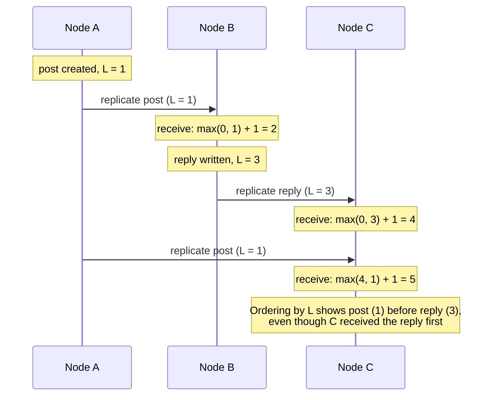

On one machine, "which happened first?" is answered by the order of operations. Across machines, each with its own imperfect clock,
timestamps can disagree by milliseconds or more — enough to put an effect before its cause. Distributed systems therefore use two kinds of
time: physical clocks, kept roughly in sync, for human purposes and timeouts; and logical clocks, which order events by causality instead
of by the wall.

## Why it matters

Timestamps sneak into designs everywhere: "last write wins", "order messages by time", "expire after 30 seconds", "generate time-ordered
IDs". Interviewers probe whether you know these break when clocks disagree, and what to use instead. Clock awareness separates designs that
merely look right from ones that stay correct under skew.

## How it works

### Physical clocks drift

A server's clock is a quartz oscillator that runs slightly fast or slow — tens of parts per million is typical. At 20 ppm a clock gains or
loses about **1.7 seconds a day**. Clock synchronisation corrects it:

- **NTP** (Network Time Protocol) keeps servers typically within about a millisecond of a reference on a good local network, and within
  tens of milliseconds over the internet — but accuracy degrades with network delay and asymmetry, and a misconfigured server can be off
  by much more.
- **PTP** (Precision Time Protocol) and cloud time services built on dedicated hardware can reach microsecond-level accuracy where
  available.
- **Steps and smears.** When NTP finds a large error, the clock may **jump** — even backwards. Leap seconds were handled by stepping or by
  "smearing" the extra second over many hours.

Two rules follow:

1. **Use a monotonic clock for durations and timeouts** (`System.nanoTime()` in Java, `CLOCK_MONOTONIC`), never the wall clock, which can
   jump.
2. **Don't use wall-clock timestamps from different machines to order events** that may be close together.

### Why timestamp ordering fails

Two clients write the same key on two replicas 5 ms apart. Replica 1's clock is 20 ms ahead. Under **last-write-wins**, the *earlier* write
carries the *later* timestamp and silently wins — the actual last write is lost. The same skew makes logs from different servers interleave
incorrectly and can let a "newer" cache entry be overwritten by an older one.

### Lamport clocks: a consistent order

Each node keeps a counter:

- Increment it before each event.
- Attach it to every message sent.
- On receiving a message, set the counter to `max(local, received) + 1`.

If event A **happened before** B (A caused B through a chain of messages), then `L(A) < L(B)`. Breaking ties by node ID gives a **total
order** that every node agrees on and that never puts an effect before its cause. The limitation: `L(A) < L(B)` does **not** mean A
happened before B — Lamport clocks can't detect that two events were concurrent.

### Vector clocks: detecting concurrency

Each node keeps a vector of counters, one per node. A node increments its own entry on each event and merges vectors (element-wise max) on
receive. Comparing two vectors:

- If every entry of V(A) ≤ V(B), and at least one is smaller, A happened before B.
- If neither dominates, A and B are **concurrent** — a genuine conflict to resolve.

This is how Dynamo-style stores detect conflicting writes and keep both as siblings (see [leaderless replication](lesson:leaderless-quorums)).
The cost: vectors grow with the number of writers, so systems prune or use variants (dotted version vectors).

### Hybrid logical clocks and TrueTime

- **Hybrid logical clocks (HLC)** combine a physical timestamp with a logical counter: they stay close to wall-clock time (useful for humans
  and for snapshot reads "as of" a time) while still respecting causality. CockroachDB and YugabyteDB use them.
- **TrueTime** (Google Spanner) exposes time as an interval `[earliest, latest]` with a bounded uncertainty, using GPS and atomic clocks.
  Spanner **waits out** the uncertainty before making a commit visible ("commit wait"), so commit timestamps respect real-time order —
  linearizability across the globe, paid for in a few milliseconds of latency per write.

## Architecture



## Failure scenarios

- **Last-write-wins drops a newer write** because a node's clock was ahead.
- **A timeout fires early or never** because code measured it with the wall clock across a clock step.
- **Time-ordered IDs go backwards**: a Snowflake-style ID generator sees its clock jump back and either issues duplicate-looking IDs or must
  wait — generators should refuse to issue IDs until the clock passes the last timestamp used.
- **Leases misjudged**: a lock holder with a slow clock believes its lease is still valid after the lock service considers it expired — one
  more reason for [fencing tokens](lesson:distributed-locks).
- **Logs out of order** across services make incident timelines misleading; correlate with trace IDs and causal links, not timestamps alone.

## Trade-offs

| Approach | Ordering it gives | Cost | Use for |
|---|---|---|---|
| Wall clock + NTP | Approximate real time | Skew of ms or more | Human timestamps, coarse expiry, metrics |
| Monotonic clock | Durations on one machine | Not comparable across machines | Timeouts, latency measurement |
| Lamport clock | Total order consistent with causality | One counter per message | Ordering events in a replicated log |
| Vector clock | Detects concurrency | Grows with writers | Conflict detection in multi-writer stores |
| HLC | Causal + close to real time | Small overhead | Distributed databases, snapshots |
| TrueTime | Real-time (external) consistency | Special hardware, commit wait | Spanner-style global transactions |

## In real systems

- Cassandra resolves conflicts per cell with last-write-wins using client or coordinator timestamps — so NTP health matters there.
- Riak used vector clocks (later dotted version vectors) to keep siblings for concurrent writes.
- CockroachDB uses hybrid logical clocks and rejects nodes whose clocks drift beyond a configured maximum offset.
- Spanner's TrueTime uncertainty is typically a few milliseconds; commit wait adds about that much to write latency.

## Common mistakes

- **Ordering events from different machines by wall-clock timestamp.**
- **Measuring timeouts with the wall clock.**
- **Assuming NTP makes clocks equal** — it makes them close, usually.
- **Using last-write-wins for data where losing a write matters.**
- **Thinking Lamport clocks detect concurrency** — they don't; vector clocks do.

## In the interview

````question title="Why can't you use timestamps to order writes from different servers?"
Each server's clock drifts and is only approximately synchronised — typically within a millisecond on a good network with NTP, sometimes
far worse — and clocks can even jump backwards when corrected. Two writes a few milliseconds apart on different servers can therefore carry
timestamps in the wrong order, so last-write-wins may keep the older write and silently discard the newer one. To order events safely use a
single sequencer (a leader or a partition's log), logical clocks such as Lamport or vector clocks, or a database with a clock design that
accounts for uncertainty, like hybrid logical clocks or Spanner's TrueTime.
````

````question title="What is the difference between Lamport clocks and vector clocks?"
A Lamport clock is one counter per node, updated on events and messages, giving a total order consistent with causality: if A caused B,
then A's timestamp is smaller. But a smaller timestamp doesn't prove causality, so Lamport clocks can't tell concurrent events apart. A
vector clock keeps a counter per node; by comparing vectors you can tell whether one event happened before another or whether they were
concurrent — which is exactly what's needed to detect conflicting writes. The price is size: vectors grow with the number of writers.
````

## Key takeaways

- Physical clocks **drift and jump**; NTP keeps them **close, not equal**.
- Use **monotonic clocks** for durations; never order cross-machine events by wall-clock time.
- **Lamport clocks** give a causality-respecting total order; **vector clocks** detect concurrency.
- **HLC** and **TrueTime** are how modern distributed databases reconcile causality with real time.

## Knowledge check

```quiz
? Two replicas accept writes to the same key 3 ms apart; the first replica's clock is 15 ms ahead. With last-write-wins, which write survives?
- The later write, always
! The earlier write carries a later timestamp because of the skewed clock.
+ The earlier write, because its timestamp is larger — the newer write is lost
- Both, as siblings
! Last-write-wins keeps one value.
- Neither; the store rejects both
! LWW accepts both and keeps one.
> Clock skew makes timestamp ordering unreliable for close events.

? Which clock should a service use to implement a 500 ms request timeout?
+ A monotonic clock
- The wall clock
! The wall clock can jump forward or backward when corrected.
- A Lamport clock
! Lamport clocks count events, not elapsed time.
- The database server's clock
! Remote clocks add latency and skew.
> Monotonic clocks only move forward at a steady rate on one machine.

? Event A has Lamport timestamp 5 and event B has 9. What can you conclude?
- A happened before B
! A smaller Lamport timestamp doesn't prove causality.
+ B did not happen before A (and A may or may not have caused B)
- A and B are concurrent
! Lamport clocks can't detect concurrency.
- B caused A
! That would require L(B) < L(A).
> If B → A then L(B) < L(A); the converse doesn't hold.

? Why does Spanner wait before making a commit visible?
- To batch writes
! Commit wait isn't batching.
+ To wait out clock uncertainty so commit timestamps respect real-time order
- To replicate to every region
! Replication uses Paxos; commit wait is about time uncertainty.
- To let the client retry
! Clients aren't involved.
> TrueTime's bounded uncertainty is converted into a short wait for external consistency.
```
