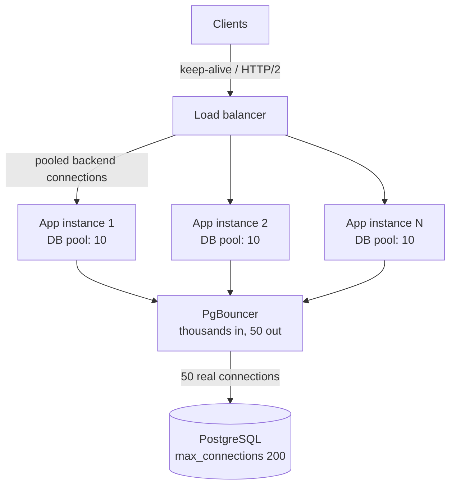

Opening a connection is expensive; using one that is already open is cheap. Keep-alive and connection pools exploit that
difference everywhere — between browsers and load balancers, between services, and above all between application servers and
databases, where getting the pool size wrong is one of the most common causes of production outages.

## Why it matters

From the [request lifecycle](lesson:http-lifecycle): a new HTTPS connection costs about three round trips before the first response
byte, and a database connection is even heavier — TCP, often TLS, authentication, and on PostgreSQL a whole new server process.
Doing that per request would multiply latency and burn CPU on both ends.

Pools make connections cheap to *use* but introduce a new shared, limited resource. When a pool is too small, requests queue for a
connection even though the database is idle. When the pools of many app servers add up to more than the database allows, new
connections are refused. Interviewers probe this whenever you scale an application tier in front of a database.

## How it works

### Keep-alive

HTTP/1.1 keeps connections open by default (persistent connections); a client sends further requests on the same connection until either
side closes it, typically after an **idle timeout**. HTTP/2 and HTTP/3 go further and multiplex many concurrent requests over one connection.

Keep-alive applies at every hop: browser to CDN or load balancer, load balancer to backends, and service to service. Each hop has its own
idle timeout; when two sides disagree, the side with the shorter timeout closes connections the other still thinks are usable.

### Connection pools

A pool keeps a set of open connections and lends them out:

1. A request thread **borrows** a connection (waiting up to a timeout if none is free).
2. It runs its queries and **returns** the connection — it is not closed.
3. The pool **validates** connections, replaces broken ones, retires them after a maximum lifetime, and closes idle extras.

Every serious HTTP client and database driver has one. In the Java world, HikariCP is the default database pool for Spring Boot; its
defaults are a maximum of **10** connections, a **30-second** wait for a free connection and a **30-minute** maximum connection lifetime.

### Sizing a pool

A pool needs enough connections to cover the queries that are in flight at once — which [Little's law](lesson:scalability-performance)
gives directly:

```text title="Formula"
connections busy on average = queries per second × average time a connection is held (seconds)
```

An instance running 400 queries per second that each hold a connection for 5 ms keeps about 400 × 0.005 = **2** connections busy on
average. Add headroom for bursts and slow queries and a pool of 5–10 is plenty. Bigger is not better: the database does its work on a
fixed number of CPU cores and disks, so beyond a point extra connections only add contention. The HikariCP project quotes a starting
point from the PostgreSQL community — about **(CPU cores × 2) + effective disk spindles** *active* connections for the whole database —
to be refined by load testing.

### The fleet-wide budget

The number that breaks systems is the **total**:

```text title="Formula"
total connections = app instances × pool size per instance
                    + every other client (admin tools, migrations, batch jobs)
```

PostgreSQL's default `max_connections` is 100, and each connection is a separate server process using memory. Forty app instances with
the default pool of 10 already need 400. The fixes, in order of preference:

1. **Smaller pools per instance** — sized with Little's law, not left at defaults or raised "just in case".
2. **A connection pooler in front of the database** (PgBouncer, RDS Proxy, ProxySQL for MySQL) that multiplexes thousands of client
   connections onto a small number of real database connections.
3. **Fewer, larger app instances** when the fleet is very wide.

### Service-to-service connections

The same idea applies to HTTP clients calling other services: reuse a single client object (which owns the pool) rather than creating one
per request, cap connections per destination, and set connect and read timeouts. With HTTP/2 or gRPC, one connection carries many
concurrent requests, so a handful of connections per destination is enough — but then load balancing has to happen per request, not
per connection (see [load balancers](lesson:load-balancers)).

## Architecture



Without the pooler, N instances × 10 connections go straight to the database; with it, the database sees a fixed, small number no matter
how far the app tier scales.

## Failure scenarios

- **Pool exhaustion.** Slow queries hold connections longer; by Little's law the same traffic now needs more connections; the pool runs
  dry, threads queue, request latency climbs and timeouts start — while the database itself may look only moderately busy. The root
  cause is usually a slow query or a downstream call made while holding a connection.
- **Too many connections.** An auto-scaling event doubles the app fleet, total connections exceed `max_connections`, and new instances
  fail on startup — exactly when you needed more capacity.
- **Stale connections.** A firewall or load balancer silently drops idle connections; the pool hands out a dead connection and the first
  query fails. Validation, keep-alive probes and a maximum lifetime shorter than the network's idle timeout prevent this.
- **Failover storms.** After a database failover every instance reconnects at once. Pools with backoff and jitter, and a pooler in
  front, smooth the spike.
- **Long transactions in a transaction-mode pooler.** PgBouncer's transaction pooling assigns a server connection per transaction; session
  features (prepared statements in older setups, session variables, advisory locks) can misbehave across transactions.

## Trade-offs

| Decision | Larger | Smaller |
|---|---|---|
| Pool size per instance | Tolerates bursts and slow queries; risks exceeding the DB budget and adds DB contention | Protects the DB; requests wait for a connection under bursts |
| Connection-wait timeout | Rides out short spikes; holds threads (and users) longer when overloaded | Fails fast so callers can retry or degrade; more errors in spikes |
| Maximum lifetime | Fewer reconnects | Rebalances after failover or scaling, avoids silent drops |
| Idle timeout | Connections ready for bursts | Releases resources on quiet instances |

A short wait timeout (a second or two rather than 30 s) is usually right for user-facing services: a request that can't get a connection
quickly is better failed and retried than left hanging.

## In real systems

- Spring Boot uses HikariCP by default; managed PostgreSQL offerings commonly provide a pooler (for example, Amazon RDS Proxy) because
  serverless and auto-scaled fleets otherwise exhaust connections.
- PgBouncer in transaction mode lets thousands of application connections share a few dozen PostgreSQL connections.
- Service meshes and HTTP clients (Envoy, OkHttp, Java's `HttpClient`) maintain per-destination pools and reuse HTTP/2 connections.

## Java and Spring Boot example

Pool settings live in configuration, so each environment can be tuned without code changes. A user-facing service that runs about 400
queries per second at about 5 ms each needs roughly two connections on average; ten leaves room for bursts, and the short connection
timeout makes a starved pool fail fast instead of piling up threads.

```properties title="application.properties"
spring.datasource.url=jdbc:postgresql://orders-db.internal:5432/orders
# Little's law: 400 queries/s x 0.005 s = ~2 busy connections; 10 leaves headroom.
spring.datasource.hikari.maximum-pool-size=10
spring.datasource.hikari.minimum-idle=10
# Fail fast (2 s) instead of the 30 s default when the pool is exhausted.
spring.datasource.hikari.connection-timeout=2000
# Retire connections before network devices silently drop them.
spring.datasource.hikari.max-lifetime=1500000
spring.datasource.hikari.keepalive-time=120000
```

With 30 instances this service uses 300 database connections — so either the database's `max_connections` and memory are sized for it,
or a pooler sits in between. The configuration file makes the fleet-wide budget visible at review time.

## Common mistakes

- **Raising the pool size to fix slowness.** If queries are slow, more connections usually make the database slower. Find the slow
  query first.
- **Forgetting the multiplication.** Pool size × instance count × services sharing the database must fit the database.
- **Holding a connection during a remote call.** Calling another service or an external API inside a transaction keeps a connection
  busy for the whole call.
- **Creating a client per request.** A new HTTP or database client per request throws away its pool and pays the handshake each time.
- **Default 30-second waits on user paths.** Threads pile up behind an exhausted pool; fail fast instead.

## In the interview

````question title="How would you size the database connection pool for a service?"
Start from Little's law: connections needed equals queries per second times the time each query holds a connection. If an instance runs
500 queries per second at 4 ms each, about two connections are busy on average, so a pool of around 10 covers bursts. Then check the
fleet-wide total: instances times pool size, plus every other client, must fit within the database's connection limit and memory.
Keep the active connections near what the database can actually execute in parallel — roughly a small multiple of its cores — and if
the app tier is large or auto-scales, put a pooler such as PgBouncer or RDS Proxy in front. Finally, set a short acquire timeout so
an exhausted pool fails fast, and validate the size with a load test.
````

````question title="Latency is rising and the logs show threads waiting for database connections, but database CPU is at 40%. What is going on?"
That is pool exhaustion rather than database overload. Something is holding connections longer — a slow query, a lock wait, or code
making a remote call inside a transaction — so by Little's law the same traffic needs more connections than the pool has, and requests
queue for them. I'd look at the slowest queries and how long connections are held, check for transactions spanning network calls, and
fix that. Raising the pool size might hide the symptom briefly but risks exceeding the database's connection limit and adding
contention.
````

## Key takeaways

- New connections cost round trips, CPU and (on databases) server memory; **keep-alive and pools** amortise that cost.
- Size pools with **Little's law** — throughput × hold time — plus headroom; bigger pools don't make a database faster.
- The real limit is the **fleet-wide total** against the database's connection budget; use a **pooler** when the app tier is wide.
- Use **short acquire timeouts**, validate connections, and **never hold a connection across a remote call**.

## Knowledge check

```quiz
? An instance handles 1,000 queries per second and each query holds a connection for 8 ms. About how many connections are busy on average?
- 1
! That ignores the hold time; 1,000 × 0.008 is larger.
+ 8
- 125
! That divides instead of multiplying.
- 8,000
! That treats milliseconds as seconds.
> Little's law: 1,000/s × 0.008 s = 8 connections in use on average.

? Sixty app instances each use the default pool of 10 against a PostgreSQL database with `max_connections = 100`. What happens when they all start?
- PostgreSQL queues the extra connections until some close
! Connections beyond the limit are refused, not queued.
+ Most instances can't open their connections; they fail or keep retrying
- Each instance automatically shrinks its pool to 1
! Pools don't coordinate across instances.
- Nothing — pools only open connections when needed
! With minimum idle equal to the maximum, pools open them eagerly; under load they will all be needed anyway.
> 600 connections against a limit of 100: shrink the pools, raise the limit with memory to match, or add a pooler.

? Latency spikes; threads wait for connections; database CPU is low. What is the best first step?
- Double the pool size on every instance
! It may exceed the database's connection limit and doesn't fix why connections are held so long.
+ Find what holds connections for longer — slow queries, lock waits or remote calls inside transactions
- Add read replicas
! Replicas add capacity, but the database isn't busy; connections are being held idle.
- Increase the connection-wait timeout to 60 seconds
! Longer waits just pile up more threads behind the exhausted pool.
> Pool exhaustion with an idle database means hold time grew; fix the cause.

? Why should a connection's maximum lifetime be shorter than the idle timeout of firewalls between the app and the database?
+ So the pool retires connections before a network device silently drops them
- To force a new TLS handshake for security
! Security isn't the driver here; avoiding dead connections is.
- To reduce database memory
! Replacing a connection doesn't reduce the number of connections.
- Because databases can't keep connections open longer
! Databases can keep connections open indefinitely; middleboxes are the issue.
> Silent drops hand dead connections to requests; retiring them first avoids that error.
```

Two pool-sizing estimates:

```drill
? A service runs 2,400 queries per second per instance, each holding a connection for 5 ms. How many connections are busy on average?
= 12
~ 1.25
> 2,400/s × 0.005 s = 12.

? Twenty-five instances each have a pool of 20. A reporting tool and migrations need 20 more. How many connections must the database allow?
= 520
~ 1.1
> 25 × 20 = 500 for the app, plus 20 = 520 — far above PostgreSQL's default of 100.
```
