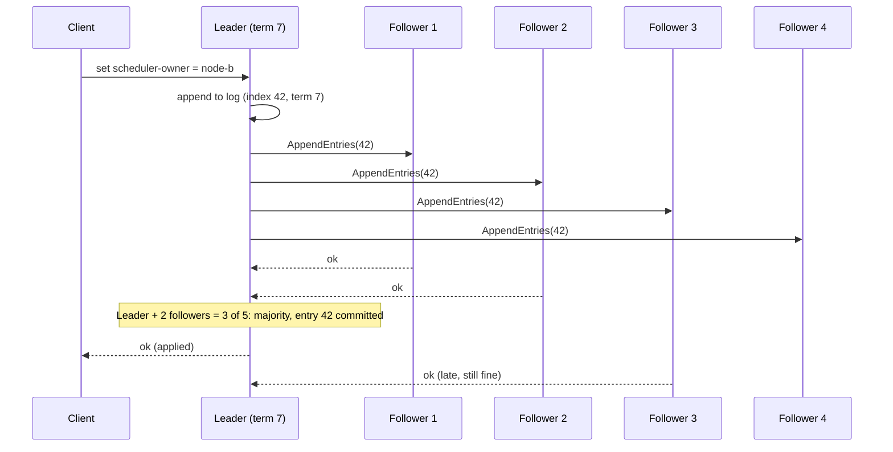

Consensus is how a group of machines agrees on one value — who the leader is, what the next log entry is, what the configuration says —
even when some of them crash and messages are delayed. It underpins leader election, distributed locks, configuration stores and
strongly consistent databases. You will almost never implement it, but you will use it in nearly every design, and you need to know what
it guarantees and what it costs.

## Why it matters

"How do you elect a leader?" and "how do you make sure only one scheduler runs a job?" are common follow-ups. The wrong answer is
"heartbeats": a node that stops hearing from the leader can't tell whether the leader is dead or just unreachable, and if every node acts on
its own guess you get two leaders. The right answer is **majority agreement** — consensus — usually by using a service built on Raft or
Paxos, such as etcd or ZooKeeper.

## How it works

### What consensus provides

A consensus protocol lets a cluster agree on a sequence of values (a **replicated log**) such that:

- **Safety**: no two nodes ever decide different values for the same log position, even with crashes and message delays.
- **Liveness**: as long as a **majority** of nodes can communicate, the cluster keeps making progress.

Everything rests on **majorities (quorums)**: any two majorities of the same cluster overlap in at least one node, so two conflicting
decisions can't both gather a majority. A 3-node cluster tolerates 1 failure, a 5-node cluster tolerates 2; a cluster of 2F + 1 nodes
tolerates F. Even numbers add cost without adding tolerance (4 nodes still tolerate only 1).

### Raft in five steps

Raft was designed to be understandable; its main ideas:

1. **Terms.** Time is divided into numbered terms; each term has at most one leader. Terms act as a logical clock — a node seeing a higher
   term updates and steps down if it was leader.
2. **Leader election.** Followers expect regular heartbeats from the leader. One whose randomised election timeout expires becomes a
   **candidate**, increments the term, votes for itself and asks the others for votes. A node grants at most one vote per term, and only to
   a candidate whose log is at least as up to date as its own. A candidate with votes from a **majority** becomes leader. Randomised
   timeouts make split votes rare.
3. **Log replication.** Clients send commands to the leader, which appends them to its log and sends them to followers
   (`AppendEntries`). Once a **majority** has stored an entry, it is **committed**; the leader applies it to its state machine and replies
   to the client. Followers apply committed entries in the same order.
4. **Safety.** Because a candidate needs votes from a majority, and every committed entry is on a majority, any new leader is guaranteed
   to have every committed entry — committed data survives leader changes.
5. **Membership changes** (adding or removing nodes) are themselves log entries, handled carefully so two different majorities can't
   exist during the transition.

### The cost

Every committed write needs a round trip from the leader to a majority. In one zone that's sub-millisecond to a few milliseconds; across
regions, tens to hundreds of milliseconds. Consensus clusters are therefore **small** (3 or 5 nodes) and hold **small, critical data**:
leadership, configuration, locks, membership, metadata — not your main dataset (unless the database partitions data into many small
consensus groups, as Spanner, CockroachDB and TiKV do).

### Use it, don't build it

| Service | Protocol | Typical uses |
|---|---|---|
| etcd | Raft | Kubernetes state, leader election, configuration, locks (leases + revisions) |
| ZooKeeper | Zab (Paxos-like) | Leader election, configuration, locks (ephemeral sequential nodes) |
| Consul | Raft | Service discovery, configuration, sessions/locks |
| Kafka (KRaft) | Raft-based | Kafka cluster metadata since ZooKeeper's removal in Kafka 4.0 |
| Spanner, CockroachDB, TiKV | Paxos / Raft per data range | Strongly consistent, horizontally partitioned data |

Leader election with etcd: each candidate tries to create a key with a **lease** (a TTL it must keep renewing); the one that succeeds is the
leader, and the key's revision number serves as a **fencing token** (see [distributed locks](lesson:distributed-locks)). If the leader dies,
the lease expires and another candidate takes over.

## Architecture



## Failure scenarios

- **Leader crash.** Followers stop receiving heartbeats; after an election timeout (often hundreds of milliseconds to a few seconds) one is
  elected. Writes pause during the election; committed data is safe.
- **Network partition.** The majority side elects (or keeps) a leader and continues; the minority side can't commit anything — it chooses
  consistency over availability. When the partition heals, the minority's uncommitted entries are discarded and it catches up.
- **Losing a majority.** With 2 of 3 nodes down, the cluster stops accepting writes entirely (by design). Spread nodes over three zones.
- **Slow disks.** Raft requires durable log writes; a slow disk on the leader slows every write and can trigger leader churn. etcd is
  sensitive to disk latency.
- **Overloading the coordination store** with application data or heavy watch traffic makes leadership and locks unreliable for
  everyone.

## Trade-offs

- **Safety vs latency**: majority round trips on every write; cross-region clusters are slow.
- **Fault tolerance vs cost**: 5 nodes tolerate 2 failures but each write waits for 3 acknowledgements.
- **Availability during partitions**: the minority side is unavailable — CP in [CAP](lesson:cap-pacelc) terms.
- **Generality vs simplicity**: building consensus yourself is a research project; a coordination service gives you its guarantees with a
  small API.

## In real systems

- Kubernetes stores all cluster state in etcd; controllers use leases in the API server for leader election.
- Kafka replaced ZooKeeper with its Raft-based KRaft controller quorum; ZooKeeper mode was removed in Kafka 4.0.
- Google's Chubby (Paxos-based lock service) inspired ZooKeeper and later systems.
- CockroachDB and TiKV run thousands of small Raft groups, one per data range, to scale strongly consistent storage horizontally.

## Common mistakes

- **Electing leaders with heartbeats alone**, without majority agreement — the recipe for split brain.
- **Even-sized clusters** (2 or 4 nodes), which add cost without tolerance.
- **All consensus nodes in one zone.**
- **Putting large or high-volume data** in etcd/ZooKeeper.
- **Implementing Raft or Paxos yourself** for a product feature.

## In the interview

````question title="How would you ensure exactly one instance of a scheduler is active?"
Use leader election through a consensus-backed coordination service such as etcd or ZooKeeper. Each scheduler instance tries to acquire a
leadership key with a lease; whoever holds it is the active scheduler and must keep renewing the lease. If it crashes or loses contact, the
lease expires and another instance takes over. Because the service decides by majority, a partitioned old leader can't keep its lease —
and to guard against a paused old leader still acting, the jobs it dispatches carry a fencing token (the lease revision) that workers or
storage check, rejecting stale ones.
````

````question title="Why does a consensus cluster need a majority, and why use 3 or 5 nodes?"
Any two majorities of the same set overlap in at least one node, so two conflicting decisions can't both be accepted, and a newly elected
leader is guaranteed to have every committed entry. A cluster of 2F + 1 nodes tolerates F failures: 3 nodes survive 1, 5 survive 2. Even
sizes don't help — 4 nodes still tolerate only 1 failure but need 3 acknowledgements. Larger clusters make every write wait for more
acknowledgements, so 3 or 5 spread across zones is the usual balance.
````

## Key takeaways

- Consensus makes a cluster agree on one **ordered log** despite crashes and delays, using **majorities**.
- **Raft**: terms, randomised elections by majority vote, log entries committed once on a majority.
- **2F + 1 nodes tolerate F failures**; use 3 or 5 nodes across zones; every write costs a majority round trip.
- **Use** etcd, ZooKeeper or Consul for leader election, locks and configuration — don't build your own.

## Knowledge check

```quiz
? A 5-node Raft cluster loses 2 nodes. What happens?
+ It keeps working: 3 of 5 is still a majority
- It stops accepting writes
! It stops only when a majority is lost (3 nodes).
- It splits into two clusters
! Only a majority can elect a leader.
- It loses committed data
! Committed entries are on a majority, so they survive.
> 2F + 1 = 5 tolerates F = 2 failures.

? Why is electing a leader by "whoever stops hearing heartbeats takes over" unsafe?
- Heartbeats are too slow
! Speed isn't the core problem.
+ A partitioned but alive leader keeps acting while another node also takes over — two leaders
- Heartbeats use too much bandwidth
! Bandwidth is negligible.
- Followers can't send heartbeats
! Leaders send heartbeats; that's not the issue.
> Without majority agreement, nodes act on conflicting guesses.

? When is a Raft log entry committed?
- When the leader writes it to its own disk
! One copy isn't enough.
+ When a majority of the cluster has stored it
- When every node has stored it
! Waiting for all would block on any slow or failed node.
- When the client receives a response
! The response follows commitment, it doesn't define it.
> Majority storage guarantees any future leader has the entry.

? What kind of data belongs in etcd or ZooKeeper?
- User profiles and orders
! These are application data for a database.
+ Small, critical coordination data: leadership, locks, configuration, membership
- Logs and metrics
! High-volume data overwhelms coordination stores.
- Cached web pages
! Use a cache.
> Coordination stores are small, consistent and latency-sensitive.
```
