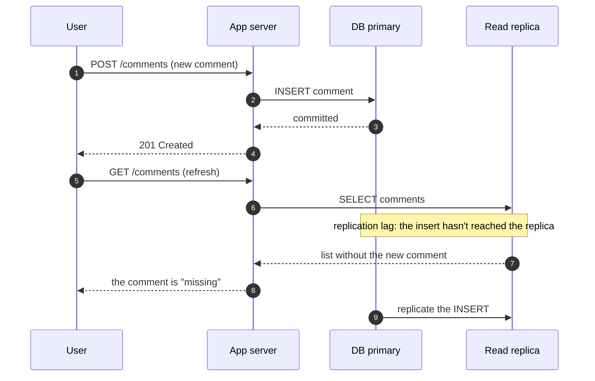

The moment a system keeps more than one copy of data — a replica, a cache, a second region — a read can return something other than
the latest write. Consistency is the rule for what a read is *allowed* to return. This lesson explains it through what users see;
[Stage 6](lesson:consistency-models) formalises it.

## Why it matters

Users don't say "the system violated linearizability". They say:

- *"I posted a comment and it disappeared when I refreshed."*
- *"The like count went from 12 to 11 to 12."*
- *"Two of us were charged for the same seat."*
- *"I saw a reply before I saw the message it was replying to."*

Each is a different consistency failure, with a different cost. Some are harmless annoyances; some are lost money. Deciding which
guarantees each feature needs is a core design skill — and saying it explicitly is one of the strongest signals in an HLD interview.

> [!NOTE] Two different "C"s
> The C in **ACID** means a transaction keeps the database's rules (constraints) intact. The C in **CAP** — and in this lesson — is
> about whether all copies agree on the latest value. Same letter, different ideas.

## How it works

### Strong vs eventual consistency

- **Strong consistency**: every read returns the most recent completed write, as if there were a single copy. Simple to reason about;
  requires coordination between copies on every write or read, which costs latency and, during failures, availability.
- **Eventual consistency**: if writes stop, all copies *eventually* converge on the same value — but in the meantime a read may
  return an older value. Cheap, fast and highly available; the application must tolerate staleness.

Between the two are useful middle grounds that fix the specific problems users notice.

### The anomalies users notice

| What users see | Name | Typical cause | Common fix |
|---|---|---|---|
| My own post vanishes after I refresh | Read-your-writes violation | Write went to the primary, read came from a lagging replica | Read your own recent writes from the primary, or wait for the replica to catch up to your write's version |
| A count goes 12 → 11 → 12 | Non-monotonic reads | Consecutive reads hit replicas with different lag | Pin a user's reads to one replica (session stickiness) |
| A reply appears before its message | Causality violation | Related writes replicated out of order | Carry causal dependencies, or keep related data in one partition |
| Two buyers get the same seat | Lost update / write conflict | Two writers read the same state and both "won" | Atomic conditional writes, transactions or locks |
| Stale price after an update | Stale cache | Cache entry not invalidated | Invalidate on write, short TTLs, versioned keys |

Notice that the last two are about **writes** (conflicts) and the first four about **reads** (staleness). Write conflicts on scarce
resources usually need strong guarantees; read staleness often just needs a session-level fix.

### Deciding per feature

Ask, for each piece of data: *what is the cost of a stale or conflicting read?*

| Feature | Acceptable staleness | Guarantee to design for |
|---|---|---|
| Account balance after a transfer | None | Strong (read from the primary or a quorum) |
| Seat or inventory reservation | None for the write | Atomic conditional update; reads may be slightly stale |
| A user's own profile edit | None *for that user* | Read-your-writes |
| Like and view counts | Seconds | Eventual |
| Search index, recommendations | Seconds to minutes | Eventual |
| Analytics dashboards | Minutes to hours | Eventual (batch) |

## Architecture

Here is how a stale read happens with a primary and an asynchronously replicated read replica. Step through it:



Three common fixes, from simplest: route a user's reads to the primary for a few seconds after they write; return the write's
log position to the client and only read from replicas that have caught up to it; or send all reads for data the user owns to the
primary.

## Failure scenarios

- **Replication lag spikes.** Lag is usually milliseconds, but a long-running query, a big migration or a network hiccup can push it
  to seconds or minutes — and every stale-read bug appears at once.
- **Failover loses writes.** With asynchronous replication, the newest writes on a failed primary may not have reached the replica that
  gets promoted. Those writes are gone, and the application may have already told users they succeeded.
- **Cache and database disagree.** A cache populated just before a write — and not invalidated after it — serves the old value until it
  expires.
- **Multi-region conflicts.** Two regions accept writes to the same record at the same time; one must win, and the other user's change is
  silently lost unless conflicts are detected.

## Trade-offs

- **Consistency costs latency.** Strong consistency means waiting for coordination — a quorum of replicas, or a single leader that
  every request must reach, possibly in another region.
- **Consistency costs availability during failures.** If copies can't talk to each other, a strongly consistent system must refuse some
  requests rather than risk returning wrong data. An eventually consistent one keeps answering.
- **Weaker guarantees cost application complexity.** The application must tolerate stale reads and resolve conflicts, and the bugs are
  intermittent and hard to reproduce.

The usual answer is to **keep strong guarantees for a small set of critical operations** and accept eventual consistency elsewhere.

## In real systems

- **DynamoDB** reads are eventually consistent by default; a strongly consistent read is available on request and costs twice the read
  capacity — consistency, priced.
- **Amazon S3** has provided strong read-after-write consistency for objects since December 2020; before that, some operations were
  eventually consistent and applications had to work around it.
- Social products typically show your *own* actions immediately (read-your-writes) while other people's activity, counts and feeds
  lag by seconds — exactly the per-feature split above.

## Common mistakes

- **One consistency level for the whole system.** Pick per feature.
- **Assuming replicas are always current.** Design for lag, and monitor it.
- **Fixing read staleness with strong consistency everywhere.** Read-your-writes and session stickiness solve most user-visible issues
  far more cheaply.
- **Ignoring write conflicts.** Stale reads are annoying; lost updates on money or inventory are incidents.
- **Confusing ACID consistency with replica consistency.** Say which one you mean.

## In the interview

````question title="What is the difference between strong and eventual consistency? When would you use each?"
With strong consistency, every read returns the latest completed write, as if there were one copy; it requires coordination, so it
costs latency and some availability during failures. With eventual consistency, copies converge once writes stop, but reads may be stale
in the meantime; it is fast, cheap and highly available. Use strong consistency where a stale or conflicting result causes real harm —
balances, inventory, uniqueness — and eventual consistency for counts, feeds, search and analytics, adding session guarantees such as
read-your-writes where users would notice their own changes missing.
````

````question title="A user updates their profile, refreshes, and sees the old version. How would you fix it without making everything strongly consistent?"
This is a read-your-writes violation, usually from reading a lagging replica or a stale cache. Options: after a user writes, route that
user's reads of their own data to the primary for a short window; or return the write's log position or version and only serve reads
from replicas that have caught up to it; and invalidate (delete) the cached profile on write rather than waiting for its TTL. Other
users can keep reading from replicas and caches.
````

````question title="Why is a lost update on inventory worse than a stale read of a like count?"
A stale like count is temporarily wrong and corrects itself; nobody is harmed. A lost update on inventory — two buyers both reading
"1 seat left" and both succeeding — creates a real-world conflict that has to be fixed with refunds and apologies. Write conflicts on
scarce resources need atomic conditional updates, transactions or locks, while read staleness on derived data can usually be tolerated.
````

## Key takeaways

- Consistency defines **what a read may return** once copies exist.
- Users see **read-your-writes violations, non-monotonic reads, causality violations, lost updates and stale caches** — each with its
  own fix.
- **Decide per feature**: strong for scarce resources and money, eventual for counts and feeds, session guarantees for a user's own data.
- Strong consistency costs **latency and availability**; weak consistency costs **application complexity**.

## Knowledge check

```quiz
? A user posts a comment, refreshes, and the comment is missing for a few seconds. What is the most likely cause?
+ The refresh read from a replica that hadn't yet received the write
- The write failed and was retried
! A failed write wouldn't reappear by itself a few seconds later.
- The CDN cached the page forever
! A permanently cached page would never show the comment.
- The database lost the comment
! The comment reappears, so it wasn't lost.
> This is a classic read-your-writes violation caused by replication lag.

? Which feature most needs strong consistency?
- A video's view counter
! A slightly stale view count harms no one.
- A "people you may know" list
! Recommendations are derived data and can lag.
+ Reserving the last available hotel room
- A trending-topics list
! Trending lists are computed periodically and are inherently approximate.
> Two people must not both get the last room; that write must be atomic and conditional.

? A like count shows 12, then 11, then 12 on consecutive refreshes. Which guarantee would fix this?
- Strong consistency for every request in the system
! It would fix it, but at far greater cost than needed.
+ Monotonic reads, for example by pinning a user's reads to one replica
- Read-your-writes
! The user didn't write anything; the problem is reads going backwards.
- A longer cache TTL
! A longer TTL changes how stale the value is, not whether successive reads can go backwards.
> Reads bouncing between replicas with different lag go backwards in time; sticking to one replica keeps them monotonic.

? What is the main cost of making every operation strongly consistent?
- More storage space
! Consistency doesn't change how much data is stored.
+ Higher latency and reduced availability during network failures
- Inability to use indexes
! Indexes work under any consistency model.
- Users must log in more often
! Authentication is unrelated to replica consistency.
> Strong consistency requires coordination between copies, which adds latency and forces refusals when copies can't communicate.
```
