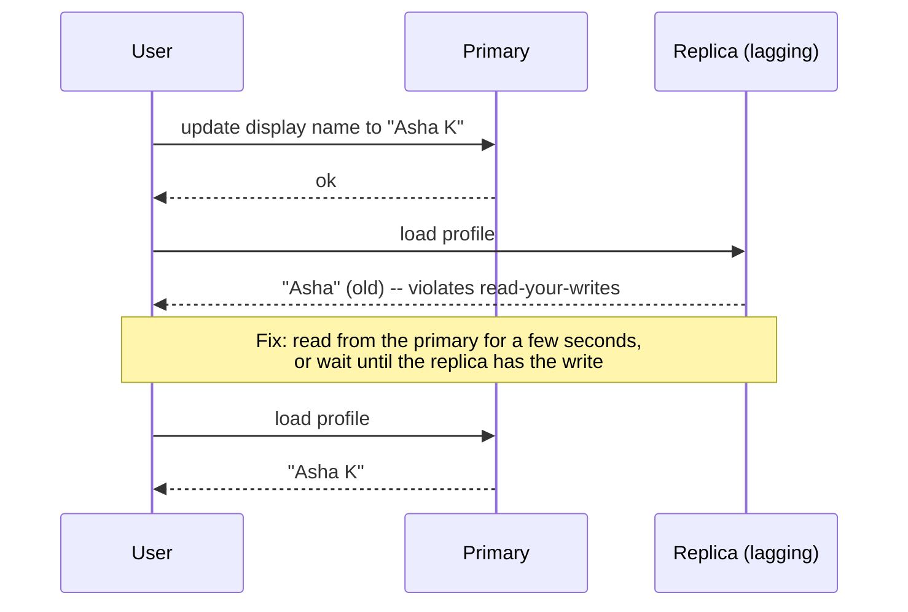

"Consistent" isn't a yes-or-no property. Between "behaves exactly like a single copy" and "converges eventually" lies a spectrum of
models, each with a precise promise and a price. Knowing the main ones — and the session guarantees users actually notice — lets you pick
the weakest model each feature can tolerate.

## Why it matters

Stage 1's [consistency introduction](lesson:consistency-intro) asked what users see; this lesson names the models precisely. In design
interviews you'll say things like "the like count can be eventually consistent, but users must read their own posts" or "the auction's
highest bid must be linearizable". Being precise shows you understand what each guarantee costs — coordination, latency, availability —
and keeps you from paying for guarantees a feature doesn't need.

## How it works

### The main models, strongest first

| Model | The promise | Typical cost | Example need |
|---|---|---|---|
| **Linearizability** (strong) | Each operation appears to happen instantly at one point between its start and end; everyone sees the same order, matching real time | Coordination on every write (and some reads); unavailable in a partition | Leader election, unique usernames, the current highest bid |
| **Sequential consistency** | Everyone sees the same order of operations, consistent with each client's own order, but not necessarily real time | Still a global order | Rarely chosen explicitly in system design |
| **Causal consistency** | Operations that are causally related (a reply after the post it answers) are seen in that order by everyone; unrelated ones may differ | Tracking dependencies (e.g. version vectors) | Comments and replies, chat threads |
| **Eventual consistency** | If writes stop, all replicas eventually converge; meanwhile reads may be stale or out of order | Cheapest; highly available | Like counts, view counts, recommendations |

### Session guarantees: what users notice

Between causal and eventual, four **session guarantees** describe what a single user experiences — and they are often all a feature needs:

- **Read-your-writes**: after I write something, my reads show it. *(Edit your profile, see the edit.)*
- **Monotonic reads**: once I've seen a value, I never see an older one. *(Refreshing a page doesn't make a comment disappear.)*
- **Monotonic writes**: my writes are applied in the order I made them. *(Rename, then rename again — the second wins.)*
- **Writes-follow-reads**: if I write after reading something, my write is ordered after what I read. *(A reply appears after the post
  it replies to.)*

These can be provided cheaply with session stickiness (pin a user to one replica, or to the primary after a write) or by tracking the
version a user has seen and waiting for replicas to catch up to it.

### Bounded staleness

A practical middle ground: reads may be stale, but by **at most** some bound — five seconds, or 100 versions. Several cloud databases
offer it explicitly (Azure Cosmos DB's bounded staleness level, for example).

### Choosing

Pick the **weakest model the feature tolerates**, because weaker models are cheaper, faster and more available:

1. Would a stale or reordered read cause **harm** (money, safety, double allocation)? → linearizable, for that operation.
2. Would it cause **confusion** (my edit vanished, a reply before its post)? → session guarantees or causal.
3. Would anyone **notice**? → eventual.

## Architecture



## Failure scenarios

- **Disappearing writes.** A user posts a comment, refreshes, and it's gone (the refresh hit a lagging replica). Read-your-writes.
- **Time travel.** Two refreshes hit two replicas; a comment appears, then vanishes. Monotonic reads.
- **Replies before posts.** A reply replicates faster than its parent; readers see an answer to nothing. Causal ordering.
- **Double allocation.** Two clients both see a seat free on stale replicas and both book. That needed linearizability (or a
  conditional write on the single source of truth).
- **Lost update under eventual consistency.** Two concurrent writes to the same key; last-write-wins keeps one silently.

## Trade-offs

- **Strength vs latency and availability.** Linearizable operations need coordination and fail during partitions
  ([CAP and PACELC](lesson:cap-pacelc)); eventual ones are fast and always available.
- **Global vs per-user guarantees.** Session guarantees give users a consistent experience without paying for global linearizability.
- **Simplicity vs efficiency.** One strong level everywhere is easier to reason about; per-feature levels are cheaper but must be designed.

## In real systems

- etcd and ZooKeeper provide linearizable writes (and linearizable reads on request) for coordination data.
- Spanner provides external consistency (linearizability for transactions) using TrueTime.
- MongoDB offers causally consistent client sessions; DynamoDB and Cassandra default to eventual reads with stronger options per request.
- Azure Cosmos DB exposes five explicit levels: strong, bounded staleness, session, consistent prefix and eventual — "session" is the
  default and provides the session guarantees above.

## Common mistakes

- **"Strong consistency everywhere"** — paying latency and availability for counters and feeds.
- **"Eventual consistency everywhere"** — then losing bookings and balances.
- **Ignoring session guarantees**, which fix most user-visible anomalies cheaply.
- **Confusing ACID consistency with CAP consistency.**
- **Not naming the model** — "consistent" alone means nothing in a design review.

## In the interview

````question title="Which consistency model would you use for each feature of a social app?"
Per feature, the weakest that's safe. Usernames and account settings that must be unique: linearizable writes, through a single leader or
a conditional write. A user's own posts and edits: read-your-writes, by reading their own data from the primary or waiting for replicas to
catch up. Comment threads: causal, so replies never appear before what they reply to — usually achieved by ordering within a thread on one
partition. Feeds, like counts and follower counts: eventual, served from caches and replicas. That keeps strong guarantees, with their
latency and availability costs, to the few places that need them.
````

````question title="What is the difference between linearizability and eventual consistency?"
Linearizability makes a replicated system behave like a single copy: each operation takes effect at one instant between its start and
finish, so once a write completes every later read, anywhere, sees it. That needs coordination and makes the system unavailable on the
minority side of a partition. Eventual consistency only promises that replicas converge once writes stop; in the meantime reads may be stale
or arrive in different orders on different replicas. It's cheap, fast and always available, but the application has to tolerate staleness
and resolve conflicts.
````

## Key takeaways

- **Linearizable** (single-copy, real-time order) → **sequential** → **causal** (cause before effect) → **eventual** (converges).
- **Session guarantees** — read-your-writes, monotonic reads and writes, writes-follow-reads — fix what users notice, cheaply.
- **Bounded staleness** caps how stale reads can be.
- Pick the **weakest model per feature**; reserve linearizability for uniqueness, money and scarce resources.

## Knowledge check

```quiz
? A user edits their bio, refreshes, and sees the old bio. Which guarantee is missing?
- Linearizability, for everyone
! Only this user's experience needs fixing.
+ Read-your-writes
- Monotonic writes
! Their writes weren't reordered; their read was stale.
- Causal consistency between unrelated users
! The issue is the user's own write.
> Read-your-writes is the session guarantee for "I see my own changes".

? Which feature most needs linearizability?
- A post's like count
! A slightly stale count harms no one.
- A recommendations list
! Recommendations tolerate staleness.
+ Claiming a unique username
- A news feed
! Feeds are eventually consistent everywhere.
> Uniqueness requires everyone to agree on who claimed it first.

? A reply occasionally appears before the comment it answers. Which model prevents this?
- Eventual consistency
! That's the model that allows it.
+ Causal consistency
- Bounded staleness of one hour
! A bound on staleness doesn't enforce cause-before-effect order.
- Read-your-writes for the reader
! The reader didn't write either comment.
> Causal consistency orders causally related operations for every reader.

? Two page refreshes show a comment, then not. What is the cheapest fix?
- Make every read linearizable
! Far more expensive than needed.
+ Pin the user's session to one replica so reads are monotonic
- Disable caching
! The issue is replica differences.
- Increase replica count
! More replicas make the problem more likely.
> Monotonic reads stop a user's view going backwards.
```
