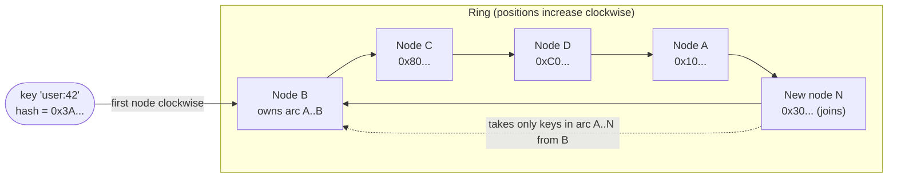

When data or traffic is spread over servers by hashing keys, the obvious formula — `hash(key) mod N` — has a nasty property: change
N and almost every key moves. Consistent hashing fixes that: adding or removing a server moves only about 1/N of the keys. It is how
caches, key-value stores and load balancers stay stable while their membership changes.

## Why it matters

Clusters change all the time: nodes fail, capacity is added, instances are replaced. If every membership change remapped most keys, a
cache cluster would lose nearly its whole hit ratio when one node died, and a database would have to move most of its data to add one
server. Interviewers bring up consistent hashing in distributed caches, key-value stores, sharded databases and "sticky" load balancing,
and expect you to explain both the ring and its weaknesses.

## How it works

### Why modulo hashing fails

With `server = hash(key) mod 10`, a key's server depends on N. Moving from 10 to 11 servers changes the answer for every key whose hash
gives different remainders mod 10 and mod 11 — in the run below, **90.9%** of 100,000 keys moved. For a cache, that's a near-total miss
storm; for a datastore, a near-total data migration.

### The hash ring

1. Hash each **server** onto a circle of hash values (for example, 0 to 2⁶⁴ − 1).
2. Hash each **key** onto the same circle.
3. A key belongs to the **first server clockwise** from its position.

When a server joins, it takes over only the keys between itself and its predecessor — about 1/N of them. When a server leaves, only its
keys move, to its successor. Everyone else is untouched.

### Virtual nodes

With one point per server, the arcs between points are uneven: some servers own far more of the circle than others. The fix is **virtual
nodes** — place each server at many points (often 100–256). The arcs average out, load evens, and when a server leaves, its keys spread
across many successors instead of piling onto one. Virtual nodes also make **weighting** easy: a server with twice the capacity gets twice
the points.

### Replication on the ring

To keep R copies, store each key on the first R **distinct** servers clockwise — the scheme Dynamo-style stores such as Cassandra use.
When one server fails, its keys' other replicas are already on its neighbours.

### Rendezvous (highest random weight) hashing

An alternative: for each key, compute `score = hash(key, server)` for every server and pick the highest. Adding or removing a server
moves only the keys for which it wins or won. It needs no ring or virtual nodes and balances well, but costs O(N) hash computations per
lookup — fine for tens of servers, less so for thousands. It's popular for choosing among a modest set of backends (caches, CDN nodes).

### Fixed slots: the practical variant

Many systems pre-split the hash space into a fixed number of **slots** or **partitions** — Redis Cluster uses 16,384 hash slots — and
assign slots to servers in a table. Adding a server means moving some slots. It's consistent hashing with explicit, inspectable
placement, which makes rebalancing and operations easier.

## Architecture



## Failure scenarios

- **A cache node dies.** Its keys move to their successors (as misses); the rest of the cluster keeps its hit ratio. With virtual nodes the
  extra load spreads over many nodes instead of one neighbour.
- **Uneven load without virtual nodes.** In the run below, with a single point per server the busiest server held **3.04×** its fair
  share of keys; with 100 virtual nodes, **1.22×**.
- **Hot keys.** Consistent hashing spreads *keys*, not *traffic*. One very popular key still lands on one node — see
  [hot keys](lesson:hot-keys).
- **Membership disagreement.** If clients have different views of which servers exist, they send the same key to different servers.
  Distribute membership through a coordination service or gossip, and version it.
- **Cascading failure.** A failed node's load lands on its successors; if they were near capacity, they fail too. Keep headroom and use
  virtual nodes so load spreads widely.

## Trade-offs

| Scheme | Keys moved on change | Balance | Lookup cost | Notes |
|---|---|---|---|---|
| Modulo `hash mod N` | ~all | Good | O(1) | Fine only if N never changes |
| Ring, 1 point per node | ~1/N | Poor | O(log points) | Simple, uneven |
| Ring with virtual nodes | ~1/N | Good | O(log points) | The common choice |
| Rendezvous hashing | ~1/N | Good | O(N) per key | No ring state; great for small N |
| Fixed slots + table | Only moved slots | Good (managed) | O(1) | Explicit placement; used by Redis Cluster |

## In real systems

- Amazon's Dynamo paper popularised the ring with virtual nodes and replication to successors; Cassandra uses token ranges with virtual
  nodes in the same spirit.
- Redis Cluster maps keys to 16,384 hash slots (`CRC16(key) mod 16384`); hash tags in braces force related keys into one slot.
- Client libraries for Memcached commonly use consistent hashing (the "ketama" scheme) so adding a cache server doesn't flush the cache.
- Load balancers such as Envoy offer ring-hash and Maglev hashing for sticky, consistent routing.

## Java and Spring Boot example

A ring with virtual nodes against modulo hashing, for 100,000 keys moving from 10 to 11 servers. Positions come from MD5 so they're
stable between runs:

```java file="ConsistentHashing.java"
import java.nio.charset.StandardCharsets;
import java.security.MessageDigest;
import java.security.NoSuchAlgorithmException;
import java.util.HashMap;
import java.util.Map;
import java.util.TreeMap;

// Modulo hashing vs a consistent-hash ring, for 100,000 keys on 10 servers when an 11th joins.
public class ConsistentHashing {

    static final int KEYS = 100_000;

    // Each server owns `vnodes` points on a ring of 64-bit positions.
    static class Ring {
        private final TreeMap<Long, String> ring = new TreeMap<>();
        private final int vnodes;

        Ring(int vnodes) {
            this.vnodes = vnodes;
        }

        void add(String server) {
            for (int i = 0; i < vnodes; i++) {
                ring.put(hash(server + "#" + i), server);
            }
        }

        String owner(String key) {
            Map.Entry<Long, String> e = ring.ceilingEntry(hash(key)); // first point clockwise
            return e != null ? e.getValue() : ring.firstEntry().getValue(); // wrap around
        }
    }

    public static void main(String[] args) {
        int moduloMoved = 0;
        for (int k = 0; k < KEYS; k++) {
            long h = hash("key-" + k);
            if (Math.floorMod(h, 10) != Math.floorMod(h, 11)) {
                moduloMoved++;
            }
        }
        System.out.printf("modulo hashing, 10 -> 11 servers: %5.1f%% of keys move%n",
                100.0 * moduloMoved / KEYS);

        for (int vnodes : new int[] {1, 100}) {
            Ring before = ring(10, vnodes);
            Ring after = ring(10, vnodes);
            after.add("server-10");
            int moved = 0;
            Map<String, Integer> load = new HashMap<>();
            for (int k = 0; k < KEYS; k++) {
                String key = "key-" + k;
                if (!before.owner(key).equals(after.owner(key))) {
                    moved++;
                }
                load.merge(before.owner(key), 1, Integer::sum);
            }
            int max = load.values().stream().mapToInt(Integer::intValue).max().orElse(0);
            System.out.printf("ring, %3d vnode(s) per server:     %5.1f%% of keys move;"
                    + " busiest server holds %.2fx its fair share%n",
                    vnodes, 100.0 * moved / KEYS, max / (KEYS / 10.0));
        }
    }

    static Ring ring(int servers, int vnodes) {
        Ring r = new Ring(vnodes);
        for (int s = 0; s < servers; s++) {
            r.add("server-" + s);
        }
        return r;
    }

    // First 8 bytes of MD5 as a long: well spread and stable across runs and machines.
    static long hash(String s) {
        try {
            byte[] d = MessageDigest.getInstance("MD5").digest(s.getBytes(StandardCharsets.UTF_8));
            long h = 0;
            for (int i = 0; i < 8; i++) {
                h = (h << 8) | (d[i] & 0xff);
            }
            return h;
        } catch (NoSuchAlgorithmException e) {
            throw new IllegalStateException(e);
        }
    }
}
```

```text title="Output" output="ConsistentHashing.java"
modulo hashing, 10 -> 11 servers:  90.9% of keys move
ring,   1 vnode(s) per server:       7.8% of keys move; busiest server holds 3.04x its fair share
ring, 100 vnode(s) per server:      10.4% of keys move; busiest server holds 1.22x its fair share
```

Modulo hashing moved nine keys in ten; the ring moved close to the ideal 1/11 ≈ 9.1%. With one point per server the ring was badly
unbalanced; 100 virtual nodes brought the busiest server within about 20% of its fair share.

## Common mistakes

- **Using `hash mod N`** for anything whose membership changes.
- **Forgetting virtual nodes**, then wondering why one node is overloaded.
- **Believing consistent hashing fixes hot keys.** It balances keys, not requests.
- **Ignoring how clients learn membership**, so different clients route the same key differently.
- **Placing replicas on adjacent virtual nodes of the same physical server** — replicas must be on distinct machines (and racks/zones).

## In the interview

````question title="Explain consistent hashing and why it is used."
Servers and keys are hashed onto the same circle; each key belongs to the first server clockwise from it. When a server joins or leaves,
only the keys on the arc next to it move — about 1/N of them — instead of nearly all keys as with hash mod N. Each server is placed at many
points (virtual nodes) so the arcs even out, load balances and a failed server's keys spread over many others; weights are just more points.
It's used in distributed caches, key-value stores and sticky load balancing, wherever membership changes but most keys should stay put.
Replication is done by storing each key on the next R distinct servers clockwise.
````

````question title="A cache cluster uses consistent hashing, but one node is overloaded. Why might that be, and what do you do?"
Either the ring is unbalanced — too few virtual nodes, or a weight that doesn't match the node's capacity — or the node owns a hot key that
gets disproportionate traffic. Check key counts versus request counts per node. For imbalance, add virtual nodes or adjust weights. For a
hot key, consistent hashing can't help by itself: replicate that key to several nodes and read from any, cache it in-process in the
clients, or coalesce requests for it.
````

## Key takeaways

- `hash mod N` remaps **almost every key** when N changes; consistent hashing remaps **about 1/N**.
- Use **virtual nodes** for balance, weighting and spreading a failed node's load.
- Replicate to the next **R distinct** servers; distribute **membership** consistently to clients.
- Consistent hashing balances **keys, not traffic** — hot keys need separate treatment. **Rendezvous** and **fixed slots** are common
  alternatives.

## Knowledge check

```quiz
? A cache cluster uses `hash(key) mod N`. One of 20 nodes fails and N becomes 19. Roughly what happens to the hit ratio?
- Drops by about 5%
! That would be true with consistent hashing; modulo remaps almost all keys.
+ Collapses, because nearly every key now maps to a different node
- Stays the same
! Most keys move to nodes that don't have them.
- Improves
! Cache misses rise sharply.
> Modulo hashing ties placement to N; any change reshuffles keys.

? Why use 100+ virtual nodes per physical server on a hash ring?
+ To even out arc sizes (load), allow weighting, and spread a failed server's keys over many others
- To make lookups faster
! More points make lookups slightly slower (more ring entries).
- To store more copies of each key
! Replication is a separate choice.
- To avoid needing a hash function
! Virtual nodes are hashed positions.
> Many points per server average out the randomness of single positions.

? A single key receives 40% of all traffic in a consistently hashed cache. What does consistent hashing do about it?
- Spreads that key's traffic across all nodes
! Each key maps to one node (or one replica set).
+ Nothing — the key still lives on one node; you need replication, local caching or coalescing for it
- Moves the key to the least loaded node automatically
! Placement depends on the hash, not load.
- Splits the key into slots
! Slots group keys; they don't split one key.
> Balance of keys is not balance of requests.

? How does Redis Cluster decide which node holds a key?
- A ring with virtual nodes
! Redis Cluster uses fixed slots.
+ It hashes the key to one of 16,384 slots, and each slot is assigned to a node
- Modulo the number of nodes
! That would reshuffle keys on every change.
- A random choice per write
! Placement must be deterministic for reads.
> Fixed slots make placement explicit and rebalancing a matter of moving slots.
```
