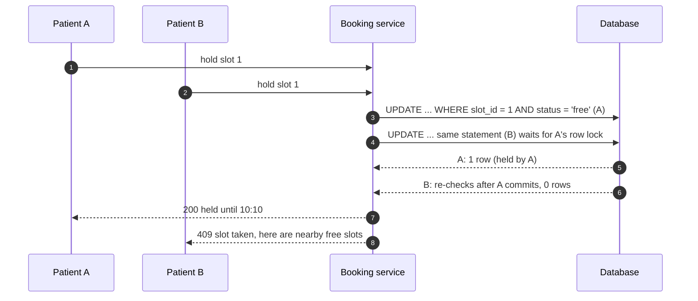

Many users, one scarce thing: the last seat, the final unit of a limited product, a 10:30 appointment, a username. Contention problems are
about **correctness first** — never sell the same thing twice — and **throughput second**, because every correctness mechanism serialises
access to the hot item. This lesson walks the toolkit from a single atomic statement up to virtual waiting rooms.

## The problem

Two requests arrive within a millisecond for the same appointment slot. Both read "free", both write "booked": a **lost update** and a
double booking. The classic race is **check-then-act** across separate steps ([transactions](lesson:transactions)).

Contention also limits throughput. If a row lock is held for the duration of a transaction, that row processes at most one transaction per
lock-hold time:

```drill
? A hot inventory row is locked for 5 ms per purchase transaction. At most how many purchases per second can that row process?
= 200
~ 1.1
> 1 ÷ 0.005 s = 200 transactions/s for that one row, no matter how many servers you add.

? A flash sale expects 20,000 purchase attempts per second on one product. Locks are held for 2 ms. How many independent stock buckets would you need, at minimum, to keep up?
= 40
~ 1.25
> One bucket handles 1 ÷ 0.002 = 500/s; 20,000 ÷ 500 = 40 buckets (plus headroom), each holding a share of the stock.
```

## Architecture

```mermaid title="Holds with expiry, confirmation after payment, a waiting room for spikes"
flowchart TB
  U["Users"]:::client --> WR["Waiting room (only for spikes)<br/>admits N users per second"]:::lb
  WR --> BS["Booking service"]:::svc
  BS -->|"atomic conditional UPDATE:<br/>free -> held (10 min)"| DB[("Slots / inventory<br/>PostgreSQL")]:::db
  BS --> PAY["Payment provider"]:::ext
  PAY -->|"webhook: paid"| BS
  BS -->|"held -> booked<br/>only if hold still valid"| DB
  SW["Expiry sweeper"]:::svc -->|"expired holds -> free"| DB
```

The toolkit, from simplest to heaviest:

1. **Atomic conditional updates**: put the check inside the write. The database serialises updates to one row, so exactly one of two
   concurrent requests matches the condition.
2. **Pessimistic locking**: `SELECT ... FOR UPDATE` locks the row while the application runs logic that can't fit in one statement.
3. **Optimistic concurrency**: read a version, write only if the version is unchanged, retry on conflict — cheap when conflicts are rare.
4. **Constraints**: unique indexes and exclusion constraints make the database reject invalid states outright.
5. **Reservations with expiry**: a short **hold** while the user pays; confirm if paid in time, release otherwise.
6. **Serialise per key**: a queue partitioned by item ID with one consumer per partition processes requests for one item in order.
7. **Split the hot item**: divide stock into buckets (sharded counters) or use an in-memory atomic counter (Redis with Lua,
   [Redis beyond caching](lesson:redis-beyond-cache)), reconciling to the database.
8. **Admission control**: a virtual **waiting room** admits users at the rate the booking path can handle, so the database never sees the
   full spike.

[Distributed locks](lesson:distributed-locks) are a last resort for resources outside a database — and need fencing tokens to be safe.

## Request and data flow

An appointment table with holds:

```sql title="Slots with a status, a hold owner and an expiry"
CREATE TABLE slots (
  slot_id         bigint      PRIMARY KEY,
  doctor_id       int         NOT NULL,
  starts_at       timestamptz NOT NULL,
  status          text        NOT NULL DEFAULT 'free'
                  CHECK (status IN ('free', 'held', 'booked')),
  held_by         bigint,
  hold_expires_at timestamptz,
  version         int         NOT NULL DEFAULT 0
);
INSERT INTO slots (slot_id, doctor_id, starts_at)
VALUES (1, 7, '2026-11-09 10:00'), (2, 7, '2026-11-09 10:30'), (3, 7, '2026-11-09 11:00');
```

**1. Hold atomically.** The condition and the change are one statement; a free slot, or one whose hold expired, can be taken:

```sql title="Atomic conditional hold"
UPDATE slots
SET status = 'held', held_by = 501, hold_expires_at = now() + interval '10 minutes'
WHERE slot_id = 1
  AND (status = 'free' OR (status = 'held' AND hold_expires_at < now()))
RETURNING slot_id, held_by, hold_expires_at;
```

If a second patient runs the same statement a millisecond later, it waits for the first row lock, re-checks the condition against the
committed row, matches nothing and returns zero rows — the API answers `409 Conflict`.



**2. Confirm after payment**, only if the hold is still yours and still valid:

```sql title="Confirm the hold"
UPDATE slots
SET status = 'booked'
WHERE slot_id = 1 AND status = 'held' AND held_by = 501 AND hold_expires_at > now()
RETURNING slot_id;
```

If the payment arrives after the hold expired and someone else took the slot, this returns zero rows — refund the payment
([idempotent APIs](lesson:idempotent-apis)).

**Pessimistic locking** when the decision needs more than one statement:

```sql title="Lock, decide in the application, write"
BEGIN;
SELECT status, held_by FROM slots WHERE slot_id = 2 FOR UPDATE;
-- application checks rules: patient's other bookings, doctor's limits, ...
UPDATE slots SET status = 'booked', held_by = 502 WHERE slot_id = 2;
COMMIT;
```

Keep the locked section short and never wait on a slow external call while holding the lock.

**Optimistic concurrency** when conflicts are rare and you'd rather not lock:

```sql title="Write only if nobody changed the row since you read it"
UPDATE slots
SET status = 'booked', held_by = $1, version = version + 1
WHERE slot_id = $2 AND version = $3;
```

Zero rows updated means someone else won; re-read and decide again.

**Any free item** (seat in a section, coupon code from a pool): let concurrent requests skip rows others are locking instead of queueing
behind them:

```sql title="Claim the next free slot without waiting on locked rows"
WITH next_slot AS (
  SELECT slot_id FROM slots
  WHERE doctor_id = 7 AND status = 'free'
  ORDER BY starts_at
  LIMIT 1
  FOR UPDATE SKIP LOCKED
)
UPDATE slots s
SET status = 'held', held_by = 503, hold_expires_at = now() + interval '10 minutes'
FROM next_slot
WHERE s.slot_id = next_slot.slot_id
RETURNING s.slot_id;
```

**Constraints** for overlapping time ranges — the database itself refuses a double booking of a room:

```sql title="An exclusion constraint: no overlapping bookings per room"
CREATE EXTENSION IF NOT EXISTS btree_gist;
CREATE TABLE room_bookings (
  booking_id bigint GENERATED ALWAYS AS IDENTITY PRIMARY KEY,
  room_id    int       NOT NULL,
  during     tstzrange NOT NULL,
  EXCLUDE USING gist (room_id WITH =, during WITH &&)
);
INSERT INTO room_bookings (room_id, during)
VALUES (7, '[2026-11-09 10:00, 2026-11-09 11:00)');
```

Inserting `[10:30, 11:30)` for room 7 fails with an exclusion-constraint violation (verified in PostgreSQL 18); `[11:00, 12:00)` succeeds
because the ranges only touch.

## Advantages

- **Correctness enforced where the data lives**: conditional writes and constraints can't be bypassed by a buggy client.
- **Simple for most cases**: one well-written `UPDATE ... WHERE ... RETURNING` handles the majority of contention problems.
- **Holds improve user experience**: the item is reserved while the user pays, instead of failing at the last step.
- **Graduated**: you add queues, sharded counters or waiting rooms only when measured contention demands them.

## Disadvantages

- **Hot rows cap throughput** at roughly one transaction per lock-hold time.
- **Pessimistic locks** risk deadlocks and long waits if held across slow work.
- **Optimistic concurrency** wastes work under high contention (most attempts retry).
- **Holds need expiry handling**: sweepers, late payments and refunds.
- **Splitting stock** complicates "sold out" logic and reconciliation.

## Failure scenarios

| Failure | What happens | Mitigation |
|---|---|---|
| Check and write in separate steps | Double booking | Conditional update or lock in one transaction |
| Payment completes after hold expiry | Paid but slot gone | Confirm conditionally; refund automatically |
| Hold sweeper stops | Slots stay held forever | Treat expired holds as free in the hold condition itself |
| Flash sale spike | Lock queues, timeouts, database overload | Waiting room, sharded stock, in-memory counters |
| Deadlock between two locked rows | One transaction aborted | Lock rows in a consistent order; retry |
| Client retries a confirm | Duplicate booking attempts | Idempotency keys; conditional confirm is naturally idempotent |

## Alternatives

- **Serializable isolation**: PostgreSQL's SERIALIZABLE detects conflicting transactions and aborts one; simple to reason about, but
  every transaction must be retryable.
- **Single-writer per key**: route all requests for one item through a partitioned queue to one consumer — no locks, natural ordering,
  added latency.
- **Accept and reconcile**: for low-stakes items, allow small oversells and compensate (apologise, refund, back-order).
- **Lotteries**: for extreme demand (concert presales), collect entries and allocate fairly afterwards instead of racing.

## Where it shows up in interviews

Ticket booking, auctions and bidding, flash sales and inventory, ride matching (one driver, many requests), appointment and hotel booking,
username or short-code claims. State the race explicitly, fix it with a conditional write or constraint, add holds with expiry, and only
then discuss scaling the hot item.

````question title="How do you prevent two users from booking the same seat?"
Make the database decide atomically. Holding a seat is a conditional UPDATE — set status to held only where status is available or the
previous hold expired — returning the row if it succeeded; the second concurrent request matches no row and gets a conflict. Confirmation
after payment is another conditional update that only succeeds if the hold is still owned and unexpired. A unique or exclusion constraint
on (event, seat) or on time ranges backs this up, so even a buggy code path can't create a double booking.
````

````question title="A flash sale of 10,000 items expects a million users in the first minute. What changes?"
Protect the booking path from the spike: a virtual waiting room admits users at the rate the system can process and gives everyone else a
queue position. Split the hot stock into buckets or keep the counter in Redis with an atomic decrement script, so purchases don't serialise
on one row; reconcile to the database asynchronously. Use short holds while users pay, release expired holds automatically, and make every
step idempotent so retries don't oversell.
````

## Common mistakes

- **Read, check in code, then write** without a lock or condition.
- **Holding a database lock while calling a payment provider.**
- **Distributed locks** for something a conditional `UPDATE` handles.
- **Holds without expiry**, or expiry that depends entirely on a background job.
- **Scaling servers** to fix a hot row — the row, not the servers, is the bottleneck.

## Key takeaways

- The race is **check-then-act**; fix it with an **atomic conditional write**, a **lock**, a **version check** or a **constraint**.
- **Holds with expiry** plus **conditional confirmation** model reservations safely.
- A hot row processes about **1 ÷ lock-hold time** transactions per second; beyond that, **split, serialise per key, or admit gradually**.
- Use `SKIP LOCKED` for "any free item" and exclusion constraints for time-range bookings.

## Knowledge check

```quiz
? Two requests run `UPDATE slots SET status='held' WHERE slot_id=1 AND status='free'` at the same moment. What happens in PostgreSQL?
+ One updates the row; the other waits for the row lock, re-checks the condition against the committed row, and updates nothing
- Both succeed and the slot is double booked
! The WHERE condition is re-evaluated after the first commit.
- Both fail with a deadlock
! Two updates on one row don't deadlock.
- The database picks one at random and errors the other
! The second simply matches zero rows.
> Conditional updates turn check-then-act into one atomic step.

? A booking service locks the slot with SELECT ... FOR UPDATE, then calls the payment provider (2–8 s), then commits. What goes wrong under load?
- Payments are charged twice
! Not inherently.
+ Locks are held for seconds, so other requests for that slot queue up and time out, and connection pools exhaust
- The slot is released too early
! The lock is held, not released.
- Nothing; FOR UPDATE is designed for this
! It's designed for short critical sections.
> Use a hold with expiry instead of a lock across slow work.

? Conflicts are rare and you want to avoid locking during a multi-step edit form. Which approach fits?
- Pessimistic locking when the form opens
! Locks would be held while the user types.
+ Optimistic concurrency: save with WHERE version = :read_version and retry or show a conflict if 0 rows change
- A distributed lock in Redis
! Unnecessary complexity.
- SERIALIZABLE for reads only
! Isolation applies to transactions, and this would still need retries.
> Check the version at write time.

? Workers grab "any unprocessed coupon code" and are mostly waiting on each other's row locks. What helps?
- SELECT ... FOR UPDATE NOWAIT on the same first row
! They'd mostly fail instead of waiting.
+ SELECT ... FOR UPDATE SKIP LOCKED so each worker takes a different free row
- Adding more workers
! More workers queue on the same row.
- Removing the index
! Makes it slower.
> SKIP LOCKED spreads claims across rows.
```
