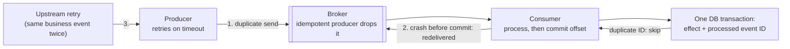

Every messaging design must answer two questions: **how many times** can a message be processed, and **in what order**? The honest
answers are "at least once, so make processing idempotent" and "in order per key, if you partition by that key". "Exactly once" exists —
but only inside carefully drawn boundaries, and understanding those boundaries is what interviewers are testing.

## Why it matters

Duplicate charges, double-counted clicks, notifications sent twice, and events applied out of order ("shipped" before "paid") are classic
production bugs and classic interview probes. A strong answer names the delivery guarantee the system actually provides, explains where
duplicates and reordering come from, and shows the mechanism — idempotent consumers, partition keys, transactions — that makes the outcome
correct anyway.

## How it works

### The three guarantees

- **At-most-once**: each message is processed zero or one times. Achieved by committing the consumer's position **before** processing (or
  fire-and-forget producers). Crash after commit → message lost. Acceptable for loss-tolerant data (some metrics, ephemeral presence).
- **At-least-once**: each message is processed one or more times. Achieved by committing the position **after** processing, and by
  producers retrying until acknowledged. Crash between processing and commit → redelivered → processed again. The usual default.
- **Exactly-once (effectively-once)**: the **effect** of each message happens once. Not by magically delivering once over an unreliable
  network, but by combining at-least-once delivery with **idempotence** or **atomic commits** of effect and position.

### Where duplicates come from

1. **Producer retries**: the broker stored the record but the acknowledgement was lost; the producer resends. Kafka's **idempotent
   producer** (enabled by default in current clients) attaches a producer ID and sequence numbers so the broker drops these duplicates.
2. **Consumer redelivery**: the consumer processed a record but crashed before committing its offset (or its queue visibility timeout
   expired). The next consumer processes it again. Only the consumer can fix this — by being idempotent.
3. **Upstream duplicates**: the original event was emitted twice by a retrying client or a webhook sender — dedup by a business key.

### Where exactly-once is real

- **Kafka transactions**: a consume-transform-produce application can write its output records and commit its input offsets **in one
  transaction**; downstream consumers with `isolation.level=read_committed` see only committed output. Exactly-once for pipelines that read
  from Kafka and write to Kafka (Kafka Streams uses this).
- **Database transactions**: a consumer writes its effect and the processed message ID (or the consumed offset) in **one database
  transaction**. On redelivery, the ID is already there — skip.
- **Idempotent effects**: upserts keyed by a natural ID, "set to value" updates, conditional writes.

Outside these — sending an email, calling a payment API — you're back to at-least-once, and must pass idempotency keys downstream or accept
rare duplicates. See [deduplication](lesson:dedup).

### Ordering

- **Kafka**: ordered within a partition. Use the entity whose events must be ordered as the key (`orderId`), so they share a partition, and
  process each partition sequentially (one thread per partition, or per-key sequencing inside a consumer).
- **SQS FIFO / message groups**: ordered within a message group ID; different groups in parallel.
- **Standard queues**: best-effort ordering — design consumers to tolerate reordering.

Ordering breaks in subtle ways:

- **Parallel processing within a partition** (a thread pool consuming one partition) reorders events.
- **Retries that move a failed message to a retry topic** let later messages for the same key overtake it (see
  [retries and DLQs](lesson:retries-dlq)).
- **Repartitioning** (adding partitions) moves keys to new partitions; old and new events for a key may be processed in parallel briefly.

When strict ordering isn't available, make consumers **order-tolerant**: carry a version or sequence number per entity and ignore events
older than the stored version.

## Architecture



## Failure scenarios

- **Commit before process** (accidentally at-most-once): a crash loses messages silently — e.g. auto-commit on an interval while processing
  asynchronously.
- **Non-idempotent consumer** under at-least-once: double charges, double counts.
- **"Exactly-once" claimed end to end** while the consumer calls an external API: duplicates reappear on retries.
- **Out-of-order events** after a retry or a parallel consumer: "delivered" applied before "shipped". Version checks per entity.
- **Hot partition** from an ordering key that's too coarse (all events keyed by `country`): ordering preserved, throughput capped.

## Trade-offs

| Guarantee | Cost | Use for |
|---|---|---|
| At-most-once | Possible loss | Loss-tolerant telemetry, presence |
| At-least-once + idempotent consumers | Dedup state or idempotent design | Most business events |
| Exactly-once via transactions | Throughput and latency overhead; only within the transactional boundary | Kafka-to-Kafka pipelines, financial aggregates |

| Ordering | Cost |
|---|---|
| Global order | One partition: no parallelism |
| Per-key order | Parallelism across keys; hot keys limit it |
| No order + version checks | Most parallel; consumers must reconcile |

## In real systems

- Kafka clients enable idempotent producers by default; Kafka Streams offers `exactly_once_v2` processing using transactions.
- Amazon SQS standard queues are at-least-once with best-effort ordering; FIFO queues offer ordering per message group and deduplication
  within a 5-minute interval.
- Payment and ledger systems combine at-least-once messaging with idempotency keys and unique constraints rather than relying on broker
  guarantees.

## Common mistakes

- **Promising exactly-once delivery** without saying where it stops.
- **Committing offsets before processing.**
- **Processing one partition with a thread pool** and then assuming order.
- **Keying by something too coarse** for ordering, creating hot partitions.
- **No per-entity versioning** where order can't be guaranteed.

## In the interview

````question title="Can your system guarantee exactly-once processing of payment events?"
Not exactly-once delivery — the network makes that impossible — but exactly-once effect. Delivery is at-least-once: producers retry, and
consumers commit offsets only after processing. Each payment event carries a stable payment ID; the consumer applies the ledger entry and
inserts the payment ID into a processed table in one database transaction with a unique constraint, so a redelivered event is skipped.
Calls out to the card processor pass the same payment ID as an idempotency key. Kafka's idempotent producer removes broker-side duplicates
from producer retries, and if a stage reads and writes Kafka only, Kafka transactions give exactly-once for that stage.
````

````question title="How do you keep events for the same order in order, while processing many orders in parallel?"
Partition by order ID: all events for one order go to the same partition, and Kafka preserves order within a partition. Consumers process
each partition sequentially — one thread per partition, or per-key queues inside a consumer — while different partitions, and therefore
different orders, run in parallel. Because retries and repartitioning can still reorder events, each event carries the order's version, and
the consumer ignores events older than the version it has stored.
````

## Key takeaways

- **At-most-once** loses, **at-least-once** duplicates; most systems choose at-least-once plus **idempotent processing**.
- Duplicates come from **producer retries** (idempotent producers fix these), **consumer redelivery** and **upstream retries** (idempotent
  consumers fix these).
- "Exactly-once" is real **within a boundary**: Kafka transactions, or effect + processed ID in one database transaction.
- Ordering is **per partition/key**; keep per-key processing sequential and use **versions** when order can't be guaranteed.

## Knowledge check

```quiz
? A consumer commits its offset, then processes the record, then crashes mid-processing. What guarantee did it provide for that record?
+ At-most-once: the record is lost
- At-least-once
! The record won't be redelivered; its offset was committed.
- Exactly-once
! The effect didn't happen at all.
- It depends on the producer
! The consumer's commit order decides this.
> Commit after processing for at-least-once.

? Which mechanism removes duplicates caused by a producer retrying a send whose acknowledgement was lost?
- Consumer groups
! They distribute partitions; they don't dedup producer retries.
+ The idempotent producer (producer ID + sequence numbers checked by the broker)
- Log compaction
! Compaction keeps the latest value per key over time; it doesn't dedup retries.
- Increasing partitions
! Unrelated.
> Broker-side dedup of producer retries; consumer redelivery still needs idempotent consumers.

? A consumer uses a thread pool to process records from one partition concurrently. What breaks?
- Durability
! Records remain stored.
+ Per-key ordering — records for the same key can be applied out of order
- Consumer group membership
! Membership is unaffected.
- Offset storage
! Offsets are still committed (though correctness of commits gets harder too).
> Keep per-key processing sequential.

? When is Kafka's exactly-once processing (transactions) sufficient on its own?
- When the consumer sends emails
! Emails leave Kafka's transactional boundary.
- When the consumer calls a payment API
! External calls aren't covered.
+ When a stage consumes from Kafka and produces to Kafka, committing offsets in the same transaction
- Always
! Only within Kafka.
> Exactly-once ends where the transaction's boundary ends.
```
