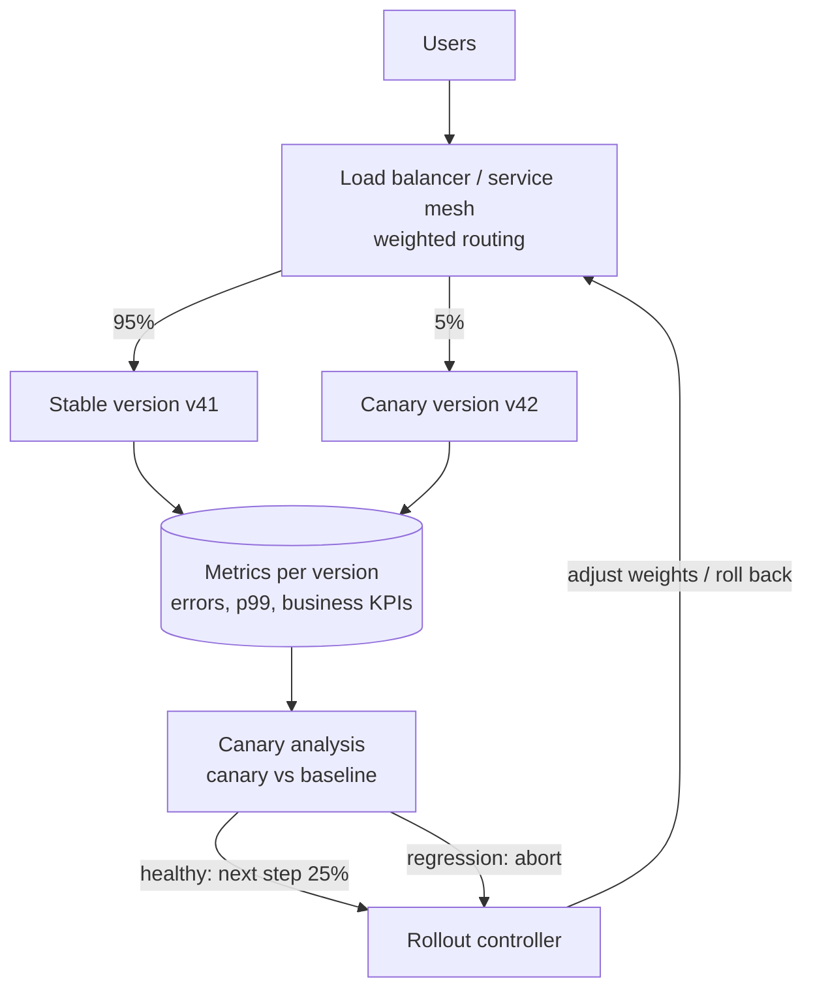
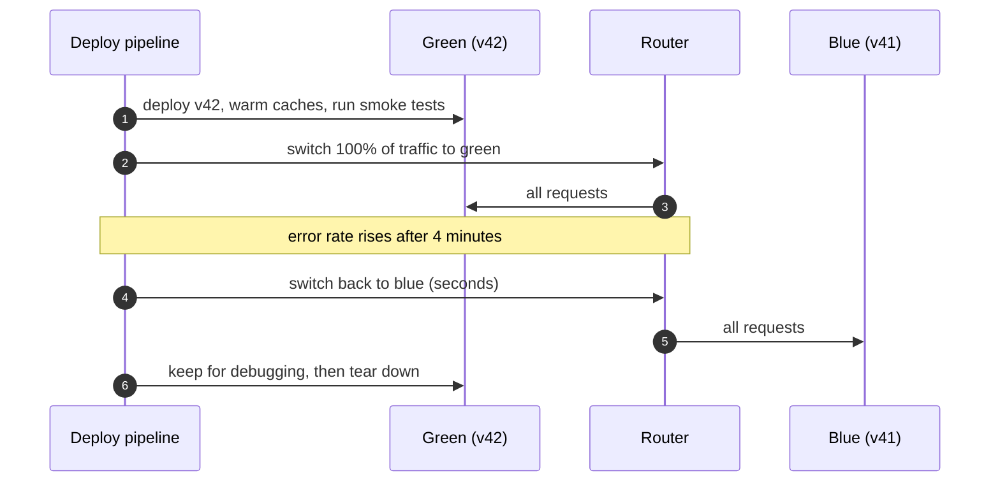

Most outages are caused by changes — new code, new configuration, new infrastructure. Deployment strategies decide **how many users
see a change before you know whether it's safe**, and **how fast you can undo it**. Rolling updates, blue-green switches, canaries and
feature flags each trade cost and complexity for a smaller blast radius and a faster rollback.

## Why it matters

- Shipping often is good for products and for reliability (small changes are easier to debug), but only if each change is cheap to undo.
- A bad change that reaches everyone at once spends the whole error budget in minutes ([SLOs and error budgets](lesson:slos-error-budgets));
  the same bug in a 1% canary costs a hundredth as much.
- During every deployment, **two versions run at the same time**, so APIs, message formats and database schemas must work with both
  ([API evolution](lesson:api-evolution)).

```drill
? 200,000 requests/minute. A bad release fails 30% of requests. A 5% canary catches it after 10 minutes and rolls back. How many requests failed?
= 30000
~ 1.05
> 200,000 × 5% × 30% × 10 = 30,000 failed requests.

? The same bug shipped to 100% of traffic is caught after the same 10 minutes. How many requests fail?
= 600000
~ 1.05
> 200,000 × 30% × 10 = 600,000 — twenty times more.
```

## How it works

### Rolling deployment

Replace instances in batches: start some new-version instances, wait until they're ready, drain and stop some old ones, repeat. In
Kubernetes, `maxSurge` and `maxUnavailable` control the batch size.

- **Pros**: no extra fleet; built into orchestrators.
- **Cons**: during the rollout, a random mix of users hits each version; rollback is another rolling deployment (minutes); problems are
  noticed only after a good part of the fleet has changed.

### Blue-green deployment

Run two complete environments. **Blue** serves traffic; deploy the new version to **green**, test it, then switch the router (load
balancer or DNS) to green. Keep blue running until green is proven.

- **Pros**: near-instant switch and instant rollback (switch back); full testing of the new environment before it receives traffic.
- **Cons**: double capacity during the switch; all users move at once; shared databases must support both versions; long-lived
  connections and caches need warming.

### Canary deployment

Send a **small share of traffic** to the new version, compare its SLIs with the old version, and widen exposure in steps only if it's
healthy — for example 1% → 5% → 25% → 50% → 100%, with automated analysis at each step.

- **Automated canary analysis** compares error rates, latency percentiles and business metrics of canary versus baseline, with
  statistical tests, and rolls back automatically on regression.
- Canaries can be scoped by **region, cell or cohort** (internal users first), combining with cell-based isolation
  ([fault isolation](lesson:fault-isolation)).

### Shadow traffic and dark launches

**Shadowing** mirrors real requests to the new version and discards its responses — useful for testing performance and correctness of
rewrites without user impact (careful with side effects: shadowed writes must not apply).

### Feature flags: deploy is not release

**Feature flags** separate deploying code from enabling behaviour. Code ships dark; a flag enables it for employees, then 1% of users,
then everyone — and turns it off in seconds if something goes wrong, without a deploy. Flags also act as **kill switches** for expensive
features during incidents ([graceful degradation](lesson:graceful-degradation)). Remove flags once a feature is fully launched, or
flag debt accumulates.

## Architecture





Progressive delivery tools express canary steps declaratively. An Argo Rollouts canary, for example:

```yaml title="Canary steps (Argo Rollouts)"
apiVersion: argoproj.io/v1alpha1
kind: Rollout
metadata:
  name: checkout
spec:
  strategy:
    canary:
      steps:
        - setWeight: 5
        - pause: { duration: 10m }      # analysis runs during pauses
        - setWeight: 25
        - pause: { duration: 10m }
        - setWeight: 50
        - pause: { duration: 10m }
```

## Failure scenarios

| Failure | What happens | Mitigation |
|---|---|---|
| Incompatible schema change | Old version breaks when the new one migrates the database | Expand-contract migrations ([zero-downtime migrations](lesson:zero-downtime-migrations)) |
| New message format | Old consumers can't parse messages from new producers | Backward-compatible formats; consumers first, producers second |
| Canary too small to detect a rare bug | Regression reaches 100% | Longer canaries for low-traffic services; synthetic load; business metrics |
| Rollback impossible | Data written by the new version breaks the old one | Keep changes reversible; forward-compatible readers |
| Config change bypasses the pipeline | Global, instant breakage | Treat config like code: same staged rollout |
| Flag misconfigured | Feature exposed to everyone, or turned off for everyone | Flag changes are audited, staged and alarmed like deploys |

## Trade-offs

| Strategy | Blast radius | Rollback speed | Extra cost | Best for |
|---|---|---|---|---|
| Rolling | Grows during rollout | Minutes (roll again) | Little | Routine stateless services |
| Blue-green | All users at the switch | Seconds | Double capacity briefly | Big-bang changes needing a full pre-test |
| Canary | Small, controlled | Seconds (shift weight) | Routing and analysis tooling | High-traffic, critical services |
| Feature flags | Per feature, per cohort | Seconds, no deploy | Flag system, code complexity | Product changes, kill switches |

## In real systems

- Kubernetes Deployments do rolling updates by default; Argo Rollouts and Flagger add canary and blue-green with metric-based analysis.
- Netflix and Google have published about automated canary analysis (Netflix and Google open-sourced Kayenta); cloud deployment services
  offer canary and linear traffic shifting.
- Feature-flag platforms (LaunchDarkly, Unleash, OpenFeature-compatible tools) are standard in product teams.

## Common mistakes

- **Deploying to 100% at once** for critical services.
- **Assuming one version at a time**, and shipping changes that break when old and new run together.
- **Manual canary judgement** ("looks fine") instead of automated comparison against the baseline.
- **Database changes that can't be rolled back**, coupled to a code deploy.
- **Configuration and flags outside the deployment safety net.**
- **Never cleaning up feature flags.**

## In the interview

When asked how you'd ship changes safely, answer with a pipeline: *"Canary to one cell at 5% with automated analysis on the SLO burn rate,
then 25%, 50%, 100%; schema changes via expand-contract a release ahead; risky features behind flags for gradual exposure and instant
kill."*

````question title="Compare blue-green and canary deployments."
Blue-green runs two full environments and switches all traffic from old to new at once, so rollback is an instant switch back and the new
environment can be tested fully beforehand — but every user moves together and you need double capacity during the switch. Canary sends a
small, growing share of traffic to the new version and compares its metrics with the old one, so a bad release affects only a few users and
is caught automatically, at the cost of weighted routing and analysis tooling. Canary is usually preferred for high-traffic services;
blue-green suits changes that are hard to run side by side.
````

````question title="How do feature flags change the way you release?"
They separate deploying code from releasing behaviour. New code ships disabled, then the flag turns it on for internal users, a small
percentage of customers, specific regions or plans, and finally everyone — with metrics checked at each step. If something goes wrong, the
flag turns it off in seconds without a deploy, and the same mechanism provides kill switches for expensive features during incidents. The
cost is extra code paths and flags that must be cleaned up after launch.
````

## Key takeaways

- **Rolling**: cheap, gradual, slow rollback. **Blue-green**: instant switch and rollback, double capacity, everyone moves at once.
  **Canary**: small, measured exposure with automated analysis.
- **Feature flags** decouple deploy from release and provide kill switches.
- Two versions always overlap: keep **APIs, messages and schemas compatible** across them.
- Put **configuration and flags** through the same staged, observable rollout as code.

## Knowledge check

```quiz
? Which strategy gives the smallest blast radius for an undetected bug in a high-traffic service?
- Rolling update with large batches
! Many users are on the new version before you notice.
- Blue-green
! All traffic switches at once.
+ Canary with automated analysis at a small initial weight
- Deploying at night
! Fewer users, but all of them exposed.
> Expose a small share, measure, then widen.

? During a rolling deploy, the new version renames a database column. Old instances start failing. What went wrong?
+ The schema change wasn't backward compatible with the version still running; use expand-contract
- Rolling deploys can't change databases
! They can, with compatible changes.
- The new version was too slow
! It's a compatibility failure.
- The load balancer routed incorrectly
! Mixed versions are expected during rollouts.
> Old and new must both work during the overlap.

? A new search ranking is risky. You want employees to try it first, then 1% of users, with instant switch-off. What do you use?
- Blue-green deployment
! All users switch together.
+ A feature flag with cohort targeting and percentage rollout
- A longer rolling deploy
! Can't target cohorts or switch off instantly.
- A database migration
! Unrelated.
> Deploy dark, release by flag.

? Why should configuration changes go through canary rollout too?
- Configuration can't break production
! Many major outages are configuration changes.
+ A bad config pushed everywhere at once has a global blast radius, just like bad code
- Config systems require it
! It's a safety practice, not a requirement.
- To make deploys slower
! Speed isn't the goal.
> Treat config as code.
```
