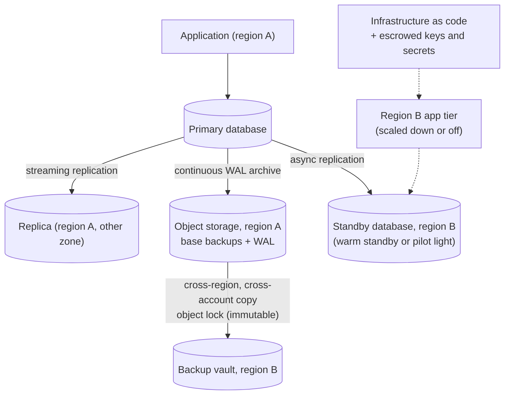
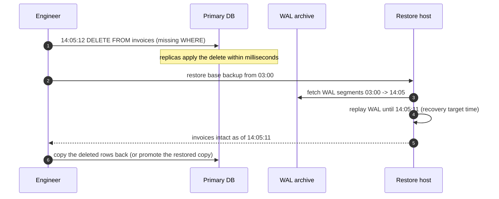

Replication protects you from a server dying. It does not protect you from an engineer running `DELETE` without a `WHERE`, a bug that
corrupts records for a week, ransomware, or a whole region going offline — replication copies those mistakes faithfully. **Disaster
recovery** starts with two numbers the business has to agree on — how much data you may lose and how long you may be down — and designs
backups and standby capacity to meet them, then proves it by restoring regularly.

## Why it matters

- **Replicas are not backups.** Logical corruption and deletions replicate in milliseconds ([leader-follower](lesson:leader-follower)).
- **Untested backups fail when needed**: wrong scope, broken scripts, missing keys, or restores that take days instead of hours.
- **DR costs scale with ambition**: zero data loss and near-zero downtime across regions costs many times more than nightly backups.
  The targets must come from business impact, not optimism.
- Interviewers expect RPO and RTO for systems holding money, documents or anything users can't recreate.

## How it works

### RPO and RTO

- **Recovery point objective (RPO)**: the maximum acceptable data loss, measured in time — "we can lose at most 5 minutes of orders".
- **Recovery time objective (RTO)**: the maximum acceptable time to restore service — "checkout back within 1 hour".

They are derived from impact: revenue lost per hour down, regulatory obligations, the cost of re-entering data, user trust. Different data
gets different targets: payments may need RPO ≈ 0, analytics can tolerate a day.

### Backups

- **Full, incremental, differential** backups trade storage and backup time against restore time (incrementals are small but restores
  replay a chain).
- **Snapshots** (volume or storage-level) are fast to take and restore, but must be crash-consistent or application-consistent.
- **Continuous archiving** of the database log (PostgreSQL WAL archiving, MySQL binlogs) enables **point-in-time recovery (PITR)**: restore
  the last base backup, then replay the log to the second before the mistake ([PostgreSQL & MySQL](lesson:postgres-mysql)).
- **Logical backups** (`pg_dump`) are portable and selective but slow for large databases; **physical backups** are fast and complete.
- **The 3-2-1 rule**: at least three copies, on two kinds of storage, with one off-site — today usually a different account and region.
- **Immutability**: object-lock or write-once retention, in a separate account with separate credentials, so an attacker (or a buggy
  script) with production access can't delete the backups.
- **Back up the rest**: configuration, secrets and encryption keys (escrowed), infrastructure-as-code, and the knowledge to use them.

Restore time is a throughput problem — check it against the RTO:

```drill
? A 20 TB database restores from backup at 500 MB/s. How many hours does the restore take, before log replay?
= 11.1
~ 1.05
> 20 × 10¹² B ÷ 500 × 10⁶ B/s = 40,000 s ≈ 11.1 hours. An RTO of 1 hour needs a different strategy (standby, smaller shards, snapshots).

? The same database then replays 6 hours of WAL at 50 GB per hour, applied at 200 MB/s. How many extra minutes does replay take?
= 25
~ 1.05
> 300 GB ÷ 200 MB/s = 1,500 s = 25 minutes.
```

### DR strategies

| Strategy | What runs in the recovery site | Typical RPO | Typical RTO | Cost |
|---|---|---|---|---|
| **Backup and restore** | Nothing; backups stored in another region | Hours (last backup) to minutes (with log archiving) | Hours to a day | Lowest |
| **Pilot light** | Data replicated; minimal core services ready, scaled to zero | Seconds to minutes | Tens of minutes to hours | Low |
| **Warm standby** | A scaled-down full copy running | Seconds | Minutes | Medium |
| **Multi-site active-active** | Full capacity serving traffic in each site | Near zero | Near zero (traffic shift) | Highest |

The active-passive and active-active mechanics are covered in [failover](lesson:failover); DR adds the cases failover doesn't cover —
corruption, deletion, ransomware, and losing the primary site entirely.

## Architecture





## Failure scenarios

| Failure | Why DR fails | Prevention |
|---|---|---|
| Accidental deletion or bad migration | Replicas copy it instantly | PITR from log archives; delayed replicas |
| Backups never restored | Corrupt, incomplete or unusable when needed | Automated restore tests on a schedule, with checks |
| Restore slower than RTO | Throughput math ignored | Measure restores; standby or sharding to cut size |
| Attacker deletes backups | Same credentials as production | Separate account, immutable retention, MFA on deletion |
| Encryption keys lost with the region | Backups unreadable | Key replication and escrow, tested |
| Forgotten dependencies | Restored service can't start (secrets, DNS, allowlists, third parties) | Full DR exercises, not just database restores |

## Trade-offs

| Choice | Gain | Cost |
|---|---|---|
| Lower RPO | Less data lost | Continuous replication and archiving; sync replication costs latency |
| Lower RTO | Faster recovery | Standby capacity running and maintained |
| Longer retention | Recover from slow-burning corruption | Storage cost, privacy and deletion obligations |
| Immutable backups | Ransomware and mistake protection | Can't delete early (plan retention carefully) |
| Frequent DR drills | Confidence, faster real recoveries | Engineering time, risk during drills |

## In real systems

- AWS documents the four DR strategies above (backup and restore, pilot light, warm standby, multi-site active/active) as a cost-versus-
  recovery spectrum.
- In GitLab's widely discussed 2017 incident, a production database directory was deleted by mistake and several backup mechanisms turned
  out not to be working; the service was restored from a snapshot about six hours old. The public postmortem is a standard lesson in
  testing restores.
- Managed databases offer automated backups with PITR windows and cross-region snapshot copies; they still need restore tests and
  documented RPO/RTO.

## Common mistakes

- **Treating replicas or RAID as backups.**
- **No restore testing**, or testing only that backup files exist.
- **Backups in the same account and region** as production, with the same credentials.
- **RTO promises without restore-throughput math.**
- **Backing up data but not keys, secrets and configuration.**
- **One RPO/RTO for everything** instead of per data set.

## In the interview

For any system with valuable data, state: *"RPO 5 minutes and RTO 1 hour for orders: continuous WAL archiving to an immutable,
cross-region vault with weekly automated restore tests, plus a warm standby in a second region; analytics data is rebuilt from the event
log, so its RPO is a day."*

````question title="What is the difference between RPO and RTO, and how do you choose them?"
RPO is how much data you can afford to lose, measured as time before the failure; RTO is how long you can afford to be down. Choose them
from business impact — revenue per hour of downtime, regulatory requirements, and the cost or impossibility of recreating data — separately
for each data set. Then design to them: RPO drives backup frequency, log archiving and replication; RTO drives whether you restore from
backups, keep a pilot light, or run a warm or active standby.
````

````question title="Why aren't database replicas enough as a backup strategy?"
Replicas protect against hardware and zone failures, but they apply every change from the primary — including accidental deletes, bad
migrations, application bugs that corrupt data, and ransomware encryption — within seconds. Recovering from those needs copies of past states:
point-in-time recovery from base backups plus archived logs, stored immutably in a separate account and region, and restored regularly to
prove they work.
````

## Key takeaways

- **RPO** = acceptable data loss; **RTO** = acceptable downtime — set per data set from business impact.
- **Replicas aren't backups**; use **PITR** (base backups + log archiving), the **3-2-1** rule and **immutable, separate-account** copies.
- DR tiers: **backup-restore → pilot light → warm standby → active-active**, trading cost for RPO/RTO.
- **Test restores** and full DR exercises; check restore **throughput** against the RTO.

## Knowledge check

```quiz
? An engineer accidentally drops a table. The database has two synchronous replicas. How do you recover?
- Promote a replica
! The replicas dropped the table too.
+ Point-in-time recovery: restore a base backup and replay archived logs to just before the drop
- Restart the primary
! The table is gone, not cached.
- Wait for the replicas to resync
! They're already in sync — with the drop.
> Replication copies mistakes; backups preserve the past.

? A team promises RTO 30 minutes for a 15 TB database restored from backups at 400 MB/s. What's wrong?
+ The restore alone takes over 10 hours; meeting 30 minutes needs a standby or much smaller units of restore
- Nothing; backups are fast
! Throughput math says otherwise.
- RTO is about data loss, not time
! RTO is time; RPO is data loss.
- 400 MB/s is too fast to be realistic
! It's plausible; the problem is the size.
> 15 TB ÷ 400 MB/s ≈ 10.4 hours.

? Ransomware gains admin credentials in the production account. Which backup design survives?
- Nightly snapshots in the same account
! The attacker can delete them.
- Replicas in another zone
! They replicate the encryption.
+ Immutable (object-locked) backups copied to a separate account and region with separate credentials
- Backups on the database server's local disk
! Same blast radius.
> Isolation plus immutability.

? Which DR strategy keeps data replicated and core infrastructure defined but mostly off, aiming for recovery in tens of minutes to hours?
- Backup and restore
! Nothing is replicated continuously or pre-provisioned.
+ Pilot light
- Warm standby
! A scaled-down copy is already running.
- Multi-site active-active
! Full capacity is already serving.
> Pilot light: the minimal core is ready to ignite.
```
