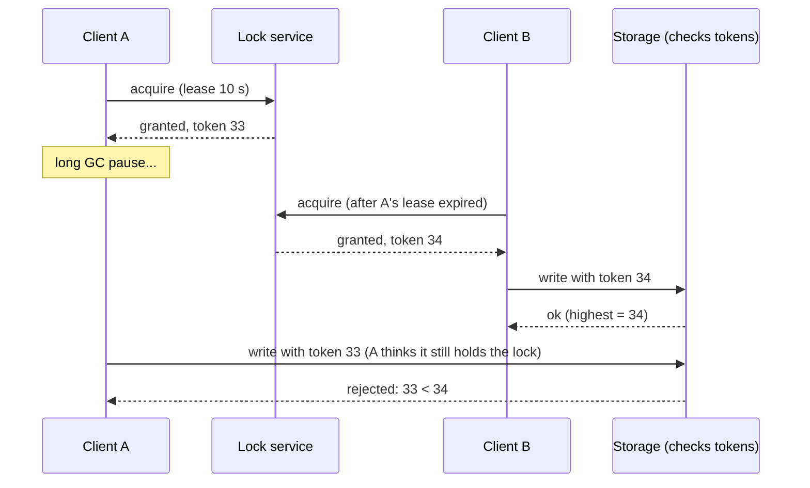

A distributed lock gives one process at a time the right to do something — run a nightly job, process a file, edit a resource —
across many machines. It sounds like a mutex over the network, but it isn't: processes pause, clocks drift and networks delay messages,
so a lock holder can be wrong about still holding the lock. Safe distributed locking needs leases and fencing.

## Why it matters

Interviewers ask about locks in schedulers, job queues, ticketing and anything "only one should do this". A naive answer ("use Redis
`SETNX`") is a common trap: the follow-up is "what if the holder pauses for 30 seconds?" The strong answer explains leases, fencing tokens,
the difference between locks for **efficiency** and locks for **correctness**, and when to avoid locks altogether.

## How it works

### Locks must be leases

A lock that never expires is held forever by a crashed client. So distributed locks are **leases**: granted for a time (say 30 seconds),
renewed by the holder while it works, released explicitly or by expiry. Expiry introduces the core problem: the holder may not know its
lease expired.

### Why a lease alone isn't safe

1. Client A acquires the lease for 10 seconds and starts writing.
2. A pauses — a long garbage-collection pause, a VM migration, a slow network — for 15 seconds.
3. The lease expires; client B acquires it and writes.
4. A resumes, still believing it holds the lock, and writes too. Two writers; data corrupted.

No amount of checking "do I still hold it?" fixes this: the pause can happen between the check and the write.

### Fencing tokens

The fix is to make the **resource** reject stale holders. The lock service issues a **fencing token** — a number that increases with every
grant — and the resource (database, storage service) remembers the highest token it has seen and refuses writes with lower ones. A paused
holder's token is now old, so its late writes are rejected. Consensus-backed stores provide such numbers naturally: etcd's revision or
lease ID, ZooKeeper's zxid or sequential node number.

The resource must participate. If it can't (an external API), you can't make the lock fully safe — design for idempotency instead.

### Efficiency locks vs correctness locks

- **Efficiency**: the lock prevents duplicate *work* (two instances sending the same daily report). Occasional double execution is
  annoying, not harmful. A simple Redis lease is fine.
- **Correctness**: two holders would corrupt data or double-spend. You need a consensus-backed lock **and** fencing — or, better, a design
  that doesn't need the lock (a database constraint, a conditional write, single-writer partitioning).

### Redis locks

The common single-instance pattern: acquire with `SET lock:report-42 <random-token> NX PX 30000` (set only if absent, expire in 30 s);
release only if you still own it, atomically, with a script. Deleting unconditionally could release a lock that has expired and been
granted to someone else.

```lua file="release_lock.lua"
-- Release a lock only if we still own it.
-- KEYS[1] = lock key, ARGV[1] = the random token we stored when acquiring
-- (acquire with: SET lock:report-42 <token> NX PX 30000)
if redis.call('GET', KEYS[1]) == ARGV[1] then
  return redis.call('DEL', KEYS[1])
end
return 0
```

Tested with a simulated Redis: a stale holder (token A) releasing after its lease expired returns 0 and leaves B's lock in place; B's
release returns 1; a second release returns 0.

**Redlock** (acquiring the lock on a majority of independent Redis nodes) was proposed to survive a Redis node failure; it has been
criticised — notably by Martin Kleppmann in 2016 — for depending on timing assumptions and lacking fencing tokens. For correctness-critical
locking, prefer a consensus-backed store with fencing.

### Consensus-backed locks

- **etcd**: create a key with a lease; watch the predecessor; the lease's revision is a fencing token. etcd ships a lock API built on this.
- **ZooKeeper**: each contender creates an *ephemeral sequential* node; the lowest number holds the lock; others watch the node just before
  theirs (avoiding a herd). The node disappears when the holder's session dies.

### Alternatives to locks

| Instead of a lock… | Use |
|---|---|
| "Only one may book this seat" | A conditional update or unique constraint in the database |
| "Only one consumer processes this order" | Partition by order ID so one consumer owns it |
| "Run this job once a day" | A scheduler with leader election, plus idempotent jobs |
| "Don't process this message twice" | Idempotent consumers with a dedup key |

## Architecture



## Java and Spring Boot example

The scenario above in plain Java, with a simulated clock — the lock service grants increasing tokens, and storage rejects anything older
than the highest token it has seen:

```java file="FencingTokens.java"
import java.util.ArrayList;
import java.util.List;

// A lease-based lock can be held by two clients at once if one is paused (GC, network delay)
// past its lease. A fencing token - a number that grows with every grant - lets the storage
// reject writes from the client whose lease has already expired.
public class FencingTokens {

    // Lock service: grants a lease with a monotonically increasing token.
    static class LockService {
        private long nextToken = 33;
        private String holder;
        private long expiresAt;

        Long acquire(String client, long now, long leaseMs) {
            if (holder != null && now < expiresAt) {
                return null; // someone else holds a valid lease
            }
            holder = client;
            expiresAt = now + leaseMs;
            return nextToken++;
        }
    }

    // Storage: remembers the highest token it has seen and refuses anything older.
    static class Storage {
        private long highestToken = -1;
        final List<String> log = new ArrayList<>();

        String write(String client, long token, String value) {
            if (token < highestToken) {
                return "REJECTED (token " + token + " < " + highestToken + ")";
            }
            highestToken = token;
            log.add(value);
            return "accepted";
        }
    }

    public static void main(String[] args) {
        LockService lock = new LockService();
        Storage storage = new Storage();

        long tokenA = lock.acquire("A", 0, 10_000);
        System.out.println("t=0s    A acquires the lock, token " + tokenA);
        System.out.println("t=1s    A starts a long GC pause...");

        Long denied = lock.acquire("B", 5_000, 10_000);
        System.out.println("t=5s    B tries the lock: " + (denied == null ? "busy" : denied));

        long tokenB = lock.acquire("B", 11_000, 10_000);
        System.out.println("t=11s   A's lease has expired; B acquires, token " + tokenB);
        System.out.println("t=12s   B writes:   " + storage.write("B", tokenB, "B's update"));

        System.out.println("t=15s   A wakes up, still believes it holds the lock");
        System.out.println("t=15s   A writes:   " + storage.write("A", tokenA, "A's stale update"));
        System.out.println("stored: " + storage.log);
    }
}
```

```text title="Output" output="FencingTokens.java"
t=0s    A acquires the lock, token 33
t=1s    A starts a long GC pause...
t=5s    B tries the lock: busy
t=11s   A's lease has expired; B acquires, token 34
t=12s   B writes:   accepted
t=15s   A wakes up, still believes it holds the lock
t=15s   A writes:   REJECTED (token 33 < 34)
stored: [B's update]
```

## Failure scenarios

- **Holder pauses past its lease** — two holders. Fencing tokens at the resource.
- **Holder crashes** — lease expiry frees the lock after its TTL; work done so far must be resumable or idempotent.
- **Lease too short** — a slow but healthy holder loses the lock mid-task; renew the lease periodically (heartbeat) while working.
- **Lease too long** — a crashed holder blocks everyone for the full duration.
- **Lock service partition** — a Redis primary fails over before replicating the lock; the replica grants it again. Consensus-backed
  stores don't have this problem.
- **Herd on release** — hundreds of waiters retry at once; use watches on predecessors (ZooKeeper recipe) or randomised backoff.

## Trade-offs

- **Simplicity vs safety**: a Redis lease is simple and fast; a consensus-backed lock with fencing is safe for correctness.
- **Lease length**: short leases recover quickly from crashes but risk expiry during slow work; long leases are the reverse.
- **Locks vs design**: locks serialise work and add a dependency; constraints, conditional writes and partitioned ownership often achieve
  the same safety with less coordination.

## In real systems

- etcd and ZooKeeper provide lock and leader-election recipes used across infrastructure (Kubernetes uses leases for controller leader
  election).
- Redis locks with `SET NX PX` and a check-and-delete script are widely used for efficiency locking (de-duplicating cron jobs, caching
  rebuilds).
- Google's Chubby paper describes "sequencers" — fencing tokens — passed to servers so they can reject stale lock holders.

## Common mistakes

- **Locks without expiry.**
- **Unconditional `DEL` on release.**
- **Assuming a lease makes the holder safe** — without fencing, pauses break it.
- **Using Redis locks for money or inventory correctness.**
- **Reaching for a lock** when a unique constraint or conditional update would do.

## In the interview

````question title="How would you make sure a nightly billing job runs exactly once across 10 instances?"
Elect a leader for the job through a consensus-backed store such as etcd: instances compete for a key with a lease, and the winner runs the
job while renewing the lease. Because a paused or partitioned leader could still try to act, every billing write carries the lease's
fencing token (its revision) and the database rejects writes with a token older than the newest it has seen. Separately, the billing job
itself is idempotent — invoices are keyed by customer and billing period with a unique constraint — so even a duplicated run can't
double-bill. The lock prevents duplicate work; the constraint guarantees correctness.
````

````question title="What is a fencing token and why is it needed?"
It's a number issued by the lock service that increases with every lock grant. The lock holder passes it with every write, and the
resource remembers the highest token it has accepted, rejecting lower ones. It's needed because leases expire: a holder that pauses —
garbage collection, a network stall — can wake up after its lease expired and someone else acquired the lock, still believing it holds it.
Without fencing, its late writes interleave with the new holder's; with fencing, they're rejected.
````

## Key takeaways

- Distributed locks are **leases**; expiry makes "do I still hold it?" unanswerable for a paused client.
- **Fencing tokens** checked by the resource make stale holders harmless.
- Distinguish **efficiency locks** (Redis lease is fine) from **correctness locks** (consensus + fencing).
- Release Redis locks **only if you own them**, atomically — and prefer **constraints, conditional writes or partitioning** over locks.

## Knowledge check

```quiz
? Client A's lease expired during a 20-second GC pause and B acquired the lock. A resumes and writes. What prevents corruption?
- A checking whether it still holds the lock before writing
! The pause can happen between the check and the write.
+ A fencing token: storage rejects A's write because its token is older than B's
- A longer lease
! Any lease length can be exceeded by a long enough pause.
- Retrying A's write
! Retrying a stale write doesn't make it safe.
> The resource must reject stale holders.

? Why release a Redis lock with a compare-and-delete script rather than plain DEL?
+ Plain DEL could delete a lock that expired and was re-granted to another client
- DEL is slower
! Speed isn't the issue.
- DEL doesn't work on keys with TTLs
! It does.
- Scripts are required for all Redis writes
! They're not.
> Only the owner (matching token) may release.

? Which case is fine with a simple single-node Redis lease (no fencing)?
- Preventing two transfers from the same account
! That's a correctness lock; use the database or consensus plus fencing.
+ Avoiding two instances regenerating the same cached report
- Assigning the last concert seat
! Double assignment is harmful.
- Electing the leader that commits payments
! Correctness-critical; needs consensus.
> Efficiency locks tolerate occasional duplicate work.

? Two users try to book the same seat. What is usually better than a distributed lock?
- A ZooKeeper lock per seat
! Works, but adds a dependency and latency for something the database can do.
+ A conditional update or unique constraint in the database that owns the seat
- A Redis lock per seat with a 10-minute TTL
! Unsafe for correctness without fencing, and slow to recover.
- A client-side mutex
! Clients don't share memory.
> The data's owner can enforce exclusivity atomically.
```
