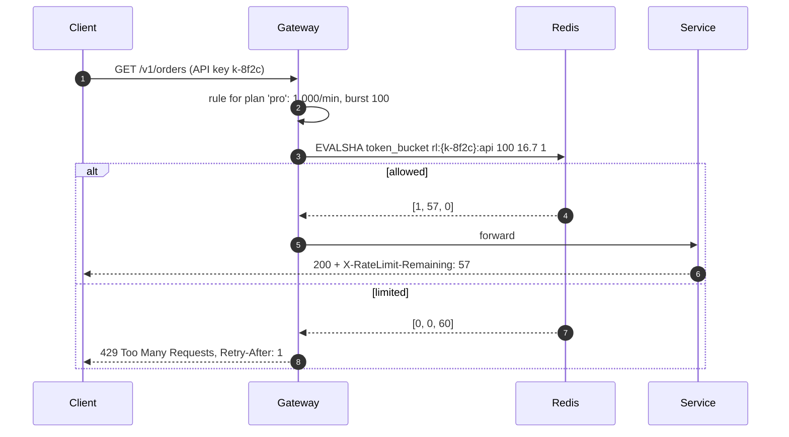

A rate limit on one server is a counter in memory ([rate limiting](lesson:rate-limiting)). A rate limit enforced across 200 gateway
instances — "1,000 requests per minute per API key, no matter which instance receives them" — needs **shared state**, and shared state on
every request costs latency and creates a dependency that can fail. This lesson covers the designs, from a central Redis counter to local
buckets that borrow tokens, and what to do when the limiter itself is down.

## The problem

Requests for one API key arrive at any of N instances behind a load balancer. Each instance sees only a fraction:

- **Per-instance limits** (1,000 ÷ N each) break when traffic is uneven across instances, and change meaning whenever N changes with
  autoscaling.
- **A shared counter** gives the right answer but adds a network round trip to every request and makes the counter store a critical,
  possibly hot, dependency ([hot keys](lesson:hot-keys)).
- **Checks must be atomic**: read-then-write from two instances at once admits too many.
- The limiter sits on the **hot path of every request**, so its latency budget is a millisecond or two and its failure mode matters as much
  as its accuracy.

## Architecture

```mermaid title="Gateways check a shared limiter, with rules pushed from config"
flowchart TB
  C["Clients"]:::client --> LB["Load balancer"]:::lb
  LB --> G1["Gateway 1<br/>local cache of rules"]:::svc
  LB --> G2["Gateway 2"]:::svc
  LB --> G3["Gateway N"]:::svc
  G1 & G2 & G3 -->|"EVALSHA token_bucket<br/>(~0.5 ms in-zone)"| R[("Redis Cluster<br/>bucket per key, hash-tagged")]:::cache
  CFG[("Rules store<br/>limits per plan / route")]:::store -.->|"pushed on change"| G1 & G2 & G3
  G1 & G2 & G3 --> SVC["Backend services"]:::svc
```

The main designs:

| Design | How it works | Accuracy | Cost per request |
|---|---|---|---|
| **Central atomic counter** | Every request runs an atomic script in Redis | Exact (within one store) | One round trip |
| **Local buckets** | Each instance enforces limit ÷ N | Poor with uneven traffic | None |
| **Token leasing (hybrid)** | Instances take batches of tokens (say 20) from Redis and spend them locally | Over-admits at most one batch per instance | One round trip per batch |
| **Sticky routing** | The load balancer hashes the key to one instance, which limits locally | Exact while routing is stable | None, but uneven load and rebalancing |

The central counter runs the whole token-bucket update — refill, check, take, store — **atomically** in one Lua script, using Redis's clock
so instance clocks don't matter:

```lua file="token_bucket.lua"
-- Token bucket, atomically, inside Redis.
-- KEYS[1] = bucket key, e.g. "rl:{key_8f2c}:api"
-- ARGV[1] = capacity (max burst), ARGV[2] = refill rate per second,
-- ARGV[3] = tokens to take (usually 1)
-- Returns { allowed (1/0), tokens left (rounded down), ms until one token is available }
local capacity = tonumber(ARGV[1])
local rate = tonumber(ARGV[2])
local cost = tonumber(ARGV[3])

local t = redis.call('TIME')                                  -- Redis's clock, not the caller's
local now = tonumber(t[1]) * 1000 + math.floor(tonumber(t[2]) / 1000)

local state = redis.call('HMGET', KEYS[1], 'tokens', 'ts')
local tokens = tonumber(state[1]) or capacity                 -- new bucket starts full
local ts = tonumber(state[2]) or now

tokens = math.min(capacity, tokens + (now - ts) * rate / 1000)

local allowed = 0
local wait_ms = 0
if tokens >= cost then
  tokens = tokens - cost
  allowed = 1
else
  wait_ms = math.ceil((cost - tokens) * 1000 / rate)
end

redis.call('HSET', KEYS[1], 'tokens', tokens, 'ts', now)
redis.call('PEXPIRE', KEYS[1], math.ceil(capacity * 1000 / rate) + 1000)  -- idle buckets vanish
return { allowed, math.floor(tokens), wait_ms }
```

Tested with a Lua interpreter and a simulated `redis.call` (capacity 10, 5 tokens per second): a burst of 12 requests at once admits 10
and rejects 2 with a 200 ms wait hint; 200 ms later one request is admitted again.

## Request and data flow



**Cheaper approximations** when exactness isn't needed:

- **Sliding window counter**: keep counts for the current and previous fixed windows and weight the previous one by how much of it still
  overlaps the sliding window — two small integers per key, no per-request log.

```drill
? Limit 100 per minute. The previous minute had 80 requests; the current minute has 30 so far and is 25% elapsed. What is the sliding-window estimate?
= 90
~ 1.05
> 30 + 80 × (1 − 0.25) = 30 + 60 = 90, so the next request is allowed (90 < 100).

? 300 gateway instances lease tokens in batches of 20. In the worst case, how many requests above the limit can be admitted at a window boundary?
= 6000
~ 1.1
> Each instance may hold an unspent batch: 300 × 20 = 6,000 extra requests — acceptable for a 1M/min limit, not for 1,000/min.
```

- **Local pre-check**: drop obviously abusive traffic locally (per-IP flood limits) before touching Redis.
- **Multi-region**: either give each region its own share of the limit, or count locally and synchronise counts asynchronously between
  regions — accepting brief over-admission rather than adding cross-region latency to every request.

**When the limiter is down** — decide per limit:

- **Fail open** (allow) for ordinary API quotas: the backend is protected by its own capacity limits, and blocking all traffic because the
  limiter is down would be an outage of your own making.
- **Fail closed** (deny) for limits that protect against abuse or cost: login attempts, OTP sends, expensive operations.
- Either way, use a **short timeout** (a few milliseconds) on the limiter call and a circuit breaker, so a slow Redis doesn't slow every
  request ([circuit breakers](lesson:circuit-breakers-bulkheads)).

## Advantages

- **Consistent limits** regardless of which instance serves a request or how many instances exist.
- **Atomic scripts** remove race conditions without locks.
- **Flexible accuracy**: token leasing and approximate windows trade a bounded error for far fewer round trips.
- **Central rules**: plans and per-route limits change without redeploying gateways.

## Disadvantages

- **Latency on the hot path** — one round trip per request (or per batch).
- **A new critical dependency** whose failure mode must be designed.
- **Hot keys**: a single very busy key lands on one Redis shard.
- **Approximations over-admit** at boundaries or across regions.

## Failure scenarios

| Failure | What happens | Mitigation |
|---|---|---|
| Redis unreachable | Every request waits on the limiter | Millisecond timeout, circuit breaker, fail open or closed per rule |
| Redis failover loses recent counts | Limits briefly reset | Acceptable for quotas; for strict limits, add a local backstop |
| One huge tenant | Its bucket's shard is hot | Token leasing, local pre-limits, dedicated shard |
| Clock skew between gateways | Refills computed inconsistently | Use Redis `TIME` inside the script |
| Autoscaling changes N | Per-instance limits drift | Avoid static per-instance shares; use shared or leased tokens |
| Retry storms from limited clients | Load continues despite 429s | `Retry-After`, exponential backoff in SDKs, stricter limits for abusers |

## Alternatives

- **API gateway or service mesh features**: Envoy's global rate-limit service, managed gateways' usage plans
  ([API gateway](lesson:api-gateway)).
- **Load shedding by capacity** instead of per-client fairness, when the goal is protecting the backend rather than enforcing plans
  ([graceful degradation](lesson:graceful-degradation)).
- **Queues** when excess work can wait rather than being rejected ([backpressure](lesson:backpressure)).
- **Edge rate limiting** at the CDN or WAF for anonymous traffic and attacks.

## Where it shows up in interviews

The rate limiter problem itself ([design a rate limiter](problem:rate-limiter)), API gateways, login and OTP protection, public APIs with
plans and quotas, and any design that mentions abuse. Name the algorithm, where the state lives, how the check stays atomic, the latency it
adds, and whether it fails open or closed.

````question title="How do you enforce 1,000 requests per minute per API key across 100 gateway instances?"
Keep each key's bucket in a shared store — Redis Cluster, hash-tagged by key — and have every gateway run one atomic Lua script per request
that refills, checks and takes a token using Redis's clock. That adds about half a millisecond in-zone. If that's too much load, gateways
lease small batches of tokens and spend them locally, bounding over-admission to one batch per instance. Rules are cached in gateways and
pushed on change. If Redis is unreachable, the gateway times out within a few milliseconds and fails open for ordinary quotas.
````

````question title="Should a rate limiter fail open or fail closed?"
It depends on what the limit protects. Commercial quotas and fairness limits usually fail open: briefly over-serving some clients is better
than rejecting all traffic because of a limiter outage, and backend capacity is protected separately. Security and cost limits — login
attempts, OTP sends, expensive jobs — fail closed, because the abuse they prevent is worse than temporary denial. Configure it per rule and
alert either way.
````

## Common mistakes

- **Read-then-write counters** without atomicity.
- **Static per-instance shares** that break with uneven traffic and autoscaling.
- **Instance clocks** used for refill calculations.
- **No timeout on the limiter call**, turning a slow Redis into a slow API.
- **One failure mode for all limits.**
- **Returning 429 without `Retry-After`**, inviting retry storms.

## Key takeaways

- Distributed limits need **shared or coordinated state**; per-instance shares only work with even, stable traffic.
- Run the token bucket **atomically in Redis** (Lua, Redis time, hash-tagged keys); expect ~one round trip per request.
- **Token leasing** and **sliding-window counters** trade bounded inaccuracy for fewer round trips and less memory.
- Choose **fail open or closed per limit**, with tight timeouts and circuit breakers.

## Knowledge check

```quiz
? Each of 10 instances enforces 100 requests/min for a key (limit 1,000/min). The load balancer sends 60% of that key's traffic to one instance. What happens?
+ That instance rejects the key's requests after 100/min even though the key is well under its 1,000/min total
- The limit works correctly
! Per-instance shares assume even traffic.
- Other instances share their unused tokens automatically
! Nothing coordinates them.
- The key gets 10,000/min
! Each instance still caps at 100.
> Static per-instance shares break with uneven routing.

? Why does the token bucket script call redis.call('TIME') instead of receiving the time from the gateway?
- TIME is faster
! Speed isn't the point.
+ All gateways then refill against one clock, so skew between gateway clocks can't over- or under-fill buckets
- Lua has no access to time otherwise
! The caller could pass a time.
- Redis requires it for HSET
! Unrelated.
> One clock for shared state.

? Limit 60/min; previous minute 50 requests; current minute 20 requests at 40% elapsed. Sliding-window estimate?
- 70
! Ignores the weighting.
+ 50
- 20
! Ignores the previous window.
- 42
! Weight is 1 − 0.4 = 0.6, not 0.4.
> 20 + 50 × 0.6 = 50, so the request is allowed.

? Redis is down. Which limit should fail closed?
- Free-tier API quota
! Over-serving briefly is usually acceptable.
+ OTP SMS sends per phone number
- Internal service-to-service fairness limits
! Usually fail open.
- Partner API monthly quota
! Typically reconciled later; fail open.
> Fail closed where abuse or cost is the risk.
```
