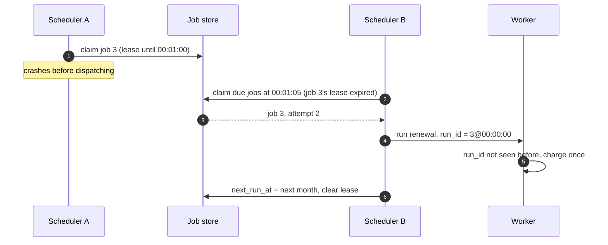

"Send a reminder 24 hours before the appointment." "Bill every subscriber on their renewal date." "Close the auction at 18:00:00."
"Retry this webhook in 5 minutes." Scheduling looks like cron, but at scale it means **finding due work among billions of future jobs**,
running each **once** across many machines, and recovering **missed runs** after an outage — without stampeding at midnight.

## The problem

A single cron server is a [single point of failure](lesson:spof-redundancy) and a throughput ceiling. A distributed scheduler must:

- **Store** future jobs durably — one-off delayed jobs and recurring ones.
- **Find due jobs quickly**: scanning every job each second doesn't work with a billion rows.
- **Run each occurrence once**, even with several scheduler nodes, crashes and retries.
- **Handle missed runs** after downtime: run them all, run the latest once, or skip?
- **Avoid thundering herds** when millions of jobs share the same time (midnight, the top of the hour).
- **Live with clocks** that disagree slightly between machines ([clocks](lesson:clocks)).

```drill
? 15 million subscription renewals are all scheduled for 00:00 UTC, and the system starts them within one minute. What rate does that demand?
= 250000
~ 1.1
> 15,000,000 ÷ 60 s = 250,000 jobs/s — a self-inflicted spike. Spread them (hash-based offsets or jitter across the hour) to ~4,200/s.
```

## Architecture

```mermaid title="Store, find due, claim with a lease, dispatch, execute idempotently"
flowchart TB
  API["Scheduling API<br/>create / cancel / list jobs"]:::client --> JS
  JS[("Job store<br/>indexed by next_run_at,<br/>or bucketed by minute")]:::db
  S1["Scheduler node A"]:::svc -->|"claim due jobs<br/>(lease: locked_by, locked_until)"| JS
  S2["Scheduler node B"]:::svc --> JS
  S1 & S2 -->|"dispatch occurrence<br/>run_id = job_id + scheduled_for"| Q[["Execution queue"]]:::queue
  Q --> W["Workers<br/>idempotent by run_id"]:::svc
  W -->|"record result, compute next run"| JS
```

**Finding due jobs** — two common layouts:

- **An index on `next_run_at`** in a relational store: scheduler nodes repeatedly claim the earliest due rows. Simple and correct up to
  millions of jobs and thousands of runs per second.
- **Time buckets** in a wide-column or key-value store: partition key = the minute a job is due (plus a shard number to spread large
  minutes), so the scheduler reads exactly the bucket for "now" ([partition keys](lesson:partition-keys-retention)). Scales to billions of
  future jobs.

For short delays, specialised structures help: a **Redis sorted set** scored by due timestamp (`ZRANGE ... BYSCORE` to find due items);
queues with **delivery delays** (SQS delays up to 15 minutes); and **hierarchical timing wheels** for in-memory timers inside a process.

**Claiming jobs** so each occurrence runs once:

- **Leases in the database**: `FOR UPDATE SKIP LOCKED` plus a `locked_until` column lets many scheduler nodes claim different jobs
  concurrently; an expired lease makes a job claimable again if a node dies ([contention](lesson:contention)).
- **Partition ownership**: assign time buckets or job-ID ranges to nodes with consistent hashing or a coordinator, so each partition has
  one owner at a time ([consensus](lesson:consensus)).
- **One active leader** with a standby — the simplest option when throughput is modest.

## Request and data flow

A jobs table and the claim loop each scheduler node runs (all statements verified in PostgreSQL 18):

```sql title="Jobs with a next run time and a lease"
CREATE TABLE scheduled_jobs (
  job_id       bigint      PRIMARY KEY,
  kind         text        NOT NULL,              -- 'reminder', 'renewal', ...
  payload      jsonb       NOT NULL,
  cron         text,                              -- null for one-off jobs
  next_run_at  timestamptz NOT NULL,
  locked_by    text,
  locked_until timestamptz,
  attempts     int         NOT NULL DEFAULT 0
);
CREATE INDEX scheduled_jobs_due ON scheduled_jobs (next_run_at);

INSERT INTO scheduled_jobs (job_id, kind, payload, next_run_at) VALUES
  (1, 'reminder', '{"appointment": 88}', now() - interval '1 minute'),
  (2, 'reminder', '{"appointment": 89}', now() + interval '1 day'),
  (3, 'renewal',  '{"subscription": 7}', now() - interval '5 seconds');
```

```sql title="Claim up to 100 due jobs with a 60-second lease"
WITH due AS (
  SELECT job_id
  FROM scheduled_jobs
  WHERE next_run_at <= now()
    AND (locked_until IS NULL OR locked_until < now())
  ORDER BY next_run_at
  LIMIT 100
  FOR UPDATE SKIP LOCKED
)
UPDATE scheduled_jobs j
SET locked_by = 'scheduler-a', locked_until = now() + interval '60 seconds',
    attempts = attempts + 1
FROM due
WHERE j.job_id = due.job_id
RETURNING j.job_id, j.kind, j.next_run_at AS scheduled_for;
```

The node then enqueues one message per claimed job with `run_id = job_id + scheduled_for`, and afterwards either deletes a one-off job or
advances a recurring job's `next_run_at` and clears the lease. If the node crashes, leases expire after 60 seconds and another node claims
the jobs; the queue and workers deduplicate by `run_id`, so a double claim doesn't cause a double effect ([dedup](lesson:dedup)).



**Policies that need deciding up front:**

- **Misfires** (runs missed during an outage): *catch up* every missed occurrence (billing), *run once now* (a daily report), or *skip*
  (a "good morning" notification at 15:00 is worse than none).
- **One clock**: compare against the database's `now()` rather than each node's clock, so skew between nodes doesn't matter.
- **Jitter and spreading**: give recurring jobs a hash-based offset within their window instead of all firing at :00.
- **Catch-up rate limits**: after an outage, drain the backlog at a bounded rate so downstream services aren't flattened.

## Advantages

- **No single point of failure**: any node can claim work; leases recover from crashes.
- **Horizontal scale**: more scheduler nodes claim more jobs in parallel; time buckets scale storage and scans.
- **Separation of concerns**: scheduling decides *when*; queues and workers decide *how*.
- **Explicit semantics** for misfires, retries and duplicates.

## Disadvantages

- **At-least-once execution**: correctness depends on idempotent jobs.
- **Precision trade-off**: polling every second gives roughly one-second accuracy; tighter accuracy costs more polling or in-memory timers.
- **Hot time slots** need spreading or sharding.
- **Operational complexity** compared with a single cron box.

## Failure scenarios

| Failure | What happens | Mitigation |
|---|---|---|
| Scheduler node crashes after claiming | Jobs delayed by the lease length | Short leases; another node reclaims |
| Lease expires while a slow dispatch is still running | Two nodes dispatch the same occurrence | Deduplicate by run_id; fencing tokens on side effects |
| Whole scheduler down for an hour | Backlog of missed runs | Misfire policy per job type; rate-limited catch-up |
| Millions of jobs at the same second | Spike overloads workers and downstream | Jitter, hash-based offsets, per-minute sharding |
| Clock skew between nodes | Jobs run early or late on some nodes | Use database time; NTP; never trust local clocks for ordering |
| Recurring job's next time computed wrongly (DST) | Skipped or doubled runs | Store schedules in the user's time zone; compute with a time-zone-aware library |

## Alternatives

- **Single cron host with a standby**: fine for a handful of internal jobs.
- **Managed schedulers**: Amazon EventBridge Scheduler, Google Cloud Scheduler, Kubernetes CronJobs.
- **Workflow engines with durable timers** when the schedule is part of a larger process ([multi-step workflows](lesson:multi-step-workflows)).
- **Quartz (JDBC job store, clustered mode)** inside Java services: database-backed claiming similar to the SQL above.

## Where it shows up in interviews

Task schedulers and job queues, reminder and notification systems, subscription billing, auction closing, retry-later mechanisms for
webhooks, and report generation. Explain how due jobs are found, how a run is claimed exactly once (lease plus idempotency), and what
happens after an outage.

````question title="How do you make sure a scheduled job runs only once across many scheduler instances?"
Claim each occurrence with a lease: an atomic update (SELECT ... FOR UPDATE SKIP LOCKED, or a conditional write) that sets locked_by and
locked_until only if the job is due and unleased. Only one instance can win that update. Because leases can expire while work is still in
progress, each occurrence also carries a run ID (job ID plus scheduled time), and the worker or downstream service deduplicates on it, so a
rare double dispatch never becomes a double effect.
````

````question title="Your scheduler was down for two hours. What happens when it comes back?"
Each job type has a misfire policy. Billing catches up every missed occurrence; a daily digest runs once; time-sensitive notifications that
are now pointless are skipped. The scheduler drains the backlog in due-time order at a bounded rate so workers and downstream systems aren't
overwhelmed, and alerts report how many runs were delayed or skipped.
````

## Common mistakes

- **Scanning the whole job table** every tick instead of an index or time buckets.
- **Relying on a lock alone** without idempotent execution.
- **Local clocks** deciding what's due on each node.
- **Everything at midnight** with no jitter.
- **No misfire policy**, so an outage silently drops or floods runs.
- **Ignoring time zones and daylight saving** for user-facing schedules.

## Key takeaways

- Store jobs with **`next_run_at`** (indexed) or in **time buckets**; claim due jobs with **leases** and `SKIP LOCKED`.
- Execution is **at least once**: make jobs **idempotent by run ID**.
- Decide **misfire policies**, use **one clock**, and **spread** recurring jobs to avoid herds.
- For short delays, consider **Redis sorted sets**, **queue delays** or **timing wheels**.

## Knowledge check

```quiz
? Two scheduler nodes run the claim query at the same moment. Why don't they both get the same due job?
- PostgreSQL runs queries one at a time
! It runs them concurrently.
+ FOR UPDATE locks the selected rows and SKIP LOCKED makes the other node skip rows already locked, so each claims different jobs
- The index prevents duplicates
! Indexes don't coordinate claims.
- Each node only sees its own rows
! Both see all rows.
> Row locks plus SKIP LOCKED partition the work.

? A lease of 30 seconds expires while a node is still dispatching a job, and another node claims and dispatches it too. How do you avoid a double charge?
- Make leases infinite
! A crashed node would hold jobs forever.
+ Give each occurrence a run ID (job ID + scheduled time) and deduplicate on it where the effect happens
- Use a faster database
! Speed doesn't remove the race.
- Run only one scheduler node
! Reintroduces a single point of failure.
> Leases bound duplicates; idempotency makes them harmless.

? A morning digest scheduled at 08:00 was missed because of an outage that ended at 14:00. Which misfire policy makes sense?
- Catch up every missed run
! There's only one, and it's stale.
+ Run once now or skip, depending on whether a late digest is still useful
- Run it at 08:00 the next day and also now
! Two digests is worse.
- Fail the job permanently
! It should still run tomorrow.
> Misfire policy depends on the job's meaning.

? Why spread 15M renewals across the hour instead of running them all at 00:00?
+ Firing them at once demands ~250,000 jobs/s; spreading them over an hour needs ~4,200/s
- Payment providers reject midnight charges
! Not the reason.
- Databases can't store that many jobs
! Storage isn't the issue.
- Cron syntax can't express it
! Scheduling syntax isn't the constraint.
> Avoid self-inflicted thundering herds.
```
