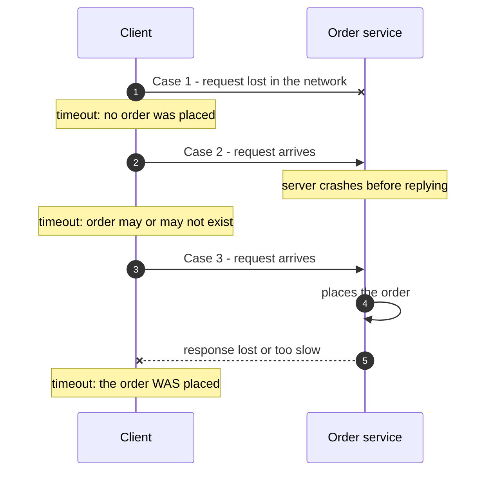

A distributed system is one where a computer you didn't know existed can make yours unusable. Three facts about networks — partial
failure, unbounded delay and no shared clock — explain most of what makes distributed systems hard, and most of the techniques in
later stages.

## Why it matters

Inside one process, a function call either returns or throws, quickly and deterministically. Between machines, a call can:

- succeed,
- fail with an error,
- **never return** — because the request was lost, the server crashed, the server is slow, or the response was lost on the way back.

From the caller's side, the last four look identical: silence until a timeout. That single ambiguity — *"did it happen?"* — is why
distributed systems need idempotency, retries with care, replication protocols, consensus and careful failure handling. Every HLD
design with more than one machine inherits it.

## How it works

### Fact 1: partial failure

In a distributed system, some parts fail while others keep running. A database replica is down while the primary is up; one of
twenty app servers is out of memory; the network between two zones drops packets while each zone is healthy internally. The system as
a whole must keep working — correctly — around the broken parts, and it cannot always tell which parts are broken.

### Fact 2: unreliable, unbounded networks

Messages between machines can be **lost, delayed, duplicated or reordered**, and there is no upper bound on how long delivery may take.
A timeout is therefore a *guess*: "I've waited long enough that I'll treat this as failed." It can be wrong in both directions — too
short and you give up on healthy but slow servers; too long and users wait on dead ones.

The consequence is profound: **when a request times out, you do not know whether it was executed.** Retrying might do the work twice;
not retrying might not do it at all. The fix is to make operations safe to repeat — **idempotency** — which comes up in almost every
design.

### Fact 3: no shared clock

Each machine has its own clock, and clocks drift apart. Synchronisation (NTP) keeps them close — typically within milliseconds — but
not exact, and a clock can jump. So you cannot reliably order events on different machines by their timestamps: a later event can carry
an earlier time. Systems that need ordering use other tools — a single leader, sequence numbers, or logical clocks — covered in
[clocks](lesson:clocks).

### The fallacies of distributed computing

A classic list of assumptions engineers new to distributed systems make — every one of them false:

1. The network is reliable.
2. Latency is zero.
3. Bandwidth is infinite.
4. The network is secure.
5. Topology doesn't change.
6. There is one administrator.
7. Transport cost is zero.
8. The network is homogeneous.

Each false assumption maps to a design response: retries and idempotency (1), caching, batching and fewer hops (2), compression and
avoiding chatty protocols (3), encryption and authentication everywhere (4), service discovery and health checks (5), clear ownership
and automation (6), cost-aware data placement (7), and standard protocols (8).

## Architecture

Three different things can go wrong after a client sends a request, and the client sees the same thing in all three — a timeout:



Retrying is correct in case 1, possibly harmful in case 2, and harmful in case 3 — unless the server can recognise the retry. That is
exactly what an idempotency key provides (see [idempotent APIs](lesson:idempotent-apis)).

## Failure scenarios

- **Lost request**: the server never saw it. Safe to retry.
- **Lost response**: the work was done. A naive retry duplicates it — double charge, two orders, two emails.
- **Slow server**: the client times out and retries while the first attempt is still running; both complete.
- **Crash mid-operation**: the server wrote to its database but crashed before publishing an event; other services never hear about it.
- **Network partition**: two groups of machines can't talk to each other but can each talk to some clients. If both sides keep
  accepting writes, they diverge — the **split brain** problem (see [network partitions](lesson:partitions-failure-detection)).
- **Clock skew**: two writes are ordered by wall-clock time on different machines, and the "latest" one is actually the older.

## Trade-offs

- **Short vs long timeouts.** Short timeouts fail fast and free resources but give up on slow-but-healthy servers; long ones do the
  opposite. Derive them from latency percentiles, not guesses.
- **Retry vs don't.** Retries recover from transient failures and amplify load and duplicates. Retry only idempotent operations, with
  backoff and limits.
- **Coordination vs availability.** Asking other machines to agree (consensus, quorums) gives stronger guarantees and costs latency and
  availability when machines can't reach each other.

## In real systems

- Payment APIs such as Stripe's accept an **idempotency key** with each request so clients can safely retry after a timeout without
  charging twice — a direct answer to case 3 above.
- Cloud providers' published postmortems frequently describe partial failures: a degraded network link, an overloaded internal service,
  a control-plane bug — rarely a clean "everything is down".
- Distributed databases, queues and coordination services (etcd, ZooKeeper, Kafka) are largely machinery for living with these three
  facts, which is why later stages study them.

## Java and Spring Boot example

This program makes the ambiguity concrete. A local "order service" does its work but replies too slowly; the client times out after
200 ms and — not knowing whether the order went through — retries once. Every attempt "fails" from the client's point of view, yet the
server placed every one of them.

```java file="DidItHappen.java"
import com.sun.net.httpserver.HttpServer;
import java.net.InetSocketAddress;
import java.net.URI;
import java.net.http.HttpClient;
import java.net.http.HttpRequest;
import java.net.http.HttpResponse;
import java.net.http.HttpTimeoutException;
import java.time.Duration;
import java.util.concurrent.CountDownLatch;
import java.util.concurrent.TimeUnit;
import java.util.concurrent.atomic.AtomicInteger;

public class DidItHappen {

    public static void main(String[] args) throws Exception {
        AtomicInteger ordersPlaced = new AtomicInteger();
        CountDownLatch handled = new CountDownLatch(2);

        // A slow "order service": it does the work, but replies after the client gave up.
        HttpServer server = HttpServer.create(new InetSocketAddress("127.0.0.1", 0), 0);
        server.createContext("/orders", exchange -> {
            ordersPlaced.incrementAndGet();
            sleep(800);
            byte[] body = "created".getBytes();
            try {
                exchange.sendResponseHeaders(201, body.length);
                exchange.getResponseBody().write(body);
            } catch (Exception clientLeft) {
                // The client already timed out and closed the connection.
            } finally {
                exchange.close();
                handled.countDown();
            }
        });
        server.start();

        HttpClient client = HttpClient.newHttpClient();
        URI uri = URI.create("http://127.0.0.1:" + server.getAddress().getPort() + "/orders");
        HttpRequest order = HttpRequest.newBuilder(uri)
                .timeout(Duration.ofMillis(200))
                .POST(HttpRequest.BodyPublishers.ofString("{\"item\":\"book\"}"))
                .build();

        for (int attempt = 1; attempt <= 2; attempt++) {
            try {
                client.send(order, HttpResponse.BodyHandlers.ofString());
                System.out.println("attempt " + attempt + ": success");
            } catch (HttpTimeoutException e) {
                System.out.println("attempt " + attempt
                        + ": timed out - did the order go through?");
            }
        }

        handled.await(5, TimeUnit.SECONDS);
        System.out.println("orders the server actually placed: " + ordersPlaced.get());
        server.stop(0);
    }

    private static void sleep(long ms) {
        try {
            Thread.sleep(ms);
        } catch (InterruptedException e) {
            Thread.currentThread().interrupt();
        }
    }
}
```

```text title="Output" output="DidItHappen.java"
attempt 1: timed out - did the order go through?
attempt 2: timed out - did the order go through?
orders the server actually placed: 2
```

The client saw two failures; the server placed two orders. Fixing this does not mean "use a longer timeout" — it means sending an
idempotency key with the request so the server can recognise the retry and return the original result instead of placing a second
order.

## Common mistakes

- **Treating a timeout as "it failed".** It means "I don't know".
- **Retrying non-idempotent operations blindly.** Duplicates are the usual result.
- **Ordering events by wall-clock timestamps from different machines.** Clocks disagree.
- **Assuming the network is either up or down.** Real networks degrade: slow, lossy, partitioned.
- **Ignoring partial failure in designs.** Every box in a diagram can fail independently of the others.

## In the interview

````question title="A client's request to create an order times out. Should it retry? What could go wrong?"
It depends on whether the operation is idempotent. The timeout doesn't tell the client whether the order was created: the request may
have been lost, the server may have crashed before or after committing, or the response may have been lost. A blind retry can therefore
create a duplicate order. The safe approach is for the client to send an idempotency key; the server stores the result of the first
request under that key and returns it for retries. Retries should also use backoff and a limit so they don't add load during an outage.
````

````question title="Why can't you order events from different servers by their timestamps?"
Each server's clock drifts and is only approximately synchronised (NTP keeps clocks within milliseconds, not exactly in sync), and
clocks can jump. Two events a few milliseconds apart on different machines can carry timestamps in the wrong order. When ordering
matters, use a single sequencer (a leader or a partition), per-key sequence numbers or versions, or logical clocks such as Lamport or
vector clocks.
````

````question title="Name some fallacies of distributed computing and the design response to each."
The network is reliable — so use timeouts, retries with idempotency, and replication. Latency is zero — so minimise round trips, batch,
cache and avoid chatty call chains. Bandwidth is infinite — so compress, paginate and keep payloads small. The network is secure — so
encrypt and authenticate service-to-service traffic. Topology doesn't change — so use service discovery and health checks rather than
hard-coded addresses.
````

## Key takeaways

- Distributed systems have **partial failure**, **unreliable networks with unbounded delay** and **no shared clock**.
- A timeout means **"I don't know whether it happened"** — so operations must be **idempotent** to be retried safely.
- Don't order events across machines by wall-clock time.
- Most later techniques — replication, consensus, idempotency keys, logical clocks — are answers to these three facts.

## Knowledge check

```quiz
? A payment request times out. What does the client know?
- The payment failed
! The payment may have succeeded and only the response was lost.
- The payment succeeded
! The request might never have arrived.
+ Nothing certain — the payment may or may not have been processed
- The server is down
! The server might be up but slow, or the network might have dropped the response.
> Lost requests, crashes, slowness and lost responses all look like the same timeout.

? What makes it safe for a client to retry a "create order" request after a timeout?
- Using a longer timeout
! Longer timeouts reduce, but don't remove, the ambiguity.
+ An idempotency key the server uses to recognise and de-duplicate the retry
- Retrying immediately without delay
! Immediate retries add load and still create duplicates.
- Using UDP instead of TCP
! The transport doesn't change whether the operation is repeated.
> With a key, the server can return the stored result of the first attempt instead of doing the work again.

? Two servers record events with local timestamps 10:00:00.003 and 10:00:00.001. What can you conclude about their order?
- The 0.001 event happened first
! Clocks on different machines can differ by more than two milliseconds.
+ Nothing reliable — clock skew between machines can exceed the difference
- They happened at the same time
! Equal or close timestamps don't mean simultaneous events.
- The 0.003 event happened first
! That doesn't follow from the timestamps either.
> Cross-machine timestamps can't order events closer together than the clock skew.

? Which is NOT one of the fallacies of distributed computing?
- The network is reliable
! That is the first fallacy.
- Latency is zero
! That is the second fallacy.
+ Servers can fail
- Topology doesn't change
! That is one of the eight fallacies.
> "Servers can fail" is true — the fallacies are false assumptions engineers make.
```
