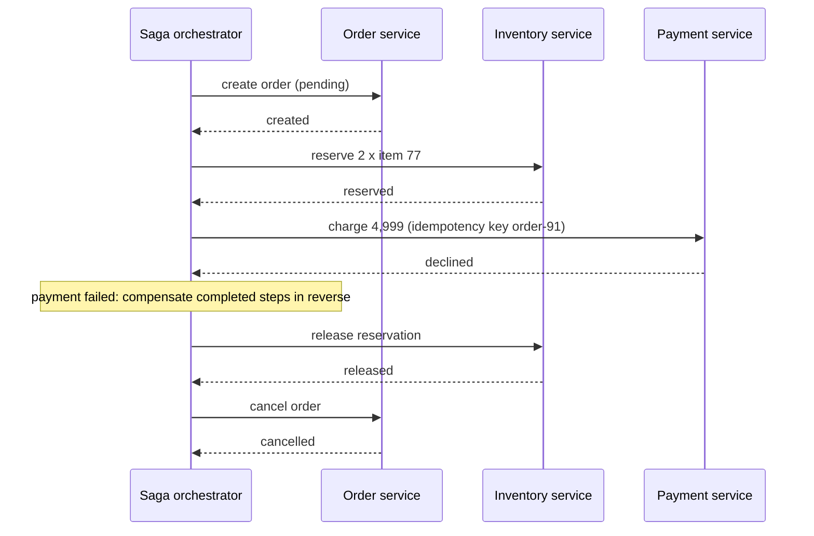

A single database makes multi-step changes atomic with a transaction. Once the steps span two services or two databases — reserve
stock in one, charge a card in another, create a shipment in a third — there is no shared transaction. Two answers exist: make the
participants agree to commit together (two-phase commit), or let each step commit on its own and undo earlier steps if a later one fails
(sagas).

## Why it matters

Checkout, booking, money transfer between banks, order fulfilment — interview problems are full of workflows that touch several systems.
Interviewers want to see that you recognise the dual-write problem, know why two-phase commit is rarely used between services, and can
design a saga with compensations, idempotency and an outbox. They're also impressed when you avoid the distributed transaction altogether
by redrawing the boundaries.

## How it works

### Two-phase commit (2PC)

A **coordinator** runs the protocol over **participants** (databases or resource managers):

1. **Prepare.** The coordinator asks each participant to prepare the transaction. Each makes the changes durable but not yet visible,
   holds the locks, and votes yes ("I promise I can commit") or no.
2. **Commit or abort.** If every vote is yes, the coordinator durably records "commit" and tells everyone to commit; any no (or a timeout)
   means abort.

Strengths: atomicity across participants; isolation via held locks. Weaknesses:

- **Blocking.** A participant that voted yes must wait for the coordinator's decision, holding locks. If the coordinator crashes after
  prepare, participants are stuck until it recovers — the classic 2PC failure.
- **Latency and throughput**: two round trips plus locks held across them.
- **Availability**: every participant must be up for any transaction to commit.
- **Support**: requires participants that speak a 2PC protocol (XA); most message brokers, SaaS APIs and many NoSQL stores don't.

2PC works **inside** systems built for it — distributed databases such as Spanner and CockroachDB use a form of it over replicated
(consensus-backed) participants, which removes the single-coordinator blocking problem. Between independently owned microservices, it is
rarely the right tool.

### Sagas

A **saga** is a sequence of local transactions, each in one service's own database. If a step fails, the saga runs **compensating
transactions** that semantically undo the completed steps, in reverse order.

| Step | Action | Compensation |
|---|---|---|
| 1 | Create order (status `pending`) | Cancel order |
| 2 | Reserve stock | Release stock |
| 3 | Charge payment | Refund payment |
| 4 | Create shipment | — (pivot: after this, the saga only moves forward) |
| 5 | Mark order `confirmed` | — |

Two coordination styles:

- **Orchestration**: a saga orchestrator (a workflow service or engine such as Temporal or AWS Step Functions) tells each service what to
  do next and tracks state. Clear, observable, easy to change; the orchestrator is a component to run.
- **Choreography**: each service reacts to events from the previous one ("OrderCreated" → stock service reserves → "StockReserved" →
  payment service charges…). No central component, but the flow is spread across services and harder to follow as it grows.

### What sagas give up, and how to compensate for it

- **No isolation.** Other requests can see intermediate states (an order `pending`, stock reserved but not yet paid). Use **semantic
  locks** — statuses like `pending` that other operations respect — and design reads to tolerate them.
- **Compensation isn't rollback.** A refund is a new action; an email can't be unsent. Order steps so irreversible ones come last (the
  **pivot**), and make compensations themselves retryable.
- **Every step and compensation must be idempotent**, because messages are retried and redelivered (see [deduplication](lesson:dedup)).
- **Publish events reliably** with the [transactional outbox](lesson:outbox-cdc): write the state change and the "step done" event in one
  local transaction.

### Avoiding the distributed transaction

Often the best answer is to remove the need for one:

- **Redraw boundaries**: data that must change atomically belongs in one service and one database.
- **Reserve, then confirm**: hold a resource with an expiry (a seat hold for ten minutes) instead of a long transaction.
- **Accept and reconcile**: record intent, process asynchronously, reconcile periodically — common in payments, which settle later anyway.

## Architecture



## Failure scenarios

- **Coordinator crash in 2PC** after prepare: participants hold locks, blocked, until it recovers.
- **Orchestrator crash mid-saga**: the saga must resume from persisted state, not restart — workflow engines persist every step.
- **Compensation fails** (refund API down): retry it with backoff; alert after a limit; never silently drop it.
- **Duplicate step execution** after a retry: double charge, double reservation — prevented by idempotency keys per step.
- **Dual write**: a service updates its database and then publishes an event; it crashes in between; the saga stalls or diverges. Use the
  outbox.
- **Intermediate states visible**: a user sees "pending" for too long when a step is stuck; timeouts and alerts on saga age.

## Trade-offs

| Aspect | 2PC | Saga | Avoid it |
|---|---|---|---|
| Atomicity | Yes | Eventually, via compensation | Within one service |
| Isolation | Yes (locks) | No — intermediate states visible | Within one service |
| Availability | Low — all participants must be up | High — steps proceed independently | Highest |
| Latency | Locks held across round trips | Each step commits quickly | Lowest |
| Complexity | Protocol support needed | Compensations, idempotency, outbox, monitoring | Boundary redesign |

## In real systems

- Spanner and CockroachDB run transactions across partitions using 2PC over Raft/Paxos groups, so participants are themselves highly
  available.
- XA transactions (for example between a relational database and a JMS broker) exist in Java EE stacks but are avoided in most cloud-native
  designs.
- Workflow engines — Temporal (and its predecessor Cadence), AWS Step Functions, Camunda — are widely used to orchestrate sagas with durable
  state, retries and compensation.
- E-commerce and food-delivery platforms commonly model orders as sagas: create, reserve, pay, dispatch, with compensations up to the pivot.

## Common mistakes

- **Proposing 2PC across microservices** without discussing blocking and availability.
- **Sagas without idempotency**, so retries double-apply steps.
- **Forgetting the outbox**, leaving dual writes between database and broker.
- **Irreversible steps first** (sending the confirmation email before charging).
- **Ignoring isolation**: other operations acting on half-finished sagas.

## In the interview

````question title="How do you keep an order, the inventory and the payment consistent across three services?"
With a saga rather than a distributed transaction. An orchestrator — a workflow engine or a dedicated service with persisted state —
creates the order as pending, reserves stock, then charges the payment with an idempotency key, and finally confirms the order. Each step is
a local transaction in its own service, and each service publishes its result through a transactional outbox so state and events can't
diverge. If a step fails, the orchestrator runs compensations in reverse: release the stock, cancel the order. Every step and compensation is
idempotent so retries are safe, irreversible actions like emails come after the pivot, and the pending status acts as a semantic lock so
other operations don't treat the order as complete.
````

````question title="Why is two-phase commit rarely used between microservices?"
Because it blocks and couples availability. After participants vote yes, they hold locks until the coordinator decides; if the coordinator
crashes, they're stuck. Every participant must be available for any transaction to commit, latency includes two round trips with locks
held, and many components — message brokers, external APIs, NoSQL stores — don't support the XA protocol at all. It also couples services'
databases tightly, defeating independent deployment. Inside a distributed database with replicated participants it works well; between
services, sagas or a redesign are usually better.
````

## Key takeaways

- **2PC** gives atomic commit across participants but **blocks** on coordinator failure and needs every participant up.
- **Sagas** chain local transactions with **compensations**, orchestrated or choreographed — atomic eventually, without isolation.
- Sagas need **idempotent steps, an outbox, semantic locks and irreversible steps last**.
- The best distributed transaction is often **none**: redraw boundaries, reserve-then-confirm, or reconcile.

## Knowledge check

```quiz
? In 2PC, the coordinator crashes after all participants voted yes. What happens?
- Participants commit on their own
! They can't know whether the coordinator decided commit or abort.
+ Participants stay blocked, holding locks, until the coordinator recovers
- Participants abort on their own
! They promised to commit if asked; aborting unilaterally could break atomicity.
- The client retries and nothing is lost
! The participants are stuck, not the client.
> This blocking is 2PC's fundamental weakness.

? A saga reserves stock, then the payment step fails. What should happen?
- Leave the stock reserved forever
! Reservations would leak.
+ Run compensating transactions: release the stock and cancel the order
- Roll back the inventory database's committed transaction
! The local transaction already committed; compensation is a new action.
- Retry the reservation
! The reservation succeeded; payment failed.
> Compensations semantically undo completed steps in reverse order.

? Why must each saga step be idempotent?
- To make it faster
! Idempotency is about correctness under retries.
+ Because messages and commands are retried and redelivered, so a step may run more than once
- Because sagas use 2PC
! They don't.
- Because compensation needs it
! Compensations need idempotency too, but the reason is retries.
> At-least-once delivery means duplicates; idempotent steps absorb them.

? Which step should come last (after the pivot) in a checkout saga?
- Charging the card
! It's reversible via refund, so it can come before the pivot.
+ Sending the order confirmation email and shipping
- Reserving stock
! Reservations are cheap to release and should come early.
- Creating the pending order
! That's naturally the first step.
> Irreversible actions belong after all steps that might fail.
```
