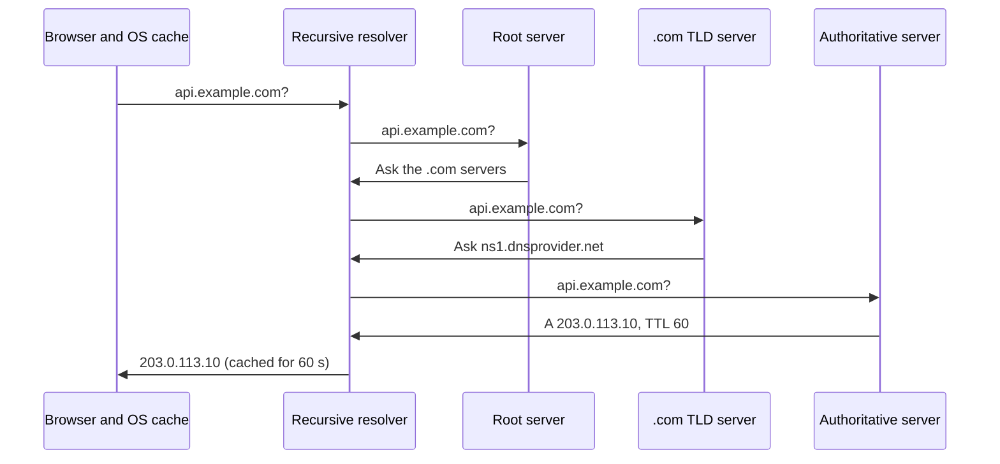
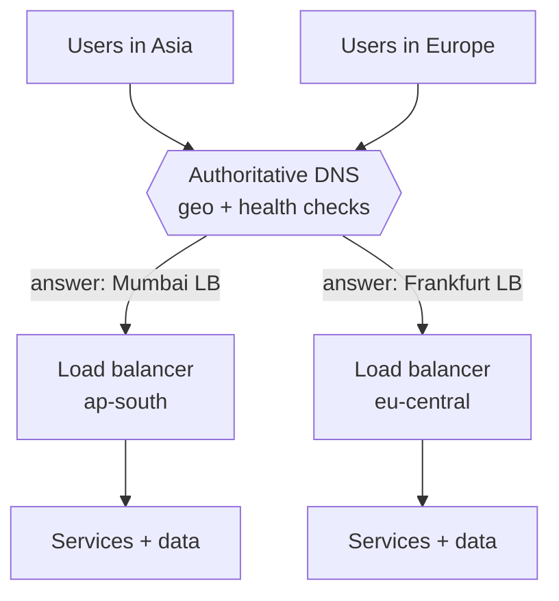

Before any request reaches your system, a client has to turn a name like `api.example.com` into an IP address. DNS does that
through a hierarchy of servers and a lot of caching — and that caching is what makes DNS both fast and slow to change.

## Why it matters

DNS is the first hop of every request and the outermost layer of your traffic management:

- **Latency.** An uncached lookup can take tens to hundreds of milliseconds; a cached one is effectively free.
- **Failover.** Moving traffic from a dead region to a healthy one often means changing a DNS answer — and waiting for caches to expire.
- **Load distribution.** DNS can hand different users different IP addresses: by geography, by measured latency, or by weight.
- **Availability.** If your DNS provider is down, your perfectly healthy servers are unreachable by name.

In an interview, DNS appears in the first box of the request flow and again whenever you discuss multi-region designs.

## How it works

### Resolution, step by step

A client asks a **recursive resolver** (run by the ISP, the company network, or a public service) to resolve a name. The resolver does the
walking for it, caching every answer along the way:

1. **Root servers** answer: "for `.com`, ask these servers."
2. **Top-level domain (TLD) servers** for `.com` answer: "for `example.com`, ask these authoritative servers."
3. The **authoritative servers** for `example.com` — run by your DNS provider — answer with the record, for example
   `api.example.com A 203.0.113.10` with a **TTL** of 60 seconds.
4. The resolver returns the answer to the client and caches it for the TTL. The operating system and browser cache it too.

Most lookups never reach step 1: the resolver already has the TLD and authoritative servers cached, and popular names are cached
outright.

### Records you will mention

| Record | Maps | Typical use |
|---|---|---|
| `A` / `AAAA` | Name → IPv4 / IPv6 address | Pointing a name at a load balancer |
| `CNAME` | Name → another name | `www.example.com` → a CDN or load balancer hostname |
| `NS` | Zone → its authoritative servers | Delegation |
| `MX` | Domain → mail servers | Email delivery |
| `TXT` | Name → text | Domain verification, email security policies |
| `SRV` | Service → host and port | Service discovery in some systems |

### TTLs: the dial between speed and agility

The TTL tells every cache how long it may reuse an answer. A long TTL (hours) means fewer lookups and less dependence on the DNS
provider, but a change takes hours to reach everyone. A short TTL (30–60 seconds) means changes propagate quickly, at the cost of more
lookups. Two caveats:

- **Not every client honours TTLs.** Some resolvers and long-running applications cache longer than they should — older JVM
  configurations famously cached successful lookups indefinitely when a security manager was installed. Expect a tail of clients to keep
  using an old address for a while.
- **Lower the TTL before a planned change.** If a record has a one-day TTL, reduce it a day before a migration so that the switch itself
  propagates quickly.

### DNS as a traffic manager

Authoritative DNS can return different answers to different resolvers:

- **Round robin**: several `A` records; clients tend to pick different ones. Crude — no health awareness, uneven in practice.
- **Weighted**: send 90% of answers to one target and 10% to another (useful for migrations and canaries).
- **Geolocation (GeoDNS)**: answer based on the resolver's location, sending users to a nearby region.
- **Latency-based**: answer with the region that measured lowest latency from the resolver's network.
- **Failover with health checks**: the DNS provider probes your endpoints and stops returning unhealthy ones.

A related technique, **anycast**, advertises the *same* IP address from many locations; internet routing delivers each packet to the
nearest one. Root servers, public resolvers and CDNs use anycast — it fails over at the routing layer, without waiting for DNS caches.

## Architecture



In a multi-region design, DNS sits in front of regional load balancers:



If Mumbai fails its health checks, DNS starts answering with Frankfurt for Asian users. New lookups move immediately; clients holding a
cached answer move when their TTL expires — or later, if they ignore it.

## Failure scenarios

- **DNS provider outage.** Cached answers keep working until they expire; after that, names stop resolving. Mitigation: a provider with
  anycast and a strong track record, or two providers serving the same zone.
- **Slow failover.** A one-hour TTL means up to an hour (plus misbehaving caches) before clients leave a dead region. Use short TTLs on
  records you may need to move.
- **Stale caches after a migration.** Some clients keep hitting the old IP address. Keep the old endpoint serving (or redirecting) for a
  while after a switch.
- **Misconfiguration.** A wrong record or an expired domain takes everything down at once — and is slow to undo because the bad answer is
  now cached. Review DNS changes like code.
- **Resolver latency.** Each new hostname on a page costs a lookup; pages that pull from many domains pay repeatedly.

## Trade-offs

| Choice | Benefit | Cost |
|---|---|---|
| Long TTL | Fewer lookups, resilience to brief DNS outages | Slow changes and failover |
| Short TTL | Fast failover and migrations | More queries, more dependence on the DNS provider |
| DNS-based load balancing | Global, cheap, no extra hop | Coarse: per-resolver, delayed by caches, no per-request awareness |
| Anycast | Instant routing-level failover, nearest site | Needs your own network presence or a provider that has one |
| Load balancer behind one name | Fine-grained, health-aware, immediate | A component per region to run and scale |

DNS is the right tool for **coarse, global** decisions (which region); load balancers are the right tool for **fine, local** ones (which
server).

## In real systems

- Managed DNS services such as Amazon Route 53, Cloudflare DNS and Google Cloud DNS offer weighted, latency-based, geolocation and
  health-checked failover routing.
- Cloud load balancers are usually reached through a DNS name (often a `CNAME` or alias record) rather than a fixed IP, because the
  provider changes the underlying addresses as it scales.
- CDNs combine DNS and anycast to steer each user to a nearby edge location.

## Common mistakes

- **Treating DNS failover as instant.** It is bounded by TTLs and by clients that ignore them.
- **Using round-robin DNS as a load balancer.** It has no health checks and no awareness of load; put a real load balancer behind the name.
- **Forgetting DNS is a dependency.** If it fails, everything fails — consider its availability like any other component's.
- **Setting very low TTLs everywhere.** Five-second TTLs multiply query volume and cost for little benefit on records that never change.

## In the interview

````question title="Walk me through what happens when a user types a URL — just the DNS part."
The browser checks its own cache and the operating system's. On a miss it asks the configured recursive resolver. If the resolver has
nothing cached it asks a root server, which refers it to the TLD servers for .com; those refer it to the domain's authoritative servers,
which return the record — say an A record for the load balancer with a 60-second TTL. The resolver caches every step and returns the
address; the browser and OS cache it too. Then the browser opens a TCP connection to that address. In practice most steps are cached,
so a typical lookup is answered by the resolver directly.
````

````question title="How would you use DNS to fail over from one region to another, and what are the limits?"
Put each region behind its own load balancer and publish the name with health-checked failover or latency-based routing at the DNS
provider, with a short TTL such as 60 seconds. When the primary region fails health checks, the provider stops returning it and new
lookups get the healthy region. The limits: clients with cached answers move only when the TTL expires, some clients ignore TTLs, and the
data layer must already be available in the other region — DNS moves traffic, not data. For faster failover, anycast or a global load
balancer reroutes at the network layer without waiting for caches.
````

## Key takeaways

- DNS resolves names through **resolver → root → TLD → authoritative**, with caching at every step.
- The **TTL** trades lookup volume against how quickly changes and failovers take effect — and some clients ignore it.
- DNS can steer traffic **by weight, geography, latency and health**, but only coarsely and with cache delays.
- **Anycast** fails over at the routing layer; DNS is a dependency whose availability matters as much as your servers'.

## Knowledge check

```quiz
? A record has a TTL of 3,600 seconds. You change it during an incident. When will all clients use the new address?
- Immediately
! Resolvers and clients may reuse the cached answer until the TTL expires.
- Within 60 seconds
! That would require a 60-second TTL set before the change.
+ Most within an hour, with a tail of clients that cache longer than the TTL
- Never, until they restart
! Most clients do refresh after the TTL; only some misbehave.
> Lower TTLs before planned changes; for incidents, expect up to the old TTL plus stragglers.

? Why is round-robin DNS a poor substitute for a load balancer?
- DNS can't return more than one address
! A name can have several A records.
+ It has no health checks or load awareness, and cached answers keep sending clients to the same address
- It only works for IPv6
! Round robin works for A and AAAA records alike.
- It requires anycast
! Round robin is independent of anycast.
> DNS answers are cached and blind to server health; a load balancer decides per connection or request.

? Which technique moves users away from a failed site without waiting for DNS caches to expire?
- Lowering the TTL after the failure
! Already-cached answers keep their old TTL.
+ Anycast, where the same IP address is advertised from many sites
- Adding a CNAME record
! A CNAME is still cached like any other record.
- Using MX records
! MX records are for mail delivery.
> With anycast, routing withdraws the failed site and packets flow to the next-nearest one.

? A global product needs European users served from Frankfurt and Asian users from Mumbai. What does DNS contribute?
+ Geolocation or latency-based answers that return each user's nearest regional load balancer
- It replicates the database between regions
! DNS steers traffic; it doesn't move data.
- It balances requests between servers inside a region
! Within a region, a load balancer does that with health and load awareness.
- It terminates TLS for each region
! TLS is terminated by load balancers or proxies, not DNS.
> DNS makes the coarse, per-region decision; regional load balancers make the fine-grained ones.
```
