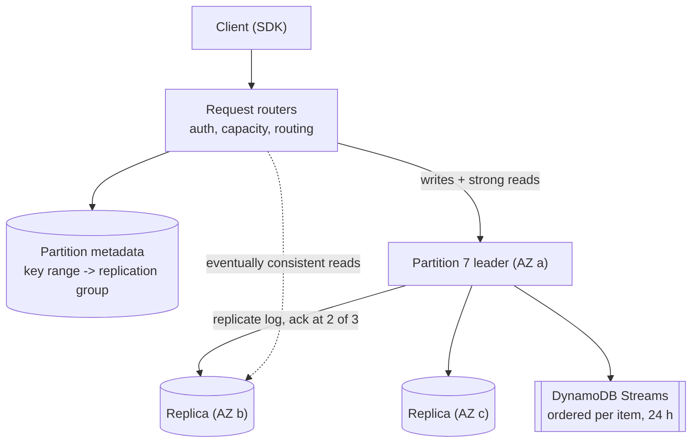

DynamoDB is AWS's fully managed key-value and document database: you choose keys and capacity, and it handles partitioning, replication
across availability zones, and scaling to millions of requests per second with single-digit-millisecond latency. In interviews it's the
standard answer for "a store that never needs a DBA and scales with traffic" — provided your access patterns are known, because the keys you
choose decide what you can ask.

## What it is for

- **High-scale key-value access** with predictable latency: user profiles, sessions, carts, device state, URL mappings, idempotency keys.
- **Known, narrow access patterns** expressed as "get this item" or "get these items for this key, sorted": orders by customer, messages by
  conversation, events by device and time.
- **Serverless and spiky workloads**: on-demand capacity charges per request and absorbs sudden growth without capacity planning.
- **Event-driven designs**: DynamoDB Streams emit every change for triggers, projections and replication ([outbox and CDC](lesson:outbox-cdc)).

## Data model

A **table** holds **items** (up to 400 KB each) made of attributes. Every item has a **primary key**:

- **Partition key only** — a pure key-value lookup: `GetItem(user_id)`.
- **Partition key + sort key** — items with the same partition key form an **item collection**, stored together and sorted by the sort key.
  `Query` reads a range of one collection: equality on the partition key, optional conditions on the sort key (`=`, `<`, `between`,
  `begins_with`), ascending or descending, up to 1 MB per call with pagination.

**Secondary indexes** add access paths:

| Index | Keys | Consistency | Notes |
|---|---|---|---|
| Global secondary index (GSI) | Any partition key and sort key | Eventually consistent | Separate partitions and capacity; up to 20 per table by default |
| Local secondary index (LSI) | Same partition key, different sort key | Strong reads possible | Up to 5, created with the table; caps each item collection at 10 GB |

**Single-table design** stores several entity types in one table with generic key names, so related items share a partition and one `Query`
returns them together. A project-management app, for example:

```text title="Single-table design: keys per access pattern"
PK               SK                         other attributes        Access pattern served
ORG#acme         META                       name, plan              get organisation
ORG#acme         PROJECT#p1                 name, owner             list projects in an org
PROJECT#p1       META                       name, status            get project
PROJECT#p1       TASK#2026-11-07#t9         title, assignee=u7      tasks in a project by due date
PROJECT#p1       TASK#2026-11-12#t4         title, assignee=u3

GSI1PK           GSI1SK
USER#u7          DUE#2026-11-07#t9                              tasks assigned to a user by due date
```

`Query(PK = "PROJECT#p1", SK begins_with "TASK#")` returns a project's tasks sorted by due date in one call; the GSI serves "my tasks".
No joins exist, so every access path is designed into the keys up front ([NoSQL families](lesson:nosql-families)).

**Writes** can carry a **condition expression** that must hold for the write to apply — the building block for uniqueness, idempotency and
optimistic locking:

```json title="UpdateItem with optimistic locking"
{
  "TableName": "app",
  "Key": { "PK": { "S": "PROJECT#p1" }, "SK": { "S": "META" } },
  "UpdateExpression": "SET #s = :new, version = :next",
  "ConditionExpression": "version = :expected",
  "ExpressionAttributeNames": { "#s": "status" },
  "ExpressionAttributeValues": {
    ":new": { "S": "archived" }, ":expected": { "N": "7" }, ":next": { "N": "8" }
  }
}
```

If another writer bumped the version first, the call fails with `ConditionalCheckFailedException` and the client re-reads and retries.
`PutItem` with `attribute_not_exists(PK)` inserts only if the key is new — a uniqueness check without a separate lock.

## How it works inside



- **Partitioning**: the partition key is hashed to choose a **partition**; partitions split automatically as data or traffic grows (a
  partition holds up to about 10 GB).
- **Replication**: each partition is a replication group of three replicas in different availability zones. A leader, chosen with
  Multi-Paxos, accepts writes and acknowledges once a quorum has persisted the log record. Despite the name, today's DynamoDB is not the
  leaderless Dynamo of the 2007 paper ([leaderless quorums](lesson:leaderless-quorums)).
- **Reads**: **strongly consistent** reads go to the leader; **eventually consistent** reads (the default, half the cost) may hit any
  replica and can be slightly stale.
- **Capacity**: one read unit = one strongly consistent read per second of up to 4 KB (or two eventually consistent); one write unit = one
  write per second of up to 1 KB; transactional reads and writes cost double. **On-demand** mode bills per request; **provisioned** mode
  reserves units, optionally with auto scaling.
- **Per-partition limits**: a single partition serves at most **3,000 read units and 1,000 write units per second**. **Adaptive capacity**
  shifts throughput to hot partitions and can isolate a very hot item on its own partition — but one item can never exceed those limits.
- **Transactions**: `TransactWriteItems` / `TransactGetItems` give ACID across up to 100 items (4 MB) in one region.
- **Streams**: an ordered (per item) log of changes kept for 24 hours, consumed by Lambda or the Kinesis adapter.
- **TTL**: an attribute with an expiry timestamp; expired items are deleted in the background, typically within a few days, so filter them
  on reads if precision matters.
- **Global tables** replicate a table to several regions, all writable. The default multi-region eventual consistency resolves conflicting
  writes by last writer wins; a multi-region strong consistency mode is also available.

## Strengths and weaknesses

| Strengths | Weaknesses |
|---|---|
| No servers, patching or capacity planning (on-demand) | Access patterns must be known up front; ad-hoc queries are expensive `Scan`s |
| Predictable single-digit-ms latency at any table size | 400 KB item limit; large objects belong in S3 |
| Multi-AZ replication by default; global tables for multi-region | Hot partition keys are capped at 3,000 reads / 1,000 writes per second |
| Conditional writes, transactions and streams built in | GSIs are eventually consistent; LSIs constrain item collections to 10 GB |
| Pay per request; scales to zero | Cost grows with item size and request volume; heavy scans are costly |

## Scaling characteristics

- **Scales horizontally with distinct partition keys**: throughput is the sum across partitions, so well-spread keys mean near-unlimited
  scale (default per-table quotas of 40,000 read and write units per second can be raised).
- **Hot keys don't scale**: one key is one partition. Spread writes by **write sharding** (append a suffix `#0`–`#9` and read all ten), or
  put a cache in front for hot reads (DAX, or Redis) ([hot keys](lesson:hot-keys)).
- **Monotonic keys are fine for the partition key only if many exist at once** — "today's date" as a partition key funnels all of today's
  writes into one partition.
- **GSIs have their own partitions**: a GSI keyed on a low-cardinality attribute (`status`) becomes a hot partition and throttles the
  base table's writes when it can't keep up.

## When to use it

- On AWS, when access patterns are **known and key-based**, scale is high or spiky, and you want no database operations.
- For **metadata at scale** next to S3 blobs, session and cart stores, device and user state, idempotency and deduplication records.
- **Avoid** for analytics and ad-hoc reporting (export to S3 and query with Athena instead), data with many relationships queried in
  changing ways, or when you need portability away from AWS.

## Alternatives

| Alternative | Prefer it when |
|---|---|
| PostgreSQL / Aurora | Queries are varied, relationships matter, write volume fits a primary |
| Cassandra / ScyllaDB | Similar model, self-managed or multi-cloud, very high sustained writes with tunable consistency |
| MongoDB | Rich document queries and secondary indexes matter more than strict key design |
| Redis | Sub-millisecond access to data that fits in memory and can tolerate loss |
| Google Bigtable / Azure Cosmos DB | You're on those clouds and want a comparable managed service |

## Interview trade-offs

- **Key design is the design**: state the partition key and sort key for each access pattern and how a hot key is avoided.
- **Strong vs eventual reads**: strong reads cost twice as much and only work on the base table and LSIs.
- **GSIs vs duplicated items**: GSIs are maintained for you but are eventually consistent and consume capacity.
- **On-demand vs provisioned**: on-demand for spiky or unknown traffic; provisioned (with auto scaling or reserved capacity) is cheaper
  for steady load.
- **Multi-region**: global tables give local writes everywhere; with last-writer-wins, design so concurrent cross-region writes to the
  same item are rare, or use the strong-consistency mode and pay its latency.

## Key takeaways

- Items are addressed by **partition key (+ sort key)**; `Query` reads one sorted item collection; everything else needs an index or a scan.
- **Design keys per access pattern**; single-table design co-locates related items for one-call reads.
- Each partition is a **3-replica, leader-based group** across AZs; strong reads hit the leader, eventual reads any replica.
- A partition caps at **3,000 RCU / 1,000 WCU** — spread keys, shard hot writes, cache hot reads.
- **Conditional writes** give uniqueness and optimistic locking; **transactions** span up to 100 items; **streams** feed CDC.

## Knowledge check

```quiz
? A table uses `date` (e.g. 2026-11-07) as the partition key for click events, 5,000 writes per second. What happens?
- It scales because DynamoDB is serverless
! Serverless doesn't remove per-partition limits.
+ All of today's writes hit one partition, which caps at 1,000 write units per second, so writes throttle
- Writes are spread across sort keys automatically
! The sort key doesn't choose the partition.
- Adaptive capacity removes all limits
! It can't push one key past the partition maximum.
> Add a shard suffix (date#0..date#9) or key by a high-cardinality attribute.

? Two clients update the same item at the same time. How do you prevent a lost update?
- Use eventually consistent reads
! Read consistency doesn't protect writes.
+ A condition expression on a version attribute: update only if version equals the value you read
- Put a GSI on the item
! Indexes don't coordinate writers.
- Use BatchWriteItem
! Batches aren't conditional transactions.
> Optimistic concurrency with conditional writes.

? You need "orders for a customer, newest first" and "orders by status across all customers". Which design is reasonable?
+ Base table PK = customer, SK = order date; a GSI on status with a sharded key (status#0..#9) and date as sort key
- One Scan with a filter for each query
! Scans read the whole table.
- An LSI on status
! An LSI keeps the customer partition key, so it can't query across customers.
- Store all orders in one item per customer
! Items cap at 400 KB.
> Each access path gets keys; low-cardinality GSI keys need sharding.

? Why might an eventually consistent read miss a write that succeeded 50 ms earlier?
- The write was rolled back
! It succeeded.
+ The read was served by a replica that hadn't yet applied the write
- Streams delay writes by 24 hours
! Streams retain changes for 24 hours; they don't delay them.
- DynamoDB batches writes every second
! Writes are acknowledged once a quorum persists them.
> Use a strongly consistent read when read-your-writes matters.
```
