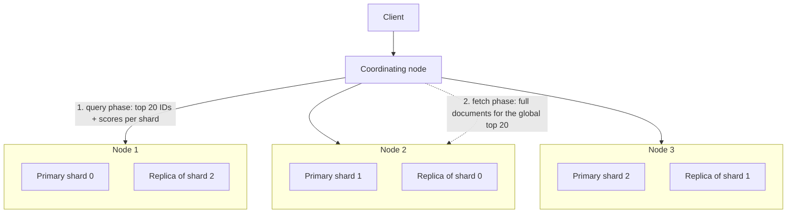
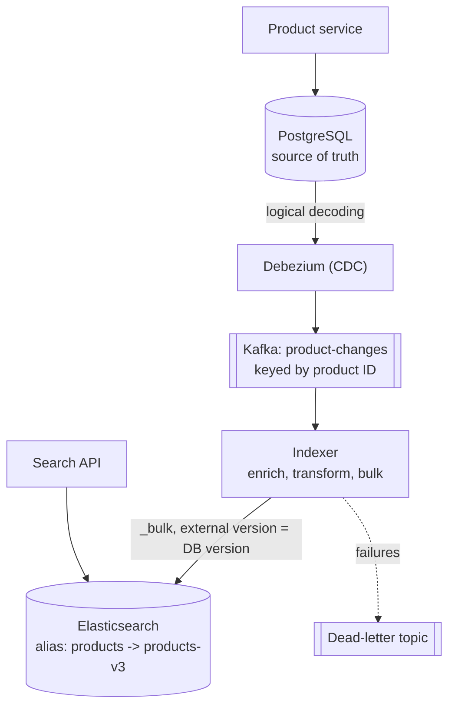

Elasticsearch (and its fork OpenSearch) is the standard engine behind product search, log search and analytics dashboards: a
distributed layer over Lucene's [inverted indexes](lesson:search-fundamentals) that adds sharding, replication, a JSON query language and
aggregations. In designs it almost always sits **beside** a database, fed by a pipeline — so the interesting questions are about that
pipeline, freshness and shard sizing.

## What it is for

- **Full-text search with relevance**: products, listings, documents, help articles, messages.
- **Filtering and faceting at scale**: "boots under $100, size 43, in stock", with counts per brand and price bucket.
- **Log and event search**: time-based indices of machine data with aggregations ([logging system](problem:logging-system)).
- **Geo and hybrid queries**: distance filters and sorting, and vector (kNN) search combined with keyword relevance.

## Data model

An **index** holds JSON **documents**; a **mapping** defines each field's type and how it's indexed. The key distinction is between
**`text`** (analysed for full-text search) and **`keyword`** (exact values for filters, sorting and aggregations); a field can be both.

```http title="Create an index with explicit mappings"
PUT /products-v3
{
  "settings": { "number_of_shards": 3, "number_of_replicas": 1 },
  "mappings": {
    "dynamic": "strict",
    "properties": {
      "name":     { "type": "text", "analyzer": "english",
                    "fields": { "raw": { "type": "keyword" } } },
      "brand":    { "type": "keyword" },
      "price":    { "type": "scaled_float", "scaling_factor": 100 },
      "in_stock": { "type": "boolean" },
      "rating":   { "type": "float" },
      "location": { "type": "geo_point" },
      "updated":  { "type": "date" }
    }
  }
}
```

`"dynamic": "strict"` rejects documents with unknown fields — without it, every new attribute name silently adds a mapping, and a source with
ever-changing keys can grow the mapping until the cluster struggles.

Queries are JSON. A `bool` query separates **scoring** clauses (`must`, `should`) from **filters** (`filter`), which don't affect scores
and are cached:

```http title="Relevance, filters, a popularity boost and facets"
GET /products/_search
{
  "query": {
    "function_score": {
      "query": {
        "bool": {
          "must":   [ { "multi_match": { "query": "waterproof hiking boots",
                                          "fields": ["name^3", "description"] } } ],
          "filter": [ { "term": { "in_stock": true } },
                      { "range": { "price": { "lte": 100 } } } ]
        }
      },
      "field_value_factor": { "field": "rating", "modifier": "log1p" }
    }
  },
  "aggs": { "brands": { "terms": { "field": "brand", "size": 10 } } },
  "size": 20
}
```

## How it works inside



- **Shards**: an index is split into primary shards (1 by default), each a complete Lucene index; documents are routed by
  `hash(_id) mod number_of_primary_shards`, which is why the primary count is fixed after creation (changing it means a split, shrink or
  reindex). Each primary has replicas (1 by default) on other nodes for availability and read throughput.
- **Search** is scatter-gather: the coordinating node sends the query to one copy of every shard; each returns its top hits; the
  coordinator merges them and fetches the winning documents. Deep pages make every shard rank `from + size` hits — by default requests
  beyond 10,000 hits are rejected (`index.max_result_window`) — so use `search_after` cursors for deep scrolling.
- **Writes** go to the primary shard, then to its replicas. Each write is appended to a **translog**; by default the translog is fsynced
  before the write is acknowledged, so acknowledged writes survive a crash.
- **Near real-time**: new documents sit in an in-memory buffer until a **refresh** writes a new searchable segment — every 1 second by
  default (shards that receive no searches skip background refreshes until searched). Updates are delete-plus-reinsert; **merges** combine
  segments in the background.
- **Cluster state** (mappings, shard locations) is managed by an elected master node; dedicated master-eligible nodes keep large clusters
  stable.

### The indexing pipeline

Elasticsearch is a **derived** store: the database is the source of truth, and a pipeline keeps the index in sync.



- **CDC rather than dual writes**: writing to the database and to Elasticsearch from the application loses updates when one write fails;
  capture changes from the database log instead ([outbox and CDC](lesson:outbox-cdc)).
- **Keyed by document ID** so updates to one product stay in order; index with **external versioning** (the database row version) so a
  delayed, older update can't overwrite a newer one.
- **Bulk requests** of a few MB amortise per-request overhead; back off on `429` rejections ([backpressure](lesson:backpressure)).
- **Aliases for reindexing**: build `products-v4` with a new mapping from the database (or a snapshot), replay changes made meanwhile, then
  atomically point the `products` alias at it. Clients never notice.

## Strengths and weaknesses

| Strengths | Weaknesses |
|---|---|
| Relevance-ranked full-text search with rich analyzers | Not a system of record: no multi-document transactions, eventual visibility |
| Fast filters, facets and aggregations over large indexes | Mappings and primary shard counts are hard to change without reindexing |
| Horizontal scale through shards and replicas | Memory-hungry (JVM heap, filesystem cache); costly at large scale |
| Geo, vector and hybrid search in one engine | Operational complexity: shard sizing, cluster state, upgrades |
| Near-real-time freshness (~1 s) | Deep pagination and high-cardinality aggregations are expensive |

## Scaling characteristics

- **Shard sizing**: Elastic recommends shards between **10 GB and 50 GB**, with fewer than **200 million documents** per shard.
  Too many small shards waste heap and cluster-state overhead; too few large shards limit parallelism and slow recovery.
- **Reads** scale with replicas (more copies to serve searches); **writes** scale with primaries across more nodes.
- **Time-based data** uses an index per day or week (or data streams with rollover), so retention is dropping old indices and hot data
  lives on faster nodes ([partition keys and retention](lesson:partition-keys-retention)).
- **Indexing throughput** improves with bulk requests, a longer `refresh_interval` during heavy loads, and fewer indexed fields.

## When to use it

- The product needs **search with relevance**, typo tolerance, facets or geo filters across a large catalogue.
- You need **interactive search and aggregation** over logs or events.
- **Not** as the primary store for orders or anything transactional; **not** when PostgreSQL full-text search or `pg_trgm` already meets
  modest needs without another system to run.

## Alternatives

| Alternative | Prefer it when |
|---|---|
| OpenSearch | Apache-2.0-licensed fork (under the Linux Foundation); AWS's managed service |
| PostgreSQL full-text + pg_trgm | Moderate scale, and avoiding a second system matters more than relevance features |
| Apache Solr | Existing Solr expertise; also Lucene-based |
| Typesense, Meilisearch, Algolia | Simple, fast site and app search with less tuning (Algolia hosted) |
| ClickHouse / Loki | Log analytics where aggregation speed or cost beats full-text relevance |

## Interview trade-offs

- **Freshness vs indexing throughput**: refresh interval and bulk sizes; say the expected lag (about a second plus pipeline delay).
- **Source of truth**: the database; Elasticsearch is rebuilt from it. Name the sync mechanism (CDC + Kafka) and how ordering is kept.
- **Shards**: size them for 10–50 GB; pick primary counts for expected data; plan reindexing with aliases.
- **Consistency of critical fields**: filter stock or permissions at query time from fresh data, or re-check results against the source.

## Key takeaways

- Elasticsearch distributes **Lucene indexes as shards** with replicas; searches scatter to shards and gather the top hits in two phases.
- **Mappings** decide `text` versus `keyword`; use strict mappings to stop field explosions.
- Documents become searchable after a **refresh** (1 s by default): search is **near real-time**.
- Feed it with **CDC → Kafka → bulk indexer**, keyed and versioned; reindex behind **aliases**.
- Size shards at **10–50 GB** and treat the cluster as a **derived, rebuildable** view.

## Knowledge check

```quiz
? A service writes to PostgreSQL and then to Elasticsearch in the same request. Occasionally search shows stale data forever. Why, and what is better?
- Elasticsearch drops writes randomly
! Acknowledged writes are durable.
+ When the second write fails or the process crashes between writes, the index never catches up; stream changes from the database log (CDC) instead
- The refresh interval is too long
! That causes seconds of lag, not permanent staleness.
- PostgreSQL needs synchronous replication
! The issue is the dual write.
> CDC makes the database log the single source of changes.

? Two updates for the same product reach the indexer out of order. How do you stop the older one from winning?
- Use a longer refresh interval
! Ordering isn't about refresh.
+ Index with external versioning using the database row version, so a lower version is rejected
- Use more primary shards
! Sharding doesn't order updates.
- Delete and recreate the index nightly
! That hides the bug for a day.
> Also key the Kafka topic by product ID to preserve per-product order.

? An index was created with 1 primary shard and has grown to 400 GB. What is the right fix?
- Add replicas
! Replicas copy the same oversized shard.
+ Reindex into a new index with more primaries (or split it) and switch an alias to it
- Change number_of_shards in the settings
! The primary count can't be changed in place.
- Increase the refresh interval
! Unrelated to shard size.
> Aim for shards of 10–50 GB.

? Why does a request for page 400 (20 results per page) hurt the cluster?
+ Every shard must find and rank its top 8,000 hits for the coordinator to merge
- Elasticsearch caches every page
! It doesn't.
- Pages are stored as separate indices
! They're computed per query.
- Replicas are bypassed
! Replica use is unaffected.
> Use search_after for deep scrolling.
```
