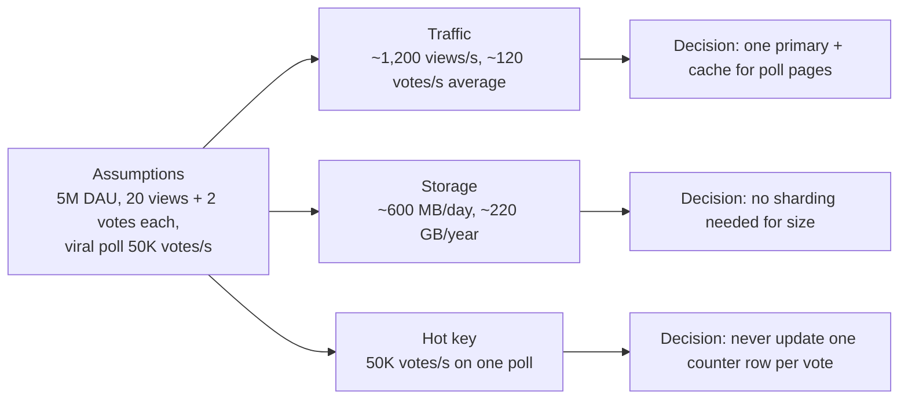

Back-of-the-envelope estimation is not about getting the right number. It is about getting a number that is right to within a
factor of a few, fast enough to say out loud, so you can make a decision you'd otherwise have to guess: one database or many, cache or
no cache, a CDN or not. If a number won't change a decision, don't compute it.

## The question it answers

Every estimate in an interview answers a **design question**:

| Number | The decision it drives |
|---|---|
| Requests per second (average and peak) | How many servers; whether one database can take the load; whether reads need a cache |
| Read:write ratio | Where to spend effort — caching and replicas for read-heavy, partitioning and batching for write-heavy |
| Storage over the retention period | One database or several; database or object storage; whether old data must be archived |
| Bandwidth | Whether a CDN is required; whether uploads should bypass your servers |
| Memory for the hot set | Whether a cache fits on one node |
| Load on the single hottest key | Whether one row, partition or cache key becomes the bottleneck |

The last row is easy to forget, and in many designs it matters most. Averages tell you about the whole system; **hot keys tell you where it
breaks**.

### When to estimate in an interview

- **Do it** right after the requirements, when the scale answers are fresh — but only for the numbers in the table that the problem makes
  interesting. A URL shortener needs reads/s and storage; a chat system needs concurrent connections and messages/s.
- **Skip or shorten it** when the interviewer says scale is modest, or when every number obviously fits one machine. Say so: "At a few
  hundred writes per second, one primary handles it, so I won't break this down further."
- **Come back to it** during deep dives, when a specific decision needs a specific number ("how big is this cache?").

Many interviewers now prefer **less estimation up front and more at the moment a number is needed**. Either way, the rule is the same:
every number you compute should end with "…so we need / don't need X".

## Formula

There is no single formula — there is a habit. Four techniques cover almost everything:

**1. Per-day to per-second.** A day has 86,400 seconds. Round it to **100,000 (10⁵)** for mental arithmetic:

```text title="Formula"
per second ≈ per day ÷ 100,000        (exact: ÷ 86,400 — about 15% more)
1 million per day   ≈ 12 per second
1 billion per day   ≈ 12,000 per second
```

**2. Powers of ten.** Write everything as a small number times a power of ten, multiply the small numbers and add the exponents.
`3 × 10⁶ users × 2 × 10³ bytes = 6 × 10⁹ bytes = 6 GB`.

**3. Round aggressively, in one direction.** Use 1, 2, 3 or 5 times a power of ten. When the answer feeds a capacity decision, round
**up**, so mistakes leave headroom rather than outages.

**4. State assumptions as you go.** "Assume 5 million daily users, each voting twice and viewing 20 polls." The interviewer can correct an
assumption in a second; they can't correct arithmetic they can't see.

And the shape of most estimates:

```text title="Formula"
requests/day = daily active users × actions per user per day
requests/s   = requests/day ÷ 86,400          (× peak factor for peak)
storage      = writes/day × bytes per write × days retained × copies
bandwidth    = requests/s × bytes per request
```

## Worked example

The polling service from [requirements](lesson:requirements): anyone can create a poll, vote once and watch live results. Assumptions,
said out loud:

- 5 million daily active users; each **views 20 poll pages** and **casts 2 votes** a day.
- About 200,000 new polls a day.
- A viral poll can receive **50,000 votes per second** (from the requirements).

**Traffic:**

- Votes: 5M × 2 = 10M a day ≈ 10M ÷ 86,400 ≈ **116 votes/s** on average.
- Views: 5M × 20 = 100M a day ≈ **1,160 views/s** on average, ~3,500/s at a 3× evening peak.
- Read:write ≈ 10:1.

**Storage:** a vote is a poll ID, a user ID, an option and a timestamp — about 60 bytes with overhead. 10M × 60 B = 600 MB a day,
about 220 GB a year. Comfortably one database.

**The number that matters:** a viral poll at 50,000 votes/s is **about 430 times the average vote rate**, all aimed at *one* poll. The
averages say "one database is plenty"; the hot key says "a single counter row will not survive". That is the decision the estimate exists
to reveal: record votes with a uniqueness check, but count them with sharded counters or asynchronous aggregation.



## Try it

Change the assumptions and watch which outputs move. The calculator shows each formula with your numbers substituted:

```estimator title="Polling service"
dau = 5M
requestsPerUser = 22
readsPerWrite = 10
writeBytes = 60 B
readBytes = 4 KB
retentionYears = 2
peakFactor = 3
replication = 3
cachePercent = 20
serverRps = 2000
targetUtilization = 70
```

Then practise the two habits — converting per day to per second, and multiplying with powers of ten. Include a unit where one applies:

```drill
? 30 million events a day. Roughly how many per second on average?
= 347
~ 1.5
> 30,000,000 ÷ 86,400 ≈ 347/s. With the shortcut: 30M ÷ 100K = 300/s — close enough to decide anything.

? 4 million users each upload 2 photos a day at 500 KB each. How much new storage per day?
= 4 TB
~ 1.3
> 4 × 10⁶ × 2 × 5 × 10⁵ B = 40 × 10¹¹ B = 4 × 10¹² B = 4 TB.

? A system averages 2,000 requests/s with a peak factor of 4. What peak should you plan for?
= 8000
~ 1.2
> 2,000 × 4 = 8,000 requests/s — then add headroom for a failed server or zone.
```

## How it changes the design

Estimates earn their time only when they end in a decision. Common thresholds (orders of magnitude, explained in
[numbers to know](lesson:numbers-to-know)):

| If the estimate says… | …the design usually needs |
|---|---|
| Hundreds of writes/s | One relational primary — no sharding discussion needed |
| Tens of thousands of writes/s or more | Partitioning, batching or a write-optimised store |
| Reads ≫ writes, with repeated reads of the same items | A cache, read replicas, maybe a CDN |
| Terabytes of blobs | Object storage, not the database |
| Gigabits per second of egress | A CDN |
| One key receiving a large share of traffic | Sharded counters, hot-key caching, or asynchronous aggregation |
| Everything fits one machine with room to spare | Say so, keep the design simple, and move on |

## Common mistakes

- **Computing numbers that change nothing** — five minutes of arithmetic, no decision.
- **Precision theatre**: 1,157.4 requests per second when "about 1,000" makes the same decision.
- **Only averages**: forgetting peaks, and forgetting the hottest single key.
- **Silent arithmetic**: working in your head and announcing a result the interviewer can't check.
- **Unit slips**: mixing bits and bytes, or milliseconds and seconds — the classic 1,000× error.

## Key takeaways

- Estimate to **make decisions**: servers, databases, caches, CDNs, partitioning — and stop when a number won't change one.
- Use **÷ 100,000 for per-day → per-second**, powers of ten, and aggressive rounding, **up** for capacity.
- **State assumptions out loud** and end every number with its consequence.
- Look beyond averages to **peaks and the hottest key** — that is often where the design breaks.

## Knowledge check

```quiz
? Why estimate at all in a system design interview?
- To show you can multiply large numbers precisely
! Precision isn't the point; interviewers care about decisions.
+ To decide things you'd otherwise guess: server counts, caching, sharding, CDNs, hot-key handling
- Because every interview requires exactly five estimates
! There is no fixed list; estimate what the problem makes interesting.
- To fill time before designing
! Estimates that change nothing waste time.
> Every number should end in "so we need / don't need…".

? A service gets 50 million requests a day. Using the shortcut, roughly how many per second is that on average?
- About 50
! That divides by 10⁶ instead of 10⁵.
+ About 500
- About 5,000
! That divides by 10⁴.
- About 50,000
! That divides by 1,000.
> 50 × 10⁶ ÷ 10⁵ = 500/s (exactly ≈ 579/s).

? Average vote traffic is about 120 per second, but one viral poll receives 50,000 votes per second. Which number should drive the counter design?
- The average, because it represents the whole system
! The average hides that all the load lands on one poll.
+ The viral poll's rate, because it concentrates on a single key
- Neither — counters are always cheap
! A single row updated 50,000 times a second becomes a lock hotspot.
- The number of polls created per day
! Poll creation is unrelated to counter contention.
> Hot keys, not averages, decide how you store and count.

? When should you round an estimate up rather than down?
+ When it feeds a capacity decision, so errors leave headroom instead of causing overload
- Never; always round to the nearest value
! Nearest rounding is fine for intuition, but capacity planning prefers safety.
- Only for storage, never for traffic
! The same reasoning applies to any capacity.
- When the interviewer isn't looking
! Assumptions and rounding should always be explicit.
> Rounding up turns estimation error into spare capacity.
```
