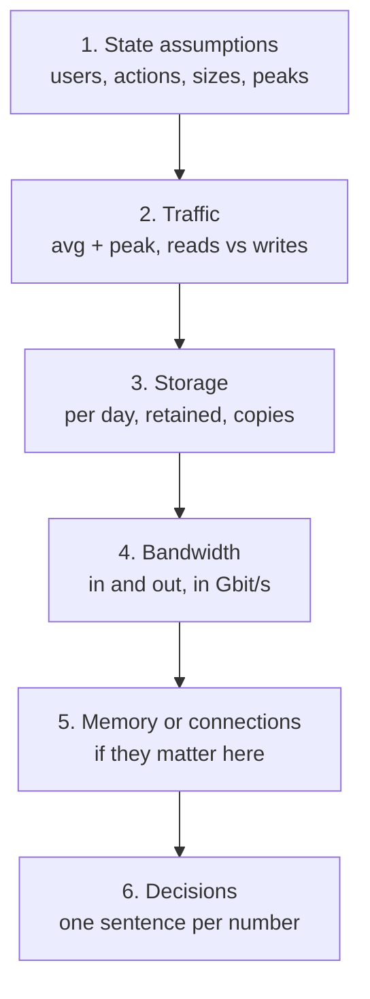

Four systems with four different shapes: one read-heavy, one write-heavy, one dominated by media bandwidth and one by live
connections. For each, run a complete estimate from the stated assumptions, then — the part that matters — write down the design
decisions the numbers force. None of these is one of the practice problems.

## How to use this workshop

Use the same short script for every exercise. It is also how to present an estimate in an interview in under three minutes:



- Work each exercise **on paper first**, rounding to one or two significant figures. Aim for about five minutes.
- Open the hints one at a time if you're stuck, then compare with the worked solution — particularly the **decisions**, which are what an
  interviewer remembers.
- Every number in the solutions was computed, not guessed; if yours differs by less than about 2×, the decisions should still match.
- You can check any estimate with the [estimator](#system-design/hld/estimator).

## Exercises

### Exercise 1 — An online encyclopedia (read-heavy)

A free encyclopedia read by people worldwide:

- **2 billion page views a day**; global audience, so the peak is about **2×** average.
- **500,000 edits a day**; every edit stores a **new revision** of the article's text, about **20 KB**. Revisions are kept forever.
- A rendered page (HTML, compressed) is about **60 KB**; images are served separately and are out of scope.
- Almost all readers are anonymous and see the same page as everyone else.

Estimate traffic, the read:write ratio, five years of revision storage and page egress. Then name three decisions.

````hint title="Hint: how lopsided is it?"
Compare views per day with edits per day. A ratio in the thousands means the read path and the write path are almost separate systems.
````

````hint title="Hint: what makes the read path cheap?"
Anonymous readers all receive the same rendered page. What can serve identical responses without touching your servers?
````

````solution title="Worked solution"
**Traffic:** 2B ÷ 86,400 ≈ **23,000 views/s** on average, **~46,000/s** at peak. Edits: 500K ÷ 86,400 ≈ **6 edits/s**. Read:write
≈ **4,000:1**.

**Storage:** 500K × 20 KB = **10 GB/day** → 3.65 TB/year → **~18 TB over five years** of revisions (before replicas; compression or
storing diffs would shrink it a lot).

**Egress:** 2B × 60 KB = **120 TB/day** ≈ 1.4 GB/s ≈ **11 Gbit/s** average, ~22 Gbit/s at peak.

**Decisions:**

- **Cache rendered pages at a CDN / edge cache.** Anonymous pages are identical for everyone; at a 99% hit ratio the origin sees ~460
  requests/s at peak instead of 46,000.
- **Purge on edit.** With 6 edits a second, invalidating a page's cached copy when it changes is cheap — far better than short TTLs.
- **The write path is tiny:** one relational primary handles 6 edits/s; the revision history (~18 TB in five years) is the size concern, so
  store revision text compressed (or in object storage) with metadata in the database.
- Logged-in editors see personalised pages, so they bypass the shared cache; they are a small fraction of traffic.
````

### Exercise 2 — Smart electricity meters (write-heavy)

A utility installs smart meters in homes:

- **30 million meters**, each reporting a reading every **15 minutes**.
- A reading (meter ID, timestamp, kWh, voltage, flags) is about **100 bytes** with overhead.
- Raw readings are kept **2 years**; three copies.
- Customers check usage in an app: about **5 million app sessions a day**, each loading a usage chart.

Estimate the write rate, storage and ingress, and spot the hidden peak.

````hint title="Hint: readings per day"
Each meter reports 96 times a day (24 × 4). Multiply by 30M meters, then divide by 86,400.
````

````hint title="Hint: when do meters report?"
If every meter reports exactly at :00, :15, :30 and :45, what happens to the per-second rate at those moments?
````

````solution title="Worked solution"
**Writes:** 30M × 96 = **2.88B readings/day** ≈ **33,000 writes/s** — if spread evenly.

**The hidden peak:** if meters report on the quarter-hour, 30M readings arrive within seconds: **~3 million writes/s** if they land in a
10-second window. The fix is in the protocol, not the database: each meter adds a random offset (jitter) across the 15-minute window,
turning a 3M/s spike into a flat ~33K/s.

**Storage:** 2.88B × 100 B = **288 GB/day** → ~105 TB/year → **~210 TB for 2 years**, **~630 TB** with three copies. Ingress is only
~3.3 MB/s — the challenge is the *number* of writes, not bytes.

**Reads:** 5M sessions/day ≈ 60/s — negligible next to writes. Read:write is about 1:500.

**Decisions:**

- **Buffer ingestion in a log** (for example Kafka) so bursts and slow consumers don't drop readings.
- **A write-optimised, partitioned store** keyed by `(meter_id, day)` (wide-column or a time-series database), with TTL-based retention.
- **Precompute rollups** (hourly, daily per meter) for the app's charts instead of scanning raw readings.
- **Jitter at the device** — the cheapest scaling fix in the whole design.
````

### Exercise 3 — A podcast hosting platform (media)

Creators upload episodes; listeners stream or download them:

- **20,000 new episodes a day**, each about an hour of audio at **128 kbit/s** (≈ 58 MB; call it **60 MB**).
- **50 million episode downloads a day**, average **60 MB** each; morning commute peak about **2×** average.
- Episodes are kept indefinitely; object storage handles redundancy.

Estimate upload storage per year and download bandwidth.

````hint title="Hint: which number is the scary one?"
Compute bytes uploaded per day and bytes downloaded per day. Compare them, then convert the larger one to Gbit/s.
````

````solution title="Worked solution"
**Uploads:** 20K × 60 MB = **1.2 TB/day** → **~440 TB/year** in object storage. Large but routine for object storage.

**Downloads:** 50M × 60 MB = **3 PB/day** ≈ 35 GB/s ≈ **280 Gbit/s** on average and **~560 Gbit/s** at peak.

**Decisions:**

- **A CDN is not optional.** Hundreds of Gbit/s can't come from a few origin servers; popular episodes are downloaded many times, so edge
  hit ratios are high. Origin bandwidth = total × miss ratio.
- **Uploads go straight to object storage** (presigned or resumable uploads); a processing pipeline normalises loudness and generates
  metadata asynchronously.
- **Metadata is small** (episodes, feeds, creators): one relational database handles it easily.
- Bandwidth, not storage, dominates cost — so a lower-bitrate variant for mobile listeners is worth discussing.
````

### Exercise 4 — A live quiz game (real-time)

Teachers run live quizzes; students answer on their phones:

- At peak, **2 million players are connected**, in about **100,000 games** of ~20 players.
- Each game shows a new question every **20 seconds**; every player answers each question; after each question, every player receives
  the updated scores.
- Assume each open connection costs about **20 KB** of server memory, and one connection server holds **50,000** connections comfortably.

Estimate inbound answers, outbound messages, connection servers and connection memory.

````hint title="Hint: per-second rates from per-question events"
Every player sends one answer and receives two messages (the question and the scores) every 20 seconds. Divide by 20.
````

````hint title="Hint: what is the unit of partitioning?"
All the state for one game — players, current question, scores — is small and accessed together. Where should it live?
````

````solution title="Worked solution"
**Inbound:** 2M answers every 20 s ≈ **100,000 answers/s** (games are not synchronised, so this is fairly smooth).

**Outbound:** 2 messages per player per question ≈ **200,000 messages/s**.

**Connections:** 2M ÷ 50K = **40 connection servers** at peak, plus spares; memory ≈ 2M × 20 KB = **40 GB** across the fleet (1 GB per
server).

**Decisions:**

- **A dedicated connection tier** (WebSockets) separate from game logic, sized by concurrent connections.
- **Partition by game:** each game's state lives in memory on one game server (games are tiny: 20 players), routed by `game_id`; the
  connection servers forward messages for that game.
- **Fan-out is per game**, not global: 20 recipients per message — no global broadcast problem.
- **Persist results asynchronously** after each game; durability during the game matters less than latency, but losing a whole game on a
  server crash should be survivable (snapshot state, or accept a restart).
````

### Check your numbers

Any of the four can be reproduced in the calculator. For example, the encyclopedia (2B reads and 500K writes a day ≈ 4,000:1):

```estimator title="Online encyclopedia"
requestsPerDay = 2.0005B
readsPerWrite = 4000
writeBytes = 20 KB
readBytes = 60 KB
retentionYears = 5
peakFactor = 2
replication = 3
cachePercent = 1
serverRps = 3000
targetUtilization = 60
```

## Key takeaways

- Run the same script every time: **assumptions → traffic → storage → bandwidth → memory or connections → decisions**.
- **Read-heavy**: the decision is caching (often at the edge) and invalidation; writes are trivial.
- **Write-heavy**: the decision is the write path — buffering, partitioning, rollups — and hidden synchronised peaks.
- **Media**: bandwidth in Gbit/s dominates; CDN and direct-to-storage uploads.
- **Real-time**: concurrent connections and messages per second; partition state by the natural unit (a game, a room, a conversation).

## Knowledge check

```quiz
? 30M devices report every 15 minutes, all exactly on the quarter-hour. What is the most effective fix for the resulting spikes?
- A database with more write capacity
! It can be done, but you'd pay for capacity that idles 99% of the time.
+ Add random jitter to each device's reporting time across the window
- Report every hour instead
! It reduces volume but keeps the synchronised spike.
- A CDN
! CDNs serve reads, not device writes.
> Spreading the same work over the window turns a 3M/s spike into a flat ~33K/s.

? 50M downloads a day at 60 MB each. Roughly what average egress is that?
- About 3 Gbit/s
! That's 100× too low.
+ About 280 Gbit/s
- About 2.8 Tbit/s
! That's 10× too high.
- About 35 Mbit/s
! That treats GB/s as MB/s and forgets ×8.
> 3 PB/day ÷ 86,400 ≈ 35 GB/s × 8 ≈ 280 Gbit/s.

? For a read-heavy site where anonymous users see identical pages, what is the highest-leverage decision?
+ Cache rendered pages at a CDN or edge cache, with purge on edit
- Shard the database
! Writes are tiny; sharding addresses the wrong side.
- Add read replicas only
! Replicas help, but edge caching removes most requests before they reach the origin.
- Use WebSockets
! Page views don't need persistent connections.
> Identical responses to many readers are exactly what shared caches are for.

? In a live quiz with 2M connected players in 100K games, what is the natural partitioning unit for game state?
- The player
! Players in the same game must see shared state, so per-player partitioning scatters it.
+ The game
- The question
! Questions belong to games; partitioning by question scatters a game across servers.
- The country
! Country doesn't align with who interacts with whom.
> All state for one game is accessed together; keep it on one server.
```
