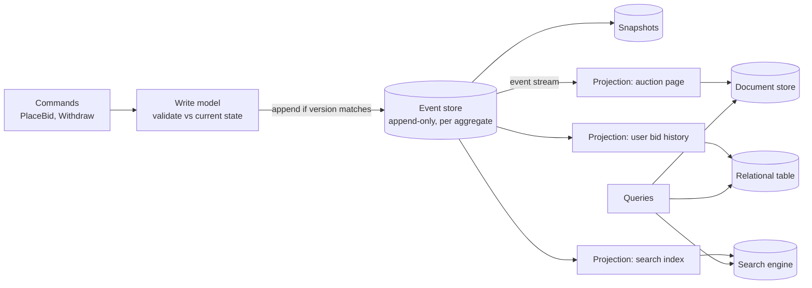

Most systems store current state and overwrite it on each change. **Event sourcing** stores the changes instead — an append-only log of
events — and derives current state by replaying them. **CQRS** (Command Query Responsibility Segregation) separates the model that handles
writes from the models that serve reads. They're often used together, and both are powerful, expensive tools that interviewers expect you to
use deliberately rather than by default.

## Why it matters

Audit-heavy domains (payments, ledgers, auctions, bookings), systems with very different read and write shapes (feeds, dashboards, search),
and "reconstruct what happened" requirements all point towards these patterns. Interviewers want to see that you know what they give —
complete history, replay, independently scalable read models — and what they cost: eventual consistency, schema evolution of events,
snapshots, and much more complexity than CRUD.

## How it works

### Event sourcing

- Each change is recorded as an immutable **event** in an append-only **event store**, per aggregate: `AccountOpened`, `MoneyDeposited(500)`,
  `MoneyWithdrawn(200)`.
- **Current state** is a fold over the aggregate's events: balance = 0 + 500 − 200 = 300.
- **Commands** are validated against current state (rebuilt from events) and, if accepted, produce new events. Concurrency control is
  **optimistic**: append only if the aggregate's version is still what you read (expected version), otherwise retry.
- **Snapshots** store the folded state every N events, so rebuilding an aggregate replays only events since the last snapshot.
- **Projections** consume the event stream and build read models.

What you gain:

- **A complete, trustworthy history** — audit for free, and the ability to answer "what was the state at 14:03 last Tuesday?"
- **Replay**: fix a bug in a projection, rebuild it from history; add a new read model from all past events.
- **Natural integration**: events are already there to publish.

What it costs:

- **Event schema evolution**: events are kept forever; old versions must remain readable (upcasting, versioned event types).
- **No ad-hoc queries on the event store** — every query needs a projection.
- **Eventual consistency** between the write side and projections.
- **Deleting personal data** is hard in an immutable log (common approaches: keep personal data outside events, or crypto-shredding —
  encrypting per user and deleting the key).
- **Complexity**: most teams find it significantly harder than CRUD.

### CQRS

Separate **commands** (change state) from **queries** (read state), possibly with different models and stores:

- The **write model** enforces invariants: normalised, transactional, small.
- **Read models** are shaped for each query — a denormalised document per page, a search index, a leaderboard in Redis — and updated from
  events or CDC.

CQRS **doesn't require** event sourcing: a relational write model plus read models updated by [CDC or an outbox](lesson:outbox-cdc) is CQRS
too, and is the more common form. It's the generalisation of [denormalised read models](lesson:normalization) and
[scaling reads](lesson:scaling-reads).

### When it pays off

- **Event sourcing**: when history is a requirement (financial ledgers, compliance, auctions with bid histories, versioned documents), or the
  domain is naturally a sequence of events.
- **CQRS**: when reads and writes differ greatly in shape or scale — complex search or feeds over simple writes — or several read models need
  the same data.
- **Neither**: simple CRUD with modest scale. A ledger table (append-only rows) often gives most of the audit benefit without full event
  sourcing.

## Architecture



## Failure scenarios

- **Projection lag**: a user places a bid and the auction page (a read model) doesn't show it yet. Read-your-writes: return the new state in
  the command response, or read the write model for the user's own recent actions.
- **Projection bug**: a read model computes wrong totals. Fix the code and rebuild by replaying events — a strength of the pattern.
- **Concurrent commands** on one aggregate: optimistic concurrency rejects the second append; the command handler retries against the new
  state.
- **Unbounded replay**: an aggregate with millions of events is slow to load. Snapshots.
- **Event schema drift**: a new service can't read old events. Versioned schemas, upcasters, compatibility tests.

## Trade-offs

| | CRUD | CQRS (with CDC/outbox) | Event sourcing + CQRS |
|---|---|---|---|
| History | Only what you log | Only what you log | Complete, by construction |
| Read flexibility | Queries on one model | Purpose-built read models | Purpose-built read models, rebuildable from history |
| Consistency of reads | Immediate | Eventual for read models | Eventual for read models |
| Complexity | Low | Medium | High |
| Best for | Most applications | Different read/write shapes | Audit-critical, event-shaped domains |

## In real systems

- Banking ledgers and payment systems record immutable entries and derive balances — event sourcing in spirit, if not always in name.
- Version control systems (Git) are event-sourced: commits are immutable changes, and any state can be reconstructed.
- EventStoreDB and Axon are dedicated event-sourcing platforms; Kafka is often used to distribute events to projections, though it isn't an
  event store with per-aggregate optimistic concurrency by itself.
- Many large read-heavy systems use CQRS without event sourcing: a relational source of truth plus search indexes, caches and denormalised
  stores fed by CDC.

## Common mistakes

- **Event sourcing everything** in a CRUD application.
- **Treating Kafka topics as an event store** without per-aggregate concurrency control or long-term retention planning.
- **Ignoring event versioning.**
- **Forgetting read-your-writes** for users after commands.
- **Putting personal data in immutable events** without a deletion strategy.

## In the interview

````question title="Would you use event sourcing for an online auction?"
For the bidding part, it fits well: an auction is naturally a sequence of events — opened, bid placed, bid retracted, closed — and the bid
history is a requirement for disputes and audit. Each auction is an aggregate; a PlaceBid command is validated against current state (rebuilt
from events plus snapshots) and appended with optimistic concurrency on the auction's version, which also serialises competing bids. Read
models — the auction page, a user's bid history, search — are projections updated from the event stream, eventually consistent, with the
command response returning the new highest bid so bidders see their own action immediately. The rest of the product — user profiles, item
catalogues — stays plain CRUD.
````

````question title="What is CQRS, and do you need event sourcing to use it?"
CQRS separates the write model, which validates commands and enforces invariants, from read models shaped for each query — a denormalised
document for a page, a search index, a cache. Read models are updated from the write side's changes, so they're eventually consistent. You
don't need event sourcing: a relational write model with read models fed by an outbox or CDC is CQRS, and it's the more common form. Event
sourcing adds a complete event history as the source of truth, which makes projections rebuildable but adds versioning and complexity.
````

## Key takeaways

- **Event sourcing** stores immutable events and derives state by replay — complete history, replayable projections, higher complexity.
- **CQRS** separates write and read models; read models are **eventually consistent** and shaped per query.
- CQRS works **without** event sourcing (CDC/outbox-fed read models are common).
- Use them where **history or divergent read shapes** justify the cost; keep CRUD elsewhere.

## Knowledge check

```quiz
? In an event-sourced system, how is an account's current balance obtained?
- Read the balance column
! There's no mutable balance column as the source of truth.
+ Replay (fold) the account's events, starting from the latest snapshot
- Query the search index
! Search indexes are read models, not the source of truth.
- Ask the payment provider
! External systems aren't the account's state.
> State is derived from the event history.

? A projection has a bug that produced wrong totals for a month. What does event sourcing allow?
+ Fix the projection code and rebuild the read model by replaying the events
- Nothing — the wrong totals are permanent
! The events are intact.
- Edit the events to match the totals
! Events are immutable history.
- Restore last month's database backup
! Replay is cleaner and loses nothing.
> Read models are disposable and rebuildable.

? Two commands try to append to the same aggregate at version 41. What prevents a lost update?
- Last-write-wins on the event store
! That would lose one command's effect.
+ Optimistic concurrency: append only if the expected version is still 41; the second command retries against version 42
- A global lock on the event store
! Far too coarse.
- Projections
! Projections are downstream.
> Expected-version appends serialise changes per aggregate.

? Which situation least justifies event sourcing?
- A financial ledger with audit requirements
! A natural fit.
- An auction with full bid history
! A natural fit.
+ A simple CRUD admin panel for editing product descriptions
- A versioned document collaboration system
! History is a core requirement there.
> Complexity must buy something the domain needs.
```
