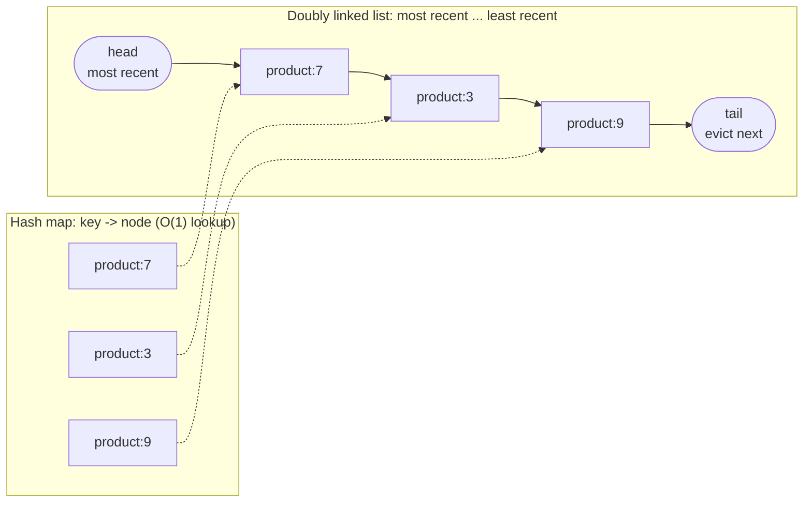

A cache is smaller than the data behind it, so when it's full, something must go. The eviction policy decides what — and with it, how
many future requests hit or miss. LRU is the usual default, LFU wins when popularity is stable and scans pollute the cache, and real
systems approximate both cheaply.

## Why it matters

Eviction policy is a classic interview topic in two forms: as part of a distributed cache design ("what happens when Redis fills up?") and
as a coding-flavoured question ("implement an LRU cache"). In HLD you need to know the policies, what Redis actually does by default (a
surprise for many), and how to choose from the access pattern.

## How it works

### The policies

| Policy | Evicts | Strength | Weakness |
|---|---|---|---|
| **LRU** (least recently used) | The entry unused for the longest time | Adapts quickly to changing popularity; simple | A one-off scan of many keys flushes the hot set |
| **LFU** (least frequently used) | The entry with the fewest accesses | Keeps consistently popular items; scan-resistant | Slow to forget items that used to be popular (needs decay) |
| **FIFO** | The oldest inserted entry | Trivial; no bookkeeping on reads | Evicts hot items just because they're old |
| **Random** | A random entry | No bookkeeping; surprisingly decent | No awareness of popularity |
| **TTL-based** | Entries closest to expiry | Uses your own knowledge of value lifetime | Only as good as your TTLs |

Modern caches go further: **W-TinyLFU** (used by Java's Caffeine) combines a small LRU "window" with a frequency-based admission filter, so a
new item must prove it's more popular than the one it would replace — near-optimal hit ratios across many workloads. **ARC** adapts between
recency and frequency automatically.

### What Redis does

Redis evicts only when `maxmemory` is set and reached, according to `maxmemory-policy`:

- `noeviction` — **the default**: writes that need memory fail with an error; reads still work.
- `allkeys-lru`, `allkeys-lfu`, `allkeys-random` — consider every key.
- `volatile-lru`, `volatile-lfu`, `volatile-random`, `volatile-ttl` — consider only keys with an expiry set.
- `allkeys-lrm`, `volatile-lrm` — **least recently modified**, added in Redis 8.6: evicts keys that haven't been written recently, even if
  they're read often.

Redis's LRU and LFU are **approximations**: instead of tracking exact order, it samples a few keys (`maxmemory-samples`, default 5) and evicts
the best candidate among them, keeping a pool of good candidates. LFU uses a small logarithmic (Morris) counter per key that decays over time
(`lfu-decay-time`, default one minute), so formerly popular keys eventually become evictable. For a pure cache, `allkeys-lru` is the common
choice; `allkeys-lfu` when a stable hot set competes with one-off scans.

### Choosing

- **Mostly recency-driven access** (recent items are likely to be read again: sessions, recent posts): **LRU**.
- **Stable popularity plus scans or bursts of one-off reads** (product catalogue browsed alongside crawlers and reports): **LFU** or TinyLFU.
- **Mixed cache and persistent keys in one instance**: `volatile-*` so only expiring keys are evicted — though separate instances are
  cleaner.
- **Never evict, error instead** (the cache is actually a store of record): `noeviction` — and then it isn't really a cache.

## Architecture



A read moves the entry to the head; inserting into a full cache removes the tail. Both operations are O(1) — the classic LRU
implementation (Java's `LinkedHashMap` in access order does exactly this).

## Java and Spring Boot example

LRU against LFU on the same workload — ten hot keys read constantly, interrupted by scans of thirty never-repeated keys — with room for
twenty entries:

```java file="EvictionPolicies.java"
import java.util.HashMap;
import java.util.LinkedHashMap;
import java.util.Map;

// LRU vs LFU on the same workload: 10 hot keys read constantly, interrupted every so often by a
// scan that touches 30 keys once each (a report, a crawler, a batch job). Cache size: 20 entries.
public class EvictionPolicies {

    interface Cache {
        boolean get(String key); // true on a hit; on a miss the key is loaded and inserted
    }

    // LinkedHashMap in access order evicts the least recently used entry.
    static class Lru implements Cache {
        private final LinkedHashMap<String, Boolean> map;

        Lru(int capacity) {
            map = new LinkedHashMap<>(16, 0.75f, true) {
                @Override
                protected boolean removeEldestEntry(Map.Entry<String, Boolean> eldest) {
                    return size() > capacity;
                }
            };
        }

        public boolean get(String key) {
            if (map.get(key) != null) {
                return true;
            }
            map.put(key, true);
            return false;
        }
    }

    // Evicts the entry with the fewest accesses (oldest first on ties). O(n) eviction: a demo.
    static class Lfu implements Cache {
        private final int capacity;
        private final Map<String, Integer> counts = new LinkedHashMap<>();

        Lfu(int capacity) {
            this.capacity = capacity;
        }

        public boolean get(String key) {
            if (counts.containsKey(key)) {
                counts.merge(key, 1, Integer::sum);
                return true;
            }
            if (counts.size() == capacity) {
                String victim = null;
                for (Map.Entry<String, Integer> e : counts.entrySet()) {
                    if (victim == null || e.getValue() < counts.get(victim)) {
                        victim = e.getKey();
                    }
                }
                counts.remove(victim);
            }
            counts.put(key, 1);
            return false;
        }
    }

    public static void main(String[] args) {
        Map<String, Cache> caches = new LinkedHashMap<>();
        caches.put("LRU", new Lru(20));
        caches.put("LFU", new Lfu(20));
        Map<String, Integer> hits = new HashMap<>();
        int requests = 0;
        int scanKey = 0;
        for (int round = 0; round < 200; round++) {
            for (int i = 0; i < 50; i++) { // 50 reads of the hot set
                String key = "hot-" + (i % 10);
                requests++;
                for (Map.Entry<String, Cache> c : caches.entrySet()) {
                    if (c.getValue().get(key)) {
                        hits.merge(c.getKey(), 1, Integer::sum);
                    }
                }
            }
            for (int i = 0; i < 30; i++) { // a scan of 30 keys never seen again
                String key = "scan-" + scanKey++;
                requests++;
                for (Map.Entry<String, Cache> c : caches.entrySet()) {
                    if (c.getValue().get(key)) {
                        hits.merge(c.getKey(), 1, Integer::sum);
                    }
                }
            }
        }
        for (String name : caches.keySet()) {
            int h = hits.getOrDefault(name, 0);
            System.out.printf("%s: %,d hits of %,d requests (%.1f%%)%n",
                    name, h, requests, 100.0 * h / requests);
        }
        System.out.println("best possible: " + String.format("%,d", 200 * 50 - 10)
                + " hits (every hot read after the first 10)");
    }
}
```

```text title="Output" output="EvictionPolicies.java"
LRU: 8,000 hits of 16,000 requests (50.0%)
LFU: 9,990 hits of 16,000 requests (62.4%)
best possible: 9,990 hits (every hot read after the first 10)
```

Each 30-key scan pushed every hot key out of the LRU cache, so the first ten hot reads after every scan missed. LFU kept the hot keys (their
counts dwarf the scanned keys') and reached the best possible hit ratio for this workload.

## Failure scenarios

- **Redis left at `noeviction`** as a cache: when memory fills, writes start failing with out-of-memory errors — often discovered in
  production.
- **Scan pollution**: a nightly batch job reads millions of keys through the cache, evicting the hot set; next morning's traffic misses.
  Use LFU/TinyLFU, or let batch jobs bypass the cache.
- **Eviction storm**: the working set grew beyond memory; evictions and misses spike together, raising database load. Watch evictions and
  hit ratio; resize.
- **Evicting the wrong class of keys**: a shared instance evicts important non-cache keys. Separate instances or `volatile-*` policies.
- **Big keys**: one huge value evicts thousands of small ones; keep values bounded.

## Trade-offs

- **Recency vs frequency**: LRU adapts quickly; LFU resists scans but clings to stale popularity unless counts decay.
- **Accuracy vs cost**: exact LRU needs a list update on every read; sampled approximations are nearly as good and much cheaper.
- **Policy vs size**: a better policy can be worth a lot of memory — but when the working set is far bigger than the cache, no policy helps.

## In real systems

- Redis offers LRU, LFU, LRM, random and TTL-based policies, all approximated by sampling; `noeviction` is the default.
- Memcached uses a segmented LRU per slab class.
- Caffeine (Java) uses W-TinyLFU; it's the cache behind many Spring Boot applications' local caching.
- Operating systems and databases use LRU variants (clock, 2Q, LRU-K) for page caches to resist scans.

## Common mistakes

- **Not setting `maxmemory` and a policy** on a Redis used as a cache.
- **LRU for scan-heavy mixed workloads.**
- **Mixing persistent data and cache data** in one Redis with an `allkeys-*` policy.
- **Ignoring eviction metrics** — rising evictions are an early warning.
- **Expecting eviction to fix an undersized cache.**

## In the interview

````question title="What happens when your Redis cache runs out of memory?"
It depends on maxmemory-policy. With the default, noeviction, writes that need memory fail with errors — not what you want for a cache. For
a pure cache I'd set maxmemory with some headroom for replication and persistence buffers and use allkeys-lru, or allkeys-lfu if a stable
hot set competes with scans. Redis approximates these by sampling keys rather than tracking exact order, which is cheap and close to optimal.
I'd monitor evicted_keys and the hit ratio: rising evictions with a falling hit ratio means the working set has outgrown the cache.
````

````question title="When would LFU beat LRU?"
When popularity is fairly stable but the cache also sees bursts of one-off reads — scans, crawlers, reports. A scan touches many keys once;
under LRU each of those becomes "most recent" and pushes genuinely hot keys out, so the next requests miss. LFU keeps the keys with the most
accesses, so a single read of a scanned key doesn't displace a key read thousands of times. LFU needs counts to decay, otherwise yesterday's
hits never leave; Redis decays its LFU counters over time, and TinyLFU-style caches handle this automatically.
````

## Key takeaways

- **LRU** evicts the least recently used (adaptive, scan-vulnerable); **LFU** the least frequently used (scan-resistant, needs decay);
  FIFO, random and TTL-based are simpler.
- Redis defaults to **`noeviction`**; set `maxmemory` and a policy (commonly `allkeys-lru` or `allkeys-lfu`). Redis 8.6 adds **LRM**.
- Redis **approximates** LRU/LFU by sampling (`maxmemory-samples` 5).
- Choose from the **access pattern**, and watch **evictions and hit ratio**.

## Knowledge check

```quiz
? A Redis instance used as a cache starts returning out-of-memory errors on writes. What is the likely cause?
+ maxmemory was reached with the default noeviction policy
- allkeys-lru is evicting too aggressively
! LRU eviction would free memory rather than error.
- Keys have no TTL
! Without TTLs, allkeys-* policies can still evict.
- The replica is down
! Replica health doesn't cause OOM errors on the primary.
> noeviction refuses writes instead of evicting.

? A nightly report reads 5 million keys once each through the cache; mornings start with a terrible hit ratio. Which policy change helps most?
- Switch from LRU to FIFO
! FIFO is also scan-vulnerable.
+ Switch from LRU to LFU (or a TinyLFU-style cache), or make the report bypass the cache
- Increase maxmemory-samples to 100
! Better LRU approximation is still LRU.
- Remove all TTLs
! Unrelated to scan pollution.
> Frequency-aware eviction keeps the hot set through scans.

? How does Redis implement LRU?
- With an exact global linked list
! That would cost memory and CPU on every access.
+ By sampling a few keys and evicting the least recently used among them, keeping a pool of candidates
- By evicting random keys
! That's allkeys-random.
- By evicting the largest keys first
! Size isn't the criterion.
> Approximate LRU is nearly as good and far cheaper.

? Which data structures give O(1) get and put for an LRU cache?
- A sorted array
! Insertion would be O(n).
+ A hash map plus a doubly linked list ordered by recency
- A binary heap of timestamps
! Updates would be O(log n).
- A single linked list
! Moving a node to the front needs its predecessor; lookups would be O(n).
> The map finds the node; the list moves and evicts in constant time.
```
