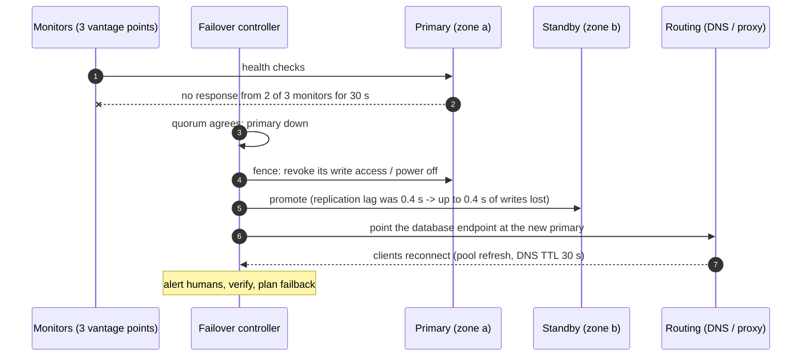

Redundancy only helps if traffic and data actually move to the healthy copy when something fails. **Failover** is that move — of a database
primary, a service, a whole availability zone or a region. The two basic shapes are **active-passive** (a standby takes over) and
**active-active** (several sites serve traffic all the time). The hard parts are the data — how much can be lost, and how writes work in
more than one place — and making sure failover actually works when it's needed.

## The problem

Every failover design answers four questions:

- **What fails over?** An instance, a database primary, a zone, a whole region.
- **How much data can be lost?** The **recovery point objective (RPO)** — usually set by replication lag at the moment of failure.
- **How long may recovery take?** The **recovery time objective (RTO)** — detection plus decision plus promotion plus traffic switch.
- **Who decides?** Automation is fast but can act on false alarms; humans are careful but slow.

[Redundancy](lesson:spof-redundancy) and [replication](lesson:leader-follower) provide the copies; failover decides when and how to use
them.

## Architecture

**Active-passive**: one site serves; a standby receives replicated data and is promoted on failure.

- **Hot standby**: running and up to date, takes over in seconds to minutes.
- **Warm standby**: running at reduced size, scaled up during failover.
- **Cold standby / backup-restore**: infrastructure created on demand from backups — cheapest, slowest.
- Simple data model (one writer), but the standby's capacity is idle, and failover is a rare, risky event.

**Active-active**: every site serves live traffic, so "failover" is mostly shifting traffic away from a failed site.

```mermaid title="Active-active across two regions with home regions for writes"
flowchart TB
  U["Users"]:::client --> GD["Global traffic routing<br/>latency-based DNS / anycast,<br/>health checks"]:::lb
  GD --> E["Region EU<br/>app tier"]:::svc
  GD --> A["Region US<br/>app tier"]:::svc
  E --> DE[("EU database<br/>primary for EU-homed users")]:::db
  A --> DA[("US database<br/>primary for US-homed users")]:::db
  DE <-->|"async replication<br/>both directions"| DA
  E -.->|"writes for US-homed users"| A
```

Writes are the crux in active-active:

| Write strategy | How it works | Trade-off |
|---|---|---|
| **Single writer per data** | Each user or tenant has a home region; writes go there, reads can be local | No conflicts; cross-region latency for writes made away from home |
| **Multi-writer with conflict resolution** | Any region accepts writes; conflicts resolved by last-writer-wins, CRDTs or merge logic | Low latency; possible lost or merged updates ([consistency models](lesson:consistency-models)) |
| **Globally consistent database** | Consensus across regions (Spanner, CockroachDB) | Correct by design; every write pays a cross-region round trip |

**Capacity**: each surviving site must absorb the failed site's traffic.

```drill
? Traffic is split evenly across 3 regions. What is the highest steady-state utilisation per region that still lets the other two absorb one region's failure without exceeding 100%?
= 66.7
~ 1.05
> After a failure, 2 regions carry 3 regions' load: each must run at ≤ 2/3 ≈ 66.7% normally.

? Same question with 2 regions.
= 50
~ 1.05
> One region must carry everything, so each can run at most 50% normally — the price of active-active with two sites.
```

## Request and data flow



The steps, and what goes wrong in each:

1. **Detect** from several vantage points, with thresholds that avoid flapping on brief blips ([partitions and failure
   detection](lesson:partitions-failure-detection)).
2. **Decide** with a quorum or a human; one monitor's view isn't enough.
3. **Fence the old primary** so it can't keep accepting writes if it was only partitioned — otherwise **split brain** creates two
   diverging histories ([distributed locks](lesson:distributed-locks)).
4. **Promote** the most up-to-date replica; writes it hadn't received are lost (the RPO).
5. **Redirect traffic**: update a proxy, virtual IP or DNS record. DNS is slowest — resolvers and clients cache records, sometimes beyond
   the TTL ([DNS](lesson:dns)).
6. **Verify and fail back** deliberately later, reconciling any writes the old primary accepted.

## Advantages

| Active-passive | Active-active |
|---|---|
| Simple data model: one writer | Capacity is always in use; failover is just shifting traffic |
| Easier consistency | Lower latency for users near each site |
| Cheaper with warm or cold standby | Failure paths are exercised daily, so they work |

## Disadvantages

| Active-passive | Active-active |
|---|---|
| Idle standby capacity | Write conflicts or cross-region write latency |
| Failover is rare, so it's often broken when needed | Each site needs headroom to absorb another's load |
| RTO includes promotion and traffic switch | More complex deployments, data placement and testing |

## Failure scenarios

| Failure | What happens | Mitigation |
|---|---|---|
| Network partition mistaken for failure | Two primaries (split brain) | Quorum-based decisions, fencing the old primary |
| Asynchronous replication lag at failure | Lost writes (RPO) | Synchronous replication for critical data, or accept and document |
| Standby under-provisioned or stale config | Fails under real load | Regular failover drills; same deployment pipeline for both sites |
| DNS caching | Clients keep hitting the dead site | Short TTLs, client retries to alternate endpoints, anycast or proxies |
| Cold caches in the new site | Database overloaded after failover | Pre-warmed caches, gradual traffic shift ([cache warming](lesson:cache-warming)) |
| Failback without reconciliation | Divergent data silently overwritten | Compare and reconcile before returning the old site to service |

## Alternatives

- **Zone-level redundancy only** (multi-AZ in one region): covers most failures at much lower cost and complexity.
- **Backup and restore** for systems with relaxed RTO and RPO.
- **Cell-based architectures**: many independent copies of the stack, each serving a slice of users, so a failure affects one cell.
- **Managed multi-region services** (global databases, DynamoDB global tables, Spanner) that handle replication and failover for you.

## Where it shows up in interviews

Payment systems (no lost transactions — synchronous replication or consensus), global social and messaging apps (active-active with home
regions), news feeds and content (active-active reads, async replication), and the generic "what if a region goes down?" follow-up. State
the RPO and RTO, the failover shape, how writes work, how traffic moves, and how you prevent split brain.

````question title="Active-active or active-passive across regions for a social network?"
Active-active for reads and most traffic: users are served from the nearest region, which gives lower latency and means every region is
exercised daily. For writes, give each user a home region where their data is mastered, replicate asynchronously to other regions for
reads, and route a user's writes to their home region (re-homing on failover, accepting a small RPO). Each region keeps enough headroom to
absorb a failed region's share. For data that can't lose writes, such as payments, use a consensus-replicated store or keep it
active-passive with synchronous replication.
````

````question title="How do you prevent split brain during a database failover?"
Make the decision with a quorum (several monitors or a consensus-backed controller) rather than a single observer, and fence the old primary
before promoting the standby — revoke its access to storage or the network, shut it down, or use a lease it must renew through the
coordinator. Writes also carry an epoch or fencing token so that, if the old primary does come back, its writes are rejected. Only then
redirect clients to the new primary.
````

## Common mistakes

- **Never testing failover** — the standby's config, capacity or credentials are stale.
- **Ignoring RPO**: asynchronous replication means lost writes; say how much.
- **Automated failover without fencing**, risking split brain.
- **Relying on DNS alone** for fast traffic switches.
- **Active-active without headroom** — the surviving region falls over too.
- **Multi-writer designs with no conflict strategy.**

## Key takeaways

- Failover = **detect → decide → fence → promote → redirect → verify**; RTO is the sum, RPO is the replication lag lost.
- **Active-passive**: simple, one writer, idle standby; **active-active**: always-used capacity, harder writes.
- Active-active writes: **home regions**, **conflict resolution**, or a **globally consistent database**.
- Keep **headroom** (2 regions → ≤ 50%, 3 → ≤ 67%) and **drill** failover regularly.

## Knowledge check

```quiz
? A primary fails with 2 seconds of replication lag to its asynchronous standby, which is promoted. What is lost?
+ Up to about 2 seconds of acknowledged writes that never reached the standby
- Nothing; promotion replays them
! The standby never received them.
- All writes since the last backup
! Replication covers most of them.
- Only reads
! Reads don't create data.
> RPO is bounded by replication lag at the moment of failure.

? Two regions run active-active, each at 70% utilisation. One region fails. What happens?
- The other region absorbs it at 85%
! It would need 140% of its capacity.
+ The survivor receives 140% of its capacity and is overloaded unless it sheds load or scales very fast
- Traffic is split across both regions anyway
! One has failed.
- DNS automatically reduces traffic
! DNS moves traffic; it doesn't reduce it.
> Two-region active-active needs ≤ 50% steady utilisation.

? Why fence the old primary before promoting a standby?
- To copy its data first
! Fencing stops writes; it doesn't copy data.
+ If it was only partitioned, it could keep accepting writes, creating two diverging primaries (split brain)
- To speed up promotion
! It adds a step.
- Because DNS requires it
! Unrelated to DNS.
> Ensure only one writer at a time.

? Which approach gives conflict-free writes in an active-active, multi-region design without paying cross-region latency on most writes?
- Last-writer-wins on every table
! Conflicts still happen; LWW just discards some writes.
+ Home regions: each user's data is written in one region and replicated to others
- Synchronous replication to all regions
! That pays cross-region latency on every write.
- Disabling writes in all but one region
! That's active-passive for writes.
> Partition write ownership.
```
