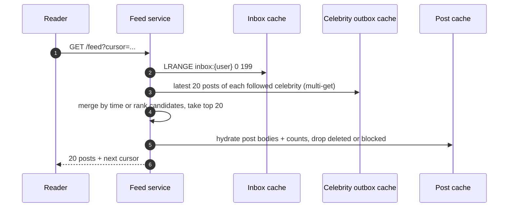

When one action must reach many people — a post to followers, a message to a group, an alert to subscribers — the system has to copy
work from one sender to many receivers somewhere. **Fan-out on write** does the copying when the event happens; **fan-out on read** does
it when someone looks. The choice decides where latency, storage and cost land, and the right answer is usually a **hybrid**.

## The problem

A user posts. Two hundred followers (or fifty million) should see it in their feeds. Two costs compete:

- **Write-time cost**: copying a reference into every recipient's feed when the post is created.
- **Read-time cost**: gathering posts from everyone a reader follows each time they open the feed.

The numbers decide. With **P** posts per second to an average of **F** followers, and **R** feed reads per second by users following an
average of **G** accounts:

```text title="Cost model"
fan-out on write: P x F inbox inserts per second         (paid once per post)
fan-out on read:  R x G outbox lookups per second         (paid on every feed open)
```

```drill
? 5,000 posts/s, 200 followers on average. How many inbox inserts per second does pure fan-out on write cost?
= 1000000
~ 1.1
> 5,000 × 200 = 1,000,000 inserts/s — large but simple, parallel work.

? 50,000 feed opens/s, each user follows 200 accounts. How many outbox lookups per second does pure fan-out on read cost?
= 10000000
~ 1.1
> 50,000 × 200 = 10,000,000 lookups/s, on the latency-critical read path.
```

Feeds are read far more often than posts are written, and reads have tight latency targets — which favours doing the work at write time.
But the follower distribution is extremely skewed: one celebrity post with 50 million followers is 50 million inserts in one burst.

## Architecture

```mermaid title="Push to inboxes, pull from celebrity outboxes, merge at read time"
flowchart TB
  A["Author posts"]:::client --> PS["Post service<br/>store post, emit event"]:::svc
  PS --> DB[("Posts + per-author outbox<br/>(author_id, post_id DESC)")]:::db
  PS --> K[["Event log: post-created"]]:::queue
  K --> FO["Fan-out workers<br/>skip authors above the threshold,<br/>skip inactive followers"]:::svc
  FO --> IN[("Per-user inbox<br/>capped list of post IDs")]:::cache
  R["Reader opens feed"]:::client --> FS["Feed service"]:::svc
  FS -->|"1. precomputed inbox"| IN
  FS -->|"2. outboxes of followed celebrities"| DB
  FS --> MG["3. merge, rank, hydrate, filter"]:::svc
```

- **Outbox**: each author's own posts, newest first — the source for profile pages and for pulls.
- **Inbox**: each reader's precomputed feed — a capped list of post IDs (not copies of posts), so a post is stored once and referenced many
  times.
- **Threshold**: authors above some follower count (tuned by measured cost, often tens to hundreds of thousands) are not pushed; their posts
  are pulled and merged at read time. Their outboxes are hot and cached widely ([hot keys](lesson:hot-keys)).
- **Activity filter**: inactive users don't get pushes; their inbox is rebuilt by a pull when they return.

## Request and data flow



The same push/pull split appears beyond feeds:

| Situation | Push (fan-out on write) | Pull (fan-out on read) |
|---|---|---|
| Social feeds | Inbox per user | Merge followees' outboxes |
| Notifications | Send to each device | Device polls an inbox |
| Real-time UI | Server pushes over WebSocket/SSE | Client polls every few seconds ([real-time transport](lesson:realtime-transport)) |
| Group chat | Copy message to each member | Store once per channel; members read the channel log |

Group chat is the instructive case: messages are stored **once per channel**, and members read the channel's log — a pull — while a
lightweight push only signals "something new" to connected members. Copying each message into every member's mailbox makes sense only for
small groups or end-to-end encrypted, per-device delivery.

## Advantages

| Fan-out on write | Fan-out on read | Hybrid |
|---|---|---|
| Fast, simple reads: one list lookup | No write amplification | Fast reads for almost everyone |
| Cost paid off the critical path, asynchronously | Always fresh; deletes and unfollows apply immediately | Bounded write amplification |
| Easy pagination over a precomputed list | Little storage | Celebrity cost moves to cached reads |

## Disadvantages

| Fan-out on write | Fan-out on read | Hybrid |
|---|---|---|
| Write amplification; celebrity bursts | Slow, expensive reads at scale | Two code paths to build and test |
| Storage for every inbox | Tail latency follows the slowest outbox | Threshold tuning and merge logic |
| Freshness depends on fan-out lag | Hard to rank across many sources quickly | Edge cases: users following thousands of celebrities |
| Deletes and unfollows need cleanup or read-time filtering | | |

## Failure scenarios

- **Fan-out lag during spikes**: a big event floods the workers and new posts appear minutes late. Chunk large fan-outs, prioritise small
  ones, autoscale on lag ([backpressure](lesson:backpressure)).
- **Celebrity storm**: one push to tens of millions blocks the pipeline — the reason for the threshold.
- **Deleted or blocked content already fanned out**: filter at hydration time; clean inboxes lazily.
- **Inbox cache loss**: every read becomes a rebuild; rate-limit rebuilds and serve a degraded feed (celebrity and own posts) meanwhile.
- **Hot celebrity outbox**: millions of readers merge it; replicate it across cache nodes and keep a short local cache.

## Alternatives

- **Pure pull with aggressive caching** works when users follow few accounts or read rarely.
- **Pure push** works when no account has an enormous audience (enterprise tools, small social apps).
- **Pub/sub topics per audience** for real-time delivery to connected clients, with persistence elsewhere
  ([real-time at scale](lesson:realtime-at-scale)).
- **Ranked candidate generation**: precomputed inbox plus pulled sources feed a ranking model instead of a time-ordered merge.

## Where it shows up in interviews

Twitter/X timelines ([Twitter home timeline](problem:twitter-feed)), Instagram and Facebook feeds, notifications, group chat, live comments
and activity streams. State the read:write ratio and follower distribution, compute both fan-out costs, then propose the hybrid with a
threshold, inactive-user skipping and read-time filtering.

````question title="Should a news feed use fan-out on write or fan-out on read?"
Mostly fan-out on write, because feeds are read far more than posts are written and reads need low latency: each post pushes its ID into
followers' capped inboxes asynchronously. The exception is accounts with huge followings, where one post would mean millions of inserts;
their posts are pulled at read time and merged with the inbox. Inactive users are skipped and rebuilt on return, and deletes or blocks are
enforced when hydrating posts.
````

````question title="How do you handle a user who unfollows someone whose posts are already in their inbox?"
Stop future fan-out immediately by updating the follow graph, then filter that author's posts at read time against the current follow set
until the inbox entries age out or a background job removes them. Removing entries synchronously is unnecessary; correctness comes from the
read-time filter, and cleanup is an optimisation.
````

## Common mistakes

- **Copying full posts** into every inbox instead of IDs.
- **Pushing celebrity posts** to every follower.
- **Pulling everything at read time** for a read-heavy product.
- **Maintaining inboxes for users who never return.**
- **Forgetting deletes, blocks and unfollows** after fan-out.
- **Per-member copies for large group chats** where one channel log would do.

## Key takeaways

- Fan-out on write costs **posts × followers**; fan-out on read costs **reads × followees** — compute both.
- Read-heavy feeds favour **push**; skewed audiences force a **hybrid**: push for most, **pull for celebrities**, merge at read time.
- Store posts **once**; inboxes hold **IDs**; enforce deletes and blocks **at read time**.
- The same push/pull choice applies to notifications, real-time updates and group messaging.

## Knowledge check

```quiz
? Posts: 2,000/s with 300 followers on average. Feed reads: 40,000/s by users following 300 accounts. Which costs more per second, pure push or pure pull?
- Push: 600,000 inserts/s
! Push is 600K/s, but pull is larger.
+ Pull: 12,000,000 lookups/s on the read path, versus 600,000 inserts/s for push
- They are equal
! 2,000 × 300 vs 40,000 × 300.
- Neither; the cache makes both free
! Caches reduce, not remove, the work.
> Reads outnumber writes 20:1, so push is cheaper here.

? Why do hybrid feeds pull posts from celebrities instead of pushing them?
+ One celebrity post would create tens of millions of inbox writes in a burst, delaying everyone else's fan-out
- Celebrities post more often
! Volume per post is the issue, not frequency.
- Celebrity posts are larger
! Inboxes store IDs.
- Readers don't want celebrity posts
! They do; they're just merged at read time.
> Move the cost of huge audiences to cached reads.

? A group chat has 5,000 members. What is usually the better storage design?
- Copy each message into all 5,000 members' inboxes
! 5,000 writes per message for no read benefit.
+ Store each message once in the channel's log; members read the channel and connected clients get a lightweight push
- Pull each member's own sent messages at read time
! That scatters reads across members.
- Store messages only in the clients
! History and multi-device sync need server storage.
> Shared channel logs are a pull; notifications are a push.

? A post is deleted after being fanned out to 2 million inboxes. What is the most practical way to make it disappear?
- Synchronously remove it from all 2 million inboxes before acknowledging
! Slow and fragile.
+ Mark it deleted so hydration drops it on every read, and clean up inbox entries lazily
- Wait until inboxes are trimmed
! Users would see deleted content until then.
- Rebuild every inbox
! Far too expensive.
> Correctness at read time; cleanup in the background.
```
