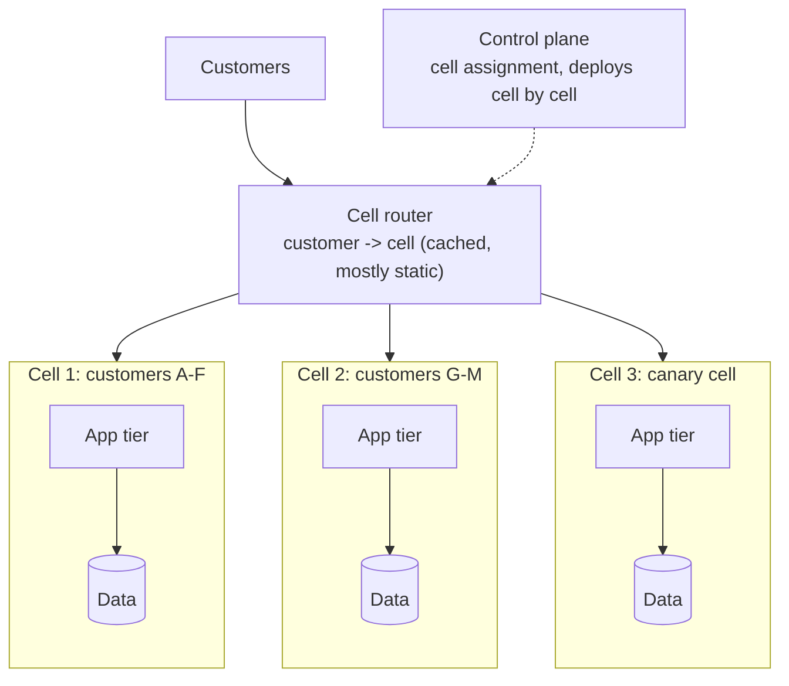
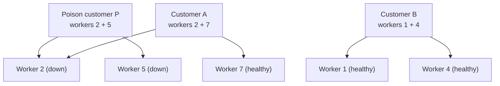

Failures will happen; the design question is **how many users each failure reaches**. That fraction is the **blast radius**. Fault isolation
shrinks it: zones and regions for infrastructure failures, cells and shuffle sharding for software and tenant problems, bulkheads and
quotas for noisy neighbours, and staged rollouts for bad changes. It's the difference between "some customers saw errors for ten minutes"
and "we were down".

## Why it matters

- Redundancy protects against **independent** failures; many real outages are **correlated** — a bad deploy, a poison request, a runaway
  tenant, a config pushed everywhere at once ([availability math](lesson:availability-math)).
- In multi-tenant systems, one customer's traffic or data can trigger failures that hit every other customer.
- Blast radius is something you can design and measure: "a single failure affects at most 1% of customers" is a concrete requirement.

## How it works

### Failure domains

Map what can fail together — a process, a host, a rack, an availability zone, a region, a deployment, a configuration push, a dependency —
and make sure redundant copies sit in **different** domains. Then make changes travel **one domain at a time**.

### Cells

A **cell** is a complete, independent copy of a service stack (app tier, data stores, queues) serving a subset of customers. A thin **cell
router** maps each customer to a cell. A failure, bad deploy or poison request inside one cell affects only that cell's customers.

- **Cell size is a choice**: 100 cells means a cell failure hits about 1% of customers; cells also cap growth limits you have to test.
- **Deploy cell by cell**, starting with a small canary cell ([deployment strategies](lesson:deployment-strategies)).
- **No cross-cell dependencies** on the request path — a shared database behind all cells recreates a global blast radius.
- **The router must be simpler and more available than the cells**: a mostly static mapping, cached at the edge.

### Shuffle sharding

Instead of putting each customer on one fixed shard, assign each customer a **random combination** of a few workers out of many. If a
customer's requests poison their workers, only customers who share the **same combination** lose all their capacity; customers who share one
worker still have others.

```drill
? 8 workers; each customer is assigned 2 of them at random. How many distinct pairs exist?
= 28
~ 1.01
> C(8, 2) = 28. A poison customer that takes down its pair fully affects only the ~1/28 (3.6%) of customers with the same pair.

? With 16 workers and 4 per customer, how many distinct combinations are there?
= 1820
~ 1.01
> C(16, 4) = 1,820 — one bad tenant fully affects about 0.05% of customers.
```

AWS has described using shuffle sharding in Route 53, where 2,048 virtual name servers with four per domain give about 730 billion possible
combinations.

### Isolation inside a service

- **Bulkheads** per dependency and per workload type, so one slow path can't consume every thread ([circuit breakers and
  bulkheads](lesson:circuit-breakers-bulkheads)).
- **Per-tenant quotas and rate limits** for requests, storage, queue depth and concurrency ([distributed rate
  limiting](lesson:distributed-rate-limiting)).
- **Separate pools** for interactive and batch work, and for premium and free tiers.
- **Poison request handling**: a request or message that crashes workers is detected (repeated failures with the same input), quarantined
  to a dead-letter queue, and blocked ([retries and DLQs](lesson:retries-dlq)).
- **Static stability**: the data plane keeps working with its last known configuration when the control plane fails
  ([API gateway](problem:api-gateway)).

## Architecture





Customer A loses one worker but keeps working through worker 7 (with retries routed to the healthy one); customer B is untouched.

## Failure scenarios

| Failure | Without isolation | With isolation |
|---|---|---|
| Bad deploy | All users affected | One canary cell or zone affected, rolled back |
| Poison request crashes workers | Crash loops across the fleet | Quarantined; shuffle sharding limits the damage |
| Noisy tenant floods the service | Everyone's latency rises | Tenant hits its quota or its own cell |
| Shared database overloaded | Every cell fails | Each cell has its own data store |
| Control plane outage | Data plane can't route | Data plane continues with cached config (static stability) |
| Cell router failure | Global outage | Router kept minimal, replicated, mapping cached at clients and edges |

## Trade-offs

| Choice | Gain | Cost |
|---|---|---|
| Many small cells | Small blast radius, tested scale limits | More infrastructure, harder cross-cell features (global search, analytics) |
| Few large cells | Efficient | Larger blast radius |
| Shuffle sharding | Huge reduction in correlated tenant failures | Routing complexity; needs clients that retry other workers |
| Strict per-tenant quotas | Fairness, protection | Legitimate bursts get throttled; quota management |
| Static stability | Survives control-plane outages | Stale configuration until recovery |

## In real systems

- AWS has written about cell-based architectures and shuffle sharding in its Builders' Library; many AWS services use cells and zone-
  isolated deployments.
- Slack has described moving to a cellular, zone-isolated architecture so that a single availability-zone problem can be drained quickly.
- Large SaaS platforms commonly pin enterprise customers to dedicated cells or "pods", which also helps with data residency.

## Common mistakes

- **Redundancy without independence**: all copies share a deploy, config or database.
- **Global configuration pushes** applied everywhere at once.
- **Cells that share a database** or another hard dependency.
- **A complex cell router** that becomes the new single point of failure.
- **No per-tenant limits** in shared infrastructure.
- **Retrying poison requests forever.**

## In the interview

When an interviewer asks "what if one customer sends malformed data that crashes the service?" or "how do you limit the impact of a bad
deploy?", answer with blast radius: per-tenant quotas, quarantining poison messages, cells or shuffle sharding, and rolling changes one
cell or zone at a time.

````question title="What is a cell-based architecture and why use it?"
The system is split into many independent copies of the full stack — cells — each serving a fixed subset of customers, with a thin router
mapping customers to cells. Because cells share nothing on the request path, a failure, bad deploy or overloaded customer affects only one
cell, so the blast radius is roughly one cell's share of customers. Cells also give a tested maximum size per unit and let you deploy
gradually, cell by cell. The costs are more infrastructure and harder cross-cell features.
````

````question title="How does shuffle sharding reduce the impact of a bad tenant?"
Each tenant is assigned a small random subset of workers from a larger pool instead of one fixed shard. If one tenant's requests crash or
overload its workers, only tenants with exactly the same subset lose all capacity — with 8 workers and 2 per tenant, about 1 in 28 — while
tenants that overlap on one worker keep working through the others. Larger pools and subsets make the affected fraction tiny.
````

## Key takeaways

- Design for **blast radius**: the fraction of users a single failure can reach.
- Separate **failure domains** and roll changes through them **one at a time**.
- **Cells** contain failures to a subset of customers; **shuffle sharding** makes correlated tenant failures rare.
- Inside services, use **bulkheads, per-tenant quotas, poison-message quarantine** and **static stability**.

## Knowledge check

```quiz
? A platform runs 50 independent cells, and a bad deploy reaches only the first cell before automated rollback. Roughly what share of customers was affected?
- 100%
! Cells contain the failure.
+ About 2%
- 50%
! Only one of 50 cells.
- 0%
! The canary cell's customers were affected.
> One cell of 50 ≈ 2%.

? Cells each have their own app tier but share one global database. What is the problem?
+ The shared database is a cross-cell dependency, so its failure or overload still affects every cell
- Cells must share databases
! They shouldn't, on the request path.
- Databases can't be shared
! They can; that's the problem.
- The cell router becomes slower
! Not the core issue.
> Cells should share nothing on the request path.

? With 8 workers and each customer assigned a random pair, a poison customer takes down its two workers. Which customers lose all capacity?
- All customers
! Most have at least one healthy worker.
+ Only customers assigned exactly the same pair (about 1 in 28)
- Customers sharing one worker with the poison customer
! They keep their other worker.
- None
! Customers with the same pair are affected.
> Shuffle sharding limits full overlap.

? The control plane that pushes routing config is down. A statically stable data plane should...
- Stop serving until config is available
! That turns a control-plane outage into a full outage.
+ Keep serving with the last known good configuration
- Fall back to an empty configuration
! That drops all routes.
- Restart repeatedly
! That makes things worse.
> Data planes must not depend on control planes at request time.
```
