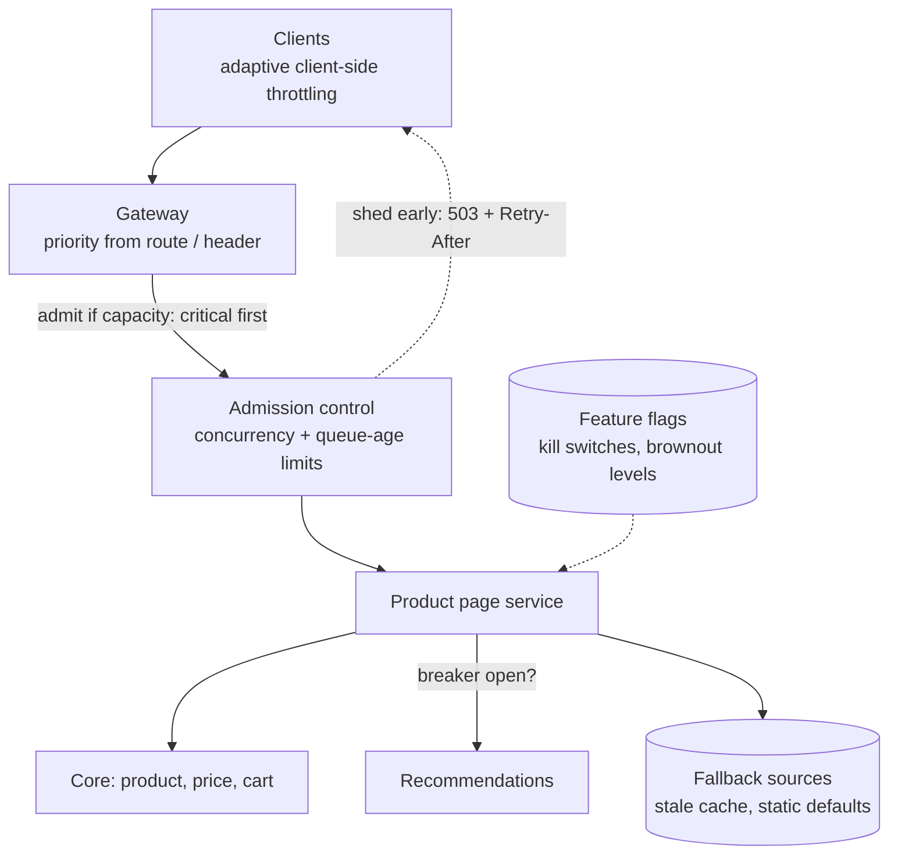
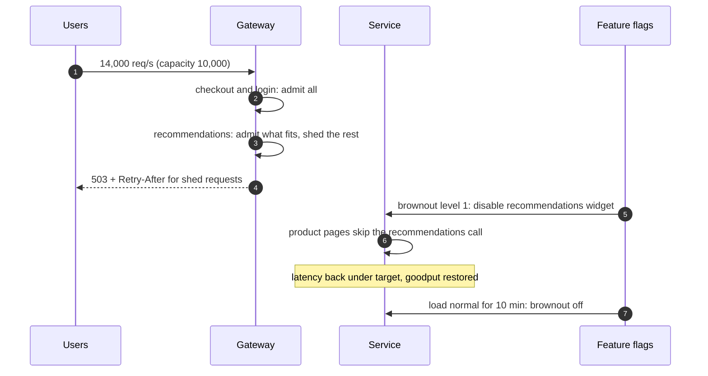

Systems rarely fail all at once; a recommendation service is slow, a database is overloaded, a region is struggling. **Graceful
degradation** keeps the core of the product working by turning off or simplifying the rest, and **load shedding** rejects some work early
so the system keeps doing useful work instead of collapsing under more than it can handle. Both are decisions you make before the incident,
not during it.

## The problem

Two situations call for it:

- **Partial failure**: one dependency is down or slow. Without a plan, the page that needed it errors — even though 90% of it could have
  rendered ([circuit breakers](lesson:circuit-breakers-bulkheads)).
- **Overload**: demand exceeds capacity. Queues grow, latency rises past client timeouts, clients retry, and the server spends its capacity
  on requests whose callers have already given up. **Throughput of useful work (goodput) collapses** even though the servers are 100% busy.

The fix for overload is counter-intuitive: **reject some requests on purpose, early and cheaply**, so the rest succeed.

```drill
? Capacity is 10,000 req/s. Traffic spikes to 14,000 req/s: 8,400 critical (checkout, login) and 5,600 low-priority (recommendations, prefetch). Shedding by priority, how many low-priority requests/s are rejected?
= 4000
~ 1.05
> Admit all 8,400 critical, then 1,600 low-priority to reach 10,000; shed 5,600 − 1,600 = 4,000/s.
```

## Architecture



**Degradation** tools, per feature:

| Fallback | Example |
|---|---|
| Serve stale data | Product details from cache past their TTL ("serve stale on error") |
| Use a default | "Popular items" instead of personalised recommendations |
| Hide the feature | Remove the reviews widget; keep the page |
| Reduce fidelity | Lower video bitrate, fewer search results, smaller images |
| Read-only mode | Browsing works; posting is temporarily disabled |
| Queue for later | Accept the order, confirm by email when the downstream recovers |

**Load-shedding** tools:

- **Priorities**: classify requests (critical, normal, best-effort) at the edge; under pressure, shed best-effort first.
- **Admission control**: cap concurrent requests per server; reject immediately (`503` with `Retry-After`) when full, rather than queueing.
- **Queue-age limits**: drop requests that have waited longer than their deadline — the client has already given up. Under overload,
  serving the newest requests first (LIFO) keeps some users fully served instead of everyone timing out.
- **Brownouts**: pre-defined levels that progressively disable expensive features (level 1: no recommendations; level 2: no search
  suggestions; level 3: read-only).
- **Client-side throttling**: clients track how many of their recent requests were rejected and start dropping requests locally before
  sending them. Google's SRE book describes rejecting locally with probability max(0, (requests − K × accepts) / (requests + 1)), with
  K = 2.

**Fail open or fail closed** when a protective component is down: rate limiters and recommendation filters usually fail open; security
checks and payment fraud checks fail closed ([distributed rate limiting](lesson:distributed-rate-limiting)).

## Request and data flow



## Advantages

- **Core functions survive** partial failures and overload.
- **Goodput is preserved**: capacity goes to requests that can still succeed.
- **Fast failure** for shed requests lets clients back off or retry elsewhere instead of hanging.
- **Predictable incidents**: pre-agreed brownout levels replace improvisation.

## Disadvantages

- **Product decisions required**: what is critical, what can degrade, what users see — engineering can't decide alone.
- **Fallback paths are rarely exercised** and rot unless tested.
- **Degraded modes can persist unnoticed** without alerts and clear exit criteria.
- **Complexity** in every feature that has a fallback.

## Failure scenarios

| Failure | What happens | Mitigation |
|---|---|---|
| No shedding under overload | Latency explodes, retries add load, goodput collapses | Admission control, queue-age limits, early 503s |
| Shedding after expensive work | Capacity still wasted | Shed at the edge, before parsing bodies and calling backends |
| Fallback depends on the failed system | Fallback fails too | Independent fallback sources; static defaults |
| Stale-data fallback serves very old data | Wrong prices or stock shown | Maximum staleness; hide fields that can't be stale |
| Kill switch never tested | Doesn't work during the incident | Exercise switches in game days ([failover](lesson:failover)) |
| Everyone retries shed requests at once | Second spike | `Retry-After`, jittered backoff, client-side throttling |

## Alternatives

- **Over-provisioning**: enough headroom that overload is rare — expensive, and still not a plan for dependency failures.
- **Autoscaling**: adds capacity, but takes minutes; shedding covers the gap ([scaling the app tier](lesson:scaling-app-tier)).
- **Queues** for work that can wait, smoothing spikes instead of rejecting ([backpressure](lesson:backpressure)).
- **Rate limiting per client** for fairness, which also prevents one client from causing overload.

## Where it shows up in interviews

Ticket sales and flash-sale spikes (virtual waiting rooms are a form of admission control), news feeds that drop ranking under load, video
streaming that lowers bitrate, e-commerce pages that hide recommendations, and any "what happens if this dependency is down?" follow-up.
Name the critical path, the fallbacks for everything else, and where load is shed.

````question title="Recommendations are down. What does the home page do?"
It still renders. The recommendations call sits behind a timeout and circuit breaker; while it's failing, the page uses a fallback — a
cached list of popular items for the user's region, or simply hides the module — and logs and alerts on the degraded state. Critical parts
(navigation, search, cart) don't depend on recommendations at all. When the dependency recovers, the breaker closes and personalised
results return automatically.
````

````question title="Your service receives twice its capacity during a spike. What should it do?"
Shed load early instead of queueing everything. Classify requests by priority at the gateway, admit critical ones first, and reject the
rest immediately with 503 and Retry-After; cap concurrency per server and drop requests that have already waited past their deadline.
Activate pre-planned brownouts that turn off expensive optional features. Clients back off with jitter or throttle themselves. Meanwhile
autoscaling adds capacity, and shedding stops once load returns under the limit.
````

## Common mistakes

- **Unbounded queues** that turn overload into universal timeouts.
- **Treating every request as equally important.**
- **Fallbacks that depend on the failing component.**
- **No user-facing design for degraded states.**
- **Never testing** kill switches, brownouts and fallbacks.
- **Shedding too late** in the request path.

## Key takeaways

- **Degrade features, not the product**: stale data, defaults, hidden widgets, read-only mode.
- Under overload, **shed early and by priority**; protect **goodput**, not throughput.
- Use **admission control, queue-age limits, brownouts and client-side throttling**.
- Decide **fail open vs fail closed** per component, and **test** degraded modes regularly.

## Knowledge check

```quiz
? A server at capacity queues every request. Latency rises to 30 s while clients time out at 5 s. What is happening to useful work?
- It increases because the server is fully busy
! Busy isn't the same as useful.
+ It collapses: the server spends capacity on requests whose clients have already given up
- It stays the same
! Timed-out work is wasted.
- It improves once the queue fills
! A full queue doesn't help.
> Bounded queues and early rejection preserve goodput.

? Under overload, which requests should be shed first on a shopping site?
- Checkout requests
! Usually the most critical.
- Login requests
! Users can't do anything without them.
+ Recommendation and prefetch requests
- Random requests regardless of type
! Priorities protect what matters.
> Shed best-effort work first.

? The fallback for a failed product-details service is to query the same database directly. What is the flaw?
+ If the database is why the service failed, the fallback fails too and adds load to the struggling database
- Fallbacks must always return errors
! They should return something useful.
- Direct database access is too fast
! Speed isn't the issue.
- Fallbacks can't read data
! They can, from independent sources.
> Fallbacks need independent sources.

? Why do some overloaded servers process the newest queued requests first?
- Newer requests are smaller
! Not necessarily.
+ Old queued requests have likely already timed out at the client; serving new ones first keeps some users fully served
- LIFO queues use less memory
! Memory isn't the reason.
- To be fair to all clients
! LIFO is deliberately unfair under overload.
> Spend capacity where the client is still waiting.
```
