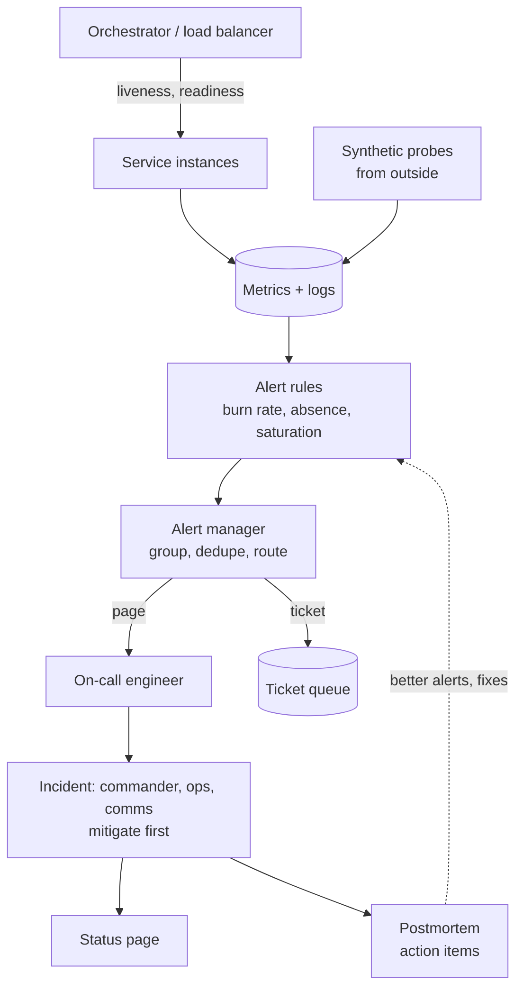
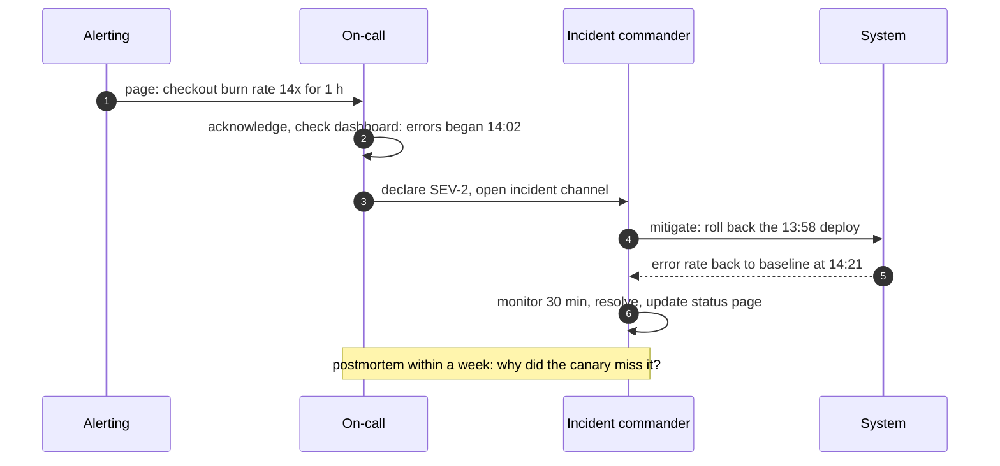

Health checks decide which instances receive traffic and which get restarted; alerts decide when a human is woken up; incident management
decides what that human does next. All three are easy to get subtly wrong — a health check that restarts every instance during a database
blip, an alert that pages for a CPU spike nobody can act on, an incident where five people debug and nobody rolls back. This lesson covers
how to get them right.

## Why it matters

- Load balancers and orchestrators act on health checks **automatically and at scale** — a bad check can turn a partial failure into a
  total one ([load balancers](lesson:load-balancers)).
- Detection and response time dominate recovery time, which drives availability ([availability math](lesson:availability-math)).
- Noisy alerts get ignored; the one real alert is then missed. Pages must be rare, urgent and actionable.
- Incidents go better with roles and a habit of mitigating first; outages repeat unless postmortems produce real fixes.

## How it works

### Liveness, readiness and startup

| Check | Question | Action on failure | Should it check dependencies? |
|---|---|---|---|
| **Liveness** | Is this process stuck beyond recovery (deadlock, wedged event loop)? | Restart the instance | **No** — a database outage would restart every instance |
| **Readiness** | Can this instance serve traffic right now (warmed up, not shutting down, not overloaded)? | Stop routing traffic to it | Only local essentials; never a shared dependency that fails for all instances at once |
| **Startup** | Has a slow-starting app finished starting? | Delay liveness checks | No |

The classic outage: readiness checks that query the shared database. The database has a 30-second hiccup, **every** instance turns
unready, the load balancer has no backends, and a partial degradation becomes a full outage — followed by a thundering herd when they all
return. Deep dependency checks belong on dashboards, not in routing decisions.

**Graceful shutdown** uses readiness too: on a termination signal the instance reports "not ready", the load balancer stops sending new
requests, in-flight requests finish, then the process exits ([scaling the app tier](lesson:scaling-app-tier)).

```yaml title="Kubernetes probes for a Spring Boot service (Actuator health groups)"
# application.yml
management:
  endpoint:
    health:
      probes:
        enabled: true          # exposes /actuator/health/liveness and /readiness
server:
  shutdown: graceful           # finish in-flight requests on SIGTERM
---
# deployment.yaml (container section)
livenessProbe:
  httpGet: { path: /actuator/health/liveness, port: 8080 }
  periodSeconds: 10
  failureThreshold: 3
readinessProbe:
  httpGet: { path: /actuator/health/readiness, port: 8080 }
  periodSeconds: 5
  failureThreshold: 2
startupProbe:
  httpGet: { path: /actuator/health/liveness, port: 8080 }
  periodSeconds: 5
  failureThreshold: 30         # allow up to 150 s to start
```

### Alerting

- **Page on symptoms** users feel — SLO burn rates, error rates, latency, a queue whose oldest message is getting old — not on causes like
  CPU or a single pod restarting ([SLOs and error budgets](lesson:slos-error-budgets)).
- **Every page must be actionable** and link to a runbook: what it means, how to check, how to mitigate.
- **Severities**: pages for "users are affected now or soon"; tickets for "fix this week"; dashboards for everything else.
- **Alert on absence**: a pipeline that silently stops produces no errors. Alert when expected events stop (no orders for 10 minutes at
  noon, consumer lag growing, a heartbeat job's "dead man's switch" not reporting).
- **Group and deduplicate** related alerts so one database failure doesn't produce 200 pages.
- **Watch on-call load**: if a rotation gets more than a couple of pages per shift, fix the alerts or the system.

### Incident management

1. **Declare** early, with a severity level, when users are (or may be) affected.
2. **Assign roles**: an **incident commander** coordinates and decides; an **operations lead** (and experts) investigate and act; a
   **communications lead** updates status pages and stakeholders; a **scribe** keeps the timeline.
3. **Mitigate first**: roll back the last deploy, fail over, disable a feature flag, shed load, scale up — restore service before finding the
   root cause ([deployment strategies](lesson:deployment-strategies), [graceful degradation](lesson:graceful-degradation)).
4. **Communicate** on a regular cadence, even when there's nothing new.
5. **Resolve and follow up** with a **blameless postmortem**: impact, timeline, root cause and contributing factors, what went well,
   and action items with owners and dates. Blameless means asking how the system allowed the mistake, not who made it.

## Architecture





## Failure scenarios

| Failure | What happens | Prevention |
|---|---|---|
| Liveness checks the database | DB blip restarts every pod; crash loop | Liveness checks only the process itself |
| Readiness depends on a shared dependency | All instances unready at once; total outage | Readiness checks local state; dependencies degrade gracefully |
| Health endpoint lies | Reports healthy while request threads are exhausted | Serve health on the same server path; include saturation signals |
| No startup probe for a slow app | Liveness kills it before it finishes starting | Startup probe or generous initial delay |
| Alert storm | Hundreds of pages; real signal lost | Grouping, inhibition, symptom-based paging |
| Silent pipeline stall | No errors, so no alerts | Absence and freshness alerts, dead man's switch |

## Trade-offs

| Choice | Gain | Cost |
|---|---|---|
| Aggressive health check thresholds | Fast removal of bad instances | Flapping and false removals under brief load |
| Lenient thresholds | Stability | Slow reaction to real failures |
| Symptom-based pages | Few, meaningful pages | Causes found during investigation, not by the alert |
| Automated remediation (restart, failover) | Fast recovery | Can amplify problems if the trigger is wrong |
| Strict incident process | Calm coordination | Overhead for small incidents (scale it by severity) |

## In real systems

- Kubernetes distinguishes liveness, readiness and startup probes; Spring Boot Actuator exposes matching health groups and tracks
  application availability state.
- Google's SRE book recommends paging on symptoms and keeping on-call load low (a small number of incidents per shift); many companies use
  the incident commander role adapted from emergency response systems.
- Public postmortems (from cloud providers and large SaaS companies) are a good source of real failure patterns
  ([production failures](lesson:production-failures)).

## Common mistakes

- **Dependency checks in liveness probes.**
- **Readiness that fails everywhere at once.**
- **Paging on CPU, memory or single-instance restarts.**
- **Alerts without runbooks or owners.**
- **Debugging root cause before mitigating.**
- **Postmortems that blame people** or produce no tracked actions.

## In the interview

In the monitoring section, include: *"Readiness gates traffic and liveness only restarts wedged processes; we page on SLO burn rate and on
consumer lag, alert on absence of orders, and mitigate incidents by rolling back or disabling the feature flag first."*

````question title="What is the difference between liveness and readiness checks?"
Liveness answers "is this process broken beyond self-recovery?" — if it fails, the orchestrator restarts the instance, so it must only check
the process itself (for example, that the event loop responds). Readiness answers "should this instance receive traffic right now?" — if it
fails, the instance is removed from load balancing but not restarted; it covers warm-up, shutdown and local overload. Neither should depend
on a shared downstream service, or one dependency hiccup restarts or removes every instance at once.
````

````question title="You are paged at 3 a.m. for elevated checkout errors. What do you do?"
Acknowledge, check the dashboards for scope and start time, and declare an incident if users are affected. Look for the most recent change —
a deploy, a config change, a dependency incident — and mitigate first: roll back, disable the feature flag, fail over or shed load. Pull in
help and assign a commander and communications if it's large. Once service is restored and stable, update the status page, close the
incident, and schedule a blameless postmortem to find root causes and fix the gaps that let it happen.
````

## Key takeaways

- **Liveness** restarts wedged processes and must not check dependencies; **readiness** gates traffic and must not fail for all instances
  at once; **startup** protects slow starts.
- **Page on symptoms** (SLO burn, user-facing errors, absence of expected events); everything paged must be actionable.
- In incidents: **declare, assign roles, mitigate first, communicate, then learn** with blameless postmortems.

## Knowledge check

```quiz
? A liveness probe calls the database. The database is unavailable for 45 seconds. What happens?
+ Every instance fails liveness and is restarted, causing a crash loop and a longer outage than the database blip
- Nothing; liveness is informational only
! Orchestrators restart instances that fail liveness.
- Only one instance restarts
! All instances see the same database.
- Traffic shifts to healthy instances
! That's readiness, and here every instance is affected.
> Liveness should check only the process.

? Which alert should page an on-call engineer at night?
- CPU above 80% on one instance
! A cause, often harmless.
- A single pod restarted
! Self-healing; not urgent.
+ The checkout SLO is burning its error budget at 14x the sustainable rate
- Disk on a log server at 60%
! Ticket-level, not a page.
> Page on user-facing symptoms.

? During an incident, the team suspects the deploy 10 minutes before errors started. What should happen first?
- Analyse logs until the root cause is proven
! Users stay affected meanwhile.
+ Roll back the deploy to mitigate, then investigate
- Write the postmortem
! That's after resolution.
- Restart the database
! Unrelated to the suspected cause.
> Mitigate first.

? A queue consumer silently stops processing; no errors are logged. How do you detect it?
- Error-rate alerts
! There are no errors.
+ Alert on growing consumer lag or the age of the oldest message (absence/freshness alerts)
- A liveness probe on the producer
! The producer is fine.
- CPU alerts on the consumer
! Low CPU looks like a quiet period.
> Alert on the absence of expected progress.
```
