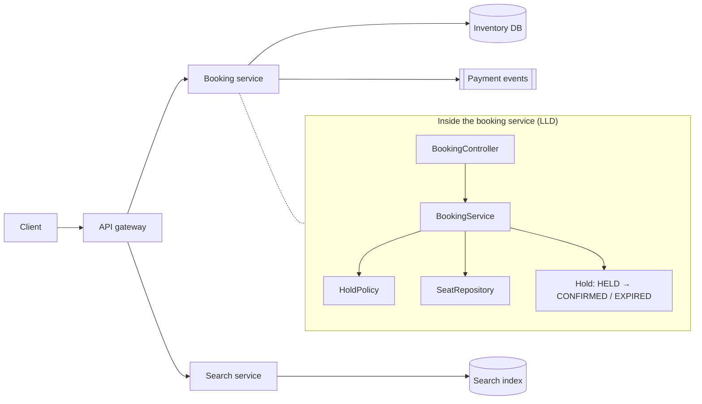
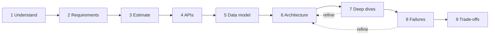

The same product can be designed at two zoom levels. Knowing which one an interview is asking for — and what the interviewer is
writing down while you talk — changes what you should produce in the next 45 minutes.

## Why it matters

Candidates lose HLD interviews in two opposite ways: by drawing class diagrams when the interviewer wanted to know how the system
survives a database failure, and by staying vague ("we'll scale it horizontally") when the interviewer wanted depth. Both come from
not knowing what the round measures.

- **High-level design (HLD)** answers *which components exist and how they work together*: clients, load balancers, services,
  databases, caches, queues, object storage, and the data flowing between them — judged on scale, latency, availability and
  consistency.
- **Low-level design (LLD)** answers *how the code inside one component is organised*: classes, interfaces, relationships, state
  machines and patterns — judged on correctness, cohesion and extensibility.

They are not competing approaches; they are two levels of one design. An HLD box labelled "Booking Service" has an LLD inside it.

## How it works

### Two zoom levels of one problem

Take an event-ticketing product and ask both questions.

| | High-level design | Low-level design |
|---|---|---|
| Question | How do thousands of people buying the same seats at once avoid double bookings? | How do `Seat`, `Hold` and `Booking` objects model a reservation? |
| Building blocks | API gateway, booking service, seat-inventory database, cache, queue | Classes, enums, interfaces, a hold state machine |
| Key concerns | Contention across servers, consistency of inventory, peak load, failover | Encapsulation, valid state transitions, testability |
| Typical output | Architecture diagram, APIs, data model, scaling and failure plan | Class diagram and working code for core flows |
| Time scale of thinking | Network hops (milliseconds) and machine failures | Method calls (nanoseconds) and object lifecycles |

HLD stops at the boundary of a service: it says *the booking service holds a seat with a conditional update and an expiry*; LLD
then decides how the code inside the service represents and enforces that.

### What interviewers evaluate

HLD interviewers score a small set of dimensions. The names vary by company; the substance is consistent:

1. **Problem navigation** — turning an ambiguous prompt into a scoped problem, asking questions that change the design, and
   managing time.
2. **Requirements and estimation** — functional requirements, quantified non-functional requirements, and estimates that inform
   decisions.
3. **High-level design** — a working end-to-end design that satisfies every functional requirement.
4. **Technical depth** — going deep on the hard parts: partitioning, consistency, contention, failure.
5. **Trade-offs** — naming alternatives and explaining why the chosen option fits these requirements.
6. **Communication** — explaining as you go, checking in, and responding well to pushback.

The bar moves with level. At **SDE-2**, a correct, reasonable design and solid depth when prompted is a pass. At **senior**, you are
expected to *drive*: find the hard parts yourself, bring alternatives before you are asked, quantify, and keep the interview on
schedule. The [rubric lesson](lesson:interview-rubric) covers this in detail.

### The nine-step framework

This track uses one repeatable sequence for every HLD interview. Each step produces something visible on the board.

| Step | Output | ~45-min budget |
|---|---|---|
| 1. Understand the problem | Users, core use case, explicit exclusions | 3 min |
| 2. Define requirements | 3–5 functional, quantified non-functional | 4 min |
| 3. Estimate capacity | The two or three numbers that matter | 3 min |
| 4. Define APIs | One endpoint per functional requirement | 4 min |
| 5. Model the data | Entities, keys, stores, indexes | 4 min |
| 6. High-level architecture | A working diagram, narrated request by request | 10 min |
| 7. Deep dives | Two or three hard problems, solved with options | 10 min |
| 8. Bottlenecks and failures | SPOFs, hot spots, failure handling | 4 min |
| 9. Trade-offs and wrap-up | Summary, alternatives, next steps | 3 min |

Stage 5 teaches each step in depth; until then, use this table as the shape of every problem you practise.

## Architecture

The zoom levels, drawn: an HLD diagram where one box is opened to show the LLD inside it.



And the interview's timeline — the steps flow left to right, and you revisit earlier boxes as deep dives refine them:



## Failure scenarios

How HLD interviews go wrong, mapped to the dimension each failure costs you:

| What happens | Dimension hurt | Fix |
|---|---|---|
| You start drawing before asking anything | Navigation, requirements | Spend the first 3–5 minutes on questions and requirements |
| You explain class hierarchies in an HLD round | High-level design | Stay at the level of services, stores and data flow unless asked |
| You say "it scales horizontally" without saying how | Depth | Name the mechanism: stateless tier, partition key, cache, replicas |
| Every choice is "better" with no downside | Trade-offs | Name what each choice costs and what you would pick if requirements changed |
| You run out of time before any deep dive | Navigation, depth | Keep a clock; get to a working design by minute ~25 |
| You argue with every pushback, or abandon your design at the first one | Communication | Treat pushback as new requirements; adapt locally, explain why |

## Trade-offs

- **Breadth vs depth.** Forty-five minutes is not enough to go deep everywhere. A strong candidate covers the whole system lightly
  first, then spends real time on the two or three parts that matter most for *this* problem.
- **Precision vs pace.** Exact numbers and full API specs feel rigorous but eat time. Round numbers and representative endpoints are
  usually enough; say what you are skipping.
- **Leading vs following.** Senior candidates are expected to drive, but driving past the interviewer's hints is a communication
  failure. Lead, and check in at each step.

## In real systems

At most companies the two levels show up as two documents and two reviews:

- A **design document** (or RFC) for a new system or major change contains the HLD: context, requirements, the architecture,
  data model, APIs, alternatives considered, failure handling and a rollout plan. It is reviewed by senior engineers who ask exactly
  the questions an HLD interviewer asks.
- **Code review** is where LLD lives day to day: class structure, naming, tests and patterns.

The interview is a compressed design review. Practising it is practising a real part of the job.

## Common mistakes

- **Treating the prompt as complete.** "Design Twitter" hides dozens of decisions; the interviewer expects you to scope it.
- **Mixing levels randomly.** Jumping from "add a cache" to Java class names and back loses the interviewer. Stay at one level per step.
- **Memorising one diagram per problem.** Interviewers change a requirement to see whether you can reason; a memorised answer breaks.
- **Saying nothing while drawing.** Silence hides your reasoning, which is what is being scored.
- **Skipping failure and trade-offs** because the design "works". Working is the starting line, not the finish.

## In the interview

````question title="How would you structure a 45-minute HLD interview?"
Roughly: 3–5 minutes clarifying the problem and scope; 3–4 minutes on functional and quantified non-functional requirements; 2–3
minutes estimating only the numbers that drive the design; about 8 minutes on APIs and the data model; about 10 minutes building a
working high-level architecture request by request; about 10 minutes on two or three deep dives into the hardest parts; and the last
few minutes on failures, trade-offs and a summary. Check in with the interviewer at each transition, and if you are behind schedule,
say so and compress the next step rather than skipping deep dives entirely.
````

````question title="What is the difference between how an SDE-2 and a senior candidate are evaluated in HLD?"
The dimensions are the same — navigation, requirements, design, depth, trade-offs, communication — but the expectation of ownership
differs. An SDE-2 should produce a correct, reasonable design and go deep where the interviewer points. A senior candidate should
drive the interview: scope it, quantify the requirements that matter, identify the hard parts unprompted, present several options
with costs, and keep the conversation on schedule, much like leading a design review.
````

````question title="The interviewer asks you to draw the classes inside a service during an HLD round. What do you do?"
Confirm the level they want ("Do you want me to go into the internal design of this service, or keep to the system level?"), then
follow their lead. If they do want detail, give a brief LLD of that one component — its main classes and how they enforce the
invariant that matters for the system (for example, how a seat hold expires) — then return to the system level. The point is to
switch zoom levels deliberately, not drift between them.
````

## Key takeaways

- HLD decides **components and their interactions**; LLD decides **code structure inside one component**. They are two zoom levels
  of the same design.
- Interviewers score navigation, requirements and estimation, the design, depth, trade-offs and communication; **seniority raises
  the bar for driving the conversation**.
- Use the **nine-step framework** so every interview has the same shape and you reach deep dives with time to spare.

## Knowledge check

```quiz
? Which question belongs to high-level design rather than low-level design?
- Should `Seat` and `Booking` share an abstract base class?
! That is about class structure inside one service — LLD.
+ How do concurrent purchases on different servers avoid selling the same seat twice?
- Which design pattern should validate a booking request?
! Patterns inside a service are an LLD concern.
- Should the `Hold` state transitions be an enum or a class hierarchy?
! Modelling states in code is LLD.
> HLD is about components, data placement and coordination across machines; preventing a double booking across servers is exactly that.

? At roughly what point in a 45-minute interview should a working end-to-end design be on the board?
- Within the first five minutes
! The first minutes belong to clarifying the problem and requirements; a design drawn before them is a guess.
+ Around minute 25, leaving time for deep dives
- Only at the very end, after all deep dives
! Deep dives refine a design; without a baseline there is nothing to refine.
- It doesn't matter as long as the final design is good
! Running out of time before deep dives is one of the most common ways to fall short on depth.
> Roughly 20 minutes for scoping, requirements, estimates, APIs and data, then about 10 for the architecture — leaving 10–15 for depth.

? An interviewer pushes back: "Your single database won't handle the writes." What is the strongest response?
- Defend the original design since it was carefully considered
! Ignoring new information is a communication red flag.
- Replace the whole design with a different architecture
! Pushback usually needs a local change, not a rewrite.
+ Ask or estimate the write rate, then adapt the part that's affected — for example partitioning the writes — and explain the trade-off
- Agree and move on without changing anything
! Agreeing without acting leaves the flaw in the design.
> Treat pushback as a new requirement: quantify it, change the affected component, and say what the change costs.

? Which behaviour most distinguishes a strong senior candidate?
- Knowing the most technologies by name
! Name-dropping without reasoning scores poorly.
- Drawing the most detailed diagram
! Detail without prioritisation wastes time.
+ Identifying the hardest parts of the problem unprompted and presenting options with their costs
- Never needing to ask the interviewer anything
! Asking good questions is part of the evaluation, at every level.
> Seniority is about driving the design toward what matters and reasoning about trade-offs, not volume.
```
