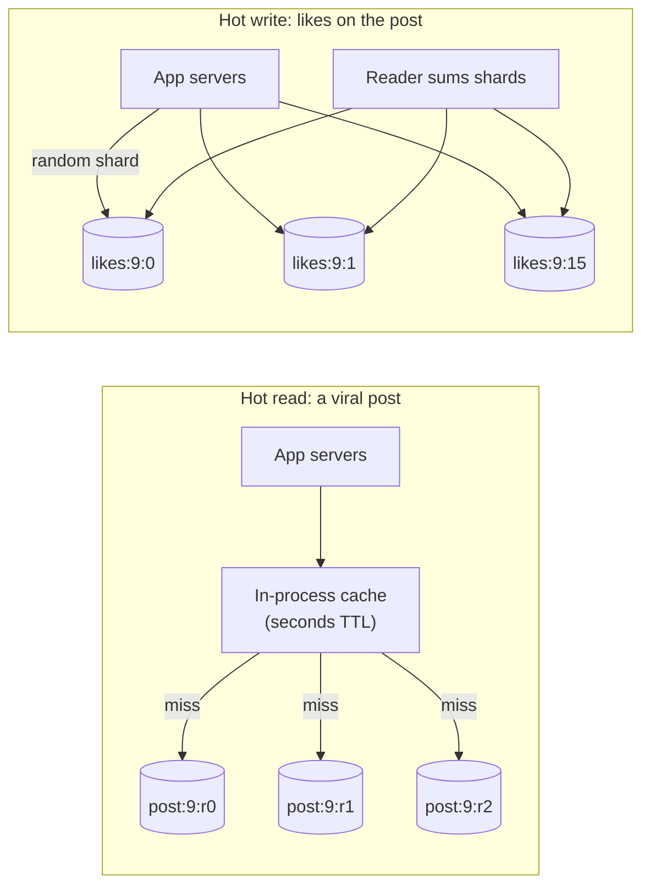

Partitioning spreads data by key, and that works beautifully — until one key gets a large share of the traffic. A celebrity's
profile, a viral post, a flash-sale product or a global counter turns one cache node, one shard or one Kafka partition into the
bottleneck for the whole system. Hot keys are where many otherwise sound designs break.

## Why it matters

Almost every social, e-commerce or real-time interview problem has a celebrity or viral moment built in: "what happens when a user with
50 million followers posts?" "what if one live stream has 5 million viewers?" Interviewers want to see that you look past averages to the
hottest single key, and that you know the different fixes for **hot reads** and **hot writes**.

## How it works

### Why hot keys hurt

A partitioned system's capacity is roughly *number of partitions × capacity per partition* — but only if load is spread evenly. One key
lives on one partition (or one replica set). If that key alone needs more than a partition can deliver, adding partitions doesn't help:
the key is still on one of them. For example, DynamoDB documents a per-partition ceiling of 3,000 read units and 1,000 write units per
second, regardless of the table's total capacity.

### Detecting them

- **Per-key metrics** are too expensive to keep for every key; instead, **sample** requests or use streaming **heavy-hitter** sketches
  (Count-Min Sketch, Space-Saving) to find the top keys.
- **Per-partition metrics**: one partition's CPU, request rate or throttling far above its peers.
- Many managed services report hot keys or partitions directly (Redis `--hotkeys` with LFU policies, DynamoDB CloudWatch Contributor
  Insights).

### Fixing hot reads

| Technique | How | Cost |
|---|---|---|
| **In-process cache** | Each app server keeps the hottest keys in memory for seconds | Brief staleness; per-server memory |
| **Replicate the key** | Copies on several cache nodes (`post:9:r0`…`r7`); readers pick one at random | Writes must update all copies |
| **Read replicas** | Spread reads of the hot partition over replicas | Replica lag |
| **Request coalescing** | Concurrent misses for the same key share one backend fetch | Little; requires support in the cache layer |
| **CDN / edge caching** | For public content, serve the hot item from the edge | Invalidation delay |

### Fixing hot writes

| Technique | How | Cost |
|---|---|---|
| **Key salting / sharded counters** | Write to `likes:post9:{0..15}` at random; read by summing the 16 | Reads fan out; totals slightly delayed |
| **Buffer and aggregate** | Accumulate increments in memory or a log; flush one combined write per interval | Seconds of delay; risk of losing the buffer |
| **Append, don't update** | Insert events (no contention) and aggregate asynchronously | Aggregation pipeline |
| **Split by time or sub-key** | `(stream_id, minute)` instead of `stream_id` | Readers combine buckets |
| **Isolate the hot tenant** | Give a huge customer a dedicated shard | Operational overhead |

### Designing for celebrities up front

Some hot keys are predictable: celebrity accounts, top products, global leaderboards, live events. Treat them as a separate path in the
design — for example, timelines that **push** posts to followers' feeds for normal accounts but **pull** celebrity posts at read time
(the hybrid in [fan-out](lesson:fan-out)) — rather than hoping the general path copes.

## Architecture



## Failure scenarios

- **A cache node melts down** under one key; its other keys (unrelated users) suffer too. Replicate or locally cache the hot key.
- **A cache stampede**: the hot key expires and thousands of requests miss at once. Coalesce requests and refresh early (see
  [cache failure modes](lesson:cache-failure-modes)).
- **Throttling on a managed store**: a hot partition is throttled while the table is mostly idle.
- **A hot Kafka partition**: everything keyed by one ID goes to one partition and one consumer; that consumer falls behind. Salt the key
  if strict per-key ordering isn't required, or split the work.
- **Contention on one row**: every request updates the same row; transactions queue on its lock. Use sharded counters or append-only events.

## Trade-offs

- **Freshness vs load.** Local caches and aggregated writes take load off the hot spot at the cost of seconds of staleness.
- **Read cost vs write cost.** Salting writes across 16 sub-keys makes writes cheap and reads 16× more expensive; replicating a hot read
  key does the opposite.
- **Special-casing vs uniformity.** A separate path for celebrities is more code, but uniform designs that ignore them fail the moment one
  appears.

## In real systems

- Social networks treat high-follower accounts specially in timeline delivery and cache their content aggressively.
- Facebook's memcache paper describes leases (a form of request coalescing) to avoid thundering herds on hot keys, and regional replication
  of hot items.
- DynamoDB recommends write sharding (random or calculated suffixes) for hot partition keys, and adaptive capacity shifts throughput toward
  busier partitions within limits.
- Twitter-scale systems and live-streaming chats aggregate counters (likes, viewers) in memory before writing them.

## Common mistakes

- **Designing only for averages** and never asking what the hottest key does.
- **Believing more partitions fix a hot key.**
- **Using the same fix for reads and writes** — replication helps reads, salting helps writes.
- **Salting keys whose order matters** without noting the loss of per-key ordering.
- **Ignoring predictable hot keys** (celebrities, top products, global counters).

## In the interview

````question title="A celebrity with 80 million followers posts. Which parts of the system get hot, and how do you handle them?"
Reads of that post and its counters are the first hot keys: millions of followers load it within minutes. I'd serve it from in-process
caches on the app servers with a short TTL, replicate it across several cache nodes, and coalesce misses so expiry doesn't cause a stampede.
Likes and comments are hot writes: I'd write likes to sharded counters (or append like events and aggregate them asynchronously) so no single
row or key takes every increment, accepting a few seconds of delay on the displayed count. And delivery to 80 million timelines would not
fan out on write: celebrity posts are pulled into followers' timelines at read time.
````

````question title="How do you detect a hot key before it causes an outage?"
Watch per-partition and per-node metrics — request rate, CPU, latency, throttling — for outliers relative to peers, and sample request keys
into a heavy-hitter sketch (a Count-Min Sketch or Space-Saving algorithm) to identify the top keys continuously. Many stores report hot keys
or partitions directly. Alert on concentration — say, one key above a few percent of a node's traffic — and have the mitigations (local
caching, replication, salting) ready to switch on per key.
````

## Key takeaways

- One key lives on one partition: **hot keys cap the system at one partition's capacity**.
- **Detect** with sampling, heavy-hitter sketches and per-partition outliers.
- **Hot reads**: local caching, key replication, read replicas, request coalescing, CDN.
- **Hot writes**: key salting/sharded counters, buffering and aggregation, append-only events, time bucketing.
- **Design predictable hot keys** (celebrities, top items) as a separate path.

## Knowledge check

```quiz
? A product page key receives 200,000 reads/s during a flash sale; one Redis node handles about 100,000 ops/s. What helps most?
- Adding more Redis shards
! The key still lives on one shard.
+ Caching the product in each app server's memory for a few seconds and replicating the key across several nodes
- Lowering the TTL to 1 second
! That increases misses and load.
- Moving the product to a bigger database
! Reads are served by the cache tier; the issue is one cache key.
> Hot reads are fixed by spreading copies of the key and local caching.

? A post's like counter receives 30,000 increments/s, and each increment locks the same row. What is the best fix?
+ Split the counter into many sub-counters (or append like events) and sum them on read or asynchronously
- Add a read replica
! Replicas don't take writes.
- Use serializable isolation
! That increases contention.
- Cache the counter
! Caching helps reads, not the write hotspot.
> Hot writes need the write spread across keys, at the cost of combining on read.

? Why might salting a Kafka message key be unacceptable?
- It reduces throughput
! Salting increases parallelism.
+ Events for the same entity land in different partitions, losing per-entity ordering
- Kafka rejects keys with suffixes
! Keys are arbitrary bytes.
- It prevents consumer groups
! Consumer groups still work.
> Per-key ordering in Kafka comes from all of a key's events sharing a partition.

? Which signal most directly points to a hot partition?
- High average CPU across the cluster
! Average load hides a single outlier.
+ One partition throttling or running far hotter than its peers while others are idle
- A slow DNS lookup
! Unrelated to data placement.
- Low cache memory usage
! Memory use doesn't indicate a hot key.
> Hot keys show as outliers relative to peers, not as high averages.
```
