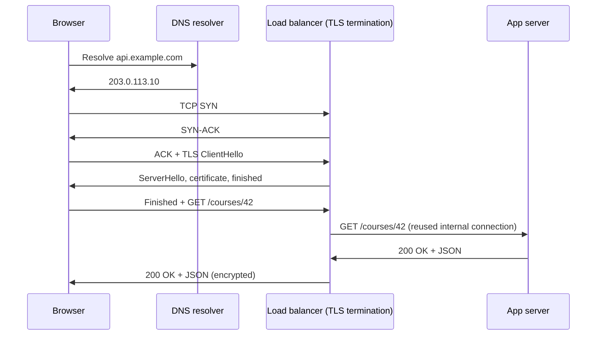

"What happens when you type a URL and press Enter?" is a classic question because the answer touches every layer of a web
system. For design work, the useful version counts round trips, names where encryption starts and ends, and explains why HTTP kept
changing versions.

## Why it matters

- **Latency budgets.** Before your server does any work, a brand-new HTTPS connection spends several round trips on DNS, TCP and TLS.
  For a user far from your servers, that setup can cost more than the request itself.
- **Architecture decisions.** Where you terminate TLS decides which components can read and route traffic, and where certificates live.
- **Protocol choice.** HTTP/2 and HTTP/3 change how many connections a client needs and how badly packet loss hurts — relevant for
  mobile clients, APIs with many small calls and real-time features.

## How it works

### The lifecycle of one HTTPS request

1. **DNS lookup** — the browser resolves the hostname (often cached; see [DNS](lesson:dns)).
2. **TCP handshake** — SYN, SYN-ACK, ACK: **1 round trip**.
3. **TLS handshake** — client and server agree on keys and the server proves its identity with a certificate. TLS 1.3 needs
   **1 round trip**; TLS 1.2 needed 2.
4. **HTTP request and response** — **1 round trip** plus server processing time and transfer time for the body.
5. **Connection reuse** — the connection stays open (keep-alive) so later requests skip steps 1–3.

So a fresh HTTPS request over TCP with TLS 1.3 costs about **3 round trips** before the first response byte; a request on a reused
connection costs **1**. Here is what that means at different distances:

| Round-trip time | New connection, TLS 1.3 (3 RTT) | New connection, TLS 1.2 (4 RTT) | Reused connection (1 RTT) |
|---|---|---|---|
| 10 ms (same region) | 30 ms | 40 ms | 10 ms |
| 80 ms (across a continent) | 240 ms | 320 ms | 80 ms |
| 200 ms (across the world) | 600 ms | 800 ms | 200 ms |

That table is the argument for connection reuse, for CDNs (which shorten the round trip by terminating connections near users), and
for HTTP/3.

### What TLS provides

TLS gives three properties: **confidentiality** (traffic is encrypted), **integrity** (tampering is detected) and **authentication** (the
server proves it owns the domain using a certificate signed by a trusted certificate authority). With **mutual TLS (mTLS)** the client
presents a certificate too — common between internal services.

**TLS termination** is where encryption ends. Typical choices:

- **At the load balancer or edge proxy.** The balancer decrypts, so it can route by path, add headers and inspect requests. Traffic to
  the backends is either plain HTTP inside a private network or re-encrypted.
- **End to end (passthrough).** An L4 balancer forwards encrypted bytes; each backend terminates TLS itself. Better isolation, but the
  balancer can't make HTTP-level decisions.
- **At a CDN.** The CDN terminates near the user and opens its own (often long-lived, reused) connection to your origin.

### HTTP versions

| Aspect | HTTP/1.1 | HTTP/2 | HTTP/3 |
|---|---|---|---|
| Transport | TCP | TCP | QUIC over UDP |
| Requests per connection at once | One (pipelining is effectively unused) | Many, multiplexed as streams | Many, as independent streams |
| Typical browser behaviour | Up to about 6 connections per host | 1 connection per host | 1 connection per host |
| Headers | Plain text, repeated each request | Compressed (HPACK) | Compressed (QPACK) |
| Head-of-line blocking | At HTTP level and TCP level | At TCP level only | Only within a stream |
| Handshake | TCP + TLS | TCP + TLS | Combined transport and TLS 1.3 handshake; 0-RTT resumption possible |

- **HTTP/1.1** handles one outstanding request per connection, so browsers open several connections per host, and one slow response
  blocks the next.
- **HTTP/2** multiplexes many requests over one connection and compresses headers — great for pages and APIs with many small requests.
  But it still runs on TCP, so one lost packet stalls every stream.
- **HTTP/3** runs on QUIC, which builds encrypted, independently ordered streams on UDP. A lost packet delays only the stream it belongs
  to, the handshake is shorter, and connections can survive a change of network (Wi-Fi to mobile) because they are identified by a
  connection ID rather than by IP and port.

### Request anatomy

An HTTP request has a **method** (`GET`, `POST`, …), a **target** (`/api/courses/42`), **headers** (`Host`, `Authorization`,
`Content-Type`, `Accept-Encoding`, `Cache-Control`, …) and an optional **body**. The response has a **status code**, headers and a body.
Most of what proxies, caches and gateways do is read and rewrite those headers — which is why they need to work at layer 7.

## Architecture



The client's handshakes happen with the load balancer, not the app server: the balancer keeps a pool of already-open connections to the
backends, so the expensive setup happens once per client connection, near the edge.

## Failure scenarios

- **Expired or misconfigured certificates.** Every client fails at once with a TLS error. Automate renewal (for example with ACME) and
  monitor expiry dates.
- **Slow handshakes under load.** TLS key exchange costs CPU; a reconnect storm after a deploy or failover can saturate termination
  points. Session resumption and keeping connections alive reduce the cost.
- **Idle-timeout mismatches.** If a proxy closes idle connections earlier than the server behind it expects, or the reverse, requests
  can be sent on a connection that is being closed, producing sporadic 502 errors. Set the backend's idle timeout longer than the
  proxy's.
- **UDP blocked.** HTTP/3 fails on networks that block UDP; clients must fall back to HTTP/2 over TCP, which browsers do automatically.
- **Large headers.** Huge cookies or tokens on every request add bandwidth and can exceed proxy header limits, producing 431 or 400
  errors.

## Trade-offs

- **Terminate TLS early vs end to end.** Terminating at the edge enables L7 routing, caching and inspection and offloads CPU from
  services; end-to-end encryption protects traffic inside your network. Many systems do both: terminate at the edge, re-encrypt (or use
  mTLS) internally.
- **HTTP/2 vs HTTP/3.** HTTP/3 helps most on lossy, high-latency or changing networks (mobile). Inside a data centre, where loss is rare
  and connections are long-lived, HTTP/2 or even HTTP/1.1 with pooling is usually sufficient.
- **Connection reuse vs balance.** Long-lived connections save handshakes but pin clients to one backend; with HTTP/2 a single connection
  can carry a lot of traffic to one server, so balance per request (L7) rather than per connection (L4) when that matters.

## In real systems

- Browsers send HTTP/3 to servers that advertise it (via the `Alt-Svc` header or DNS HTTPS records) and fall back to HTTP/2 when it
  doesn't work.
- CDNs and cloud load balancers terminate TLS at the edge and keep pooled connections to origins.
- Certificate authorities such as Let's Encrypt issue short-lived certificates through the automated ACME protocol, which makes
  automated renewal the normal practice.
- gRPC is built on HTTP/2 and relies on its multiplexed streams — see [REST vs GraphQL vs gRPC](lesson:rest-graphql-grpc).

## Common mistakes

- **Forgetting round trips.** Saying "the request takes 20 ms on the server" without counting the 3 RTTs of a new connection from a
  distant user.
- **Not saying where TLS terminates.** It decides which boxes can read traffic — and which must hold certificates.
- **Assuming HTTP/2 fixes all head-of-line blocking.** It fixes the HTTP-level blocking, not TCP's.
- **Opening a new connection per request between services.** It wastes handshakes; reuse and pool connections — see
  [keep-alive and connection pooling](lesson:connection-management).

## In the interview

````question title="What happens when you type https://example.com/courses into a browser and press Enter?"
The browser checks its caches and resolves the hostname through DNS. It opens a TCP connection to the returned address — one round trip
— then performs a TLS handshake (one more round trip with TLS 1.3), verifying the server's certificate. It sends GET /courses with
headers such as Host, cookies and Accept-Encoding. The request typically lands on a load balancer or CDN that terminated TLS, which
forwards it over a pooled connection to an application server; that server may read from a cache or database and returns a response
with a status code, headers and a body. The browser renders the HTML and fetches further resources, reusing the connection. If the
server supports HTTP/3, later visits may use QUIC with a shorter handshake.
````

````question title="What changed between HTTP/1.1, HTTP/2 and HTTP/3, and why should a system designer care?"
HTTP/1.1 handles one outstanding request per connection, so clients open several connections and suffer HTTP-level head-of-line
blocking. HTTP/2 multiplexes many requests over one TCP connection with compressed headers, cutting connection overhead — but a lost
TCP packet still stalls every stream. HTTP/3 runs on QUIC over UDP: independent streams, a combined 1-RTT transport and TLS handshake,
and connection migration across networks. For designers this affects how many connections servers hold, how gateways balance traffic
(per request rather than per connection), and how much mobile users benefit from HTTP/3.
````

## Key takeaways

- A new HTTPS connection over TCP costs about **3 round trips** with TLS 1.3 before the first response byte; reusing a connection
  costs **1**.
- **TLS termination** decides who can read and route traffic; terminate at the edge, and re-encrypt internally where needed.
- **HTTP/2** multiplexes over one TCP connection; **HTTP/3** uses QUIC to remove TCP head-of-line blocking and shorten handshakes.
- CDNs and load balancers hide handshake cost by terminating near users and **pooling connections** to origins.

## Knowledge check

```quiz
? The round-trip time to a server is 80 ms and DNS is cached. Roughly how long until the first byte of a response on a brand-new HTTPS connection using TLS 1.3 over TCP?
- About 80 ms
! That is the cost on an already-open connection.
- About 160 ms
! That omits either the TCP or the TLS handshake.
+ About 240 ms
- About 400 ms
! That would be five round trips — more than TCP + TLS 1.3 + request.
> TCP (1 RTT) + TLS 1.3 (1 RTT) + request and response (1 RTT) = 3 × 80 ms.

? Your load balancer must route `/api` and `/admin` to different services, and traffic must be encrypted from the browser. Where does TLS terminate?
+ At the load balancer, which then reads the path; traffic to backends can be re-encrypted
- At each backend service, with the balancer passing TLS through
! In passthrough mode the balancer can't read the path, so it can't route by it.
- Nowhere — the path is visible in TLS
! The path is inside the encrypted HTTP message.
- At the DNS server
! DNS never sees HTTP traffic.
> Path-based routing needs the plaintext request, so the router must terminate TLS.

? Which problem does HTTP/3 solve that HTTP/2 does not?
- Header compression
! HTTP/2 already compresses headers with HPACK.
- Multiplexing several requests on one connection
! HTTP/2 already multiplexes streams.
+ A lost packet stalling every stream on the connection
- Encrypting traffic
! Both are used with TLS in practice.
> QUIC orders data per stream, so loss in one stream doesn't block the others.

? Users see sporadic 502 errors after you put a proxy in front of your servers. The proxy's idle timeout is 60 s and the servers close idle connections after 30 s. What is the likely cause?
- The proxy can't handle HTTP/2
! The symptom matches a timeout mismatch, not a protocol problem.
+ The proxy reuses connections the server has already closed
- TLS certificates expired
! That would fail every request, not a sporadic few.
- DNS TTLs are too long
! DNS doesn't explain errors between the proxy and the servers.
> The backend's idle timeout should be longer than the proxy's so the proxy closes idle connections first.
```

Two round-trip estimates — answer with a unit such as `ms`:

```drill
? A user is 150 ms (round trip) from your servers and has never connected before. DNS is cached. Using TCP and TLS 1.2, how long until the first response byte?
= 600 ms
~ 1.25
> TCP 1 RTT + TLS 1.2 2 RTT + request 1 RTT = 4 × 150 ms = 600 ms.

? Same user, but now a CDN edge 20 ms away terminates the connection and already holds a warm connection to your origin 150 ms away. Using TLS 1.3, how long until the first byte of an uncached response?
= 210 ms
~ 1.3
> Edge setup: TCP + TLS 1.3 + request = 3 × 20 ms = 60 ms; the edge forwards over its open origin connection: 150 ms. Total about 210 ms.
```
