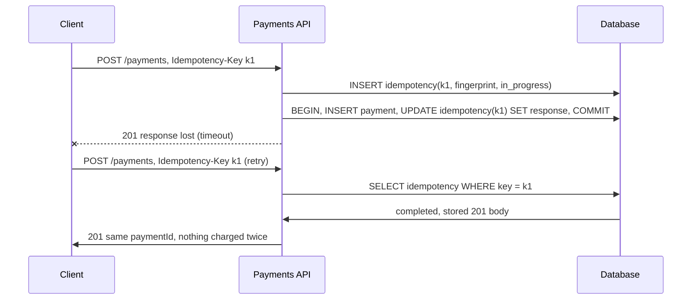

Networks fail ambiguously. When a request times out, the client can't tell whether the server never received it, received it and
failed, or completed it and lost the response. The only safe response to that uncertainty is to retry — so every operation that
matters must be safe to perform twice.

## Why it matters

Retries happen everywhere: mobile apps on flaky networks, SDKs with automatic retry, load balancers and gateways retrying failed
upstream calls, message queues redelivering messages. If "create payment" or "enrol in a paid course" isn't idempotent, each retry is a
chance to charge a customer twice. Interviewers probe this on any design involving money, inventory, notifications or external side
effects — it is one of the clearest signals that you think about failure.

## How it works

### Naturally idempotent operations

Some operations already give the same result when repeated:

- **Reads** (`GET`) don't change state.
- **Set-to-value updates** (`PUT /courses/42/title` = "Databases 101", `UPDATE ... SET status = 'published'`): applying twice leaves the
  same state.
- **Deletes**: deleting an already-deleted resource leaves it deleted (return 204 or 404 consistently).
- **Upserts keyed by a natural identifier**: "record that user 7 completed lesson 12" as `INSERT ... ON CONFLICT DO NOTHING`.

The dangerous ones are **creates without a client-chosen identity** (`POST /payments`), **increments** (`balance = balance + 100`) and
**external side effects** (send an email, call a payment processor).

### Idempotency keys

The client generates a unique key (a UUID) per *logical operation* and sends it with the request — commonly in an `Idempotency-Key`
header, the name used by Stripe and by an IETF Internet-Draft standardising the header. The server:

1. **Claims the key atomically** — inserts a record `(key, request fingerprint, status = in_progress)`. Only one request can win.
2. **Executes** the operation.
3. **Stores the response** (status code and body) under the key, ideally in the same database transaction as the side effect.
4. On a **retry with the same key and same request**, returns the stored response without executing again.
5. On the **same key with a different request** (fingerprint mismatch), rejects it — the draft recommends `422`.
6. On a **retry while the first is still running**, rejects it with `409` (the client retries later).
7. **Expires** keys after a retention period long enough to cover any retry (Stripe prunes keys after at least 24 hours).

The key is scoped to the client (API key or user), so two customers can't collide. The fingerprint (a hash of method, path and body)
catches client bugs that reuse a key for a different operation.

### Making the side effect and the record atomic

The subtle part is step 3. If the server performs the side effect and crashes before saving the response, a retry will execute again.
Options, best first:

- **Same transaction.** When the side effect is a database write (create the payment row), write the idempotency record in the same
  transaction. Either both commit or neither does.
- **Pass the key downstream.** When the side effect is an external call, forward an idempotency key to that provider too (payment
  processors accept them), so a repeated call is deduplicated there.
- **Recovery points.** For multi-step operations, record progress after each step under the key, and resume from the last completed
  step on retry.

### Conditional requests: preventing lost updates

A different problem with a related fix: two clients read a course, both edit it, and the second save silently overwrites the first. HTTP
solves this with **ETags**:

```http
GET /courses/42                 -> 200, ETag: "v17"
PATCH /courses/42
If-Match: "v17"
{ "title": "Databases 101 (2026 edition)" }
-> 200, ETag: "v18"             (or 412 Precondition Failed if someone else saved first)
```

The server applies the update only if the resource is still at version 17 — in the database, an
`UPDATE ... WHERE id = 42 AND version = 17` that reports how many rows changed. This is optimistic concurrency control, covered in depth in
[transactions](lesson:transactions).

```sql
CREATE TABLE courses (
  id       bigint PRIMARY KEY,
  title    text NOT NULL,
  version  integer NOT NULL DEFAULT 1
);
INSERT INTO courses (id, title) VALUES (42, 'Databases 101');
```

```sql
-- Optimistic update: succeeds only if nobody changed the row since version $3 was read.
UPDATE courses
SET title = $2, version = version + 1
WHERE id = $1 AND version = $3;
```

## Architecture



## Java and Spring Boot example

A plain-Java model of the server side. `putIfAbsent` stands in for the atomic insert that claims the key (in production, a unique key in a
database table or `SET NX` in Redis), and a SHA-256 fingerprint detects reuse with a different body:

```java file="IdempotencyKeys.java"
import java.nio.charset.StandardCharsets;
import java.security.MessageDigest;
import java.security.NoSuchAlgorithmException;
import java.util.HexFormat;
import java.util.concurrent.ConcurrentHashMap;

// Server-side idempotency keys for POST /payments. The first request with a key runs once;
// retries get the stored response. In production the store is a database table or Redis,
// written atomically together with (or just before) the side effect.
public class IdempotencyKeys {

    record Entry(String fingerprint, boolean done, int status, String body) {}

    private final ConcurrentHashMap<String, Entry> store = new ConcurrentHashMap<>();
    private int paymentsCreated;

    /** Phase 1: claim the key. Returns a response to send now, or null to go ahead. */
    String begin(String key, String requestBody) {
        String fingerprint = sha256(requestBody);
        Entry claim = new Entry(fingerprint, false, 0, null);
        Entry existing = store.putIfAbsent(key, claim); // atomic: only one caller wins
        if (existing == null) {
            return null;
        }
        if (!existing.fingerprint().equals(fingerprint)) {
            return "422 Idempotency-Key was already used with a different request";
        }
        if (!existing.done()) {
            return "409 a request with this Idempotency-Key is still being processed";
        }
        return existing.status() + " " + existing.body() + "   <- replayed, no new payment";
    }

    /** Phase 2: perform the side effect once and save the response under the key. */
    String complete(String key, String requestBody) {
        paymentsCreated++;
        String body = "{\"paymentId\":\"pay_" + paymentsCreated + "\"}";
        store.put(key, new Entry(sha256(requestBody), true, 201, body));
        return "201 " + body;
    }

    String handle(String key, String requestBody) {
        String early = begin(key, requestBody);
        return early != null ? early : complete(key, requestBody);
    }

    public static void main(String[] args) {
        IdempotencyKeys api = new IdempotencyKeys();
        String charge = "{\"amount\":4999,\"currency\":\"INR\"}";

        System.out.println("1. first attempt        -> " + api.handle("key-7f3a", charge));
        System.out.println("2. retry after timeout  -> " + api.handle("key-7f3a", charge));

        api.begin("key-91c2", charge); // a second payment starts and is still running...
        System.out.println("3. duplicate in flight  -> " + api.handle("key-91c2", charge));
        api.complete("key-91c2", charge);

        String other = "{\"amount\":100,\"currency\":\"INR\"}";
        System.out.println("4. same key, new body   -> " + api.handle("key-7f3a", other));
        System.out.println("payments actually created: " + api.paymentsCreated);
    }

    static String sha256(String text) {
        try {
            byte[] hash = MessageDigest.getInstance("SHA-256")
                    .digest(text.getBytes(StandardCharsets.UTF_8));
            return HexFormat.of().formatHex(hash);
        } catch (NoSuchAlgorithmException e) {
            throw new IllegalStateException(e);
        }
    }
}
```

```text title="Output" output="IdempotencyKeys.java"
1. first attempt        -> 201 {"paymentId":"pay_1"}
2. retry after timeout  -> 201 {"paymentId":"pay_1"}   <- replayed, no new payment
3. duplicate in flight  -> 409 a request with this Idempotency-Key is still being processed
4. same key, new body   -> 422 Idempotency-Key was already used with a different request
payments actually created: 2
```

Four requests, two payments: the retry replays the stored response, the concurrent duplicate is told to wait, and the misused key is
rejected. In a Spring service the same logic sits in a filter or interceptor around `POST` handlers, with the store as a table whose
primary key is `(client_id, idempotency_key)`.

## Failure scenarios

- **Crash between side effect and saving the response.** The retry runs the operation again — unless both are in one transaction or
  the downstream call is itself idempotent.
- **Key expired before the retry.** A client retrying after days creates a duplicate. Retention must exceed the longest retry window.
- **Keys generated per attempt instead of per operation.** If the client makes a new UUID on every retry, the server sees different
  operations. The key must be created once and reused for all attempts.
- **Caching failures.** Storing a transient 500 under the key means retries can never succeed. Store only final outcomes (success or
  permanent client errors), or define clearly which results are replayed.
- **Lost updates without ETags.** Two editors overwrite each other silently; return 412 and let the client merge.

## Trade-offs

- **Storage and latency vs safety.** Every idempotent POST adds a lookup and a write. For money, inventory and messages, that is
  clearly worth it; for logging a page view, it usually isn't.
- **Client-generated IDs vs idempotency keys.** Letting clients choose the resource ID (`PUT /payments/{uuid}`) makes creates naturally
  idempotent without a separate store, but exposes ID generation to clients.
- **Strict vs lenient fingerprinting.** Hashing the whole body catches misuse but rejects harmless differences (field order); hash a
  canonical form.

## In real systems

- Stripe accepts an `Idempotency-Key` on all `POST` requests, compares parameters with the original request, and prunes keys after they
  are at least 24 hours old.
- The IETF HTTPAPI working group's Idempotency-Key header draft recommends 400 for a missing required key, 409 for a request still
  being processed and 422 for reuse with a different payload.
- Cloud APIs commonly accept a client token or request ID on create calls (for example, `ClientToken` on some AWS APIs) for the same
  purpose.

## Common mistakes

- **Assuming retries won't happen** because "the client only clicks once".
- **Checking then inserting non-atomically** — two concurrent duplicates both see "no key" and both execute.
- **Generating a new key per retry.**
- **Forgetting downstream calls** — your service is idempotent, but it charges the card twice.
- **Using idempotency keys on GET**, which is already safe.

## In the interview

````question title="How do you make 'create payment' safe to retry?"
The client generates an idempotency key once per payment and sends it on every attempt. The server atomically claims the key — a
unique row keyed by client and key, with a fingerprint of the request and an in-progress status. It creates the payment and stores the
response under the key in the same database transaction, and passes an idempotency key to the payment processor so the external charge
is deduplicated too. A retry with the same key returns the stored response; a duplicate that arrives while the first is running gets
409; reuse with a different body gets 422. Keys are kept long enough to cover all retries, such as 24 hours or more.
````

````question title="Which operations are naturally idempotent, and how do you make an increment idempotent?"
Reads, set-to-value updates, deletes and upserts keyed by a natural identifier are naturally idempotent. An increment such as "add 100
credits" isn't: applying it twice adds 200. Make it idempotent by giving the operation an identity — record it as a ledger entry with a
unique operation ID (INSERT … ON CONFLICT DO NOTHING) and derive the balance from entries, or store processed operation IDs alongside
the balance update in one transaction and skip IDs already applied.
````

## Key takeaways

- Timeouts are **ambiguous**; clients must retry, so writes must be **idempotent**.
- **GET, PUT, DELETE** and set-to-value updates are naturally idempotent; **POST creates, increments and external side effects** are not.
- **Idempotency keys**: claim atomically, execute once, store the response (same transaction), replay on retry, reject mismatches.
- **ETags with If-Match** prevent lost updates between concurrent editors.

## Knowledge check

```quiz
? A mobile app retries `POST /enrollments` after a timeout and creates a key for each attempt. What happens?
- The server deduplicates the retries
! Each attempt carries a different key, so the server sees different operations.
+ Each attempt looks like a new operation, so duplicates are possible
- The second attempt gets 409 Conflict
! 409 applies to the same key while the first is still in progress.
- The server returns 422
! 422 applies to the same key with a different body.
> The key must identify the logical operation and be reused for every attempt.

? Two requests with the same idempotency key arrive at the same moment. What prevents both from executing?
- Checking whether the key exists before inserting it
! Two requests can both pass the check before either inserts.
+ An atomic claim, such as a unique constraint or SET NX, so only one insert can succeed
- A longer key
! Key length doesn't affect concurrency.
- Returning 200 to both
! That says nothing about execution.
> Check-then-act is a race; the claim must be a single atomic operation.

? The server charges the card through a payment processor, then crashes before saving the stored response. The client retries. What prevents a second charge?
+ Passing an idempotency key to the payment processor so it deduplicates the charge
- Nothing can prevent it
! Downstream idempotency keys exist for exactly this case.
- Storing the response in server memory
! Memory is lost in the crash.
- Shortening the retry timeout
! The retry still happens.
> When a side effect is outside your transaction, make the downstream call idempotent too.

? Two editors load course 42 at version 17 and both save changes. How should the API stop the second save from silently overwriting the first?
- Use POST instead of PATCH
! The method doesn't detect concurrent edits.
+ Require `If-Match: "v17"` and update only `WHERE version = 17`, returning 412 if the row moved on
- Lock the course for an hour when it is opened
! Long pessimistic locks block other editors and break when clients disappear.
- Accept the last write
! That is the lost-update problem itself.
> Optimistic concurrency detects the conflict and lets the client merge.
```
