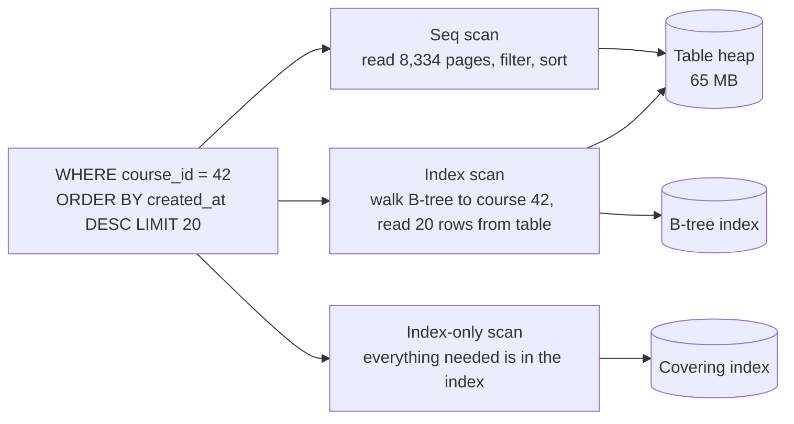

An index is a sorted copy of some columns with pointers back to the rows. It turns "read every row and keep the matches" into
"jump to the matches", which is the difference between a query that touches 65 MB and one that touches 32 KB. Indexes are the single
most effective performance tool in a database — and every one of them makes writes more expensive.

## Why it matters

Almost every data-model answer in an interview should end with "…and these indexes serve the main queries." Interviewers check that you
can match an index to a query (including multi-column order), explain why it helps, and acknowledge the cost. Indexing is also the
foundation of [cursor pagination](lesson:pagination), [query optimisation](lesson:query-optimization) and most "why is this slow?"
follow-ups.

## How it works

### The B-tree

Relational databases default to the **B-tree** (strictly, a B+tree): a balanced tree of fixed-size pages (8 KB in PostgreSQL). Inner pages
hold keys and child pointers; leaf pages hold keys in sorted order with pointers to table rows, and are linked to their neighbours.

- A lookup walks from the root to a leaf: **O(log n)** page reads. Because each page holds a few hundred keys, the tree is shallow —
  with 300 keys per page, three levels index 27 million rows and four levels about 8 billion.
- Because leaves are sorted and linked, the same index serves **equality** (`=`), **ranges** (`<`, `BETWEEN`), **prefix matches**
  (`LIKE 'data%'`) and **ordering** (`ORDER BY` in index order, forwards or backwards) without a separate sort.

### What an index does to a real query

A `reviews` table with one million rows across 5,000 courses, and the query behind "latest reviews for course 42":

```sql
CREATE TABLE reviews (
  id          bigint PRIMARY KEY,
  course_id   bigint NOT NULL,
  user_id     bigint NOT NULL,
  rating      smallint NOT NULL,
  created_at  timestamptz NOT NULL
);

SELECT id, rating, created_at
FROM reviews
WHERE course_id = 42
ORDER BY created_at DESC
LIMIT 20;
```

Without a suitable index, PostgreSQL 18 reads the whole table and sorts the matches (`EXPLAIN ANALYZE` output, trimmed):

```text title="Without an index"
Limit (actual rows=20.00 loops=1)
  ->  Sort (actual rows=20.00 loops=1)
        Sort Key: created_at DESC
        ->  Seq Scan on reviews (actual rows=200.00 loops=1)
              Filter: (course_id = 42)
              Rows Removed by Filter: 999800
              Buffers: shared hit=8334
```

It touched **8,334 pages** (the entire 65 MB table) to find 200 matching rows. Now add a composite index whose order matches the query —
equality column first, then the sort column:

```sql
CREATE INDEX reviews_course_created ON reviews (course_id, created_at DESC);
```

```text title="With a composite index"
Limit (actual rows=20.00 loops=1)
  Buffers: shared hit=23 read=3
  ->  Index Scan using reviews_course_created on reviews (actual rows=20.00 loops=1)
        Index Cond: (course_id = 42)
```

**26 pages** instead of 8,334, and no sort: the index already delivers course 42's reviews newest first, so the database stops after 20.

### Composite indexes and the leftmost-prefix rule

A composite index on `(a, b, c)` is sorted by `a`, then `b` within each `a`, then `c`. It efficiently serves queries that constrain a
**leading prefix**:

| Query filters on | Uses `(course_id, created_at)` efficiently? |
|---|---|
| `course_id = 42` | Yes |
| `course_id = 42 AND created_at > '2026-01-01'` | Yes — equality, then range |
| `course_id = 42 ORDER BY created_at DESC` | Yes — and avoids the sort |
| `created_at > '2026-01-01'` only | Generally no — the dates are scattered across every course |

Rule of thumb for column order: **equality columns first, then the range or sort column.** In the test above, a date-only query on the
`(course_id, created_at)` index fell back to a sequential scan. PostgreSQL 18 added **skip scan**, which can use a multicolumn B-tree when
the leading column has few distinct values — with an index on `(rating, created_at)` (five ratings), a date-range query used the index
with seven internal searches instead of scanning the table. With 5,000 distinct courses as the leading column, the planner still chose
the sequential scan. Design for the prefix rule; treat skip scan as a bonus.

### Covering indexes

If the index contains every column the query needs, the database can answer from the index alone — an **index-only scan** — without
visiting the table:

```sql
DROP INDEX reviews_course_created;
CREATE INDEX reviews_course_created_cov ON reviews (course_id, created_at DESC) INCLUDE (rating);
```

```text title="Covering index: index-only scan"
Limit (actual rows=20.00 loops=1)
  Buffers: shared hit=1 read=3
  ->  Index Only Scan using reviews_course_created_cov on reviews (actual rows=20.00 loops=1)
        Index Cond: (course_id = 42)
        Heap Fetches: 0
```

**4 pages.** `INCLUDE` adds payload columns to the leaf entries without making them part of the sort key. (In PostgreSQL, index-only scans
also depend on the table's visibility map being up to date, which vacuuming maintains.)

### Partial and expression indexes

```sql
-- Only index rows that queries care about: published courses.
CREATE TABLE courses (id bigint PRIMARY KEY, title text NOT NULL, published_at timestamptz);
CREATE INDEX courses_published ON courses (published_at DESC) WHERE published_at IS NOT NULL;

-- Index a computed value so case-insensitive lookups can use it.
CREATE TABLE users (id bigint PRIMARY KEY, email text NOT NULL);
CREATE UNIQUE INDEX users_email_lower ON users (lower(email));
```

A partial index is smaller and cheaper to maintain; an expression index lets `WHERE lower(email) = …` use an index (and here also enforces
case-insensitive uniqueness).

### The cost of indexes

- **Writes:** every `INSERT` and `DELETE` updates every index on the table; an `UPDATE` touching an indexed column updates that index.
  Five indexes means roughly six structures to modify per insert.
- **Storage and memory:** in the test, the covering index was **39 MB** next to a **65 MB** table and a **21 MB** primary key. Indexes
  compete with data for cache.
- **Planning and maintenance:** more choices for the planner, more bloat to vacuum, more to rebuild.

Index for the **queries you actually run**; drop indexes nothing uses (databases track index usage statistics).

### Other index types

| Type | Good for |
|---|---|
| Hash | Equality only; rarely better than a B-tree in practice |
| GIN (inverted) | Values containing many keys: `jsonb` fields, arrays, full-text search |
| GiST / SP-GiST | Geometric and range data, nearest-neighbour searches (e.g. PostGIS) |
| BRIN | Very large, naturally ordered tables (append-only time series): tiny summaries per block range |
| LSM trees | Not an index type in PostgreSQL but the storage design of Cassandra, RocksDB and others: writes are buffered and flushed as sorted files, making writes cheap and reads merge several files |

## Architecture



## Failure scenarios

- **The index exists but isn't used.** A function on the column (`WHERE date(created_at) = …`), an implicit type cast, a leading
  wildcard (`LIKE '%sql'`) or a wrong column order defeats it. See [query optimisation](lesson:query-optimization).
- **Write throughput collapses** after adding several indexes to a hot, insert-heavy table.
- **Low-selectivity indexes.** An index on a boolean or a status with three values rarely helps — the planner reads most of the table
  anyway — unless it is a partial index on the rare value.
- **Index builds lock writes.** A plain `CREATE INDEX` on a large table blocks writes for the duration; use `CREATE INDEX CONCURRENTLY` in
  PostgreSQL (or the equivalent online DDL elsewhere).
- **Cache pressure.** Too many large indexes push hot data out of memory, slowing everything.

## Trade-offs

- **Read speed vs write cost.** Each index speeds some reads and slows every write to its table.
- **Wide covering indexes vs size.** Including more columns enables index-only scans but grows the index and its write cost.
- **One composite index vs several single-column ones.** A composite index matching the query beats combining separate indexes; but each
  composite serves fewer query shapes.
- **B-tree vs LSM storage.** B-trees favour reads and in-place updates; LSM-based stores favour high write throughput at the cost of read
  and compaction overhead.

## In real systems

- PostgreSQL and MySQL (InnoDB) both default to B-tree indexes; InnoDB stores the table itself clustered by primary key, so secondary index
  entries point to primary-key values.
- DynamoDB global secondary indexes are separate, asynchronously maintained copies of the table keyed differently — reads from them are
  eventually consistent.
- Cassandra, ScyllaDB and RocksDB use LSM trees, which is a large part of why they sustain very high write rates.

## Common mistakes

- **Indexing every column "just in case".**
- **Wrong column order** in composite indexes (range column first, equality second).
- **Ignoring write cost** on write-heavy tables.
- **Assuming an index on `a` and an index on `b` equals an index on `(a, b)`.**
- **Building indexes on large live tables without the concurrent option.**

## In the interview

````question title="Which index would you add for 'latest 20 reviews of a course', and why that column order?"
A composite B-tree index on (course_id, created_at DESC), optionally with the displayed columns in INCLUDE to make it covering. The
equality column comes first so the index groups each course's reviews together; within that group entries are already sorted by
created_at descending, so the database seeks to course 42 and reads the first 20 entries with no sort. On a million-row table that
changes the query from scanning every page to touching a couple of dozen. If I also paginate with a cursor, I'd add id as a tiebreaker
to the index.
````

````question title="What does an index cost, and how do you decide whether to add one?"
Every insert and delete must update each index on the table, and updates must update indexes on the changed columns, so write latency
and throughput suffer. Indexes also take disk and, more importantly, memory that would otherwise cache data, and they need maintenance.
I add an index when a frequent or latency-critical query needs it and the selectivity is good; I prefer one composite index that matches
a query shape over several single-column ones; and I check usage statistics to drop indexes nothing uses. On write-heavy tables I keep
indexes to the minimum the reads require.
````

## Key takeaways

- A **B-tree** keeps keys sorted in a shallow tree: O(log n) lookups, ranges, prefixes and ordering.
- In composite indexes put **equality columns first, then range/sort columns** (leftmost-prefix rule).
- **Covering indexes** (`INCLUDE`) allow index-only scans; **partial** and **expression** indexes target specific queries.
- Every index **costs writes, storage and memory** — index for real queries and drop unused ones.

## Knowledge check

```quiz
? A table has an index on `(user_id, created_at)`. Which query can use it most efficiently?
- `WHERE created_at > now() - interval '1 day'`
! The leading column `user_id` isn't constrained, so matching dates are scattered across the index.
+ `WHERE user_id = 7 AND created_at > now() - interval '1 day'`
- `WHERE lower(email) = 'x'`
! The index doesn't include email.
- `WHERE created_at > now() - interval '1 day' ORDER BY user_id`
! Still no constraint on the leading column.
> Equality on the leading column, then a range on the next, is the ideal shape.

? Why can a covering index make a query faster than a regular index on the same key?
+ The query is answered from the index alone, without reading table rows
- Covering indexes are stored in memory only
! They are stored on disk like other indexes.
- Covering indexes are hash indexes
! They are B-tree indexes with extra payload columns.
- They make writes faster
! They make writes slightly slower.
> Index-only scans skip the table lookups that dominate small queries.

? A write-heavy events table has eight indexes and insert latency keeps rising. What is the first thing to examine?
- Adding a ninth index for the slow query
! More indexes add more write work.
+ Which indexes are actually used, and dropping or merging the rest
- Switching all indexes to hash indexes
! Hash indexes still have to be maintained on every write.
- Increasing the connection pool
! Connections don't reduce per-insert index work.
> Each index adds work to every insert; unused ones are pure cost.

? A query filters `WHERE status = 'active'`, and 95% of rows are active. Why might the planner ignore an index on `status`?
- Indexes can't be used on text columns
! Text columns are indexed all the time.
+ The condition matches most rows, so scanning the table sequentially is cheaper than millions of index lookups
- The index is corrupted
! Nothing suggests corruption.
- Status values are not unique
! Indexes don't need unique values.
> Low-selectivity predicates don't benefit from indexes; a partial index on the rare value might.
```
