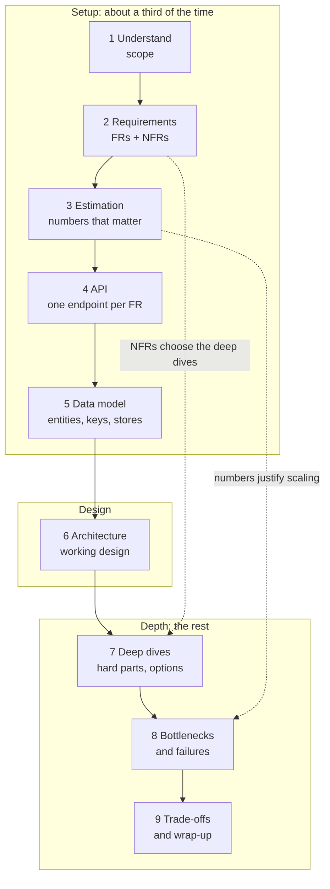

A system design interview gives you a vague prompt — "design a recipe-sharing site" — and 45 to 60 minutes. Without a plan, the
time goes to whatever you happen to think of first. The nine-step framework is a plan: each step produces something concrete, each
builds on the last, and together they cover everything interviewers score.

## Why it matters

Interviewers evaluate more than the final diagram: whether you scoped the problem, quantified what matters, produced a working design,
went deep on the hard parts, and communicated like someone they would want in a design review (see
[what interviewers evaluate](lesson:hld-vs-lld)). A framework protects all of those under time pressure:

- **Nothing important gets skipped** — requirements, API and data model each get a few minutes before the architecture.
- **The interviewer can follow you** — they know where you are and can redirect early.
- **You finish** — with time left for deep dives and failure analysis, where senior-level signal comes from.

It is a guide, not a script. Good interviewers will interrupt and steer; the framework tells you where to resume.

## How it works

### The nine steps

| # | Step | What it produces | Lesson |
|---|---|---|---|
| 1 | Understand the problem | Users, core use case, explicit scope and exclusions | [Step 1](lesson:step-understand) |
| 2 | Define requirements | 3–5 functional requirements; quantified non-functional ones | [Step 2](lesson:step-requirements) |
| 3 | Estimate | The two or three numbers that change the design, and what they imply | [Step 3](lesson:step-estimation) |
| 4 | Define the APIs | One endpoint per functional requirement | [Step 4](lesson:step-api) |
| 5 | Model the data | Entities, keys, stores, indexes and partition keys | [Step 5](lesson:step-data-model) |
| 6 | High-level architecture | A working design, built one requirement at a time, with data flows | [Step 6](lesson:step-architecture) |
| 7 | Deep dives | Two or three hard parts explored with options and trade-offs | [Step 7](lesson:step-deep-dives) |
| 8 | Bottlenecks and failures | What breaks first and what happens when components fail | [Step 8](lesson:step-bottlenecks) |
| 9 | Trade-offs and wrap-up | A 30-second summary, alternatives rejected, next steps | [Step 9](lesson:step-tradeoffs) |

Steps 1–5 are **the setup**: short, structured, mostly writing lists. Step 6 is **the design**. Steps 7–9 are **the depth**, where the
level of the interview is decided.

### Time plans

The mock interviews on this site use these budgets:

| Step | 45-minute interview | 60-minute interview |
|---|---|---|
| 1. Understand | 3 min | 4 min |
| 2. Requirements | 4 min | 5 min |
| 3. Estimation | 3 min | 4 min |
| 4. API | 4 min | 5 min |
| 5. Data model | 4 min | 5 min |
| 6. Architecture | 10 min | 13 min |
| 7. Deep dives | 10 min | 15 min |
| 8. Bottlenecks and failures | 4 min | 5 min |
| 9. Trade-offs and wrap-up | 3 min | 4 min |
| **Total** | **45 min** | **60 min** |

Interviews usually start with a few minutes of introductions and end with your questions, so the design portion of a "45-minute" slot can
be closer to 35–40 minutes. Compress the setup steps rather than the depth.

Two useful clock checks: **by about one third of the time, a first architecture should be on the board**; **by two thirds, you should be
well into deep dives**.

### Checkpoints

End each step with a one-line check-in: "Those are the requirements I'll design for — anything you'd add or drop?" It costs five seconds,
keeps you aligned, and turns the interview into a collaboration. Then move on without waiting for permission at every sentence.

### Adapting the order

- **Product designs** (a feed, a booking system) usually go API-first: requirements → API → data model → architecture.
- **Infrastructure designs** (a rate limiter, a distributed cache, a job queue) often start from the data flow and the core algorithm;
  the "API" may be a client library interface. Keep the steps, adjust their weight.
- **If the interviewer jumps ahead** ("let's talk about the database"), follow — then cover what you skipped briefly when it matters.

### Recovering when you overrun

- **Ran long on requirements?** Shrink estimation to one sentence ("modest writes, heavy reads — one primary plus a cache"), sketch the API
  as a list, and get to the diagram.
- **Stuck in a deep dive?** Say the option you'd choose and why, then name the next topic: "I'll take approach two; next I'd like to cover
  what happens when the cache fails."
- **Running out of time?** Skip to the wrap-up: summarise, name the biggest risk, say what you'd do next. Ending with a summary beats
  ending mid-sentence.

## Architecture



The dotted arrows are the reason the order matters: non-functional requirements pick the deep dives, and the estimates justify (or rule
out) scaling work later.

## Failure scenarios

How interviews go wrong, and the step that prevents it:

| Failure | Prevented by |
|---|---|
| Designing the wrong system (missed a core feature or over-scoped) | Steps 1–2 with explicit exclusions |
| Over-engineering: sharding a system with 40 writes per second | Step 3, tying numbers to decisions |
| Boxes with no data flow; requirements nothing satisfies | Step 6, building one requirement at a time |
| No time left for depth | Time plan and clock checks |
| Never discussing failure | Step 8 as an explicit step |
| A good design the interviewer couldn't follow | Checkpoints and the final summary |

## Trade-offs

- **Structure vs flexibility.** A rigid script ignores the interviewer's steering; no structure loses the thread. Follow the framework by
  default and let the interviewer redirect.
- **Breadth vs depth.** Covering every component shallowly scores lower than a solid design plus two deep dives. The framework reserves
  time for depth on purpose.
- **Writing vs talking.** Lists on the board (requirements, API, entities) are fast to read and refer back to; long verbal explanations
  are not. Write the short lists; talk through the diagram.

## In real systems

The framework mirrors how engineering teams write design documents and run design reviews: context and goals (steps 1–2), non-goals,
capacity planning (step 3), interfaces and data (steps 4–5), the proposed architecture (step 6), detailed design of the risky parts (step 7),
failure modes and operational concerns (step 8), and alternatives considered (step 9). Practising the interview is practising the job.

## Common mistakes

- **Starting with boxes** before requirements.
- **Spending fifteen minutes on estimation** that changes nothing.
- **Treating the framework as a script** and ignoring the interviewer's hints.
- **Saving deep dives for the end** and running out of time.
- **Silent stretches** while thinking — narrate instead.
- **No summary** at the end.

## In the interview

````question title="How do you structure a 45-minute system design interview?"
I use nine steps. I spend about the first fifteen minutes on setup: understand the problem and its scope, write three to five functional
requirements and quantified non-functional ones, do a quick estimate of only the numbers that change the design, list the API endpoints
and the core entities with their keys. Then about ten minutes building a working high-level design one requirement at a time, narrating
the data flow. The remaining time goes to depth: two or three deep dives chosen from the non-functional requirements, a pass over
bottlenecks and failure scenarios, and a short wrap-up with trade-offs and next steps. I check in at the end of each step so the
interviewer can redirect me early.
````

````question title="You are 30 minutes into a 45-minute interview and still on the data model. What do you do?"
Say so and adapt: "I'm conscious of time — let me get a full design on the board." I'd finish the data model in one sentence, draw the
end-to-end architecture quickly by walking each requirement through it, then pick the single most important deep dive from the
non-functional requirements and spend most of the remaining time there, and leave a minute for a summary of trade-offs and risks. A
complete, simple design with one strong deep dive beats a perfect data model and no architecture.
````

## Key takeaways

- Nine steps: **understand, requirements, estimation, API, data model, architecture, deep dives, bottlenecks, wrap-up** — each with a
  concrete output.
- Setup is short and written; **the design should be on the board by about a third of the time**; depth fills the rest.
- **Check in** at the end of each step; follow the interviewer's steering and resume the framework afterwards.
- When you overrun, **compress the setup, never the depth**, and always finish with a summary.

## Knowledge check

```quiz
? In a 45-minute interview, roughly when should a first end-to-end architecture be on the board?
- In the last five minutes
! That leaves no time for deep dives or failure analysis.
+ By about the 15-minute mark (a third of the time)
- Before asking any clarifying questions
! Designing before scoping risks designing the wrong system.
- Never; interviews are about requirements
! A working design is a core part of the evaluation.
> Setup steps are short so most of the time goes to the design and its depth.

? Which input should decide what you deep-dive into?
+ The non-functional requirements, such as latency, scale, consistency and availability targets
- Whatever technology you know best
! Deep dives should follow the problem's hard parts, not your comfort zone.
- The first component you drew
! The first box drawn is rarely the hardest part.
- Always the database schema
! Sometimes the hard part is fan-out, contention or real-time delivery.
> NFRs reveal where the design is stressed; that's where depth earns signal.

? The interviewer interrupts during your API step: "Let's talk about how you'd store this." What should you do?
- Insist on finishing every endpoint first
! Ignoring steering is a communication red flag.
+ Follow them to the data model, then return briefly to anything important you skipped
- Start the deep dives immediately
! They asked about storage, not deep dives.
- Restart from requirements
! That wastes time and ignores the request.
> The framework guides you; the interviewer steers.

? You have 5 minutes left and haven't discussed failures. What is the best use of the time?
- Add three more components to the diagram
! New boxes without analysis add little signal at the end.
+ Name the biggest failure risks and mitigations quickly, then give a 30-second summary of the design and trade-offs
- Redo the estimation more precisely
! Precision now changes nothing.
- Stay silent and let the interviewer lead
! You should drive the close.
> A clear close with risks and trade-offs leaves a strong final impression.
```
